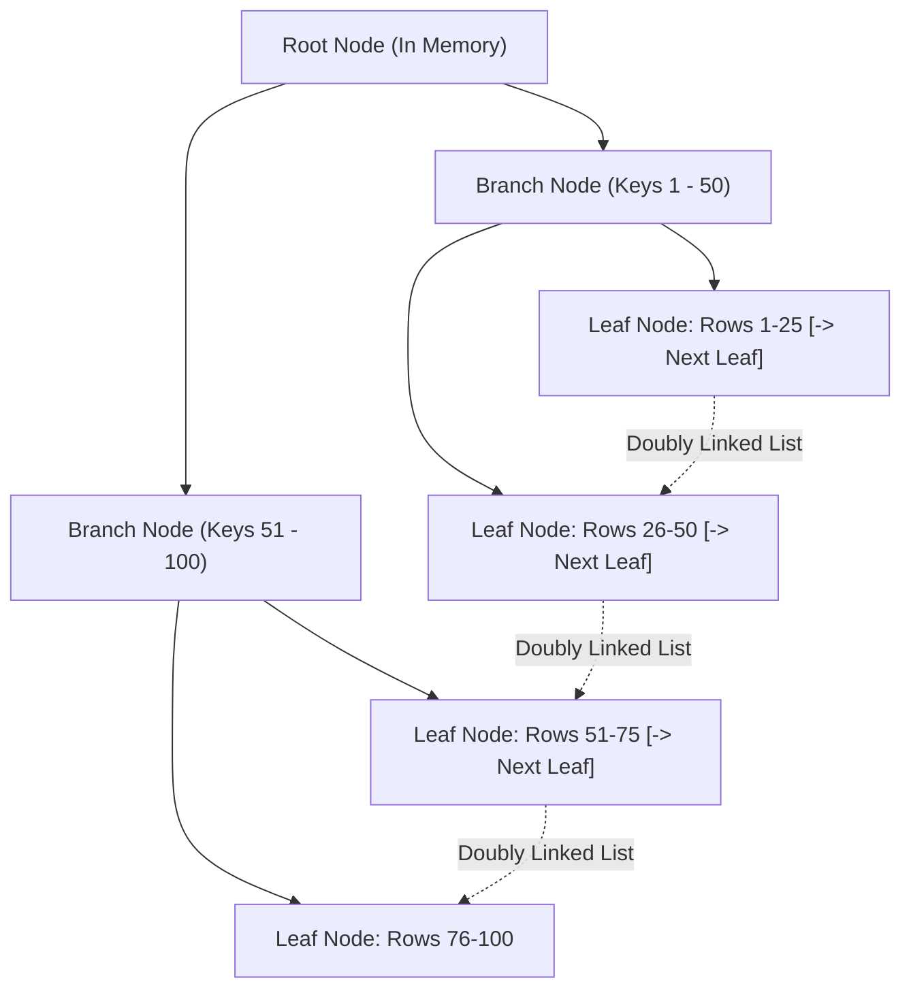

# B-Tree Indexes, Query Plans (EXPLAIN) & Optimization

> **Phase 7: Relational Databases & SQL Mastery**  
> *Estimated Reading Time: 55 minutes | Total Practice Effort: ~4 hours | Tier: Core Essential*

---

## 1. Purpose & Prerequisites

### Why This Matters in Full Stack Development
When your database contains only 500 rows, every SQL query executes in 2 milliseconds regardless of how poorly it is written. But when your production database grows to **50 million user records or 500 million orders**:
- A query without an index forces the database to read **every single page from disk** (**Full Table Scan**), spiking CPU to 100% and taking 15 to 30 seconds to return!
- The same query with an optimized **B+Tree Index** locates the target row in **3 to 4 disk page lookups**, returning in **1.8 milliseconds**!

Understanding **B+Tree Indexes**, **Clustered vs Secondary Indexes**, and how to read **`EXPLAIN` execution plans** is what separates junior coders from production-ready backend engineers.

### Prerequisites
- [Topic 7.1: Relational Concepts: Tables, Primary Keys, Foreign Keys](01-db-concepts.md)
- [Topic 7.2: SQL CRUD Operations](02-crud-operations.md)
- [Topic 7.3: Filtering, Sorting & Aggregations](03-filtering-aggregations.md)

---

## 2. Plain-English Mental Model

```
[ Full Table Scan: Reading a 1,200-page Textbook Cover to Cover ]
- You want to find "What year was Java invented?"
- You start at page 1, read every sentence on page 2, 3, 4... until page 892.
- Time taken: 3 days. Exhausting and wasteful!

[ B+Tree Index: The Alphabetical Index at the Back of the Book ]
- You flip to the back of the book, jump directly to letter "J", find "Java: page 892".
- You flip directly to page 892 in 2 seconds.
- An Index is a sorted, lightweight auxiliary data structure that points directly to data!
```

---

## 3. Under the Hood: B+Tree Data Structure

Relational databases like MySQL (InnoDB) and PostgreSQL don't use binary search trees or standard hash maps for general table indexing; they use **B+Trees** (Balanced Trees).



### Why B+Trees Are Optimal for Databases:
1. **High Fan-Out (Shallow Height):** A single 16KB database page can store hundreds of branch keys. A 3-to-4 level B+Tree can index **billions of rows**, meaning any row is located in at most 3 or 4 page reads!
2. **Sequential Leaf Linked List:** All leaf nodes are linked in a sorted doubly-linked list. Range scans (`WHERE age BETWEEN 20 AND 30`) simply find the first key in $O(\log N)$ and traverse the leaf pointers sequentially with zero tree re-traversals.

---

## 4. Clustered vs Secondary Indexes (InnoDB)

Understanding this distinction is critical for MySQL performance:

```
[ Clustered Index (Primary Key) ]
- The table IS the index!
- Leaf nodes contain the ACTUAL COMPLETE ROW DATA (id, name, email, password, address...).
- Every InnoDB table has exactly ONE Clustered Index (the PRIMARY KEY).

[ Secondary Index (Non-Primary Key Index) ]
- Example: CREATE INDEX idx_users_email ON users(email);
- Leaf nodes contain the indexed column (email) + the row's PRIMARY KEY (id).
- It does NOT store the rest of the row data!
```

### The Double-Lookup (Bookmark Lookup):
When you run:
```sql
SELECT full_name, shipping_address FROM users WHERE email = 'sarah@sky.net';
```
1. MySQL searches the `idx_users_email` Secondary B+Tree to find `'sarah@sky.net'`.
2. The leaf node yields Sarah's Primary Key: `id = 1042`.
3. MySQL must now perform a second lookup on the **Clustered Index B+Tree** using `id = 1042` to retrieve `full_name` and `shipping_address`.
4. **Covering Index Optimization:** If you only query `SELECT id, email FROM users WHERE email = 'sarah@sky.net'`, MySQL retrieves all requested fields directly from the secondary index leaf node without touching the clustered table! (Marked as `Using index` in `EXPLAIN`).

---

## 5. Deconstructing Query Plans with `EXPLAIN`

Before deploying any complex query to production, always prefix it with `EXPLAIN` (or `EXPLAIN ANALYZE` in MySQL 8+):

```sql
EXPLAIN SELECT * FROM users WHERE email = 'jane@example.com';
```

| id | select_type | table | partitions | type | possible_keys | key | key_len | ref | rows | filtered | Extra |
| :--- | :--- | :--- | :--- | :--- | :--- | :--- | :--- | :--- | :--- | :--- | :--- |
| 1 | SIMPLE | users | NULL | **const** | idx_users_email | **idx_users_email** | 602 | const | **1** | 100.00 | NULL |

### The Critical Columns to Inspect:

#### 1. `type` (Join Type / Access Method) — Ranked Best to Worst:
- `const` / `system`: Instant lookup (Primary Key or Unique Key lookup with constant). $O(1)$.
- `eq_ref`: 1 row retrieved per outer row in a join (Primary/Unique key join). Excellent.
- `ref`: Non-unique index lookup (multiple rows match). Good.
- `range`: Index range scan (`BETWEEN`, `>`, `<`, `IN()`). Good.
- `index`: Full index scan (scans the entire index tree). Slower.
- `ALL`: **FULL TABLE SCAN!** Scans every physical row on disk. Fatal for large tables!

#### 2. `rows`:
The query optimizer's statistical estimate of how many rows must be examined. If your table has 5,000,000 rows and `rows: 5000000`, your query lacks an index!

#### 3. `Extra`:
- `Using index`: **Covering Index** (Optimal! Data answered entirely from index).
- `Using where`: Rows filtered after being read from storage engine.
- `Using temporary`: Slower; engine had to create an internal temporary table.
- `Using filesort`: Slower; engine had to sort rows in memory/disk buffer instead of using index ordering.

---

## 6. Composite Indexes & The Leftmost Prefix Rule

A **Composite Index** is an index spanning two or more columns:
```sql
CREATE INDEX idx_orders_user_status_date ON orders(user_id, status, created_at);
```

### The Leftmost Prefix Rule
A composite index functions like a phone book sorted by `(Last Name, First Name, Middle Initial)`. You can search by:
1. `user_id` alone: ✅ **Uses Index**
2. `user_id` AND `status`: ✅ **Uses Index**
3. `user_id` AND `status` AND `created_at`: ✅ **Uses Index**
4. `status` alone: ❌ **Cannot use index!** (Like looking up everyone named "Bob" in a phone book sorted by last name).
5. `created_at` alone: ❌ **Cannot use index!**
6. `user_id` AND `created_at`: ⚠️ **Partially uses index** (Uses index for `user_id`, but cannot use the index for `created_at`).

> **Rule:** Column order matters! Always place high-cardinality equality filter columns first.

---

## 7. Common Rookie Mistakes & Anti-Patterns

### Anti-Pattern 1: Applying Functions to Indexed Columns
```sql
-- FATAL MISTAKE: MySQL cannot use the index on created_at!
SELECT * FROM orders WHERE YEAR(created_at) = 2026;

-- OPTIMIZED FIX: Keep the indexed column raw!
SELECT * FROM orders 
WHERE created_at >= '2026-01-01 00:00:00' 
  AND created_at < '2027-01-01 00:00:00';
```

### Anti-Pattern 2: Leading Wildcards in `LIKE`
```sql
-- FATAL MISTAKE: Leading wildcard forces a Full Table Scan!
SELECT * FROM customers WHERE email LIKE '%@gmail.com';

-- FIX: Trailing wildcards CAN use B-Tree indexes:
SELECT * FROM customers WHERE username LIKE 'john%';
```

### Anti-Pattern 3: Indexing Low-Cardinality Columns
Creating an index on a boolean column (`is_active` or `gender`) where 95% of rows have the value `TRUE`.  
*Why it fails:* The optimizer knows reading 95% of a secondary index plus doing bookmark lookups is slower than scanning the table directly. The engine will ignore the index!

### Anti-Pattern 4: Over-Indexing
"Let's just index every column!"  
*The Cost:* Every `INSERT`, `UPDATE`, and `DELETE` must rebalance and write to **all** secondary index B+Trees on disk, destroying write throughput and consuming massive storage.

---

## 8. Guided Hands-On Exercise

### The Scenario
You are analyzing a slow query on an e-commerce platform table `orders` with 10 million rows:

```sql
SELECT id, total_amount, created_at 
FROM orders 
WHERE customer_id = 45892 AND status = 'SHIPPED' 
ORDER BY created_at DESC 
LIMIT 20;
```

When running `EXPLAIN`, you see:
```
type: ALL
key: NULL
rows: 9,842,100
Extra: Using where; Using filesort
Execution Time: 8.4 seconds!
```

### Your Challenge:
1. Explain why this query is taking 8.4 seconds.
2. Design the exact single composite index statement that will eliminate both the Full Table Scan and the expensive `Using filesort`.

<details>
<summary>💡 Hint: Equality Columns First, Then Sort Column</summary>

Recall the Leftmost Prefix Rule and index-based ordering. If an index is sorted by `(A, B, C)`, filtering by `A = ?` and `B = ?` leaves the matching leaf entries already pre-sorted by `C`!
</details>

<details>
<summary>✅ Solution</summary>

```sql
-- Optimal Composite Index:
CREATE INDEX idx_orders_customer_status_created 
ON orders (customer_id, status, created_at DESC);
```

**Why this is the perfect solution:**
1. `customer_id` and `status` are equality filters (`=`), so the B+Tree instantly jumps to the exact subset of rows ($O(\log N)$).
2. Within that subset, the rows are **physically sorted by `created_at DESC`** in the index leaf nodes!
3. This eliminates `Using filesort` completely; MySQL simply reads the top 20 pre-sorted entries from the index leaf and stops!
4. Query execution drops from 8.4 seconds to **less than 2 milliseconds**!
</details>

---

## 9. Knowledge Check & Interview Defense

### Quick Quiz
1. **In MySQL InnoDB, what is stored in the leaf nodes of a Secondary Index?**
   - [x] A) The indexed column value and the Primary Key of the row.
   - [ ] B) The entire table row with all column data.
   - [ ] C) The physical disk sector address of the server.
   - [ ] D) A JSON string of the record.

2. **Under MySQL's `EXPLAIN` output, which `type` value signifies that an unindexed Full Table Scan is occurring?**
   - [x] A) `ALL`.
   - [ ] B) `const`.
   - [ ] C) `ref`.
   - [ ] D) `eq_ref`.

3. **Given an index on `(country, state, city)`, which of the following WHERE clauses CANNOT utilize the index?**
   - [x] A) `WHERE state = 'Texas' AND city = 'Austin'` (Violates the Leftmost Prefix Rule by omitting `country`).
   - [ ] B) `WHERE country = 'USA'`
   - [ ] C) `WHERE country = 'USA' AND state = 'Texas'`
   - [ ] D) `WHERE country = 'USA' AND state = 'Texas' AND city = 'Austin'`

---

### Junior Developer Interview Q&A

#### Q: "What is a 'Covering Index' and why is it so much faster than a standard indexed query?"
> **Model Answer:**  
> "A **Covering Index** is a secondary index that contains all the columns requested by a `SELECT` query (both the columns in the `WHERE` filter and the columns in the `SELECT` list).
>
> In a standard secondary index query, the database first navigates the secondary B+Tree to find matching keys, retrieves the Primary Key, and then must perform a second lookup on the Clustered Index (the primary table) to fetch the remaining columns (called a Bookmark Lookup or Double Lookup).
>
> With a Covering Index, the database engine satisfies the entire query directly from the secondary index leaf nodes in memory without touching the primary table on disk. In MySQL `EXPLAIN`, this is confirmed by `Using index` in the `Extra` column, resulting in significantly lower I/O and near-instant query execution."

---

## 10. Mastery Checklist & Next Step

Before moving on, verify that you can:
- [ ] Diagram a B+Tree and explain its fan-out and linked leaf nodes.
- [ ] Differentiate between InnoDB's Clustered Index and Secondary Indexes.
- [ ] Run and interpret MySQL `EXPLAIN` plans (`type`, `rows`, `Extra`).
- [ ] Apply the Leftmost Prefix Rule when designing composite indexes.
- [ ] Prevent common indexing traps like wrapping columns in functions or leading wildcards.

🎉 **Phase 7: Relational Databases & SQL Mastery Complete!**  
👉 **Next Phase:** **[Topic 8.1: JDBC Architecture, Drivers & Establishing a Connection](../08-jdbc/01-architecture-connections.md)**
