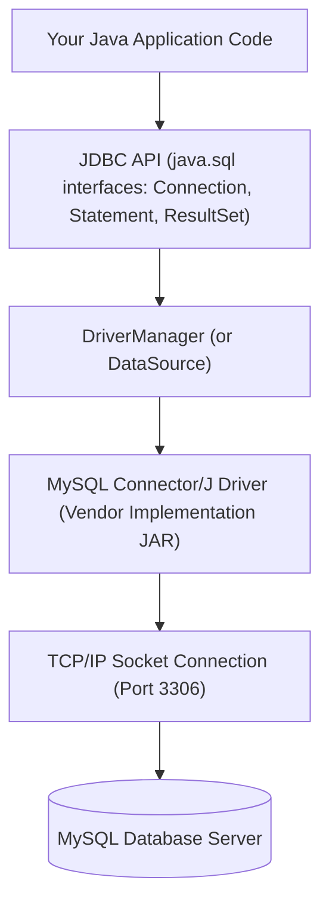

# JDBC Architecture, Drivers & Establishing a Connection

> **Phase 8: JDBC & Database Connectivity**  
> *Estimated Reading Time: 40 minutes | Total Practice Effort: ~2.5 hours | Tier: Core Essential*

---

## 1. Purpose & Prerequisites

### Why This Matters in Full Stack Development
Before high-level frameworks like Hibernate, Spring Data JPA, or MyBatis existed, Java applications communicated with databases using **JDBC (Java Database Connectivity)**.

Even today, Spring Boot and Hibernate are built on top of JDBC! When an ORM generates slow queries, leaks connections, or fails with driver exceptions, you cannot debug it without understanding what JDBC is doing under the hood.

In this lesson, you will learn how the Java application layer talks to relational databases, how JDBC drivers work, and how to open your first robust database connection.

### Prerequisites
- [Topic 2.1: Classes & Objects](../02-oop/01-classes-objects.md)
- [Topic 3.3: Maven Build Lifecycle & POM](../03-core/03-maven.md)
- [Topic 7.1: Relational Concepts: Tables & Schemas](../07-sql/01-db-concepts.md)

---

## 2. Plain-English Mental Model

```
[ Universal Travel Adapter Analogy ]
- Java Application: Your laptop plug (Standard US 3-prong plug).
- Different Databases (MySQL, PostgreSQL, Oracle): Wall sockets in different countries (UK 3-pin, EU round pin).
- JDBC API (java.sql.*): The international standard specification for what a plug should do.
- JDBC Driver (e.g. mysql-connector-j): The physical adapter brick built specifically for that country's wall socket!
- DriverManager: The concierge who hands you the right adapter brick when you ask for "MySQL".
```

---

## 3. Under the Hood: JDBC Architectural Layers

JDBC is defined in the standard JDK package `java.sql` as a set of **interfaces**. The actual database vendors (MySQL, PostgreSQL, Oracle) provide the **implementations** inside a separate JAR file.



### The 4 Driver Types (Historical Context):
1. **Type 1 (JDBC-ODBC Bridge):** Obsolete; bridged to native Windows ODBC drivers.
2. **Type 2 (Native-API Driver):** Partially Java, partially C/C++ native client libraries.
3. **Type 3 (Network Protocol Driver):** Translates JDBC calls to an intermediate middleware server.
4. **Type 4 (Pure Java Driver / Thin Driver):** **The modern standard!** Direct socket communication from Java to the database engine via the database's proprietary binary protocol. `mysql-connector-j` is a Type 4 driver.

---

## 4. Setting Up Maven & Establishing a Connection

### Step 1: Add MySQL Driver Dependency to `pom.xml`
```xml
<dependency>
    <groupId>com.mysql</groupId>
    <artifactId>mysql-connector-j</artifactId>
    <version>8.3.0</version>
</dependency>
```

### Step 2: Java Connection Code
```java
package com.career.learning.jdbc;

import java.sql.Connection;
import java.sql.DriverManager;
import java.sql.SQLException;

public class DatabaseConnectionDemo {

    // JDBC Connection URL: protocol//host:port/database?parameters
    private static final String URL = "jdbc:mysql://localhost:3306/learning_platform?useSSL=false&serverTimezone=UTC&allowPublicKeyRetrieval=true";
    private static final String USER = "root";
    private static final String PASSWORD = "secretpassword";

    public static void main(String[] args) {
        System.out.println("Attempting to connect to MySQL database...");

        // In modern JDBC 4.0+, Class.forName("com.mysql.cj.jdbc.Driver") is automatically handled via SPI!
        try (Connection connection = DriverManager.getConnection(URL, USER, PASSWORD)) {
            if (connection != null && !connection.isClosed()) {
                System.out.println(" Successfully connected to MySQL database!");
                System.out.println("Database Product: " + connection.getMetaData().getDatabaseProductName());
                System.out.println("Database Version: " + connection.getMetaData().getDatabaseProductVersion());
                System.out.println("Auto-commit Mode: " + connection.getAutoCommit());
            }
        } catch (SQLException e) {
            System.err.println(" Connection failed!");
            System.err.println("Error Message: " + e.getMessage());
            System.err.println("SQL State: " + e.getSQLState());
            System.err.println("Vendor Error Code: " + e.getErrorCode());
            e.printStackTrace();
        }
    }
}
```

---

## 5. Deconstructing the JDBC URL

A JDBC connection string has a strictly standardized format:

```
jdbc : mysql : // localhost : 3306 / learning_platform ? useSSL=false & serverTimezone=UTC
---   -----    -----------   ----   -----------------   ----------------------------------
 |      |           |          |            |                           |
 1      2           3          4            5                           6
```

1. **Protocol:** Always `jdbc:`.
2. **Sub-protocol:** Specifies the database engine (`mysql`, `postgresql`, `oracle:thin`, `h2:mem`).
3. **Host:** IP address or hostname of the database server (`localhost`, `db.internal.production.com`).
4. **Port:** Port number (default for MySQL is `3306`, PostgreSQL is `5432`).
5. **Database Name:** The target schema name.
6. **Query Parameters:** Configuration flags:
   - `serverTimezone=UTC`: Avoids timezone mismatch between JVM and MySQL.
   - `useSSL=false`: Disables TLS/SSL for local development.
   - `allowPublicKeyRetrieval=true`: Required for MySQL 8+ `caching_sha2_password` authentication over unencrypted connections.

---

## 6. How Service Provider Interface (SPI) Works

In older Java tutorials (Java 5 and earlier), you would always see this line before connecting:
```java
Class.forName("com.mysql.cj.jdbc.Driver"); // Legacy code!
```

### Why you don't need this in modern Java:
Java 6 introduced **JDBC 4.0** with the **Service Provider Interface (SPI)**.
Inside the `mysql-connector-j.jar` file, there is a metadata file:
`META-INF/services/java.sql.Driver` containing the string `com.mysql.cj.jdbc.Driver`.

When your application starts, `DriverManager` scans all JARs on the classpath using `ServiceLoader` and automatically registers all available database drivers.

---

## 7. Common Rookie Mistakes & Traps

### Trap 1: `CommunicationsLinkException: Communications link failure`
*Symptom:* `java.sql.SQLNonTransientConnectionException: Could not create connection to database server.`  
*Root Cause:* 
1. MySQL server is not running on `localhost:3306`.
2. A firewall is blocking port 3306.
3. The port or database name in the JDBC URL has a typo.

### Trap 2: Hardcoding Database Credentials in Git
```java
// NEVER COMMIT THIS TO GITHUB!
private static final String PASSWORD = "MySuperSecretProductionPassword!";
```
*Fix:* Read credentials from environment variables or a configuration file:
```java
String dbUser = System.getenv().getOrDefault("DB_USER", "root");
String dbPass = System.getenv("DB_PASSWORD");
```

### Trap 3: Catching `Exception` Instead of Inspecting `SQLException`
`SQLException` contains rich diagnostic properties that generic exceptions hide:
- `e.getSQLState()`: ANSI SQL standardized error code (e.g. `23000` for integrity violation).
- `e.getErrorCode()`: Database vendor specific error number (e.g. `1062` for MySQL duplicate entry).

---

## 8. Guided Hands-On Exercise

### The Scenario
You need to create a reusable `ConnectionFactory` class that reads database connection properties from an external `db.properties` file rather than hardcoding connection strings in source code.

### Your Challenge:
Create `DatabasePropertiesConfig.java`:
1. Load database parameters (`db.url`, `db.user`, `db.password`) from `db.properties` using `java.util.Properties`.
2. Provide a static method `getConnection()` that returns a live `java.sql.Connection`.

<details>
<summary>💡 Hint: Using java.util.Properties and ClassLoader</summary>

```java
Properties props = new Properties();
try (InputStream in = DatabasePropertiesConfig.class.getClassLoader().getResourceAsStream("db.properties")) {
    props.load(in);
}
return DriverManager.getConnection(props.getProperty("db.url"), ...);
```
</details>

<details>
<summary>✅ Solution</summary>

```java
package com.career.learning.jdbc;

import java.io.IOException;
import java.io.InputStream;
import java.sql.Connection;
import java.sql.DriverManager;
import java.sql.SQLException;
import java.util.Properties;

public class DatabasePropertiesConfig {

    private static final Properties properties = new Properties();

    static {
        try (InputStream input = DatabasePropertiesConfig.class.getClassLoader()
                .getResourceAsStream("db.properties")) {
            if (input == null) {
                throw new RuntimeException("Unable to find db.properties on classpath!");
            }
            properties.load(input);
        } catch (IOException ex) {
            throw new ExceptionInInitializerError("Failed to load db.properties: " + ex.getMessage());
        }
    }

    public static Connection getConnection() throws SQLException {
        String url = properties.getProperty("db.url");
        String user = properties.getProperty("db.user");
        String pass = properties.getProperty("db.password");
        return DriverManager.getConnection(url, user, pass);
    }
}
```
</details>

---

## 9. Knowledge Check & Interview Defense

### Quick Quiz
1. **What type of JDBC driver is `mysql-connector-j`?**
   - [x] A) Type 4: Pure Java "Thin" Driver communicating directly over TCP/IP sockets using the database protocol.
   - [ ] B) Type 1: JDBC-ODBC Bridge.
   - [ ] C) Type 2: Native C-library binding.
   - [ ] D) Type 5: Hardware accelerated driver.

2. **In modern JDBC 4.0+, why is `Class.forName("com.mysql.cj.jdbc.Driver")` no longer required?**
   - [x] A) `DriverManager` automatically discovers and loads drivers via Java's Service Provider Interface (SPI) scanning `META-INF/services/java.sql.Driver`.
   - [ ] B) Java removed the need for drivers altogether.
   - [ ] C) Operating systems inject the driver into JVM memory.
   - [ ] D) The compiler compiles the driver directly into bytecode.

3. **What does the query parameter `serverTimezone=UTC` in a MySQL JDBC URL do?**
   - [x] A) It harmonizes date/time calculations between the Java virtual machine and MySQL database server to prevent date shifts.
   - [ ] B) It speeds up query execution by 50%.
   - [ ] C) It encrypts network traffic.
   - [ ] D) It disables database logging.

---

### Junior Developer Interview Q&A

#### Q: "What is the difference between `DriverManager` and `DataSource` in enterprise Java applications?"
> **Model Answer:**  
> "`DriverManager` is the basic, legacy way to obtain connections in JDBC. Every time `DriverManager.getConnection()` is invoked, it creates a brand new, physical TCP/IP socket connection to the database. Creating physical connections is computationally heavy and slow (requiring network handshakes and authentication).
>
> `DataSource` is the modern, enterprise abstraction defined in `javax.sql.DataSource`. It acts as a factory for database connections and is typically implemented by a **Connection Pool** (like HikariCP or Apache DBCP). Instead of destroying and recreating socket connections, a `DataSource` maintains a warm pool of pre-established connections that applications can borrow and return in microseconds. In Spring Boot and production systems, `DataSource` is always preferred over `DriverManager`."

---

## 10. Mastery Checklist & Next Step

Before moving on, verify that you can:
- [ ] Diagram the JDBC architectural layers from application code to database server.
- [ ] Add the MySQL JDBC driver dependency via Maven.
- [ ] Deconstruct and configure a JDBC connection URL.
- [ ] Handle `SQLException` and extract SQLState and vendor error codes.

👉 **Next Lesson:** **[Topic 8.2: Safe Resource Management: try-with-resources & Connection Leaks](02-resource-management.md)**
