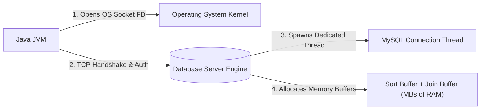
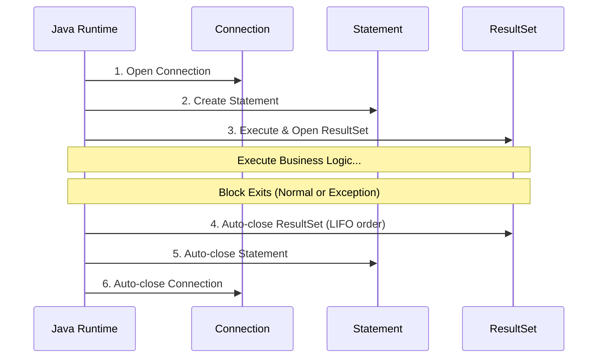

# Safe Resource Management: try-with-resources & Connection Leaks

> **Phase 8: JDBC & Database Connectivity**  
> *Estimated Reading Time: 35 minutes | Total Practice Effort: ~2.5 hours | Tier: Core Essential*

---

## 1. Purpose & Prerequisites

### Why This Matters in Full Stack Development
A relational database server like MySQL or PostgreSQL does not have infinite capacity. By default, MySQL allows a maximum of 151 simultaneous connections (`max_connections = 151`).

If your Java backend opens a `Connection`, `Statement`, or `ResultSet` on every user HTTP request and forgets to close it:
1. Within a few minutes of incoming traffic, all 151 connection slots become exhausted.
2. The database rejects all incoming traffic with the fatal error:  
   `java.sql.SQLException: Data source rejected establishment of connection, message from server: "Too many connections"`
3. Your entire backend crashes and requires an emergency server reboot!

In this lesson, you will master **Connection Leak Prevention** and the modern Java **try-with-resources** pattern.

### Prerequisites
- [Topic 3.1: Exceptions: Checked, Unchecked & Best Practices](../03-core/01-exceptions.md)
- [Topic 8.1: JDBC Architecture, Drivers & Establishing a Connection](01-architecture-connections.md)

---

## 2. Plain-English Mental Model

```
[ The Hotel Room Keycard Analogy ]
- The database has 100 rooms (connections).
- When a guest arrives, the front desk gives them a keycard.
- If guests leave the hotel without returning their keycards to the front desk, 
  the hotel soon runs out of keys.
- New paying guests are left stranded on the street, unable to check in!
- You MUST return your keycard (close your connection) immediately after you are done!
```

---

## 3. Under the Hood: Why Database Resources Are Heavy

When your Java application creates a `Connection`, it is not merely creating an in-memory Java object; it is consuming real OS and database server hardware resources:



1. **Operating System File Descriptors:** Each open network socket consumes an OS file descriptor.
2. **Database Engine Threads:** MySQL allocates a dedicated thread (or thread-pool worker) for each active connection.
3. **Dedicated Server RAM:** The database allocates query execution buffers (`read_buffer_size`, `sort_buffer_size`) per connection.
4. **Conclusion:** Leaving connections open ("leaking connections") starves both the application server and the database server of memory and thread handles.

---

## 4. The Legacy Anti-Pattern: `try-finally` and Why It Failed

Before Java 7, closing database resources was notoriously verbose and error-prone. Look at how painful and risky legacy code was:

```java
// BAD: Legacy Java 6 try-finally nightmare
Connection conn = null;
Statement stmt = null;
ResultSet rs = null;

try {
    conn = DriverManager.getConnection(URL, USER, PASS);
    stmt = conn.createStatement();
    rs = stmt.executeQuery("SELECT * FROM users");
    while (rs.next()) {
        // process rows
    }
} catch (SQLException e) {
    e.printStackTrace();
} finally {
    // If closing rs throws a SQLException, stmt and conn NEVER get closed!
    try { if (rs != null) rs.close(); } catch (SQLException e) { /* ignored */ }
    try { if (stmt != null) stmt.close(); } catch (SQLException e) { /* ignored */ }
    try { if (conn != null) conn.close(); } catch (SQLException e) { /* ignored */ }
}
```

*The Trap:* If `rs.close()` threw an exception in naive code, execution jumped out of the `finally` block before `stmt.close()` or `conn.close()` could execute. The connection leaked!

---

## 5. The Modern Standard: `AutoCloseable` & `try-with-resources`

Java 7 introduced the **try-with-resources** statement. Any object implementing the `java.lang.AutoCloseable` interface can be declared inside the `try (...)` parentheses.

The JDBC core interfaces (`Connection`, `Statement`, `PreparedStatement`, `ResultSet`) all extend `AutoCloseable`.



### Key Behavioral Rules:
1. **LIFO Closing Order (Last In, First Out):** Resources are automatically closed in the **reverse order** of their declaration: `ResultSet` closes first, then `Statement`, then `Connection`.
2. **Guaranteed Execution:** Even if your code throws a `RuntimeException`, `SQLException`, or returns early, Java guarantees all resources are closed before leaving the block.
3. **Suppressed Exceptions:** If an exception occurs in the try block *and* another exception occurs while closing a resource, Java preserves the primary exception and attaches the secondary closing exception as a **suppressed exception** (`e.getSuppressed()`).

---

## 6. Working Clean Production Code

```java
package com.career.learning.jdbc;

import java.sql.Connection;
import java.sql.DriverManager;
import java.sql.PreparedStatement;
import java.sql.ResultSet;
import java.sql.SQLException;

public class SafeResourceManagementDemo {

    private static final String URL = "jdbc:mysql://localhost:3306/learning_platform?useSSL=false&serverTimezone=UTC";
    private static final String USER = "root";
    private static final String PASSWORD = "password";

    public static void printActiveUserCount() {
        String sql = "SELECT COUNT(*) AS total FROM users WHERE is_active = true";

        // Declare all three AutoCloseable resources inside the try (...) header
        try (Connection conn = DriverManager.getConnection(URL, USER, PASSWORD);
             PreparedStatement stmt = conn.prepareStatement(sql);
             ResultSet rs = stmt.executeQuery()) {

            if (rs.next()) {
                int count = rs.getInt("total");
                System.out.println("Active Users Count: " + count);
            }

        } catch (SQLException e) {
            System.err.println("Database operation failed: " + e.getMessage());
            e.printStackTrace();
        }
        // At this exact line, rs, stmt, AND conn are 100% closed and returned!
    }

    public static void main(String[] args) {
        printActiveUserCount();
    }
}
```

---

## 7. Common Rookie Mistakes & Traps

### Trap 1: Declaring Resources Outside the Parentheses
```java
// WRONG: This will NOT auto-close the connection!
Connection conn = DriverManager.getConnection(URL, USER, PASSWORD);
try (conn) { // Valid in Java 9+, BUT if connection opening throws, it's not handled cleanly!
    // ...
}
```
*Best Practice:* Always instantiate resources directly inside the `try (...)` expression: `try (Connection conn = ...)`.

### Trap 2: Reusing a Statement After It Has Been Closed
```java
try (Connection conn = ...;
     Statement stmt = conn.createStatement()) {
    stmt.close(); // Explicitly closing prematurely!
    stmt.executeQuery("SELECT 1"); // Throws java.sql.SQLException: Statement is closed!
}
```

### Trap 3: Returning a `ResultSet` Across Method Boundaries
```java
// DANGEROUS ANTI-PATTERN!
public ResultSet getUsers() throws SQLException {
    try (Connection conn = getConnection();
         Statement stmt = conn.createStatement()) {
        return stmt.executeQuery("SELECT * FROM users");
    } // BOOM! Connection and Statement close here!
    // The returned ResultSet is now dead and invalid!
}
```
*Fix:* Always iterate through the `ResultSet` inside the method, map the rows to Java POJOs (like `List<User>`), and return the POJO collection!

---

## 8. Guided Hands-On Exercise

### The Scenario
A junior developer wrote the following method in a legacy report service. Under load tests, the server crashed with `Too many connections`.

```java
public double getAverageProductPrice() {
    try {
        Connection conn = DriverManager.getConnection(URL, USER, PASSWORD);
        Statement stmt = conn.createStatement();
        ResultSet rs = stmt.executeQuery("SELECT AVG(price) FROM products");
        if (rs.next()) {
            return rs.getDouble(1);
        }
    } catch (Exception e) {
        e.printStackTrace();
    }
    return 0.0;
}
```

### Your Challenge:
1. Identify all resources that are leaking.
2. Refactor the method into a leak-proof method using modern `try-with-resources`.

<details>
<summary>💡 Hint: All 3 resources must be enclosed</summary>

Enclose `Connection`, `Statement`, and `ResultSet` in the `try(...)` header. Return the calculated double from inside the try block; Java will still execute the auto-close before returning!
</details>

<details>
<summary>✅ Solution</summary>

```java
public double getAverageProductPrice() {
    String sql = "SELECT AVG(price) FROM products";

    try (Connection conn = DriverManager.getConnection(URL, USER, PASSWORD);
         Statement stmt = conn.createStatement();
         ResultSet rs = stmt.executeQuery(sql)) {

        if (rs.next()) {
            return rs.getDouble(1);
        }

    } catch (SQLException e) {
        System.err.println("Failed to calculate average price: " + e.getMessage());
        e.printStackTrace();
    }

    return 0.0;
}
```
</details>

---

## 9. Knowledge Check & Interview Defense

### Quick Quiz
1. **In what order does `try-with-resources` close declared resources upon exiting the block?**
   - [x] A) Reverse order of declaration (LIFO: Last In, First Out).
   - [ ] B) In the exact order they were declared (FIFO).
   - [ ] C) Random order determined by the garbage collector.
   - [ ] D) Only when JVM process terminates.

2. **What Java interface must a class implement to be declared in a `try-with-resources` statement?**
   - [x] A) `java.lang.AutoCloseable` (or `java.io.Closeable`).
   - [ ] B) `java.io.Serializable`.
   - [ ] C) `java.lang.Cloneable`.
   - [ ] D) `java.lang.Runnable`.

3. **What happens if a database connection is not closed after executing a query?**
   - [x] A) The connection remains open in the OS and DB server, eventually causing connection pool exhaustion and "Too many connections" errors.
   - [ ] B) Java immediately crashes with a NullPointerException.
   - [ ] C) The database automatically deletes the query results.
   - [ ] D) The database rolls back the operating system.

---

### Junior Developer Interview Q&A

#### Q: "What are 'Suppressed Exceptions' in Java's try-with-resources mechanism?"
> **Model Answer:**  
> "Prior to Java 7, if an exception occurred in the `try` block and another exception occurred in the `finally` block while calling `.close()`, the `finally` block exception would overwrite and hide the original business exception, making root-cause debugging very difficult.
>
> In Java 7+ `try-with-resources`, if both the `try` block throws an exception (e.g. `SQLException: Syntax error`) and the automatic `.close()` method also throws an exception (e.g. `SQLException: Network failure during socket close`), the primary exception is preserved and thrown. The closing exception is attached to the primary exception as a **Suppressed Exception**.
>
> We can retrieve any suppressed exceptions using `e.getSuppressed()`, guaranteeing that no critical debugging context is ever lost."

---

## 10. Mastery Checklist & Next Step

Before moving on, verify that you can:
- [ ] Explain why unclosed database connections exhaust server resources and trigger "Too many connections".
- [ ] Implement multi-resource `try-with-resources` blocks for `Connection`, `Statement`, and `ResultSet`.
- [ ] State the closing order (LIFO) and explain exception suppression mechanics.
- [ ] Avoid returning raw `ResultSet` objects outside of resource management scopes.

👉 **Next Lesson:** **[Topic 8.3: Statement vs PreparedStatement & SQL Injection Prevention](03-preparedstatement.md)**
