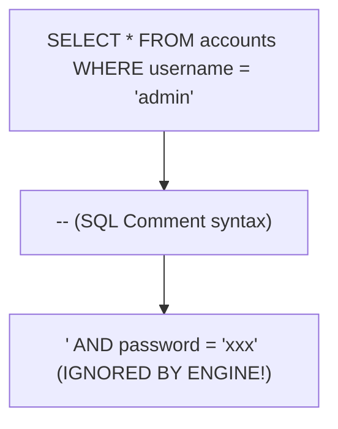
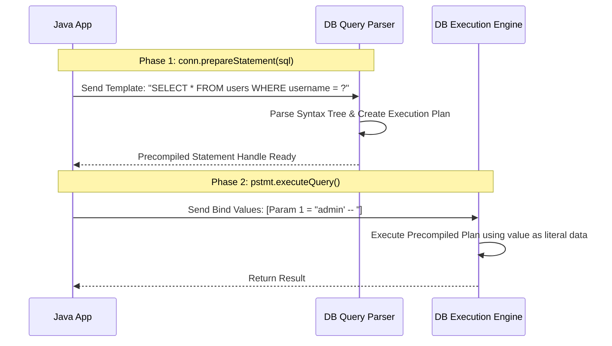

# Statement vs PreparedStatement & SQL Injection Prevention

> **Phase 8: JDBC & Database Connectivity**  
> *Estimated Reading Time: 50 minutes | Total Practice Effort: ~3.5 hours | Tier: Core Essential*

---

## 1. Purpose & Prerequisites

### Why This Matters in Full Stack Development
In the history of software development, **SQL Injection (SQLi)** has caused more multi-million dollar data breaches, stolen credentials, and compromised user databases than almost any other vulnerability.

Year after year, SQL Injection dominates the **OWASP Top 10** web application security risks.

If a developer constructs database queries using naive string concatenation (`"WHERE user = '" + input + "'"`), an attacker can bypass authentication, steal passwords, or drop entire production tables (`'; DROP TABLE users; --`).

In this lesson, you will master **PreparedStatement**, understand query plan precompilation under the hood, and ensure your backend code is 100% immune to SQL injection.

### Prerequisites
- [Topic 8.1: JDBC Architecture & Connections](01-architecture-connections.md)
- [Topic 8.2: Safe Resource Management: try-with-resources](02-resource-management.md)

---

## 2. Plain-English Mental Model

```
[ Statement (String Concatenation): A Chef who executes whatever is written on the order slip ]
- Customer writes: "Burger, medium rare." Chef makes a burger.
- Attacker writes: "Burger. Also, set fire to the kitchen and give me all the cash in the register!"
- The chef reads the whole sentence as INSTRUCTIONS and burns the restaurant down!

[ PreparedStatement (Bind Parameters): A Strict Fill-in-the-Blank Form ]
- The restaurant prints an immutable plastic card: "Make a Burger. Selected Cheese: [ _____ ]."
- Attacker writes: "Cheddar; set fire to kitchen".
- The chef treats the ENTIRE input strictly as the NAME OF THE CHEESE!
- The chef serves a burger with Cheddar; no commands can ever be executed!
```

---

## 3. Anatomy of a SQL Injection Attack

Consider this classic vulnerable Java authentication code using a standard `java.sql.Statement`:

```java
// VULNERABLE CODE - NEVER USE THIS IN PRODUCTION!
public boolean authenticate(String username, String password) {
    String sql = "SELECT * FROM accounts WHERE username = '" + username + 
                 "' AND password = '" + password + "'";
    
    Statement stmt = conn.createStatement();
    ResultSet rs = stmt.executeQuery(sql);
    return rs.next(); // If a row is returned, user is logged in!
}
```

### Scenario A: Legitimate User
- `username`: `alice`
- `password`: `secret123`
- Evaluated SQL:  
  `SELECT * FROM accounts WHERE username = 'alice' AND password = 'secret123'`  
  *(Works as expected).*

### Scenario B: The SQL Injection Exploit
An attacker enters:
- `username`: `admin' -- `
- `password`: *(anything)*

Look at how the database parser interprets the resulting string:
```sql
SELECT * FROM accounts WHERE username = 'admin' -- ' AND password = 'xxx'
```



**The Result:**  
1. The single quote `'` closes the username string literal early.
2. The `--` tells the SQL parser that everything following it is a comment.
3. The password verification check is completely bypassed!
4. The attacker is instantly logged into the `admin` account without knowing the password!

---

## 4. The Solution: `java.sql.PreparedStatement`

`PreparedStatement` solves this fundamentally by separating the **SQL Command Structure** from the **User Data Values** using question mark (`?`) placeholders:

```java
String sql = "SELECT * FROM accounts WHERE username = ? AND password = ?";

try (PreparedStatement pstmt = conn.prepareStatement(sql)) {
    // Parameter indexes are 1-BASED!
    pstmt.setString(1, username);
    pstmt.setString(2, password);

    try (ResultSet rs = pstmt.executeQuery()) {
        return rs.next();
    }
}
```

If the attacker passes `admin' -- `, the database treats the entire string `admin' -- ` as a literal value for comparison. It searches for an account whose actual username is literally `admin' -- `, finds nothing, and rejects access safely!

---

## 5. Under the Hood: Two-Phase Query Precompilation

Why is `PreparedStatement` completely immune to injection? Because of how the database engine compiles queries:



1. **Phase 1 (Compilation):** The database parses the SQL statement, analyzes table metadata, creates the Abstract Syntax Tree (AST), and builds the execution plan. At this stage, the structure of the query is **permanently locked**.
2. **Phase 2 (Binding):** When parameters are supplied, they are sent over the network as raw binary or escaped literal data. **No user input can ever alter the Abstract Syntax Tree or inject new SQL commands**, because the compilation phase has already finished!

### Performance Benefit:
If you execute the same query 1,000 times with different parameters, the database parses and plans the query **only once**, executing subsequent calls significantly faster.

---

## 6. Type-Safe Parameter Setter Methods

JDBC `PreparedStatement` provides strongly-typed setter methods for every standard SQL data type.

> **CRITICAL RULE:** JDBC parameter indices are **1-based** (the first `?` is index 1, the second `?` is index 2), NOT 0-based!

```java
String sql = "INSERT INTO products (title, sku, price, stock, is_active, created_at) " +
             "VALUES (?, ?, ?, ?, ?, ?)";

try (PreparedStatement pstmt = conn.prepareStatement(sql)) {
    pstmt.setString(1, "Wireless Mechanical Keyboard");  // VARCHAR
    pstmt.setString(2, "KB-WL-001");                     // VARCHAR
    pstmt.setBigDecimal(3, new BigDecimal("129.99"));    // DECIMAL / NUMERIC
    pstmt.setInt(4, 50);                                 // INT
    pstmt.setBoolean(5, true);                           // BOOLEAN
    pstmt.setTimestamp(6, Timestamp.valueOf(LocalDateTime.now())); // TIMESTAMP

    int rowsAffected = pstmt.executeUpdate();
    System.out.println("Inserted " + rowsAffected + " product row(s).");
}
```

### Handling Null Database Values:
```java
// If a nullable foreign key category_id is missing:
if (categoryId != null) {
    pstmt.setInt(7, categoryId);
} else {
    pstmt.setNull(7, java.sql.Types.INTEGER);
}
```

---

## 7. Common Rookie Mistakes & Anti-Patterns

### Anti-Pattern 1: The "Fake PreparedStatement" Trap
Using `PreparedStatement`, but still using string concatenation:
```java
// DISASTROUS MISTAKE: You gain ZERO protection from SQL Injection!
String sql = "SELECT * FROM users WHERE email = '" + userEmail + "'";
PreparedStatement pstmt = conn.prepareStatement(sql); // STILL VULNERABLE!
```
*Rule:* If you see a `+` sign concatenating dynamic user strings inside your SQL query, your code is vulnerable! Always use `?`.

### Anti-Pattern 2: The `ArrayIndexOutOfBoundsException: Index 0`
```java
pstmt.setString(0, "Alice"); // THROWS SQLException! JDBC IS 1-BASED!
```

### Anti-Pattern 3: Trying to Parameterize Table Names or Column Names
```java
// ERROR: You CANNOT parameterize table names, column names, or SQL keywords!
String sql = "SELECT * FROM ? WHERE ? = ?"; // INVALID!
```
*Why this fails:* The database must know table and column names during Phase 1 (compilation) to build the execution plan and verify permissions. Placeholders (`?`) can only replace **data values**.  
*Solution:* If dynamic table or column sorting is required (`ORDER BY ?`), validate against a strict programmatic **whitelist** of allowed column names:
```java
List<String> allowedSorts = List.of("price", "created_at", "title");
if (!allowedSorts.contains(sortBy)) {
    throw new IllegalArgumentException("Invalid sort column!");
}
String sql = "SELECT * FROM products ORDER BY " + sortBy; // Safe via strict whitelist
```

---

## 8. Guided Hands-On Exercise

### The Scenario
You are conducting a code review on an enterprise user management service. You discover this vulnerable password update method:

```java
public void updatePassword(String userId, String oldPass, String newPass) throws SQLException {
    String sql = "UPDATE users SET password_hash = '" + newPass + 
                 "' WHERE id = " + userId + " AND password_hash = '" + oldPass + "'";
    
    try (Statement stmt = connection.createStatement()) {
        stmt.executeUpdate(sql);
    }
}
```

### Your Challenge:
1. Explain how an attacker could exploit this method to reset anyone's password without knowing their old password.
2. Refactor the method to use a secure, parameter-bound `PreparedStatement`.

<details>
<summary>💡 Hint: Exploiting userId or oldPass</summary>

If an attacker inputs `userId = "1 OR 1=1 -- "`, the `WHERE` condition matches every user, resetting the password for all users in the system!
</details>

<details>
<summary>✅ Solution</summary>

```java
public boolean updatePassword(long userId, String oldPass, String newPass) throws SQLException {
    String sql = "UPDATE users SET password_hash = ? WHERE id = ? AND password_hash = ?";

    try (PreparedStatement pstmt = connection.prepareStatement(sql)) {
        pstmt.setString(1, newPass);
        pstmt.setLong(2, userId);
        pstmt.setString(3, oldPass);

        int rowsUpdated = pstmt.executeUpdate();
        // Returns true only if the user ID and old password matched exactly 1 row
        return rowsUpdated == 1;
    }
}
```
</details>

---

## 9. Knowledge Check & Interview Defense

### Quick Quiz
1. **Why does `PreparedStatement` prevent SQL injection attacks?**
   - [x] A) The database compiles the SQL query structure and execution plan before bind parameters are received; user inputs are treated strictly as data literals and can never alter the syntax tree.
   - [ ] B) Java converts all strings to upper case.
   - [ ] C) JDBC encrypts user inputs with AES.
   - [ ] D) PreparedStatement deletes single quotes from strings.

2. **What index number corresponds to the FIRST placeholder (`?`) in a JDBC `PreparedStatement`?**
   - [x] A) `1` (JDBC parameters are 1-based).
   - [ ] B) `0`.
   - [ ] C) `-1`.
   - [ ] D) The ASCII value of the column name.

3. **Can you use a `?` parameter placeholder for a database table name like `SELECT * FROM ?`?**
   - [x] A) No; the database query planner requires table and column names during the initial compilation phase to verify schemas and permissions.
   - [ ] B) Yes, anywhere in SQL.
   - [ ] C) Only in MySQL.
   - [ ] D) Only when using integers.

---

### Junior Developer Interview Q&A

#### Q: "Besides SQL injection prevention, what performance advantage does `PreparedStatement` have over `Statement`?"
> **Model Answer:**  
> "When a relational database executes a SQL query, it must parse the SQL string, check permissions, validate table and column names, and calculate an optimal cost-based execution plan.
>
> With a standard `Statement`, if you run a query 10,000 times with different string concatenations, the database sees 10,000 completely different query strings and must re-parse and compile the query 10,000 times.
>
> With a `PreparedStatement`, the parameterized SQL template is compiled and its execution plan is cached in the database's query plan cache. On subsequent executions, the engine reuses the precompiled plan and simply swaps in the new bind parameter values. This significantly reduces database CPU load and improves execution speed for high-throughput transactional systems."

---

## 10. Mastery Checklist & Next Step

Before moving on, verify that you can:
- [ ] Explain how SQL injection attacks bypass authentication and extract data.
- [ ] Write parameterized queries using `PreparedStatement` and `?` placeholders.
- [ ] Bind primitive and object parameters using 1-based setter methods (`setString`, `setInt`, `setBigDecimal`).
- [ ] Properly validate dynamic SQL identifiers (like `ORDER BY` columns) using strict whitelists.

👉 **Next Lesson:** **[Topic 8.4: Querying & Processing Tabular Data with ResultSet](04-resultset.md)**
