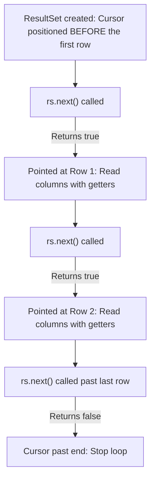

# Querying & Processing Tabular Data with ResultSet

> **Phase 8: JDBC & Database Connectivity**  
> *Estimated Reading Time: 45 minutes | Total Practice Effort: ~3 hours | Tier: Core Essential*

---

## 1. Purpose & Prerequisites

### Why This Matters in Full Stack Development
Relational databases speak **tables, rows, and columns**.  
Java applications speak **objects, references, and collections**.

This fundamental difference is known as the **Object-Relational Impedance Mismatch**.

To bridge this gap without an ORM (and to understand how tools like Spring Data JPA or MyBatis work under the hood), you must know how to navigate the tabular data stream using `java.sql.ResultSet` and map raw relational tuples into clean, type-safe Java domain models (POJOs/DTOs).

### Prerequisites
- [Topic 2.1: Classes & Objects](../02-oop/01-classes-objects.md)
- [Topic 8.2: Safe Resource Management: try-with-resources](02-resource-management.md)
- [Topic 8.3: Statement vs PreparedStatement](03-preparedstatement.md)

---

## 2. Plain-English Mental Model

```
[ ResultSet: A Reading Cursor on a Spreadsheet ]
- Imagine a spreadsheet printed on a sheet of paper with a cardboard slider over it.
- When you first create the ResultSet, the cardboard slider sits ABOVE the first row ("beforeFirst").
- You cannot read any data yet!
- Every time you call rs.next(), the slider moves down exactly one row.
- If a row exists, it returns TRUE. You can read the columns of that row.
- When you call rs.next() past the last row, it returns FALSE and stops.
```

---

## 3. The ResultSet Cursor Lifecycle



### Standard Iteration Idiom:
```java
// Standard loop pattern for multiple rows:
while (rs.next()) {
    // Process current row
}

// Idiom for single-row queries (e.g. findById):
if (rs.next()) {
    // Exactly one record found
} else {
    // Record does not exist! Throw NotFoundException
}
```

---

## 4. Extracting Column Data: Type-Safe Getters

`ResultSet` provides methods to convert SQL data types into their corresponding Java representations:

| SQL Data Type | Recommended JDBC Getter | Java Return Type |
| :--- | :--- | :--- |
| `BIGINT` | `rs.getLong("id")` | `long` / `Long` |
| `INT` / `INTEGER` | `rs.getInt("quantity")` | `int` / `Integer` |
| `VARCHAR` / `TEXT` | `rs.getString("title")` | `String` |
| `DECIMAL` / `NUMERIC` | `rs.getBigDecimal("price")` | `java.math.BigDecimal` |
| `BOOLEAN` / `TINYINT(1)` | `rs.getBoolean("is_active")` | `boolean` / `Boolean` |
| `TIMESTAMP` / `DATETIME` | `rs.getTimestamp("created_at")` | `java.sql.Timestamp` (or `LocalDateTime`) |
| `DATE` | `rs.getDate("birth_date")` | `java.sql.Date` (or `LocalDate`) |

### Access by Column Name vs Column Index:
- **By Label/Name (Recommended):** `rs.getString("email")`. Resilient to SQL column reordering.
- **By 1-Based Index:** `rs.getString(2)`. Slightly faster, but easily breaks if someone reorders columns in the `SELECT` list. Always prefer column names in production code!

---

## 5. The Critical `wasNull()` Primitive Trap

In SQL, a numeric column like `age INT` or `discount_rate DECIMAL` can contain `NULL`.  
In Java, primitive types (`int`, `double`, `boolean`) **cannot be null**.

### What happens when JDBC encounters a database `NULL`?
If `rs.getInt("age")` reads a SQL `NULL`, JDBC silently converts it to **`0`**!

```java
// BUG ALERT!
int age = rs.getInt("age"); 
// If the database has NULL, age is now 0!
// Did the user enter 0 years old, or was their age not provided?!
```

### The Solution: `rs.wasNull()`
Immediately after reading a primitive column, invoke `rs.wasNull()` to inspect if the last extracted column was actually `NULL`:

```java
// Correctly handling nullable columns:
int rawAge = rs.getInt("age");
Integer age = rs.wasNull() ? null : rawAge;

// Or in modern Java using rs.getObject(column, Class):
Integer modernAge = rs.getObject("age", Integer.class); // Returns null if SQL is NULL!
Double discount = rs.getObject("discount_rate", Double.class);
```

---

## 6. Mapping Relational Rows to Domain POJOs (The RowMapper Pattern)

In clean architecture, database logic should translate tabular rows into clean domain models:

### The Domain Model:
```java
package com.career.learning.model;

import java.math.BigDecimal;
import java.time.LocalDateTime;

public record Product(
    Long id,
    String sku,
    String title,
    BigDecimal price,
    Integer stockQuantity,
    boolean active,
    LocalDateTime createdAt
) {}
```

### The Production DAO / Repository Implementation:
```java
package com.career.learning.dao;

import com.career.learning.model.Product;
import java.sql.*;
import java.time.LocalDateTime;
import java.util.ArrayList;
import java.util.List;

public class ProductDao {

    private final String url;
    private final String user;
    private final String password;

    public ProductDao(String url, String user, String password) {
        this.url = url;
        this.user = user;
        this.password = password;
    }

    public List<Product> findAllActiveProducts() throws SQLException {
        String sql = """
            SELECT id, sku, title, price, stock_quantity, is_active, created_at 
            FROM products 
            WHERE is_active = true 
            ORDER BY created_at DESC
            """;

        List<Product> products = new ArrayList<>();

        try (Connection conn = DriverManager.getConnection(url, user, password);
             PreparedStatement pstmt = conn.prepareStatement(sql);
             ResultSet rs = pstmt.executeQuery()) {

            while (rs.next()) {
                Product product = mapRowToProduct(rs);
                products.add(product);
            }
        }

        return products;
    }

    // Isolated row mapper function (identical to how Spring RowMapper works)
    private Product mapRowToProduct(ResultSet rs) throws SQLException {
        Timestamp timestamp = rs.getTimestamp("created_at");
        LocalDateTime createdAt = (timestamp != null) ? timestamp.toLocalDateTime() : null;

        return new Product(
            rs.getLong("id"),
            rs.getString("sku"),
            rs.getString("title"),
            rs.getBigDecimal("price"),
            rs.getObject("stock_quantity", Integer.class), // Safe nullable mapping
            rs.getBoolean("is_active"),
            createdAt
        );
    }
}
```

---

## 7. Retrieving Generated Keys (`AUTO_INCREMENT`)

When inserting a new record with an auto-incrementing primary key, your application often needs the newly generated `id` immediately (e.g., to link child order items).

```java
public Long insertProduct(Product product) throws SQLException {
    String sql = "INSERT INTO products (sku, title, price, is_active) VALUES (?, ?, ?, ?)";

    // Request generated keys from the JDBC driver!
    try (Connection conn = DriverManager.getConnection(url, user, password);
         PreparedStatement pstmt = conn.prepareStatement(sql, Statement.RETURN_GENERATED_KEYS)) {

        pstmt.setString(1, product.sku());
        pstmt.setString(2, product.title());
        pstmt.setBigDecimal(3, product.price());
        pstmt.setBoolean(4, product.active());

        int affectedRows = pstmt.executeUpdate();
        if (affectedRows == 0) {
            throw new SQLException("Creating product failed, no rows affected.");
        }

        // Retrieve generated primary key
        try (ResultSet generatedKeys = pstmt.getGeneratedKeys()) {
            if (generatedKeys.next()) {
                return generatedKeys.getLong(1); // Return newly minted ID
            } else {
                throw new SQLException("Creating product failed, no ID obtained.");
            }
        }
    }
}
```

---

## 8. Common Rookie Mistakes & Traps

### Trap 1: Accessing Columns Before Calling `rs.next()`
```java
ResultSet rs = stmt.executeQuery("SELECT * FROM users");
String name = rs.getString("name"); // BOOM! java.sql.SQLException: Before start of result set
```
*Fix:* You must call `rs.next()` at least once before extracting column values!

### Trap 2: Off-By-One Column Index Errors
JDBC column indexes are **1-based**:
```java
rs.getString(0); // THROWS SQLException: Invalid column index 0
rs.getString(1); // First column
```

### Trap 3: Loading 1,000,000 Rows into a Single Java List
Executing `SELECT * FROM large_log_table` and storing all rows in an `ArrayList<Log>` in JVM memory will trigger a catastrophic `java.lang.OutOfMemoryError: Java heap space`.  
*Fix:* Always use SQL pagination (`LIMIT ? OFFSET ?`) or configure stream cursor fetching (`pstmt.setFetchSize(100)`).

---

## 9. Guided Hands-On Exercise

### The Scenario
You need to implement a user retrieval query:
`SELECT id, username, email, phone, age, created_at FROM users WHERE id = ?`

Requirements:
- `phone` is a nullable `VARCHAR`.
- `age` is a nullable `INT`. If the database contains `NULL`, the Java field must be `null`, NOT `0`.
- Return `Optional<UserRecord>` so callers cleanly handle non-existent user IDs.

### Your Challenge:
Write `findUserById(long id)` adhering to these requirements.

<details>
<summary>💡 Hint: Use Optional.of() and rs.getObject</summary>

```java
if (rs.next()) {
    Integer age = rs.getObject("age", Integer.class);
    // map and return Optional.of(user);
}
return Optional.empty();
```
</details>

<details>
<summary>✅ Solution</summary>

```java
public Optional<UserRecord> findUserById(long id) throws SQLException {
    String sql = "SELECT id, username, email, phone, age, created_at FROM users WHERE id = ?";

    try (Connection conn = DriverManager.getConnection(url, user, password);
         PreparedStatement pstmt = conn.prepareStatement(sql)) {

        pstmt.setLong(1, id);

        try (ResultSet rs = pstmt.executeQuery()) {
            if (rs.next()) {
                Timestamp ts = rs.getTimestamp("created_at");
                LocalDateTime createdAt = (ts != null) ? ts.toLocalDateTime() : null;

                UserRecord user = new UserRecord(
                    rs.getLong("id"),
                    rs.getString("username"),
                    rs.getString("email"),
                    rs.getString("phone"), // naturally null if SQL is NULL
                    rs.getObject("age", Integer.class), // returns null if SQL is NULL
                    createdAt
                );
                return Optional.of(user);
            } else {
                return Optional.empty();
            }
        }
    }
}
```
</details>

---

## 10. Knowledge Check & Interview Defense

### Quick Quiz
1. **Where is the `ResultSet` cursor positioned immediately after query execution?**
   - [x] A) Before the first row (requiring a call to `rs.next()` to reach row 1).
   - [ ] B) Directly on row 1.
   - [ ] C) At the end of the table.
   - [ ] D) At the primary key column.

2. **If an integer column in a database table has a `NULL` value, what does `rs.getInt("column_name")` return?**
   - [x] A) `0`.
   - [ ] B) `null`.
   - [ ] C) Throws a `NullPointerException`.
   - [ ] D) `-1`.

3. **How do you retrieve the auto-generated primary key created by an `INSERT` statement?**
   - [x] A) Use `Statement.RETURN_GENERATED_KEYS` in `prepareStatement()` and retrieve them via `pstmt.getGeneratedKeys()`.
   - [ ] B) Run `SELECT MAX(id)` in a second query.
   - [ ] C) Check the integer returned by `executeUpdate()`.
   - [ ] D) Read the primary key from server logs.

---

### Junior Developer Interview Q&A

#### Q: "Why should you never use `SELECT MAX(id) FROM table` to get the generated primary key of an inserted row?"
> **Model Answer:**  
> "Using `SELECT MAX(id)` introduces a fatal race condition in concurrent applications.
>
> If Thread A inserts a row, and before Thread A can execute `SELECT MAX(id)`, Thread B inserts another row, Thread A will retrieve Thread B's ID instead of its own. This leads to data corruption, linking child foreign keys to the wrong parent entity.
>
> Using JDBC's `Statement.RETURN_GENERATED_KEYS` with `pstmt.getGeneratedKeys()` is guaranteed to be atomic and thread-safe because the generated ID is returned directly by the database engine over the specific socket connection for that exact insert operation."

---

## 11. Mastery Checklist & Next Step

Before moving on, verify that you can:
- [ ] Diagram the `ResultSet` cursor movement from `beforeFirst` to past the last row.
- [ ] Map SQL types to Java types safely using type-safe getters.
- [ ] Prevent data distortion from SQL `NULL` using `rs.wasNull()` or `rs.getObject(name, Class)`.
- [ ] Extract auto-generated keys safely with `Statement.RETURN_GENERATED_KEYS`.
- [ ] Decouple database extraction logic from business domain models via the RowMapper pattern.

👉 **Next Lesson:** **[Topic 8.5: Managing Database Transactions via JDBC (Commit, Rollback)](05-transactions.md)**
