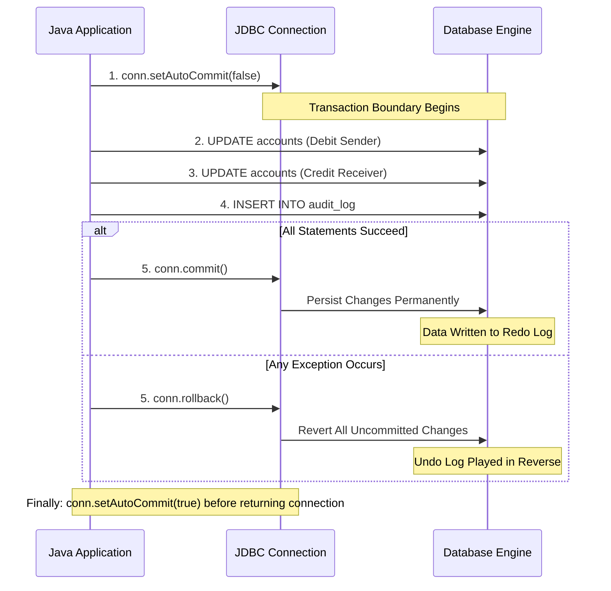

# Managing Database Transactions via JDBC (Commit, Rollback)

> **Phase 8: JDBC & Database Connectivity**  
> *Estimated Reading Time: 45 minutes | Total Practice Effort: ~3 hours | Tier: Core Essential*

---

## 1. Purpose & Prerequisites

### Why This Matters in Full Stack Development
Consider an e-commerce order checkout in Java:
1. Deduct customer balance by \$100.
2. Decrement item inventory by 1.
3. Insert order record into `orders` table.

By default, JDBC operates in **auto-commit mode**, treating each individual statement as an independent, immediately committed transaction.

If Step 1 succeeds and Step 2 succeeds, but Step 3 fails due to a network blip or constraint violation:
- The customer's money is gone.
- The warehouse inventory is reduced.
- But **no order exists in the system!**

To prevent financial and state corruption, you must understand how to take manual control of the transaction boundary using `conn.setAutoCommit(false)`, `conn.commit()`, and `conn.rollback()`.

### Prerequisites
- [Topic 7.7: ACID Properties & Transaction Isolation Levels](../07-sql/07-acid-transactions.md)
- [Topic 8.2: Safe Resource Management: try-with-resources](02-resource-management.md)
- [Topic 8.3: PreparedStatement](03-preparedstatement.md)

---

## 2. Plain-English Mental Model

```
[ Auto-Commit Mode (Default): Dropping Letters in the Mailbox One-by-One ]
- Statement 1: Drop Page 1 into the mailbox. It's gone; you can't get it back.
- Statement 2: Drop Page 2 into the mailbox. It's gone.
- Statement 3: You spill coffee all over Page 3!
- The recipient receives half a contract. Disaster!

[ Manual Transaction: The Staging Box ]
- You turn off auto-commit (open the staging box).
- You put Page 1, Page 2, and Page 3 into the staging box.
- If everything is perfect, you tape the box shut and mail it all at once (COMMIT).
- If anything goes wrong at any second, you shred the entire box (ROLLBACK).
```

---

## 3. The JDBC Transaction Lifecycle



---

## 4. Complete Production-Grade Transaction Code

Here is how to structure a robust, thread-safe transaction in Java:

```java
package com.career.learning.service;

import java.math.BigDecimal;
import java.sql.Connection;
import java.sql.DriverManager;
import java.sql.PreparedStatement;
import java.sql.SQLException;

public class BankTransferService {

    private final String url;
    private final String user;
    private final String password;

    public BankTransferService(String url, String user, String password) {
        this.url = url;
        this.user = user;
        this.password = password;
    }

    public void transferFunds(long fromAccountId, long toAccountId, BigDecimal amount) 
            throws SQLException {

        String debitSql = "UPDATE accounts SET balance = balance - ? WHERE id = ? AND balance >= ?";
        String creditSql = "UPDATE accounts SET balance = balance + ? WHERE id = ?";
        String auditSql = "INSERT INTO transfer_logs (sender_id, receiver_id, amount) VALUES (?, ?, ?)";

        Connection conn = null;

        try {
            conn = DriverManager.getConnection(url, user, password);

            // Step 1: Disable Auto-Commit to take manual control of the transaction boundary
            conn.setAutoCommit(false);

            // Step 2: Execute Debit
            try (PreparedStatement debitStmt = conn.prepareStatement(debitSql)) {
                debitStmt.setBigDecimal(1, amount);
                debitStmt.setLong(2, fromAccountId);
                debitStmt.setBigDecimal(3, amount);

                int rowsAffected = debitStmt.executeUpdate();
                if (rowsAffected == 0) {
                    throw new SQLException("Debit failed: Insufficient funds or invalid account: " + fromAccountId);
                }
            }

            // Step 3: Execute Credit
            try (PreparedStatement creditStmt = conn.prepareStatement(creditSql)) {
                creditStmt.setBigDecimal(1, amount);
                creditStmt.setLong(2, toAccountId);

                int rowsAffected = creditStmt.executeUpdate();
                if (rowsAffected == 0) {
                    throw new SQLException("Credit failed: Invalid recipient account: " + toAccountId);
                }
            }

            // Step 4: Write Audit Record
            try (PreparedStatement auditStmt = conn.prepareStatement(auditSql)) {
                auditStmt.setLong(1, fromAccountId);
                auditStmt.setLong(2, toAccountId);
                auditStmt.setBigDecimal(3, amount);
                auditStmt.executeUpdate();
            }

            // Step 5: All operations succeeded without error -> Permanently COMMIT!
            conn.commit();
            System.out.println(" Transfer of $" + amount + " completed successfully!");

        } catch (Exception ex) {
            // Step 6: On ANY failure, ROLLBACK to restore state
            if (conn != null) {
                try {
                    System.err.println("⚠ Exception encountered! Rolling back transaction: " + ex.getMessage());
                    conn.rollback();
                } catch (SQLException rollbackEx) {
                    System.err.println("Fatal: Failed to rollback transaction: " + rollbackEx.getMessage());
                    rollbackEx.printStackTrace();
                }
            }
            throw new RuntimeException("Bank transfer failed, transaction rolled back.", ex);

        } finally {
            // Step 7: Clean up and restore default connection state
            if (conn != null) {
                try {
                    conn.setAutoCommit(true); // CRITICAL: Reset state before closing/pooling!
                    conn.close();
                } catch (SQLException closeEx) {
                    closeEx.printStackTrace();
                }
            }
        }
    }
}
```

---

## 5. Fine-Grained Rollbacks: JDBC Savepoints

Sometimes you want a **partial rollback** without aborting the entire transaction.  
For example: An order is placed with 3 items. Item 3 is out of stock, but Items 1 and 2 should still be processed.

JDBC supports **Savepoints**:

```java
conn.setAutoCommit(false);

// Step 1: Charge customer
chargeCustomer(conn, orderId);

// Create a savepoint
Savepoint inventorySavepoint = conn.setSavepoint("InventoryCheckpoint");

try {
    // Attempt optional promo item deduction
    deductPromoItem(conn, promoItemId);
} catch (SQLException e) {
    // Rollback ONLY the promo item deduction, keeping the primary charge intact!
    conn.rollback(inventorySavepoint);
}

// Finalize the transaction
conn.commit();
```

---

## 6. Common Rookie Mistakes & Traps

### Trap 1: Forgetting to Reset `setAutoCommit(true)`
When using a connection pool (like HikariCP), `conn.close()` does not terminate the socket; it returns the connection to the pool.  
If you leave `autoCommit = false` on a pooled connection, the next thread that borrows that connection will inherit `autoCommit = false`! Its queries will never be saved to the database unless it happens to call `commit()`.  
*Rule:* Always reset `conn.setAutoCommit(true)` in the `finally` block before closing!

### Trap 2: Performing Slow I/O Inside the Transaction Block
```java
conn.setAutoCommit(false);
debitCustomer(conn);

// HORRIBLE PRACTICE: Network request inside DB transaction!
emailService.sendReceiptEmailOverSMTP(); // Takes 2.5 seconds!

conn.commit();
```
*Why this fails:* The database holds exclusive row locks on the customer's account for the entire 2.5 seconds while waiting for the email server. Other threads trying to query or update the customer are blocked, starving the database connection pool.

### Trap 3: Catching `Exception` Without Calling `rollback()`
If an exception is caught and simply logged without calling `conn.rollback()`, the uncommitted statements remain lingering in the connection's transaction buffer until the connection closes.

---

## 7. Guided Hands-On Exercise

### The Scenario
You are developing an e-commerce checkout module. When a customer confirms an order:
1. An order header is inserted: `INSERT INTO orders (user_id, total) VALUES (?, ?)`.
2. Each order item is inserted: `INSERT INTO order_items (order_id, product_id, quantity) VALUES (?, ?, ?)`.
3. Inventory is decreased for each product: `UPDATE products SET stock = stock - ? WHERE id = ? AND stock >= ?`.

If any item has insufficient stock, the entire checkout must be canceled and rolled back.

### Your Challenge:
Write a transactional method `processCheckout(long userId, List<CartItem> items)` ensuring ACID atomicity.

<details>
<summary>💡 Hint: Use Statement.RETURN_GENERATED_KEYS for the order ID</summary>

```java
conn.setAutoCommit(false);
// 1. Insert order with Statement.RETURN_GENERATED_KEYS
// 2. Loop through CartItem and check affectedRows for stock update
// 3. If any stock update affected 0 rows, throw SQLException!
// 4. conn.commit();
```
</details>

<details>
<summary>✅ Solution</summary>

```java
public void processCheckout(long userId, BigDecimal total, List<CartItem> items) throws SQLException {
    String orderSql = "INSERT INTO orders (user_id, total_amount) VALUES (?, ?)";
    String itemSql = "INSERT INTO order_items (order_id, product_id, quantity) VALUES (?, ?, ?)";
    String stockSql = "UPDATE products SET stock = stock - ? WHERE id = ? AND stock >= ?";

    Connection conn = null;

    try {
        conn = DriverManager.getConnection(url, user, password);
        conn.setAutoCommit(false);

        long orderId;
        // Step 1: Insert Order Header
        try (PreparedStatement orderStmt = conn.prepareStatement(orderSql, Statement.RETURN_GENERATED_KEYS)) {
            orderStmt.setLong(1, userId);
            orderStmt.setBigDecimal(2, total);
            orderStmt.executeUpdate();

            try (ResultSet rs = orderStmt.getGeneratedKeys()) {
                if (rs.next()) {
                    orderId = rs.getLong(1);
                } else {
                    throw new SQLException("Failed to obtain order ID.");
                }
            }
        }

        // Step 2 & 3: Insert items and deduct stock
        try (PreparedStatement itemStmt = conn.prepareStatement(itemSql);
             PreparedStatement stockStmt = conn.prepareStatement(stockSql)) {

            for (CartItem item : items) {
                // Deduct stock
                stockStmt.setInt(1, item.quantity());
                stockStmt.setLong(2, item.productId());
                stockStmt.setInt(3, item.quantity());
                int rows = stockStmt.executeUpdate();

                if (rows == 0) {
                    throw new SQLException("Out of stock for product ID: " + item.productId());
                }

                // Insert item record
                itemStmt.setLong(1, orderId);
                itemStmt.setLong(2, item.productId());
                itemStmt.setInt(3, item.quantity());
                itemStmt.executeUpdate();
            }
        }

        conn.commit();
        System.out.println("Order #" + orderId + " placed successfully!");

    } catch (Exception e) {
        if (conn != null) {
            try {
                conn.rollback();
            } catch (SQLException rollbackEx) {
                rollbackEx.printStackTrace();
            }
        }
        throw new RuntimeException("Checkout failed, transaction rolled back: " + e.getMessage(), e);
    } finally {
        if (conn != null) {
            try {
                conn.setAutoCommit(true);
                conn.close();
            } catch (SQLException ex) {
                ex.printStackTrace();
            }
        }
    }
}
```
</details>

---

## 8. Knowledge Check & Interview Defense

### Quick Quiz
1. **What is the default auto-commit behavior of a newly created JDBC Connection?**
   - [x] A) `true` (Every statement is automatically committed in its own transaction).
   - [ ] B) `false` (Manual commit is required).
   - [ ] C) It depends on the operating system.
   - [ ] D) JDBC connections do not support transactions.

2. **What method must be called to begin a manual transaction block in JDBC?**
   - [x] A) `connection.setAutoCommit(false);`
   - [ ] B) `connection.beginTransaction();`
   - [ ] C) `connection.startTransaction();`
   - [ ] D) `DriverManager.commit();`

3. **Why must `conn.setAutoCommit(true)` be restored before returning a connection to a connection pool?**
   - [x] A) Because the connection is reused by other threads; if left as `false`, subsequent code will fail to persist data unless it explicitly commits.
   - [ ] B) The operating system drops the database connection.
   - [ ] C) To delete cached query plans.
   - [ ] D) It is a required parameter of Maven.

---

### Junior Developer Interview Q&A

#### Q: "How does Spring's `@Transactional` annotation relate to JDBC's transaction methods?"
> **Model Answer:**  
> "Spring's `@Transactional` annotation is a declarative abstraction built directly on top of JDBC transaction boundaries.
>
> Under the hood, Spring uses Spring AOP (Aspect-Oriented Programming) to wrap the annotated method in a proxy. When the method is invoked:
> 1. The proxy obtains a JDBC `Connection` from the `DataSource` and calls `connection.setAutoCommit(false)`.
> 2. The proxy executes the business logic inside the method.
> 3. If the method finishes successfully without throwing an unhandled runtime exception, the proxy calls `connection.commit()`.
> 4. If an unhandled `RuntimeException` occurs, the proxy intercepts it, calls `connection.rollback()`, and propagates the exception.
> 5. In the finally block, the proxy restores `connection.setAutoCommit(true)` and releases the connection back to the pool."

---

## 9. Mastery Checklist & Next Step

Before moving on, verify that you can:
- [ ] Explain why auto-commit mode prevents multi-statement atomicity.
- [ ] Control transaction boundaries using `conn.setAutoCommit(false)`, `commit()`, and `rollback()`.
- [ ] Implement robust exception handling and clean rollback semantics in catch blocks.
- [ ] Ensure `conn.setAutoCommit(true)` is restored before closing pooled connections.

👉 **Next Lesson:** **[Topic 8.6: Batch Updates & Production Connection Pooling with HikariCP](06-batch-pooling.md)**
