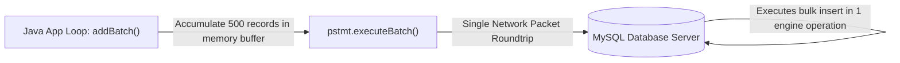
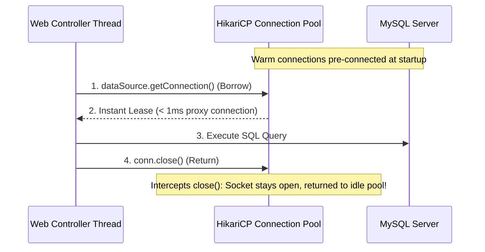

# Batch Updates & Production Connection Pooling with HikariCP

> **Phase 8: JDBC & Database Connectivity**  
> *Estimated Reading Time: 45 minutes | Total Practice Effort: ~3.5 hours | Tier: Core Essential*

---

## 1. Purpose & Prerequisites

### Why This Matters in Full Stack Development
In a high-throughput enterprise application, two major performance bottlenecks will quickly bring your database to a crawl if not designed correctly:
1. **Network Round-Trip Chatty Queries:** Executing 10,000 separate `INSERT` statements over a 5ms network link takes **50 seconds**, even if the database processes each row in microseconds.
2. **TCP Handshake & Authentication Overhead:** Opening a brand-new physical socket connection on every HTTP request consumes **30 to 100 milliseconds** per request, destroying API latency.

In this lesson, you will master **JDBC Batch Updates (`addBatch()`)** to achieve 100x insert speedups and implement production **Connection Pooling with HikariCP**, the lightning-fast default pool powering Spring Boot.

### Prerequisites
- [Topic 8.1: JDBC Architecture & Connections](01-architecture-connections.md)
- [Topic 8.2: Safe Resource Management: try-with-resources](02-resource-management.md)
- [Topic 8.3: PreparedStatement](03-preparedstatement.md)
- [Topic 8.5: Managing Database Transactions](05-transactions.md)

---

## 2. Plain-English Mental Model

```
[ Individual Inserts: 10,000 Individual Mail Couriers ]
- You want to send 10,000 letters to a central office.
- You hire a courier to carry Letter #1, drive across town, deliver it, and drive back.
- Then you hire a courier for Letter #2, and so on.
- Total time: Weeks. Enormous waste of fuel and time!

[ Batch Processing: A Shipping Container ]
- You pack 1,000 letters into a single shipping box.
- One courier delivers the entire box in ONE trip.
- Total time: Minutes!

[ Connection Pooling: A Taxi Stand vs Manufacturing a New Car ]
- Instead of building a brand-new car every time a passenger needs a ride and then 
  driving it to the junkyard immediately after (opening & destroying connections),
- A taxi stand maintains 10 warm, pre-fueled cars waiting to take passengers.
```

---

## 3. High-Performance Batch Updates with `addBatch()`

Instead of calling `pstmt.executeUpdate()` inside a loop, `PreparedStatement` provides `addBatch()` and `executeBatch()`:



### The MySQL Secret: `rewriteBatchedStatements=true`
By default, MySQL's JDBC driver still sends batched statements sequentially over the socket unless you add this magic query parameter to your JDBC URL:
`jdbc:mysql://localhost:3306/db?rewriteBatchedStatements=true`

With this flag enabled, the driver rewrites 500 individual `INSERT INTO users VALUES (?)` statements into a single multi-row insert:  
`INSERT INTO users VALUES (...), (...), (...);` yielding a **10x to 50x throughput improvement**!

### Production Batch Insert Implementation:
```java
package com.career.learning.batch;

import java.math.BigDecimal;
import java.sql.Connection;
import java.sql.DriverManager;
import java.sql.PreparedStatement;
import java.sql.SQLException;
import java.util.List;

public class BatchInsertDemo {

    private static final int BATCH_SIZE = 500;
    private static final String URL = "jdbc:mysql://localhost:3306/shop?rewriteBatchedStatements=true";
    private static final String USER = "root";
    private static final String PASS = "password";

    public record BulkProduct(String sku, String title, BigDecimal price) {}

    public static void insertProductsInBatches(List<BulkProduct> products) throws SQLException {
        String sql = "INSERT INTO products (sku, title, price) VALUES (?, ?, ?)";

        try (Connection conn = DriverManager.getConnection(URL, USER, PASS)) {
            conn.setAutoCommit(false); // Transactions mandatory for batching!

            try (PreparedStatement pstmt = conn.prepareStatement(sql)) {
                int count = 0;

                for (BulkProduct p : products) {
                    pstmt.setString(1, p.sku());
                    pstmt.setString(2, p.title());
                    pstmt.setBigDecimal(3, p.price());

                    // Add current row to internal batch buffer
                    pstmt.addBatch();
                    count++;

                    // Flush batch every 500 records to prevent JVM memory bloat
                    if (count % BATCH_SIZE == 0) {
                        int[] affectedRows = pstmt.executeBatch();
                        conn.commit(); // Commit intermediate chunk
                        pstmt.clearBatch(); // Clear buffer for next chunk
                    }
                }

                // Flush remaining records
                pstmt.executeBatch();
                conn.commit();
                System.out.println(" Successfully inserted " + count + " products in batches!");

            } catch (SQLException ex) {
                conn.rollback();
                throw ex;
            }
        }
    }
}
```

---

## 4. Connection Pooling Fundamentals & The `javax.sql.DataSource`

### The Hidden Cost of `DriverManager.getConnection()`:
Every time an application calls `DriverManager.getConnection()`:
1. OS performs a TCP 3-way handshake (`SYN`, `SYN-ACK`, `ACK`).
2. TLS handshake exchanges certificates and encrypts session keys.
3. Database checks credentials, initializes user session, and allocates server buffers.
4. Latency: **30ms to 100ms** before a single line of SQL can run!

### The Solution: Connection Pools
A connection pool creates a collection of warm, pre-established physical connections at server startup.



When code calls `conn.close()`, the connection pool **intercepts the call**. It does *not* close the underlying network socket; it simply marks the connection as "available" in the pool for the next thread to reuse.

---

## 5. HikariCP: The World's Fastest Connection Pool

**HikariCP** (from the Japanese word meaning "light" or "lightning") is the fastest, most reliable connection pool in the Java ecosystem. It is the default connection pool for Spring Boot.

### Maven Dependency:
```xml
<dependency>
    <groupId>com.zaxxer</groupId>
    <artifactId>HikariCP</artifactId>
    <version>5.1.0</version>
</dependency>
```

### Configuring HikariCP in Java:
```java
package com.career.learning.pool;

import com.zaxxer.hikari.HikariConfig;
import com.zaxxer.hikari.HikariDataSource;
import java.sql.Connection;
import java.sql.SQLException;

public class HikariCPDataSourceFactory {

    private static final HikariDataSource dataSource;

    static {
        HikariConfig config = new HikariConfig();
        
        // 1. Connection settings
        config.setJdbcUrl("jdbc:mysql://localhost:3306/learning_platform?rewriteBatchedStatements=true&cachePrepStmts=true&prepStmtCacheSize=250&prepStmtCacheSqlLimit=2048");
        config.setUsername("root");
        config.setPassword("password");
        config.setDriverClassName("com.mysql.cj.jdbc.Driver");

        // 2. Pool Sizing (Tuned for production throughput)
        config.setMaximumPoolSize(10); // Standard pool size for most web services
        config.setMinimumIdle(5);      // Minimum idle connections kept warm
        
        // 3. Timeouts (in milliseconds)
        config.setConnectionTimeout(30000); // 30 seconds max wait for connection before failing
        config.setIdleTimeout(600000);      // 10 minutes max idle time before recycling
        config.setMaxLifetime(1800000);     // 30 minutes max connection age (prevents stale DB sockets)

        // 4. Performance optimizations
        config.setPoolName("CareerLearning-HikariPool");

        dataSource = new HikariDataSource(config);
    }

    public static Connection getConnection() throws SQLException {
        return dataSource.getConnection();
    }

    public static void shutdown() {
        if (dataSource != null && !dataSource.isClosed()) {
            dataSource.close();
        }
    }
}
```

---

## 6. How Big Should Your Connection Pool Be? (The Sizing Formula)

A common beginner mistake is configuring `maximumPoolSize = 200` or `1000`.

### Why a 1,000-Connection Pool Kills Performance:
A database server has a finite number of physical CPU cores (e.g. 8 cores) and disk spindles/NVMe channels.
- If 1,000 threads execute queries concurrently against an 8-core CPU, the operating system spends 90% of its CPU time **context switching** between threads rather than executing work!
- You get high lock contention, thrashing disk I/O, and massive latency spikes.

### The PostgreSQL / Hikari Sizing Formula:
The official HikariCP formula for optimal pool size:
$$\text{Pool Size} = (\text{CPU Cores} \times 2) + \text{Disk Spindle Count}$$

> **Practical Example:**  
> On an 8-core server with modern fast NVMe SSD storage:  
> $\text{Pool Size} = (8 \times 2) + 1 = 17 \text{ connections}$!  
> A pool of **10 to 20 connections** can comfortably handle tens of thousands of active web users when each query takes only 2 to 5 milliseconds.

---

## 7. Common Rookie Mistakes & Traps

### Trap 1: Forgetting `rewriteBatchedStatements=true`
Without this property in the MySQL JDBC connection URL, calling `executeBatch()` sends every statement over the network individually. The batch will be 50x slower!

### Trap 2: Creating a New `HikariDataSource` Inside a Request Method
```java
// DISASTER! Creates a brand-new connection pool on every request!
public void handleRequest() {
    HikariDataSource ds = new HikariDataSource(config);
    Connection conn = ds.getConnection();
}
```
*Rule:* A `DataSource` must be created **once** as an application-scoped Singleton!

### Trap 3: Keeping Connections Checked Out During Heavy Work
```java
try (Connection conn = dataSource.getConnection()) {
    // 1. Run quick query
    User user = queryUser(conn);
    
    // 2. BAD: Heavy computation or external API call while holding connection!
    generatePdfReport(user); // Takes 10 seconds!
    sendEmailOverHttp();     // Takes 3 seconds!
} // Connection held for 13 seconds, starving other users!
```
*Rule:* Borrow a connection, run the query, and close it (returning it to the pool) **immediately**. Never hold connections during non-database processing.

---

## 8. Guided Hands-On Exercise

### The Scenario
You are building an import service that receives a CSV file with 50,000 student quiz submissions:
`(student_id, quiz_id, score, submission_time)`

Executing individual inserts takes over 4 minutes.

### Your Challenge:
Write a batch-import method using HikariCP that chunks the 50,000 records into batches of 1,000 and commits after each chunk.

<details>
<summary>💡 Hint: Chunking with % 1000</summary>

```java
int count = 0;
for (Submission sub : submissions) {
    pstmt.setLong(1, sub.studentId());
    ...
    pstmt.addBatch();
    if (++count % 1000 == 0) {
        pstmt.executeBatch();
        conn.commit();
    }
}
pstmt.executeBatch();
conn.commit();
```
</details>

<details>
<summary>✅ Solution</summary>

```java
public void importSubmissions(List<Submission> submissions) throws SQLException {
    String sql = "INSERT INTO quiz_submissions (student_id, quiz_id, score, submitted_at) VALUES (?, ?, ?, ?)";

    try (Connection conn = HikariCPDataSourceFactory.getConnection()) {
        conn.setAutoCommit(false);

        try (PreparedStatement pstmt = conn.prepareStatement(sql)) {
            int batchCount = 0;

            for (Submission s : submissions) {
                pstmt.setLong(1, s.studentId());
                pstmt.setLong(2, s.quizId());
                pstmt.setDouble(3, s.score());
                pstmt.setTimestamp(4, Timestamp.valueOf(s.submittedAt()));
                pstmt.addBatch();

                batchCount++;
                if (batchCount % 1000 == 0) {
                    pstmt.executeBatch();
                    conn.commit();
                    pstmt.clearBatch();
                }
            }

            // Flush the remainder
            pstmt.executeBatch();
            conn.commit();
            System.out.println("Batch import of " + batchCount + " submissions completed successfully!");

        } catch (SQLException ex) {
            conn.rollback();
            throw ex;
        }
    }
}
```
</details>

---

## 9. Knowledge Check & Interview Defense

### Quick Quiz
1. **What is the primary performance benefit of JDBC `addBatch()` / `executeBatch()` over sequential `executeUpdate()` calls?**
   - [x] A) It bundles hundreds or thousands of SQL statements into a single network round-trip and allows the database engine to execute bulk inserts efficiently.
   - [ ] B) It automatically encrypts data.
   - [ ] C) It deletes duplicate rows.
   - [ ] D) It runs queries in parallel threads on the client.

2. **When using a connection pool like HikariCP, what does invoking `connection.close()` do?**
   - [x] A) It returns the connection back to the idle pool without closing the underlying physical TCP socket.
   - [ ] B) It terminates the physical TCP socket connection and terminates the MySQL server thread.
   - [ ] C) It restarts the database server.
   - [ ] D) It executes a full database rollback.

3. **What MySQL JDBC URL parameter is strictly required to enable true multi-row batch statement rewriting?**
   - [x] A) `rewriteBatchedStatements=true`
   - [ ] B) `batchSize=1000`
   - [ ] C) `enableMultiRow=true`
   - [ ] D) `fastBatches=true`

---

### Junior Developer Interview Q&A

#### Q: "Why is a smaller connection pool (e.g. 10 to 20 connections) often much faster under high load than a pool of 200 or 500 connections?"
> **Model Answer:**  
> "A database server is fundamentally constrained by its physical hardware: CPU cores, disk I/O channels, and memory bus bandwidth.
>
> When a pool allocates 200 or 500 concurrent connections against an 8-core or 16-core database server, the CPU is overwhelmed by operating system thread context switching, cache thrashing, and internal lock contention (such as row-level locks and memory buffer locks).
>
> By restricting the pool size to roughly $(2 \times \text{CPU Cores}) + \text{Disk Spindles}$, we ensure that every active database thread gets dedicated CPU time to complete its query in milliseconds without waiting on context switches.
>
> Limiting concurrency prevents the database server from thrashing, resulting in significantly lower overall query latency and higher total throughput under heavy user traffic."

---

## 10. Mastery Checklist & Next Step

Before moving on, verify that you can:
- [ ] Implement batch inserts using `addBatch()` and `executeBatch()`.
- [ ] Configure `rewriteBatchedStatements=true` for MySQL performance.
- [ ] Explain how connection pooling eliminates socket creation latency.
- [ ] Configure HikariCP with optimal timeouts and pool sizing.
- [ ] Avoid common pool anti-patterns such as holding connections during non-database operations.

🎉 **Phase 8: JDBC & Database Connectivity Complete!**  
👉 **Next Phase:** **[Topic 9.1: Advanced JUnit 5: Parameterized Tests, Nested Tests & Assertions](../09-tools/01-advanced-junit5.md)**
