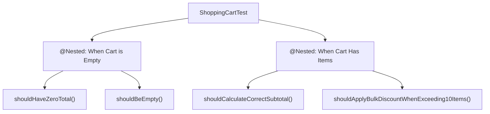

# Advanced JUnit 5: Parameterized Tests, Nested Tests & Assertions

> **Phase 9: Enterprise Testing, Logging & Clean Code**  
> *Estimated Reading Time: 45 minutes | Total Practice Effort: ~3 hours | Tier: Core Essential*

---

## 1. Purpose & Prerequisites

### Why This Matters in Full Stack Development
In Phase 3, you learned unit testing basics with JUnit 5. However, enterprise applications have complex business logic with dozens of edge cases:
- Does our password validator reject passwords with fewer than 8 characters, missing special symbols, or common dictionary words?
- Writing 20 nearly identical `@Test` methods with copy-pasted setup code creates massive test suite bloat and maintenance nightmares.

Professional developers write clean, maintainable test suites using **Parameterized Tests (`@ParameterizedTest`)**, **Grouped Assertions (`assertAll`)**, and **Hierarchical Test Structuring (`@Nested`)**.

### Prerequisites
- [Topic 3.4: JUnit 5 Unit Testing Basics](../03-core/04-junit5.md)
- [Topic 2.1: Classes & Objects](../02-oop/01-classes-objects.md)

---

## 2. Plain-English Mental Model

```
[ Copy-Paste Testing: 20 Separate Test Benches ]
- You want to test if a phone charger works with 110V, 120V, 220V, 240V.
- You build 4 separate rooms with 4 separate test setups.
- Maintenance is 4x harder!

[ Parameterized Testing: 1 Test Rig + A Conveyor Belt of Test Inputs ]
- You build ONE testing rig.
- A conveyor belt feeds in 110V, then 120V, then 220V, then 240V.
- The test runs automatically for each input, outputting clear individual pass/fail reports!
```

---

## 3. Grouped Assertions: `assertAll()`

In standard JUnit assertions, if the first assertion fails, the test aborts immediately (**short-circuits**). Any subsequent assertions are never executed:

```java
// PROBLEM: If firstName fails, we never find out if lastName, email, or role are also broken!
assertEquals("John", user.getFirstName());
assertEquals("Doe", user.getLastName());
assertEquals("john@corp.com", user.getEmail());
```

### The Solution: `assertAll()`
`assertAll()` runs **every assertion** in the group, collects all failures, and reports them together in a comprehensive failure report:

```java
@Test
void userProfileShouldContainAccurateDetails() {
    User user = userService.register("John", "Doe", "john@corp.com", Role.ADMIN);

    assertAll("User Profile Verification",
        () -> assertEquals("John", user.getFirstName(), "First name mismatch"),
        () -> assertEquals("Doe", user.getLastName(), "Last name mismatch"),
        () -> assertEquals("john@corp.com", user.getEmail(), "Email mismatch"),
        () -> assertEquals(Role.ADMIN, user.getRole(), "Role mismatch"),
        () -> assertTrue(user.isActive(), "User should be active by default")
    );
}
```

---

## 4. Parameterized Tests in JUnit 5

To run the same test logic against a table of different inputs, use `@ParameterizedTest` combined with an argument source.

### Maven Dependency:
```xml
<dependency>
    <groupId>org.junit.jupiter</groupId>
    <artifactId>junit-jupiter-params</artifactId>
    <version>5.10.2</version>
    <scope>test</scope>
</dependency>
```

---

### 1. `@ValueSource`: Single-Argument Testing
```java
@ParameterizedTest(name = "Run #{index}: ''{0}'' should be recognized as invalid email")
@ValueSource(strings = {
    "plainaddress",
    "#@%^%#$@#$@#.com",
    "@example.com",
    "email.example.com",
    "email@example@example.com"
})
void shouldRejectInvalidEmailFormats(String invalidEmail) {
    EmailValidator validator = new EmailValidator();
    assertFalse(validator.isValid(invalidEmail));
}
```

---

### 2. `@CsvSource`: Multi-Argument Tabular Testing
`@CsvSource` lets you declare tabular rows with inputs and expected outputs directly in annotations:

```java
@ParameterizedTest(name = "Cart subtotal {0} with coupon {1} yields final price {2}")
@CsvSource({
    "100.00, SUMMER10, 90.00",
    "200.00, VIP20,    160.00",
    "50.00,  INVALID,  50.00",
    "0.00,   SUMMER10, 0.00"
})
void shouldCalculateDiscountedTotals(BigDecimal subtotal, String couponCode, BigDecimal expectedTotal) {
    DiscountCalculator calculator = new DiscountCalculator();
    BigDecimal actualTotal = calculator.applyCoupon(subtotal, couponCode);
    assertEquals(0, expectedTotal.compareTo(actualTotal));
}
```

---

### 3. `@MethodSource`: Complex Objects as Arguments
When test arguments are complex domain objects, streams, or collections, use `@MethodSource`:

```java
@ParameterizedTest
@MethodSource("provideUsersForTierUpgrade")
void shouldUpgradeUserTierCorrectly(User user, Tier expectedTier) {
    TierService service = new TierService();
    Tier result = service.evaluateTier(user);
    assertEquals(expectedTier, result);
}

// Factory method must be static and return Stream, Iterable, or List
static Stream<Arguments> provideUsersForTierUpgrade() {
    return Stream.of(
        Arguments.of(new User("BronzeUser", 5), Tier.BRONZE),
        Arguments.of(new User("SilverUser", 25), Tier.SILVER),
        Arguments.of(new User("GoldUser", 100), Tier.GOLD)
    );
}
```

---

## 5. Hierarchical BDD Structuring with `@Nested`

As test files grow to hundreds of lines, flat test classes become difficult to navigate. JUnit 5 provides `@Nested` to structure tests into readable, behavior-driven hierarchies (BDD style):



### Clean `@Nested` Example:
```java
@DisplayName("Shopping Cart Operations")
class ShoppingCartTest {

    private ShoppingCart cart;

    @BeforeEach
    void setUp() {
        cart = new ShoppingCart();
    }

    @Nested
    @DisplayName("When the cart is freshly created and empty")
    class WhenEmpty {

        @Test
        @DisplayName("Total should be 0.00")
        void totalShouldBeZero() {
            assertEquals(BigDecimal.ZERO, cart.getTotal());
        }

        @Test
        @DisplayName("Item count should be 0")
        void itemCountShouldBeZero() {
            assertEquals(0, cart.getItemCount());
        }

        @Test
        @DisplayName("Checking out should throw IllegalStateException")
        void checkoutShouldFail() {
            assertThrows(IllegalStateException.class, () -> cart.checkout());
        }
    }

    @Nested
    @DisplayName("When items are added to the cart")
    class WhenItemsAdded {

        @BeforeEach
        void addSampleItem() {
            cart.addItem(new CartItem("Keyboard", new BigDecimal("100.00"), 1));
        }

        @Test
        @DisplayName("Item count should reflect addition")
        void shouldIncrementItemCount() {
            assertEquals(1, cart.getItemCount());
        }

        @Test
        @DisplayName("Total should equal item price")
        void totalShouldMatchItemPrice() {
            assertEquals(new BigDecimal("100.00"), cart.getTotal());
        }
    }
}
```

---

## 6. Testing Exceptions & Timeouts

### Testing Expected Exceptions:
```java
@Test
void withdrawingMoreThanBalanceShouldThrowInsufficientFundsException() {
    BankAccount account = new BankAccount(new BigDecimal("100.00"));

    InsufficientFundsException ex = assertThrows(
        InsufficientFundsException.class,
        () -> account.withdraw(new BigDecimal("500.00"))
    );

    assertEquals("Withdrawal amount exceeds available balance: 100.00", ex.getMessage());
}
```

### Preemptive Timeout Assertions:
```java
@Test
void complexAlgorithmMustCompleteUnder200Milliseconds() {
    assertTimeoutPreemptively(Duration.ofMillis(200), () -> {
        PathfindingAlgorithm.computeOptimalRoute(1000);
    });
}
```

---

## 7. Common Rookie Mistakes & Traps

### Trap 1: Combining `@Test` with `@ParameterizedTest`
```java
// WRONG: Never put both on the same method!
@Test
@ParameterizedTest
@ValueSource(ints = {1, 2, 3})
void someTest(int num) { ... }
```
*Result:* The test runner gets confused and executes the test once with no parameters (failing with `ParameterResolutionException`), and then 3 times parameterized!

### Trap 2: Modifying Shared State Across Nested Classes
If you declare `static List<String> sharedList` and mutate it inside nested tests, test order unpredictability will cause intermittent, hard-to-reproduce test failures ("flaky tests").  
*Rule:* Keep test fixtures local with `@BeforeEach`.

---

## 8. Guided Hands-On Exercise

### The Scenario
You are testing a `TaxCalculator` service that computes sales tax based on state and taxable amount:
- `TX` (Texas): 6.25%
- `CA` (California): 7.25%
- `NY` (New York): 4.00%
- `OR` (Oregon): 0.00% (No sales tax)
- Any invalid state code throws `IllegalArgumentException`.

### Your Challenge:
Write a parameterized test class using `@CsvSource` for valid tax calculations and a separate test with `@ValueSource` verifying invalid state codes throw `IllegalArgumentException`.

<details>
<summary>💡 Hint: Use @CsvSource with precision comparison</summary>

```java
@ParameterizedTest
@CsvSource({
    "TX, 100.00, 6.25",
    "CA, 100.00, 7.25",
    "OR, 100.00, 0.00"
})
void testTax(String state, double amount, double expectedTax) ...
```
</details>

<details>
<summary>✅ Solution</summary>

```java
package com.career.learning.test;

import org.junit.jupiter.api.DisplayName;
import org.junit.jupiter.params.ParameterizedTest;
import org.junit.jupiter.params.provider.CsvSource;
import org.junit.jupiter.params.provider.ValueSource;

import static org.junit.jupiter.api.Assertions.*;

class TaxCalculatorTest {

    private final TaxCalculator calculator = new TaxCalculator();

    @ParameterizedTest(name = "State {0} with amount ${1} should have tax ${2}")
    @CsvSource({
        "TX, 100.00, 6.25",
        "CA, 100.00, 7.25",
        "NY, 100.00, 4.00",
        "OR, 100.00, 0.00",
        "TX, 200.00, 12.50"
    })
    @DisplayName("Should correctly calculate state sales tax")
    void shouldCalculateCorrectSalesTax(String state, double amount, double expectedTax) {
        double actualTax = calculator.calculateTax(state, amount);
        assertEquals(expectedTax, actualTax, 0.001, "Sales tax calculation was incorrect");
    }

    @ParameterizedTest(name = "Invalid state code ''{0}'' must throw IllegalArgumentException")
    @ValueSource(strings = {"XX", "123", "", "CALIFORNIA"})
    @DisplayName("Should throw IllegalArgumentException for unsupported or invalid state codes")
    void shouldThrowExceptionForInvalidState(String invalidState) {
        assertThrows(
            IllegalArgumentException.class,
            () -> calculator.calculateTax(invalidState, 100.00)
        );
    }
}
```
</details>

---

## 9. Knowledge Check & Interview Defense

### Quick Quiz
1. **What is the primary architectural benefit of `assertAll()` over sequential individual assertions?**
   - [x] A) It runs all supplied assertions without short-circuiting on the first failure, reporting all failed assertions together in a single test report.
   - [ ] B) It executes assertions concurrently in multiple threads.
   - [ ] C) It connects to the database to verify data.
   - [ ] D) It suppresses all assertion errors.

2. **Which JUnit 5 annotation is used to feed multiple rows of tabular string and primitive inputs into a parameterized test?**
   - [x] A) `@CsvSource`.
   - [ ] B) `@TableSource`.
   - [ ] C) `@RowData`.
   - [ ] D) `@MatrixSource`.

3. **What is the purpose of the `@Nested` annotation in JUnit 5?**
   - [x] A) It creates hierarchical, non-static inner test classes to group related test scenarios in a Behavior-Driven Development (BDD) structure.
   - [ ] B) It nests a test inside a database transaction.
   - [ ] C) It skips tests that are not ready.
   - [ ] D) It runs a test in an infinite loop.

---

### Junior Developer Interview Q&A

#### Q: "Why should we prefer Parameterized Tests over writing a for-loop inside a single `@Test` method?"
> **Model Answer:**  
> "If you test multiple input cases using a `for` loop inside a standard `@Test` method:
> 1. **Early Termination:** If the 2nd input fails an assertion, the test immediately aborts. Cases 3 through 10 are never executed, hiding whether they would have passed or failed.
> 2. **Obscure Reporting:** In the IDE and CI/CD dashboard, it displays as one single test pass or fail. You cannot see which specific input caused the failure without opening stack traces.
>
> With `@ParameterizedTest`:
> 1. Each input row is treated as an **independent test execution**.
> 2. If row 2 fails, rows 3 through 10 continue to run and report their results.
> 3. CI/CD test reports clearly display every single iteration with custom parameter names, making regressions trivial to diagnose."

---

## 10. Mastery Checklist & Next Step

Before moving on, verify that you can:
- [ ] Use `assertAll()` to prevent assertion short-circuiting.
- [ ] Implement `@ParameterizedTest` with `@ValueSource`, `@CsvSource`, and `@MethodSource`.
- [ ] Organize test suites hierarchically using `@Nested` and descriptive `@DisplayName`.
- [ ] Assert exception types and error messages with `assertThrows()`.

👉 **Next Lesson:** **[Topic 9.2: Mocking Dependencies with Mockito (@Mock, @InjectMocks, when)](02-mockito.md)**
