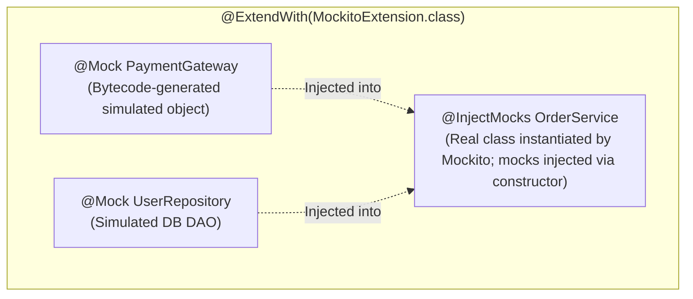

# Mocking Dependencies with Mockito (@Mock, @InjectMocks, when)

> **Phase 9: Enterprise Testing, Logging & Clean Code**  
> *Estimated Reading Time: 50 minutes | Total Practice Effort: ~3.5 hours | Tier: Core Essential*

---

## 1. Purpose & Prerequisites

### Why This Matters in Full Stack Development
In an enterprise backend, business classes rarely exist in isolation:
- An `OrderService` depends on a `PaymentGateway`, an `InventoryRepository`, and an `EmailService`.
- If you write a unit test for `OrderService` that hits a real database or charges a real credit card via Stripe, your test is **slow**, **flaky** (fails if the Wi-Fi drops), and **dangerous** (charges real money or pollutes production databases).

**Unit testing demands isolation.**  
You must test *only* the business logic of your class while replacing all external collaborators with controllable simulated objects called **Mocks**.

In the Java ecosystem, **Mockito** is the undisputed industry standard mocking framework.

### Prerequisites
- [Topic 2.1: Classes & Objects](../02-oop/01-classes-objects.md)
- [Topic 3.4: JUnit 5 Unit Testing Basics](../03-core/04-junit5.md)
- [Topic 9.1: Advanced JUnit 5](01-advanced-junit5.md)

---

## 2. Plain-English Mental Model

```
[ Movie Stunt Double Analogy ]
- In an action movie, if a scene calls for jumping out of a helicopter into an active volcano,
  the director does NOT risk the lead actor's life.
- The director hires a Stunt Double (Mock).
- The director tells the stunt double: "When I yell Action, fall down gracefully."
- The lead actor (Class Under Test) does their performance.
- After the shoot, the director inspects the tape: "Did the stunt double fall exactly 1 time?" (verify).
```

---

## 3. The Test Double Family (Stubs vs Mocks vs Spies)

Martin Fowler defines several types of test doubles:

| Double Type | Definition | Mockito Equivalent |
| :--- | :--- | :--- |
| **Dummy** | Passed to fill method signatures, never actually used. | `mock(Object.class)` |
| **Stub** | Pre-programmed with canned answers to calls made during the test. | `when(mock.find(id)).thenReturn(user)` |
| **Mock** | Pre-programmed with expectations and verifies whether methods were called. | `verify(mock, times(1)).save(any())` |
| **Spy** | Wraps a real object; executes real methods unless explicitly stubbed. | `@Spy` / `spy(realObject)` |

---

## 4. Mockito Core Annotations



### Maven Dependency:
```xml
<dependency>
    <groupId>org.mockito</groupId>
    <artifactId>mockito-junit-jupiter</artifactId>
    <version>5.11.0</version>
    <scope>test</scope>
</dependency>
```

---

## 5. End-to-End Production Mockito Test Example

Let's test an `OrderProcessingService`.

### The Class Under Test:
```java
package com.career.learning.service;

import com.career.learning.model.Order;
import com.career.learning.repository.OrderRepository;
import com.career.learning.client.PaymentGateway;
import com.career.learning.client.NotificationClient;

public class OrderProcessingService {

    private final OrderRepository orderRepository;
    private final PaymentGateway paymentGateway;
    private final NotificationClient notificationClient;

    // Constructor injection (Best practice for testability!)
    public OrderProcessingService(OrderRepository orderRepository,
                                  PaymentGateway paymentGateway,
                                  NotificationClient notificationClient) {
        this.orderRepository = orderRepository;
        this.paymentGateway = paymentGateway;
        this.notificationClient = notificationClient;
    }

    public boolean processOrder(Long orderId) {
        Order order = orderRepository.findById(orderId)
                .orElseThrow(() -> new IllegalArgumentException("Order not found: " + orderId));

        if (order.isPaid()) {
            return true; // Already processed
        }

        boolean paymentSuccess = paymentGateway.charge(order.getCustomerId(), order.getTotalAmount());
        if (!paymentSuccess) {
            order.setStatus("PAYMENT_FAILED");
            orderRepository.save(order);
            return false;
        }

        order.setStatus("CONFIRMED");
        order.setPaid(true);
        orderRepository.save(order);
        notificationClient.sendOrderConfirmation(order.getCustomerEmail(), order.getId());

        return true;
    }
}
```

### The Isolated Unit Test:
```java
package com.career.learning.service;

import com.career.learning.client.NotificationClient;
import com.career.learning.client.PaymentGateway;
import com.career.learning.model.Order;
import com.career.learning.repository.OrderRepository;
import org.junit.jupiter.api.DisplayName;
import org.junit.jupiter.api.Test;
import org.junit.jupiter.api.extension.ExtendWith;
import org.mockito.ArgumentCaptor;
import org.mockito.Captor;
import org.mockito.InjectMocks;
import org.mockito.Mock;
import org.mockito.junit.jupiter.MockitoExtension;

import java.math.BigDecimal;
import java.util.Optional;

import static org.junit.jupiter.api.Assertions.*;
import static org.mockito.ArgumentMatchers.*;
import static org.mockito.Mockito.*;

@ExtendWith(MockitoExtension.class) // Initializes @Mock and @InjectMocks
class OrderProcessingServiceTest {

    // 1. Create simulated mocks for all collaborators
    @Mock
    private OrderRepository orderRepository;

    @Mock
    private PaymentGateway paymentGateway;

    @Mock
    private NotificationClient notificationClient;

    // 2. Instantiate the REAL service and inject the 3 mocks into its constructor
    @InjectMocks
    private OrderProcessingService orderService;

    // 3. Argument captor to inspect arguments passed to mocks
    @Captor
    private ArgumentCaptor<Order> orderCaptor;

    @Test
    @DisplayName("Should successfully confirm order and send notification when payment succeeds")
    void shouldProcessOrderSuccessfully() {
        // GIVEN (Arrange)
        Order pendingOrder = new Order(101L, 45L, "sarah@sky.net", new BigDecimal("150.00"), "PENDING", false);

        // Stubbing repository and payment gateway
        when(orderRepository.findById(101L)).thenReturn(Optional.of(pendingOrder));
        when(paymentGateway.charge(eq(45L), eq(new BigDecimal("150.00")))).thenReturn(true);

        // WHEN (Act)
        boolean result = orderService.processOrder(101L);

        // THEN (Assert & Verify)
        assertTrue(result, "Service should return true on successful payment");

        // Verify that payment gateway was called exactly once
        verify(paymentGateway, times(1)).charge(45L, new BigDecimal("150.00"));

        // Verify that order was saved with CONFIRMED status
        verify(orderRepository, times(1)).save(orderCaptor.capture());
        Order savedOrder = orderCaptor.getValue();
        assertEquals("CONFIRMED", savedOrder.getStatus());
        assertTrue(savedOrder.isPaid());

        // Verify email notification was triggered
        verify(notificationClient, times(1)).sendOrderConfirmation("sarah@sky.net", 101L);
    }

    @Test
    @DisplayName("Should mark order as PAYMENT_FAILED and NOT send email when payment fails")
    void shouldHandlePaymentFailure() {
        // GIVEN
        Order pendingOrder = new Order(202L, 88L, "john@res.org", new BigDecimal("99.00"), "PENDING", false);

        when(orderRepository.findById(202L)).thenReturn(Optional.of(pendingOrder));
        when(paymentGateway.charge(anyLong(), any())).thenReturn(false);

        // WHEN
        boolean result = orderService.processOrder(202L);

        // THEN
        assertFalse(result, "Service should return false when payment fails");

        verify(orderRepository).save(orderCaptor.capture());
        assertEquals("PAYMENT_FAILED", orderCaptor.getValue().getStatus());

        // CRITICAL VERIFICATION: Make sure customer is NEVER spammed if payment failed!
        verify(notificationClient, never()).sendOrderConfirmation(anyString(), anyLong());
    }

    @Test
    @DisplayName("Should throw exception when order ID does not exist in repository")
    void shouldThrowExceptionWhenOrderNotFound() {
        when(orderRepository.findById(999L)).thenReturn(Optional.empty());

        assertThrows(IllegalArgumentException.class, () -> orderService.processOrder(999L));

        // Ensure no payment was attempted for non-existent order
        verifyNoInteractions(paymentGateway);
        verifyNoInteractions(notificationClient);
    }
}
```

---

## 6. Verification Mechanics: `verify()`, `times()`, `never()`

Mockito allows you to verify not just return values, but **behavioral contracts**:

```java
// Verify called exactly once:
verify(emailService, times(1)).sendEmail(any());
verify(emailService).sendEmail(any()); // Default is times(1)

// Verify NEVER called:
verify(emailService, never()).sendEmail(any());

// Verify called at least twice:
verify(analyticsClient, atLeast(2)).trackEvent(anyString());

// Verify no other methods were called on this mock:
verifyNoMoreInteractions(paymentGateway);

// Verify mock was completely untouched during test:
verifyNoInteractions(fraudDetector);
```

---

## 7. Common Rookie Mistakes & Traps

### Trap 1: Forgetting `@ExtendWith(MockitoExtension.class)`
If you omit this annotation, Mockito will not process `@Mock` or `@InjectMocks`.  
All your `@Mock` fields will be `null`, resulting in immediate `NullPointerException` on the first line of your test!

### Trap 2: Stubbing Without Injecting
Using `@Mock` on a class, but instantiating the service with `new OrderService(new RealRepository(), ...)` manually. The service will hit the real database instead of using your mock.

### Trap 3: Unnecessary Stubbing (Strict Stubbing Exception)
In Mockito 3+, Mockito throws `UnnecessaryStubbingException` if you write a `when(mock.foo()).thenReturn(bar)` that is never invoked during the test.  
*Rule:* Only stub methods that your test actually executes.

### Trap 4: Testing the Mock Instead of the Service
```java
// SILLY MISTAKE: You are testing Mockito, not your application!
when(mockRepo.findById(1L)).thenReturn(Optional.of(user));
assertEquals(user, mockRepo.findById(1L).get()); // Doesn't test your service at all!
```

---

## 8. Guided Hands-On Exercise

### The Scenario
You have a `UserRegistrationService`:
```java
public class UserRegistrationService {
    private final UserRepository userRepository;
    private final WelcomeEmailSender emailSender;

    public User registerUser(String email, String rawPassword) {
        if (userRepository.existsByEmail(email)) {
            throw new DuplicateEmailException("Email already taken: " + email);
        }
        User newUser = new User(email, hash(rawPassword));
        User savedUser = userRepository.save(newUser);
        emailSender.sendWelcome(savedUser.getEmail());
        return savedUser;
    }
}
```

### Your Challenge:
Write a unit test verifying that if `userRepository.existsByEmail(email)` returns `true`:
1. `DuplicateEmailException` is thrown.
2. `userRepository.save()` is **never** called.
3. `emailSender.sendWelcome()` is **never** called.

<details>
<summary>💡 Hint: Use assertThrows and verify(..., never())</summary>

```java
when(userRepository.existsByEmail("test@corp.com")).thenReturn(true);
assertThrows(DuplicateEmailException.class, () -> service.registerUser("test@corp.com", "pass123"));
verify(userRepository, never()).save(any());
verifyNoInteractions(emailSender);
```
</details>

<details>
<summary>✅ Solution</summary>

```java
package com.career.learning.service;

import com.career.learning.exception.DuplicateEmailException;
import com.career.learning.model.User;
import com.career.learning.repository.UserRepository;
import com.career.learning.client.WelcomeEmailSender;
import org.junit.jupiter.api.DisplayName;
import org.junit.jupiter.api.Test;
import org.junit.jupiter.api.extension.ExtendWith;
import org.mockito.InjectMocks;
import org.mockito.Mock;
import org.mockito.junit.jupiter.MockitoExtension;

import static org.junit.jupiter.api.Assertions.assertThrows;
import static org.mockito.ArgumentMatchers.any;
import static org.mockito.Mockito.*;

@ExtendWith(MockitoExtension.class)
class UserRegistrationServiceTest {

    @Mock
    private UserRepository userRepository;

    @Mock
    private WelcomeEmailSender emailSender;

    @InjectMocks
    private UserRegistrationService registrationService;

    @Test
    @DisplayName("Should throw DuplicateEmailException and never save or email when email exists")
    void shouldRejectDuplicateEmailRegistration() {
        String existingEmail = "taken@example.com";
        when(userRepository.existsByEmail(existingEmail)).thenReturn(true);

        assertThrows(
            DuplicateEmailException.class,
            () -> registrationService.registerUser(existingEmail, "secretPassword123")
        );

        // Verify that no user was saved to the database
        verify(userRepository, never()).save(any(User.class));

        // Verify that no welcome email was sent
        verifyNoInteractions(emailSender);
    }
}
```
</details>

---

## 9. Knowledge Check & Interview Defense

### Quick Quiz
1. **What is the difference between `@Mock` and `@InjectMocks` in Mockito?**
   - [x] A) `@Mock` creates simulated test doubles of dependencies, while `@InjectMocks` creates the real instance of the class under test and injects the created mocks into it.
   - [ ] B) `@InjectMocks` connects to the real database.
   - [ ] C) They are identical synonyms.
   - [ ] D) `@Mock` is for interfaces only.

2. **How do you verify in Mockito that a method on a mocked collaborator was NEVER called during a test?**
   - [x] A) `verify(mock, never()).methodName(...)` (or `verifyNoInteractions(mock)`).
   - [ ] B) `assertNull(mock.methodName())`.
   - [ ] C) `verify(mock, times(-1))`.
   - [ ] D) Mockito cannot verify method calls.

3. **What is an `ArgumentCaptor` used for in Mockito?**
   - [x] A) To capture and inspect the exact object or values passed into a mocked method during test execution to perform deep field assertions.
   - [ ] B) To capture network packets.
   - [ ] C) To catch unhandled exceptions.
   - [ ] D) To measure method execution time.

---

### Junior Developer Interview Q&A

#### Q: "What is the difference between a Mock and a Spy in Mockito?"
> **Model Answer:**  
> "A **Mock** is a completely simulated object generated dynamically via bytecode manipulation (CGLIB/ByteBuddy). By default, all methods on a Mock do nothing and return type-safe defaults (`null`, `0`, `false`, or empty collections) unless you explicitly stub them using `when(...).thenReturn(...)`.
>
> A **Spy** (created with `@Spy` or `Mockito.spy(realObject)`), on the other hand, is a partial mock that wraps an **actual, real object instance**. When you invoke a method on a Spy, it executes the **real, underlying Java method code** unless you explicitly stub that specific method.
>
> In production unit testing, we use `@Mock` for external dependencies (repositories, HTTP clients) to guarantee total isolation. We use `@Spy` sparingly, usually when testing legacy classes where we need to override one specific helper method while executing the rest of the real class logic."

---

## 10. Mastery Checklist & Next Step

Before moving on, verify that you can:
- [ ] Initialize Mockito using `@ExtendWith(MockitoExtension.class)`.
- [ ] Differentiate between `@Mock` dependencies and the `@InjectMocks` class under test.
- [ ] Stub method behavior with `when().thenReturn()` and `when().thenThrow()`.
- [ ] Verify execution counts using `verify(mock, times(n))` and `verify(mock, never())`.
- [ ] Capture and assert on passed arguments using `ArgumentCaptor`.

👉 **Next Lesson:** **[Topic 9.3: Enterprise Logging: SLF4J Façade, Logback Configuration & AOP](03-logging.md)**
