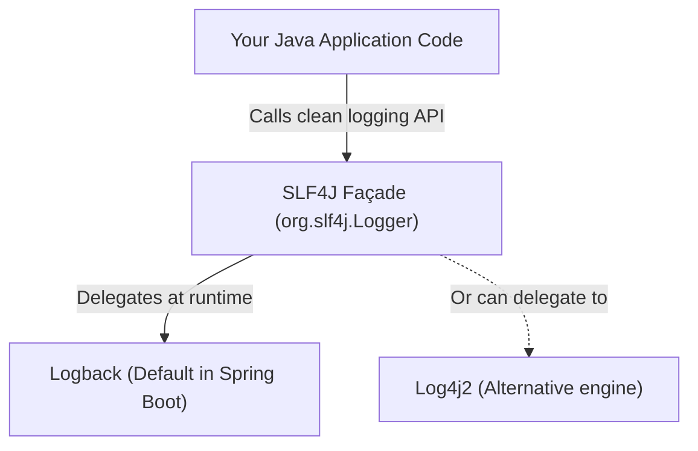
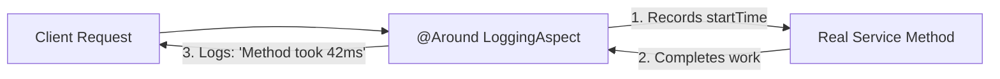

# Enterprise Logging: SLF4J Façade, Logback Configuration & AOP

> **Phase 9: Enterprise Testing, Logging & Clean Code**  
> *Estimated Reading Time: 45 minutes | Total Practice Effort: ~3 hours | Tier: Core Essential*

---

## 1. Purpose & Prerequisites

### Why This Matters in Full Stack Development
When your application is deployed to production in a Docker container in the cloud, you cannot attach an IDE debugger. You cannot set breakpoints.

Your **logs** are the only window into the health, performance, and failures of your production system.

Yet beginners frequently use:
```java
System.out.println("User created: " + user); // FORBIDDEN IN PRODUCTION!
```

`System.out.println()` is a synchronous, blocking I/O operation that cannot be filtered by severity, cannot be redirected to rotating log files, has no timestamps, and severely degrades throughput under load.

In this lesson, you will master **SLF4J**, configure **Logback**, use **MDC for distributed request tracing**, and use **Aspect-Oriented Programming (AOP)** to log execution metrics without polluting business methods.

### Prerequisites
- [Topic 2.1: Classes & Objects](../02-oop/01-classes-objects.md)
- [Topic 3.1: Exceptions & Stack Traces](../03-core/01-exceptions.md)
- [Topic 8.6: Connection Pooling & HikariCP](../08-jdbc/06-batch-pooling.md)

---

## 2. Plain-English Mental Model

```
[ System.out.println: Shouting in a Crowded Room ]
- No record, no timestamps, no severity level.
- When an emergency happens, nobody knows who shouted, when, or why.
- Slows everyone down.

[ SLF4J + Logback: An Airplane Flight Black Box ]
- Every event is timestamped to the millisecond.
- Tagged with severity (INFO vs CRITICAL WARNING).
- Includes the Thread Name, Class Name, and Transaction ID.
- Automatically archives old files, compresses them to gzip, and streams to central dashboards (Datadog, Grafana, Splunk).
```

---

## 3. Architecture: The Façade vs The Implementation

Java has had many competing logging libraries throughout history (`java.util.logging`, `log4j`, `log4j2`, `tinylog`, `logback`).

To prevent applications from being tightly coupled to a single library, we use **SLF4J (Simple Logging Facade for Java)**:



- **SLF4J:** The abstract interface (`Logger`, `LoggerFactory`).
- **Logback:** The concrete, ultra-fast logging engine that formats messages, writes to disk, and compresses log files.

---

## 4. The 5 Standard Log Levels

Log levels allow operations teams to adjust logging verbosity dynamically in production without recompiling code:

```
TRACE  ->  DEBUG  ->  INFO  ->  WARN  ->  ERROR
(Most verbose)                              (Least verbose)
```

| Log Level | Purpose | Real-World Example |
| :--- | :--- | :--- |
| **`TRACE`** | Ultra-detailed diagnostic flow. Rarely enabled except for deep driver troubleshooting. | `Entering method calculateDiscount() with args [100.0, true]` |
| **`DEBUG`** | Useful developer diagnostic information during staging and test environments. | `SQL query generated: SELECT * FROM users WHERE status = 'PENDING'` |
| **`INFO`** | Standard operational milestones and business lifecycle events. Default in production. | `User 'john_doe' logged in successfully. Order #1049 placed.` |
| **`WARN`** | An unexpected or sub-optimal condition that was safely handled, but indicates a potential issue. | `Database query took 2,800ms. Payment gateway retry attempt 2 of 3.` |
| **`ERROR`** | A critical operation failed. Requires developer or DevOps investigation. | `Failed to process credit card payment for order #1049: Connection timeout.` |

---

## 5. Parameterized Logging: The `{}` Magic

In legacy logging, developers wrote:
```java
// BAD: String concatenation runs EVERY TIME, even if DEBUG is disabled!
logger.debug("Processing order id: " + order.getId() + " for customer: " + customer.getName());
```
*Why this is wasteful:* Even if the production log level is `INFO`, Java still allocates string buffers, calls `.toString()`, and concatenates strings before passing the result to `logger.debug()`, only for Logback to immediately discard it!

### The Modern SLF4J Way:
```java
// EFFICIENT: Zero string allocations if DEBUG is disabled!
logger.debug("Processing order id: {} for customer: {}", order.getId(), customer.getName());
```
Logback checks `logger.isDebugEnabled()` first. If `false`, **no string formatting or memory allocation ever occurs!**

---

## 6. Configuring `logback.xml` for Production

Place `logback.xml` in your `src/main/resources/` directory.

### Production Features:
1. **Console Appender:** High-visibility colored logs for local development.
2. **RollingFileAppender:** Writes to disk, rolls over every midnight, limits maximum file size to 50MB, and automatically gzips old logs.

```xml
<configuration>

    <!-- Define log directory property -->
    <property name="LOG_DIR" value="./logs" />

    <!-- 1. Console Appender -->
    <appender name="CONSOLE" class="ch.qos.logback.core.ConsoleAppender">
        <encoder>
            <pattern>%d{yyyy-MM-dd HH:mm:ss.SSS} [%thread] %-5level %logger{36} [traceId=%X{traceId}] - %msg%n</pattern>
        </encoder>
    </appender>

    <!-- 2. Rolling File Appender (Production File Storage) -->
    <appender name="FILE" class="ch.qos.logback.core.rolling.RollingFileAppender">
        <file>${LOG_DIR}/application.log</file>
        
        <rollingPolicy class="ch.qos.logback.core.rolling.SizeAndTimeBasedRollingPolicy">
            <!-- Daily rollover with gzip compression -->
            <fileNamePattern>${LOG_DIR}/archived/app-%d{yyyy-MM-dd}.%i.log.gz</fileNamePattern>
            <!-- Max file size before creating a new chunk -->
            <maxFileSize>50MB</maxFileSize>
            <!-- Retain 30 days of historical logs -->
            <maxHistory>30</maxHistory>
            <!-- Cap total log directory size at 3 Gigabytes -->
            <totalSizeCap>3GB</totalSizeCap>
        </rollingPolicy>

        <encoder>
            <pattern>%d{yyyy-MM-dd HH:mm:ss.SSS} [%thread] %-5level %logger{36} [traceId=%X{traceId}] - %msg%n</pattern>
        </encoder>
    </appender>

    <!-- Configure package log levels -->
    <logger name="com.career.learning" level="DEBUG" />
    <logger name="org.springframework" level="INFO" />
    <logger name="org.hibernate.SQL" level="WARN" />

    <!-- Root logger configuration -->
    <root level="INFO">
        <appender-ref ref="CONSOLE" />
        <appender-ref ref="FILE" />
    </root>

</configuration>
```

---

## 7. Distributed Tracing with MDC (Mapped Diagnostic Context)

When 100 concurrent HTTP requests are hitting your server simultaneously, log lines from different users interleave in the log file:

```
[Thread-1] INFO Order placed
[Thread-4] INFO User updated profile
[Thread-1] ERROR Payment failed
```
How do you know which user suffered the payment failure?

**MDC (Mapped Diagnostic Context)** attaches contextual key-value pairs (like `traceId` or `userId`) to the current `ThreadLocal`. Logback automatically prints this tag on **every single log message** generated by that thread!

```java
import org.slf4j.MDC;
import java.util.UUID;

public void handleIncomingHttpRequest(HttpRequest request) {
    String traceId = UUID.randomUUID().toString().substring(0, 8);
    MDC.put("traceId", traceId); // Attached to current thread!

    try {
        logger.info("Starting order processing...");
        orderService.process();
        logger.info("Order processed successfully.");
    } finally {
        MDC.clear(); // CRITICAL: Always clear ThreadLocal in finally!
    }
}
```

Now every log message generated anywhere in that call stack will include `[traceId=e8f9a12b]`, making searching in Splunk or Datadog instant!

---

## 8. Cross-Cutting Logging with Spring AOP

Instead of manually adding `long start = System.currentTimeMillis()` and `log.info(...)` inside 50 different service methods, we use **Aspect-Oriented Programming (AOP)**:



```java
package com.career.learning.aspect;

import org.aspectj.lang.ProceedingJoinPoint;
import org.aspectj.lang.annotation.Around;
import org.aspectj.lang.annotation.Aspect;
import org.slf4j.Logger;
import org.slf4j.LoggerFactory;
import org.springframework.stereotype.Component;

@Aspect
@Component
public class PerformanceLoggingAspect {

    private static final Logger logger = LoggerFactory.getLogger(PerformanceLoggingAspect.class);

    // Intercept all public methods in any class under the service package
    @Around("execution(* com.career.learning.service.*.*(..))")
    public Object measureExecutionTime(ProceedingJoinPoint joinPoint) throws Throwable {
        long startTime = System.currentTimeMillis();
        String methodName = joinPoint.getSignature().toShortString();

        try {
            Object result = joinPoint.proceed(); // Execute the actual target method
            long duration = System.currentTimeMillis() - startTime;

            if (duration > 1000) {
                logger.warn("⚡ SLOW EXECUTION: {} took {}ms!", methodName, duration);
            } else {
                logger.info("⏱ {} completed in {}ms", methodName, duration);
            }

            return result;
        } catch (Throwable ex) {
            long duration = System.currentTimeMillis() - startTime;
            logger.error("❌ Exception in {} after {}ms: {}", methodName, duration, ex.getMessage(), ex);
            throw ex;
        }
    }
}
```

---

## 9. Common Rookie Mistakes & Traps

### Trap 1: Logging Sensitive Personal Data (PII & PCI-DSS)
```java
// ILLEGAL & CRITICAL SECURITY BREACH:
logger.info("User registered: email={}, password={}, creditCard={}", email, rawPassword, cardNumber);
```
*Rule:* **Never log raw passwords, credit card CVVs, social security numbers, or auth tokens.** Mask them: `card ending in 4112`.

### Trap 2: Eating the Exception Stack Trace
```java
// BAD: Loses the stack trace! Where did it fail?
catch (SQLException ex) {
    logger.error("Database failed: " + ex.getMessage());
}

// GOOD: Pass the exception as the last argument to print full stack trace!
catch (SQLException ex) {
    logger.error("Database transaction failed for user: {}", userId, ex);
}
```

### Trap 3: Forgetting to Clear MDC
Threads in web servers (Tomcat, Netty) are reused from a thread pool.  
If you call `MDC.put("userId", "123")` and forget `MDC.clear()` in a `finally` block, the next completely unrelated request handled by that worker thread will mistakenly inherit the old user's ID!

---

## 10. Guided Hands-On Exercise

### The Scenario
You are developing a `PaymentProcessingGateway`. If an external payment call fails, it throws a `PaymentTimeoutException`.

### Your Challenge:
Write a method `executePayment(String orderId, BigDecimal amount)` that:
1. Logs an `INFO` message at the start with order ID and amount.
2. Catches `PaymentTimeoutException`, logs a `WARN` message with order ID and stack trace.
3. Catches any unexpected `RuntimeException`, logs an `ERROR` message with order ID and stack trace.

<details>
<summary>💡 Hint: Use SLF4J parameterized logging</summary>

```java
logger.info("Initiating payment for orderId: {}, amount: {}", orderId, amount);
try { ... }
catch (PaymentTimeoutException ex) {
    logger.warn("Payment gateway timed out for orderId: {}", orderId, ex);
}
```
</details>

<details>
<summary>✅ Solution</summary>

```java
package com.career.learning.payment;

import org.slf4j.Logger;
import org.slf4j.LoggerFactory;
import java.math.BigDecimal;

public class PaymentService {

    private static final Logger log = LoggerFactory.getLogger(PaymentService.class);

    public boolean executePayment(String orderId, BigDecimal amount) {
        log.info("Initiating payment transaction. OrderId: {}, Amount: ${}", orderId, amount);

        try {
            // Simulated gateway call
            boolean success = callGateway(orderId, amount);
            log.info("Payment confirmed successfully for OrderId: {}", orderId);
            return success;

        } catch (PaymentTimeoutException ex) {
            log.warn("Payment gateway response timed out for OrderId: {}. Scheduling retry.", orderId, ex);
            return false;

        } catch (RuntimeException ex) {
            log.error("Fatal unexpected error during payment execution for OrderId: {}", orderId, ex);
            throw ex;
        }
    }

    private boolean callGateway(String orderId, BigDecimal amount) throws PaymentTimeoutException {
        // internal logic
        return true;
    }
}
```
</details>

---

## 11. Knowledge Check & Interview Defense

### Quick Quiz
1. **Why is `logger.debug("User: {}", user.getName())` more efficient than `logger.debug("User: " + user.getName())`?**
   - [x] A) If the current log level is higher than DEBUG (such as INFO in production), SLF4J avoids evaluating the string concatenation or invoking getter methods entirely.
   - [ ] B) Java compiles `{}` directly into C++ code.
   - [ ] C) It encrypts the user's name on disk.
   - [ ] D) The second one produces compiler warnings.

2. **What does Mapped Diagnostic Context (MDC) allow developers to do?**
   - [x] A) Store contextual metadata (like a `traceId` or `userId`) in a thread-local store so it is automatically included in every log line printed during that request.
   - [ ] B) Modify Java bytecode at runtime.
   - [ ] C) Compress log files directly into ZIP archives.
   - [ ] D) Stop thread execution when an error occurs.

3. **In `logback.xml`, what appender is used to write log files that automatically roll over daily and compress old logs?**
   - [x] A) `RollingFileAppender` with `SizeAndTimeBasedRollingPolicy`.
   - [ ] B) `ConsoleAppender`.
   - [ ] C) `MemoryAppender`.
   - [ ] D) `SocketAppender`.

---

### Junior Developer Interview Q&A

#### Q: "What is the difference between SLF4J and Logback, and why don't we just call Logback classes directly?"
> **Model Answer:**  
> "SLF4J is a **Logging Façade** (an abstraction layer containing interfaces like `org.slf4j.Logger`), whereas Logback is a **concrete logging engine** that implements the SLF4J specification.
>
> If our application code directly imports Logback classes (`ch.qos.logback.classic.Logger`), we tightly couple hundreds of source files to that specific library. If we ever want to switch to Log4j2 (for example, to take advantage of Log4j2's asynchronous disruptor ring-buffer architecture), we would have to modify imports across the entire codebase.
>
> By coding strictly to the SLF4J API (`LoggerFactory.getLogger(...)`), our application code remains completely decoupled from the underlying logging engine. We can swap or upgrade logging implementations at any time simply by changing Maven dependencies in `pom.xml` with zero Java code changes."

---

## 12. Mastery Checklist & Next Step

Before moving on, verify that you can:
- [ ] Contrast SLF4J interface abstraction with Logback execution engine.
- [ ] Select appropriate log levels (`TRACE`, `DEBUG`, `INFO`, `WARN`, `ERROR`).
- [ ] Use `{}` placeholder parameterized logging to avoid string concatenation overhead.
- [ ] Configure `logback.xml` with rolling file compression and size caps.
- [ ] Implement `MDC` for distributed trace correlation across concurrent requests.
- [ ] Intercept and log cross-cutting performance metrics using Spring AOP.

👉 **Next Lesson:** **[Topic 9.4: Creational Design Patterns: Singleton & Builder in Enterprise Java](04-singleton-builder.md)**
