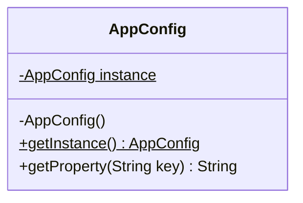

# Creational Design Patterns: Singleton & Builder in Enterprise Java

> **Phase 9: Enterprise Testing, Logging & Clean Code**  
> *Estimated Reading Time: 45 minutes | Total Practice Effort: ~3 hours | Tier: Core Essential*

---

## 1. Purpose & Prerequisites

### Why This Matters in Full Stack Development
In object-oriented programming, creating objects directly using the `new` keyword everywhere leads to two common design catastrophes:
1. **Uncontrolled Instance Sprawl:** Multiple copies of expensive or shared resources (like database pools, configuration registries, or caches) are created, thrashing memory and corrupting state.
2. **Telescoping Constructor Nightmare:** A domain class with 12 fields ends up with 6 overloaded constructors: `new Order(id, user, null, null, true, 0, "USD", null, null)`. One misplaced `null` or swapped integer breaks production silently!

The Gang of Four (GoF) **Creational Patterns** solve how objects are instantiated. In enterprise Java, the two most fundamental creational patterns are **Singleton** and **Builder**.

### Prerequisites
- [Topic 2.1: Classes & Objects](../02-oop/01-classes-objects.md)
- [Topic 2.2: Constructors & this](../02-oop/02-constructors-this.md)
- [Topic 6.3: Volatile & Thread Safety](../06-concurrency/03-visibility-atomics.md)

---

## 2. Plain-English Mental Model

```
[ Singleton: The Captain of a Ship ]
- There can only ever be ONE captain of the ship at any given moment.
- If every crew member starts acting as their own independent captain, 
  the ship steers in 5 directions and sinks!
- A Singleton ensures one global point of access to exactly one instance.

[ Builder: The Custom Burger Ordering Slip ]
- You walk into a gourmet burger restaurant.
- The burger has 15 optional toppings: bacon, jalapeños, cheddar, pickles, BBQ sauce...
- The cashier doesn't have 15 different pre-made combinations on the menu.
- You get a checklist: check Bun -> check Patty -> check Cheese -> submit.
- The chef builds your exact customized, immutable burger!
```

---

## 3. The Singleton Pattern: 4 Implementations Ranked

A Singleton guarantees that a class has **only one instance** and provides a global point of access to it.



### Implementation 1: The Broken Multithreaded Singleton (Anti-Pattern)
```java
// DANGEROUS: NOT THREAD-SAFE!
public class BrokenSingleton {
    private static BrokenSingleton instance;
    private BrokenSingleton() {}

    public static BrokenSingleton getInstance() {
        if (instance == null) { // RACE CONDITION! Two threads can enter here simultaneously!
            instance = new BrokenSingleton();
        }
        return instance;
    }
}
```

---

### Implementation 2: Double-Checked Locking with `volatile`
To avoid synchronizing every call (which kills performance), we check null twice, synchronizing only on the first instantiation:

```java
public class ThreadSafeDclSingleton {
    // CRITICAL: Must be volatile to prevent CPU instruction reordering!
    private static volatile ThreadSafeDclSingleton instance;

    private ThreadSafeDclSingleton() {
        // Private constructor prevents new keyword
    }

    public static ThreadSafeDclSingleton getInstance() {
        if (instance == null) { // 1st check (no lock)
            synchronized (ThreadSafeDclSingleton.class) {
                if (instance == null) { // 2nd check (with lock)
                    instance = new ThreadSafeDclSingleton();
                }
            }
        }
        return instance;
    }
}
```

> **Why `volatile` is strictly mandatory:**  
> In Java, `instance = new Singleton()` is compiled into 3 bytecode operations:
> 1. Allocate memory.
> 2. Call constructor to initialize object.
> 3. Point `instance` reference to the memory block.
> 
> Without `volatile`, the CPU/JIT compiler can reorder operations to **1 -> 3 -> 2**. A concurrent thread could see `instance != null` at the first check, grab the reference, and use an **uninitialized, half-constructed object**, crashing the JVM!

---

### Implementation 3: The Bill Pugh Singleton (The Industry Standard)
Uses a static inner helper class. The inner class is **not loaded into memory** until `getInstance()` is called. The JVM class loader handles thread-safety natively without needing any `synchronized` locks!

```java
public class BillPughSingleton {

    private BillPughSingleton() {}

    // Static inner class loaded ONLY when getInstance() is invoked!
    private static class SingletonHelper {
        private static final BillPughSingleton INSTANCE = new BillPughSingleton();
    }

    public static BillPughSingleton getInstance() {
        return SingletonHelper.INSTANCE;
    }
}
```

---

### Implementation 4: The Enum Singleton (Joshua Bloch's Recommendation)
In *Effective Java*, Joshua Bloch states that a single-element enum is the best way to implement a Singleton:

```java
public enum EnumSingleton {
    INSTANCE;

    public void logSystemEvent(String event) {
        System.out.println("Event recorded: " + event);
    }
}
```
**Why Enums are special:**  
1. 100% thread-safe by JVM definition.
2. **Immune to Reflection Attacks:** `Constructor.newInstance()` explicitly throws an exception when invoked on Enums.
3. **Serialization-Safe:** The JVM guarantees no duplicate instances are created during deserialization.

---

## 4. The Builder Pattern: Eliminating Constructor Chaos

### The Problem: The Telescoping Constructor
```java
// HORRIBLE CODE: Which String is the firstName? Which is the city?
User user = new User("John", "Doe", 28, "123 Main St", "Austin", "TX", "78701", true, false, null);
```

### The Solution: The GoF Builder Pattern
The Builder pattern separates the construction of a complex object from its representation, allowing the same construction process to create different representations.


---

## 5. Complete Production Builder Implementation

```java
package com.career.learning.model;

import java.time.LocalDate;
import java.util.Collections;
import java.util.HashSet;
import java.util.Objects;
import java.util.Set;

public final class UserAccount {

    // 1. All fields are private and final -> Guarantees Immutability!
    private final String username;
    private final String email;
    private final String fullName;
    private final LocalDate birthDate;
    private final Set<String> roles;
    private final boolean active;

    // 2. Private constructor: Enforces creation ONLY via the Builder!
    private UserAccount(Builder builder) {
        this.username = builder.username;
        this.email = builder.email;
        this.fullName = builder.fullName;
        this.birthDate = builder.birthDate;
        this.roles = Collections.unmodifiableSet(new HashSet<>(builder.roles));
        this.active = builder.active;
    }

    // Getters only (No Setters!)
    public String getUsername() { return username; }
    public String getEmail() { return email; }
    public String getFullName() { return fullName; }
    public LocalDate getBirthDate() { return birthDate; }
    public Set<String> getRoles() { return roles; }
    public boolean isActive() { return active; }

    public static Builder builder() {
        return new Builder();
    }

    // 3. Static Nested Builder Class
    public static class Builder {
        private String username;
        private String email;
        private String fullName;
        private LocalDate birthDate;
        private Set<String> roles = new HashSet<>();
        private boolean active = true; // Default value

        public Builder username(String username) {
            this.username = username;
            return this; // Enables method chaining!
        }

        public Builder email(String email) {
            this.email = email;
            return this;
        }

        public Builder fullName(String fullName) {
            this.fullName = fullName;
            return this;
        }

        public Builder birthDate(LocalDate birthDate) {
            this.birthDate = birthDate;
            return this;
        }

        public Builder addRole(String role) {
            this.roles.add(role);
            return this;
        }

        public Builder active(boolean active) {
            this.active = active;
            return this;
        }

        // 4. Validation and Object Instantiation
        public UserAccount build() {
            // Validate required constraints before construction
            Objects.requireNonNull(username, "Username must not be null");
            Objects.requireNonNull(email, "Email must not be null");
            if (!email.contains("@")) {
                throw new IllegalArgumentException("Invalid email format: " + email);
            }
            if (roles.isEmpty()) {
                roles.add("ROLE_USER"); // Apply business default
            }

            return new UserAccount(this);
        }
    }
}
```

### Clean Client Usage:
```java
UserAccount account = UserAccount.builder()
    .username("sarah_connor")
    .email("sarah@sky.net")
    .fullName("Sarah Connor")
    .addRole("ROLE_ADMIN")
    .addRole("ROLE_SECURITY")
    .active(true)
    .build();
```

---

## 6. Common Rookie Mistakes & Traps

### Trap 1: Using Singletons as "Global Mutable Variables"
If you put mutable state (like `public int counter` or `public List<Order> orders`) inside a Singleton without thread synchronization, concurrent HTTP threads will corrupt data via race conditions.  
*Rule:* Singletons should either be **stateless** or encapsulate **thread-safe data structures** (like `ConcurrentHashMap` or `AtomicLong`).

### Trap 2: Mutable Collections in Built Objects
In the builder, if you write `this.roles = builder.roles`, the caller still holds a reference to `builder.roles` and can mutate your "immutable" object from the outside!  
*Fix:* Always make a defensive copy: `Collections.unmodifiableSet(new HashSet<>(builder.roles))`.

---

## 7. Guided Hands-On Exercise

### The Scenario
You need to construct an immutable `HttpRequestConfig` object for an HTTP client.  
Fields:
- `url` (mandatory String)
- `method` (mandatory String: GET, POST, PUT, DELETE)
- `timeoutMillis` (optional int, defaults to 5000)
- `followRedirects` (optional boolean, defaults to true)

### Your Challenge:
Create `HttpRequestConfig` with a fluent `Builder` that validates:
1. `url` is not null or blank.
2. `timeoutMillis` is greater than 0.

<details>
<summary>💡 Hint: Validate inside build()</summary>

```java
public HttpRequestConfig build() {
    if (url == null || url.isBlank()) throw new IllegalStateException("URL required");
    if (timeoutMillis <= 0) throw new IllegalArgumentException("Timeout must be > 0");
    return new HttpRequestConfig(this);
}
```
</details>

<details>
<summary>✅ Solution</summary>

```java
package com.career.learning.http;

public final class HttpRequestConfig {

    private final String url;
    private final String method;
    private final int timeoutMillis;
    private final boolean followRedirects;

    private HttpRequestConfig(Builder builder) {
        this.url = builder.url;
        this.method = builder.method;
        this.timeoutMillis = builder.timeoutMillis;
        this.followRedirects = builder.followRedirects;
    }

    public String getUrl() { return url; }
    public String getMethod() { return method; }
    public int getTimeoutMillis() { return timeoutMillis; }
    public boolean isFollowRedirects() { return followRedirects; }

    public static Builder builder() {
        return new Builder();
    }

    public static class Builder {
        private String url;
        private String method = "GET";
        private int timeoutMillis = 5000;
        private boolean followRedirects = true;

        public Builder url(String url) {
            this.url = url;
            return this;
        }

        public Builder method(String method) {
            this.method = method;
            return this;
        }

        public Builder timeoutMillis(int timeoutMillis) {
            this.timeoutMillis = timeoutMillis;
            return this;
        }

        public Builder followRedirects(boolean followRedirects) {
            this.followRedirects = followRedirects;
            return this;
        }

        public HttpRequestConfig build() {
            if (url == null || url.trim().isEmpty()) {
                throw new IllegalStateException("Request URL cannot be null or empty.");
            }
            if (timeoutMillis <= 0) {
                throw new IllegalArgumentException("Timeout must be a positive integer.");
            }
            return new HttpRequestConfig(this);
        }
    }
}
```
</details>

---

## 8. Knowledge Check & Interview Defense

### Quick Quiz
1. **In Double-Checked Locking Singleton, why must the `instance` variable be declared `volatile`?**
   - [x] A) To prevent CPU/compiler instruction reordering from allowing another thread to see a non-null reference to an incompletely initialized object.
   - [ ] B) To make the object serializable.
   - [ ] C) To automatically run the garbage collector.
   - [ ] D) Volatile is not required in modern Java.

2. **Why is the Bill Pugh Singleton approach preferred over synchronized `getInstance()` methods?**
   - [x] A) It achieves lazy initialization and thread safety natively through the JVM class loading mechanism without any runtime synchronization locking overhead.
   - [ ] B) It compiles to native assembly code.
   - [ ] C) It uses less memory than an Enum.
   - [ ] D) It prevents database deadlocks.

3. **What is the primary advantage of the Builder pattern over using standard JavaBeans with public getters and setters?**
   - [x] A) It creates truly immutable objects and prevents objects from existing in partially initialized or invalid states during construction.
   - [ ] B) It makes the class run 10x faster.
   - [ ] C) It eliminates the need for unit tests.
   - [ ] D) It replaces the database.

---

### Junior Developer Interview Q&A

#### Q: "How does Spring Framework manage Singletons, and how is it different from the classic Gang of Four (GoF) Singleton pattern?"
> **Model Answer:**  
> "In the classic **GoF Singleton pattern**, uniqueness is hardcoded and enforced at the **ClassLoader level** using a private constructor and a static instance variable. This makes unit testing difficult because hardcoded singletons cannot easily be mocked or swapped out.
>
> In **Spring Framework**, a Singleton is a **Scope of a Bean within the ApplicationContext IoC container**. 
>
> When a bean is defined (which is the default `@Component` or `@Service` scope), the class itself remains a standard, normal Java class with a public constructor. Spring's IoC container instantiates the class **exactly once per container** and injects that single shared instance wherever it is needed.
>
> This gives us all the memory and performance benefits of a single instance while retaining total decoupling, easy mocking with Mockito during unit tests, and the flexibility to declare multiple distinct instances if requirements change."

---

## 9. Mastery Checklist & Next Step

Before moving on, verify that you can:
- [ ] Explain race conditions in naive singletons and how `volatile` prevents instruction reordering.
- [ ] Implement the Bill Pugh static inner class singleton pattern.
- [ ] Explain why Enum singletons are immune to reflection and serialization vulnerabilities.
- [ ] Implement a clean, fluent Builder pattern with validation and immutable fields.
- [ ] Contrast GoF ClassLoader singletons with Spring IoC container bean singletons.

👉 **Next Lesson:** **[Topic 9.5: Structural & Behavioral Patterns: Factory, Strategy & Observer](05-factory-strategy.md)**
