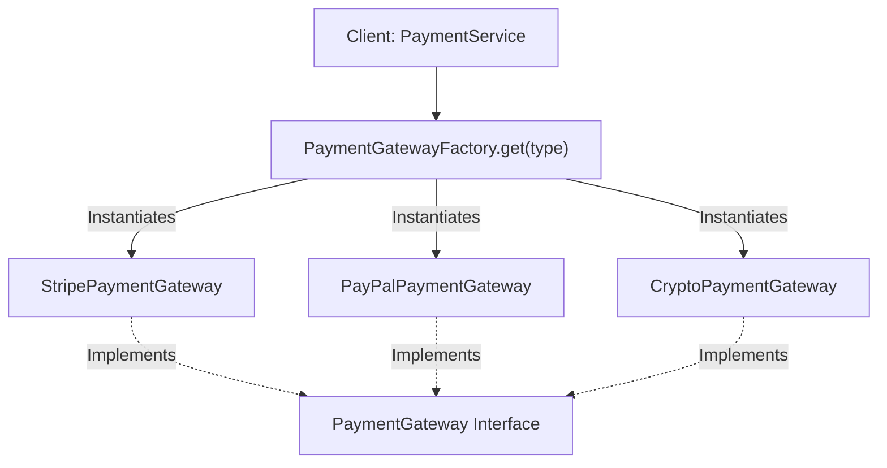
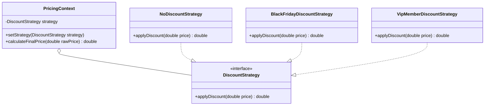
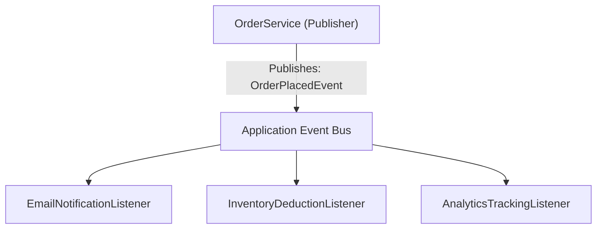

# Structural & Behavioral Patterns: Factory, Strategy & Observer

> **Phase 9: Enterprise Testing, Logging & Clean Code**  
> *Estimated Reading Time: 50 minutes | Total Practice Effort: ~3.5 hours | Tier: Core Essential*

---

## 1. Purpose & Prerequisites

### Why This Matters in Full Stack Development
In inexperienced codebases, business logic is frequently buried inside massive, monolithic `switch` statements:
```java
// BAD CODE: Violates Open-Closed Principle (OCP)!
if (paymentType.equals("CREDIT_CARD")) {
    // 50 lines of Stripe SDK calls
} else if (paymentType.equals("PAYPAL")) {
    // 50 lines of PayPal REST API calls
} else if (paymentType.equals("CRYPTO")) {
    // 50 lines of Blockchain RPC calls
}
```
Every time a new payment method is introduced, developers must edit this existing class, risking regressions in all existing payment flows.

To build flexible, extensible enterprise backends, you must master the three foundational GoF patterns:
1. **Factory Method:** Decouples object creation from business logic.
2. **Strategy:** Swaps runtime business algorithms dynamically without conditionals.
3. **Observer:** Broadcasts domain events to decoupled event listeners.

### Prerequisites
- [Topic 2.7: Polymorphism & Overriding](../02-oop/07-polymorphism.md)
- [Topic 2.8: Abstract Classes & Interfaces](../02-oop/08-abstraction-interfaces.md)
- [Topic 2.9: SOLID Principles in Practice](../02-oop/09-solid-principles.md)

---

## 2. Plain-English Mental Models

```
[ Factory Pattern: The Soda Vending Machine ]
- You don't build a soda can from aluminum and syrup inside your office.
- You press a button: "Cola" or "Lemonade".
- The vending machine (Factory) handles all assembly and dispenses an object conforming to CanOfDrink.

[ Strategy Pattern: A GPS Navigation Route ]
- You want to travel from Austin to Dallas.
- The GPS gives you 3 strategies: "Fastest Highway", "Avoid Tolls", "Scenic Backroads".
- The car and destination are identical; only the algorithm for calculating the path changes!

[ Observer Pattern: YouTube Channel Subscription ]
- A YouTuber (Publisher / Subject) doesn't call 500,000 subscribers individually.
- The creator clicks "Publish Video".
- YouTube automatically notifies all registered subscribers (Observers).
- Subscribers react independently (one watches immediately, one bookmarks for later).
```

---

## 3. The Factory Method Pattern

The **Factory Pattern** defines an interface or method for creating an object, but lets subclasses or factory logic decide which class to instantiate.



### The Interface:
```java
public interface PaymentGateway {
    PaymentResult charge(BigDecimal amount, String currency, String paymentToken);
}
```

### The Modern Spring-Powered Factory:
Instead of writing a manual `switch` statement inside a factory class, modern Spring applications inject a **Map of Strategy Beans**:

```java
package com.career.learning.factory;

import org.springframework.stereotype.Component;
import java.util.Map;

@Component
public class PaymentGatewayFactory {

    // Spring automatically populates this map where:
    // Key = Bean Name ("stripeGateway", "paypalGateway")
    // Value = The concrete PaymentGateway instance!
    private final Map<String, PaymentGateway> gateways;

    public PaymentGatewayFactory(Map<String, PaymentGateway> gateways) {
        this.gateways = gateways;
    }

    public PaymentGateway getGateway(String paymentMethod) {
        String beanName = paymentMethod.toLowerCase() + "Gateway";
        PaymentGateway gateway = gateways.get(beanName);

        if (gateway == null) {
            throw new IllegalArgumentException("Unsupported payment method: " + paymentMethod);
        }
        return gateway;
    }
}
```

---

## 4. The Strategy Pattern

The **Strategy Pattern** defines a family of algorithms, encapsulates each one, and makes them interchangeable. Strategy lets the algorithm vary independently from clients that use it.



### 1. Strategy Interface:
```java
@FunctionalInterface // Modern Strategy is simply a Single Abstract Method interface!
public interface DiscountStrategy {
    BigDecimal applyDiscount(BigDecimal amount);
}
```

### 2. Concrete Strategy Implementations:
```java
public class BlackFridayDiscount implements DiscountStrategy {
    @Override
    public BigDecimal applyDiscount(BigDecimal amount) {
        return amount.multiply(new BigDecimal("0.50")); // 50% off
    }
}

public class VipMemberDiscount implements DiscountStrategy {
    @Override
    public BigDecimal applyDiscount(BigDecimal amount) {
        return amount.multiply(new BigDecimal("0.80")); // 20% off
    }
}
```

### 3. Context Class (Using Java 8 Lambdas!):
```java
public class CheckoutContext {

    private DiscountStrategy discountStrategy;

    public CheckoutContext(DiscountStrategy discountStrategy) {
        this.discountStrategy = discountStrategy;
    }

    public void setDiscountStrategy(DiscountStrategy discountStrategy) {
        this.discountStrategy = discountStrategy;
    }

    public BigDecimal computeTotal(BigDecimal subtotal) {
        return discountStrategy.applyDiscount(subtotal);
    }
}

// Clean usage in application code:
CheckoutContext context = new CheckoutContext(new BlackFridayDiscount());
BigDecimal total = context.computeTotal(new BigDecimal("100.00")); // Returns $50.00

// In Java 8+, we don't even need a separate class for ad-hoc strategies!
context.setDiscountStrategy(amount -> amount.subtract(new BigDecimal("15.00"))); // Custom $15 coupon!
```

---

## 5. The Observer Pattern (Event-Driven Decoupling)

In a monolithic architecture, a single action often triggers multiple side-effects:
When an Order is placed:
1. Deduct stock.
2. Send push notification to user.
3. Stream metrics to DataDog.
4. Notify warehouse packing robot.

If `OrderService` calls all four classes directly, it becomes a bloated **God Class** that breaks if any single dependency fails.

The **Observer Pattern** decouples the Publisher from Subscribers.



### Spring Framework `@EventListener` Implementation:

#### 1. Define the Immutable Domain Event:
```java
public record OrderPlacedEvent(Long orderId, String customerEmail, BigDecimal totalAmount) {}
```

#### 2. Publish the Event in the Business Service:
```java
@Service
public class OrderService {

    private final ApplicationEventPublisher eventPublisher;

    public OrderService(ApplicationEventPublisher eventPublisher) {
        this.eventPublisher = eventPublisher;
    }

    public void completeOrder(Long orderId, String email, BigDecimal amount) {
        // Business logic: save order to DB...
        
        // Broadcast event to whoever is listening (zero coupling!)
        eventPublisher.publishEvent(new OrderPlacedEvent(orderId, email, amount));
    }
}
```

#### 3. Independent Observers Listening for the Event:
```java
@Component
public class EmailNotificationListener {

    private static final Logger log = LoggerFactory.getLogger(EmailNotificationListener.class);

    @EventListener
    public void onOrderPlaced(OrderPlacedEvent event) {
        log.info("📧 Sending order confirmation email to: {}", event.customerEmail());
    }
}

@Component
public class AnalyticsEventListener {

    private static final Logger log = LoggerFactory.getLogger(AnalyticsEventListener.class);

    @EventListener
    @Async // Can even process in background thread pool without slowing down main request!
    public void trackMetrics(OrderPlacedEvent event) {
        log.info("📊 Metric emitted: Order #{} with value ${}", event.orderId(), event.totalAmount());
    }
}
```

---

## 6. Common Rookie Mistakes & Anti-Patterns

### Anti-Pattern 1: The "Everything Needs a Factory" Over-Engineering
Creating `UserFactory`, `ProductFactory`, `AddressFactory` for simple data classes that only have 3 fields.  
*Rule:* Only use Factory when:
1. Object creation involves complex polymorphic selection.
2. Object creation requires heavy dependency wiring or environment-based switching.

### Anti-Pattern 2: Forgetting Asynchronous Boundaries in Observers
By default, Spring `@EventListener` executes **synchronously on the caller's thread**.  
If `EmailNotificationListener` takes 4 seconds to connect to an external SMTP server, the user's web browser freezes for 4 seconds!  
*Fix:* Annotate time-consuming event handlers with `@Async`.

---

## 7. Guided Hands-On Exercise

### The Scenario
You are building an alert dispatch engine that can send notifications across three channels: `SMS`, `EMAIL`, and `SLACK`.

### Your Challenge:
1. Define a `NotificationStrategy` interface with method `void send(String recipient, String message)`.
2. Implement three concrete strategies: `SmsNotificationStrategy`, `EmailNotificationStrategy`, `SlackNotificationStrategy`.
3. Create a `NotificationStrategyFactory` that takes a channel enum and returns the matching strategy.

<details>
<summary>💡 Hint: Use Enum or Map lookup</summary>

```java
public enum Channel { SMS, EMAIL, SLACK }
public NotificationStrategy get(Channel channel) { ... }
```
</details>

<details>
<summary>✅ Solution</summary>

```java
package com.career.learning.notification;

public interface NotificationStrategy {
    void send(String recipient, String message);
}

// 1. Concrete Strategies
public class EmailNotificationStrategy implements NotificationStrategy {
    @Override
    public void send(String recipient, String message) {
        System.out.println("📧 [EMAIL] To: " + recipient + " | Message: " + message);
    }
}

public class SmsNotificationStrategy implements NotificationStrategy {
    @Override
    public void send(String recipient, String message) {
        System.out.println("📱 [SMS] To: " + recipient + " | Message: " + message);
    }
}

public class SlackNotificationStrategy implements NotificationStrategy {
    @Override
    public void send(String recipient, String message) {
        System.out.println("💬 [SLACK] To: " + recipient + " | Message: " + message);
    }
}

// 2. Channel Enum & Factory
public class NotificationFactory {

    public enum Channel { EMAIL, SMS, SLACK }

    private static final Map<Channel, NotificationStrategy> STRATEGIES = Map.of(
        Channel.EMAIL, new EmailNotificationStrategy(),
        Channel.SMS, new SmsNotificationStrategy(),
        Channel.SLACK, new SlackNotificationStrategy()
    );

    public static NotificationStrategy getStrategy(Channel channel) {
        NotificationStrategy strategy = STRATEGIES.get(channel);
        if (strategy == null) {
            throw new IllegalArgumentException("Unknown channel: " + channel);
        }
        return strategy;
    }
}
```
</details>

---

## 8. Knowledge Check & Interview Defense

### Quick Quiz
1. **Which SOLID design principle does the Strategy pattern directly satisfy by eliminating large `if-else` blocks?**
   - [x] A) Open-Closed Principle (OCP: Open for extension, closed for modification).
   - [ ] B) Single Responsibility Principle only.
   - [ ] C) Liskov Substitution Principle only.
   - [ ] D) Interface Segregation Principle only.

2. **In modern Spring Boot applications, how can the Factory pattern be implemented cleanly without any manual `switch` statements?**
   - [x] A) By constructor-injecting a `Map<String, ServiceInterface>`, where Spring automatically populates the map with all beans implementing the interface keyed by bean name.
   - [ ] B) Using raw reflection in every request.
   - [ ] C) Spring does not support the Factory pattern.
   - [ ] D) Writing an XML configuration file.

3. **What is the primary architectural purpose of the Observer pattern?**
   - [x] A) To decouple the subject/publisher from its observers, allowing multiple independent listeners to react to domain events without the publisher knowing who they are.
   - [ ] B) To sort database rows in memory.
   - [ ] C) To encrypt passwords.
   - [ ] D) To manage connection pools.

---

### Junior Developer Interview Q&A

#### Q: "What is the difference between the Strategy Pattern and the State Pattern?"
> **Model Answer:**  
> "While both the **Strategy Pattern** and the **State Pattern** share virtually identical UML class diagrams (a Context delegating to an interface), their **intent** and lifecycle are fundamentally different:
>
> 1. **Strategy Pattern:** The client or caller typically chooses which strategy algorithm to use at runtime (e.g. choosing 'Express Shipping' vs 'Standard Shipping'). The strategy remains constant throughout the request unless explicitly changed by the client. Strategies are usually stateless and interchangeable.
>
> 2. **State Pattern:** The transitions between states are driven **internally** by the object itself based on lifecycle events (e.g., an Order transitioning from `PENDING -> PAID -> SHIPPED -> DELIVERED`). As the state changes internally, the context's behavior changes automatically without the client intervening. The client doesn't pick the state; the state machine drives itself."

---

## 9. Mastery Checklist & Next Step

Before moving on, verify that you can:
- [ ] Implement the Factory Method pattern to decouple object construction.
- [ ] Implement the Strategy pattern to eliminate branching conditionals and support OCP.
- [ ] Pass strategies concisely using Java 8 lambda expressions.
- [ ] Decouple domain side-effects using the Observer pattern and Spring `@EventListener`.
- [ ] Differentiate between the Strategy and State patterns in interview questions.

👉 **Next Lesson:** **[Topic 9.6: Refactoring Legacy Code & Code Smells to Clean Code](06-clean-code.md)**
