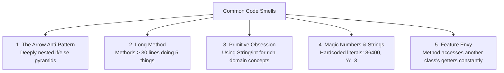

# Refactoring Legacy Code & Code Smells to Clean Code

> **Phase 9: Enterprise Testing, Logging & Clean Code**  
> *Estimated Reading Time: 45 minutes | Total Practice Effort: ~2.5 hours | Tier: Core Essential*

---

## 1. Purpose & Prerequisites

### Why This Matters in Full Stack Development
In professional software engineering, **code is read ten times more often than it is written**.

When developers rush to deliver features without refactoring, codebases accumulate **Technical Debt**:
- 200-line methods with 6 levels of nested `if-else` loops.
- Magic numbers like `if (type == 4)` scattered across dozens of files.
- Modifying a simple checkout calculation causes bug regressions in user registration.

Senior developers don't write clever, cryptic code; they write simple, self-documenting code. In this lesson, you will learn how to identify classic **Code Smells** and apply proven **Refactoring Techniques** to transform legacy code into production-grade clean code.

### Prerequisites
- [Topic 2.3: Access Modifiers & Encapsulation](../02-oop/03-encapsulation.md)
- [Topic 2.9: SOLID Principles in Practice](../02-oop/09-solid-principles.md)
- [Topic 9.1: Advanced JUnit 5](01-advanced-junit5.md) *(You must have unit tests before refactoring!)*

---

## 2. Plain-English Mental Model

```
[ Legacy Spaghetti Code: A Knotted Ball of Yarn ]
- Tug on one loose thread, and three other knots tighten up.
- You can't tell where one thread begins and another ends.
- Fixing a bug requires hours of tracing nested logic.

[ Clean Code: A Well-Organized Modular Toolkit ]
- Every tool has its dedicated slot with a clear label.
- Small, focused, single-purpose components.
- Anyone can walk into the workshop, find what they need in 5 seconds, and use it safely.
```

---

## 3. The Classic Code Smells

A **Code Smell** is a surface indication that usually corresponds to a deeper design problem in the system:



---

## 4. Key Refactoring Techniques

### 1. Guard Clauses (The Early Return Pattern)
Deeply nested `if-else` blocks (the "Arrow Anti-Pattern") make code hard to read because developers must keep multiple levels of indentation in their heads:

#### ❌ Before (Nested Arrow Pyramid):
```java
public void processTransaction(Account account, double amount) {
    if (account != null) {
        if (account.isActive()) {
            if (amount > 0) {
                if (account.getBalance() >= amount) {
                    account.setBalance(account.getBalance() - amount);
                    auditService.log(account, amount);
                } else {
                    throw new InsufficientFundsException();
                }
            } else {
                throw new InvalidAmountException();
            }
        } else {
            throw new AccountSuspendedException();
        }
    } else {
        throw new NullPointerException();
    }
}
```

#### ✅ After (Clean Guard Clauses):
```java
public void processTransaction(Account account, double amount) {
    // 1. Guard clauses handle error conditions upfront and return early!
    Objects.requireNonNull(account, "Account cannot be null");

    if (!account.isActive()) {
        throw new AccountSuspendedException("Account is inactive");
    }
    if (amount <= 0) {
        throw new InvalidAmountException("Transaction amount must be positive");
    }
    if (account.getBalance() < amount) {
        throw new InsufficientFundsException("Insufficient funds for withdrawal");
    }

    // 2. The happy path executes cleanly at the base indentation level!
    account.setBalance(account.getBalance() - amount);
    auditService.log(account, amount);
}
```

---

### 2. Eliminating Primitive Obsession with Value Objects
Using raw primitives (`String`, `long`) to represent complex domain concepts with validation rules:

#### ❌ Before:
```java
// How do we know this phone number is valid? What country code? Can it be negative?
public void sendOtp(String rawPhoneNumber, String emailAddress) { ... }
```

#### ✅ After (Clean Domain Value Objects):
```java
public record PhoneNumber(String countryCode, String nationalNumber) {
    public PhoneNumber {
        if (countryCode == null || !countryCode.startsWith("+")) {
            throw new IllegalArgumentException("Invalid country code");
        }
        if (nationalNumber == null || nationalNumber.length() < 7) {
            throw new IllegalArgumentException("Invalid national number length");
        }
    }
}

public void sendOtp(PhoneNumber phone, EmailAddress email) { ... }
```

---

### 3. Extract Method: Single Responsibility
A method should do **one thing**, do it well, and do it only.

#### ❌ Before:
```java
public void generateUserReport(User user) {
    // 15 lines calculating tax and loyalty points
    // 20 lines formatting HTML template
    // 10 lines opening socket and sending email
}
```

#### ✅ After:
```java
public void generateUserReport(User user) {
    UserMetrics metrics = calculateMetrics(user);
    String htmlReport = formatHtmlReport(user, metrics);
    emailService.sendReport(user.getEmail(), htmlReport);
}
```

---

## 5. End-to-End Refactoring Case Study

Look at this typical legacy checkout calculation method:

### The Legacy Code (Smelly & Bug-Prone):
```java
public double calculate(Order o, int c, String code) {
    double t = 0;
    for (int i = 0; i < o.items.size(); i++) {
        t += o.items.get(i).price * o.items.get(i).qty;
    }
    if (c == 1) { // 1 = VIP
        t = t * 0.90;
    } else if (c == 2) { // 2 = Corporate
        t = t * 0.85;
    }
    if (code != null) {
        if (code.equals("SAVE10") && t > 50) {
            t -= 10;
        } else if (code.equals("FREESHIP")) {
            // free shipping
        }
    }
    if (t < 0) {
        t = 0;
    }
    return t;
}
```

### Applying Clean Code Principles:
1. **Meaningful Variable Names:** Rename `o` -> `order`, `c` -> `customerTier`, `t` -> `subtotal`.
2. **Replace Magic Numbers with Enums:** Convert `1` and `2` into `CustomerTier.VIP` and `CustomerTier.CORPORATE`.
3. **Replace Loop with Stream API:** `order.getItems().stream().mapToDouble(...)`.
4. **Extract Methods:** Separate coupon deduction from tier discount.

### The Refactored Clean Code:
```java
package com.career.learning.pricing;

import java.math.BigDecimal;
import java.util.Objects;

public class OrderPricingCalculator {

    public BigDecimal calculateOrderTotal(Order order, CustomerTier tier, Coupon coupon) {
        Objects.requireNonNull(order, "Order cannot be null");
        Objects.requireNonNull(tier, "CustomerTier cannot be null");

        BigDecimal subtotal = order.calculateSubtotal();
        BigDecimal discountedTotal = applyTierDiscount(subtotal, tier);
        BigDecimal finalTotal = applyCouponDiscount(discountedTotal, coupon);

        return finalTotal.max(BigDecimal.ZERO);
    }

    private BigDecimal applyTierDiscount(BigDecimal amount, CustomerTier tier) {
        return amount.multiply(BigDecimal.valueOf(1.0 - tier.getDiscountRate()));
    }

    private BigDecimal applyCouponDiscount(BigDecimal amount, Coupon coupon) {
        if (coupon == null || !coupon.isValidFor(amount)) {
            return amount;
        }
        return amount.subtract(coupon.getDiscountAmount());
    }
}
```

---

## 6. The Boy Scout Rule

> *"Always leave the campground cleaner than you found it."*  
> — Robert C. Martin (Uncle Bob)

You don't need to rewrite an entire application in one day.  
Every time you open a file to add a feature or fix a bug:
1. Rename one obscure variable to a clear name.
2. Extract one 40-line method into two focused 20-line methods.
3. Replace one magic string with a constant.
4. Over months, your codebase naturally ascends toward clean perfection!

---

## 7. Guided Hands-On Exercise

### The Scenario
You are reviewing a legacy loan eligibility evaluator:

```java
public boolean isEligible(int age, double income, int score, boolean bankrupt) {
    if (age >= 18) {
        if (!bankrupt) {
            if (income >= 30000.0) {
                if (score >= 650) {
                    return true;
                } else {
                    return false;
                }
            } else {
                return false;
            }
        } else {
            return false;
        }
    } else {
        return false;
    }
}
```

### Your Challenge:
Refactor this into clean, concise code with zero nesting using **Guard Clauses** and a single readable boolean expression.

<details>
<summary>💡 Hint: Use guard clauses or combine boolean conditions</summary>

```java
if (age < 18 || bankrupt) return false;
return income >= 30000.0 && score >= 650;
```
</details>

<details>
<summary>✅ Solution</summary>

```java
public class LoanEligibilityEvaluator {

    private static final int MINIMUM_LEGAL_AGE = 18;
    private static final double MINIMUM_ANNUAL_INCOME = 30000.0;
    private static final int MINIMUM_CREDIT_SCORE = 650;

    public boolean isEligibleForLoan(int applicantAge, double annualIncome, int creditScore, boolean hasActiveBankruptcy) {
        // Immediate disqualification guard clauses
        if (applicantAge < MINIMUM_LEGAL_AGE || hasActiveBankruptcy) {
            return false;
        }

        // Positive financial criteria
        boolean meetsIncomeThreshold = annualIncome >= MINIMUM_ANNUAL_INCOME;
        boolean meetsCreditRequirement = creditScore >= MINIMUM_CREDIT_SCORE;

        return meetsIncomeThreshold && meetsCreditRequirement;
    }
}
```
</details>

---

## 8. Knowledge Check & Interview Defense

### Quick Quiz
1. **What is the primary architectural purpose of the "Guard Clause" (Early Return) pattern?**
   - [x] A) To handle edge cases, validations, and error conditions at the top of a method and return immediately, keeping the main "happy path" flat and un-nested.
   - [ ] B) To prevent memory leaks in the garbage collector.
   - [ ] C) To encrypt method parameters.
   - [ ] D) To execute queries in parallel.

2. **What code smell occurs when a method constantly invokes getters on another class to do calculations rather than keeping the calculation inside that class?**
   - [x] A) Feature Envy.
   - [ ] B) Primitive Obsession.
   - [ ] C) Deadlock.
   - [ ] D) Data Race.

3. **What is "Primitive Obsession"?**
   - [x] A) The excessive use of primitive data types (like String, int) to model domain concepts that possess business invariants (like PhoneNumber, Currency, or ZipCode) instead of dedicated Value Objects.
   - [ ] B) Using `long` instead of `int`.
   - [ ] C) Writing assembly code in Java.
   - [ ] D) Forgetting to close streams.

---

### Junior Developer Interview Q&A

#### Q: "What is Cyclomatic Complexity and how do you reduce it during code refactoring?"
> **Model Answer:**  
> "**Cyclomatic Complexity** is a quantitative software metric developed by Thomas McCabe that measures the number of linearly independent paths through a program's source code.
>
> Every time you introduce a conditional statement (`if`, `else if`, `switch`, `while`, `for`, `catch`, `&&`, `||`), the cyclomatic complexity count increases by 1. A method with high complexity (e.g. > 10) is difficult to comprehend, has a high likelihood of hidden edge-case bugs, and requires dozens of unit tests to achieve full branch coverage.
>
> We reduce cyclomatic complexity by:
> 1. **Using Guard Clauses:** Returning early to eliminate deep nesting.
> 2. **Applying the Strategy Pattern or Polymorphism:** Replacing large `switch` statements with polymorphic classes.
> 3. **Extracting Methods:** Decomposing large decision branches into smaller, single-purpose helper functions.
> 4. **Using Stream API / Declarative Code:** Replacing manual nested loops and filters with clean pipelines."

---

## 9. Mastery Checklist & Next Step

Before moving on, verify that you can:
- [ ] Identify common code smells: Arrow Anti-Pattern, Long Method, Feature Envy, Primitive Obsession.
- [ ] Refactor deeply nested `if-else` blocks into clean Guard Clauses.
- [ ] Replace magic numbers and strings with Enums and domain constants.
- [ ] Encapsulate rich domain logic into immutable Value Objects.
- [ ] Measure and reduce Cyclomatic Complexity across business methods.

🎉 **Phase 9: Enterprise Testing, Logging & Clean Code Complete!**  
👉 **Next Phase:** **[Topic 10.1: Web Protocol Fundamentals: HTTP Verbs, Headers, Status Codes & REST](../10-spring/01-http-rest.md)**
