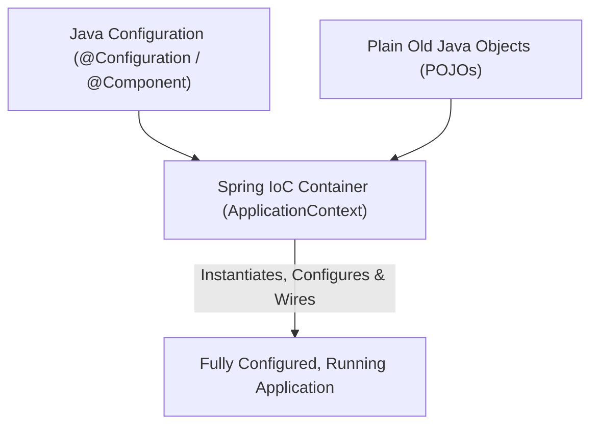
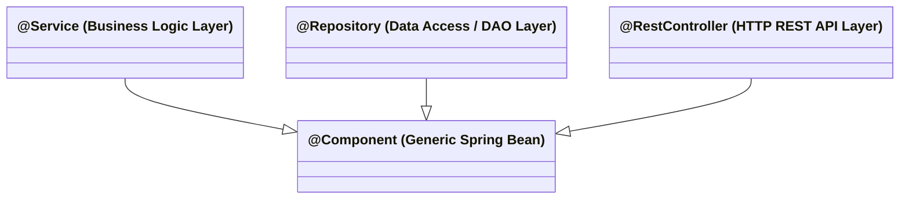

# Spring Framework Core: Inversion of Control & Dependency Injection

> **Phase 10: Spring Boot, REST APIs & Data Persistence**  
> *Estimated Reading Time: 50 minutes | Total Practice Effort: ~3.5 hours | Tier: Core Essential*

---

## 1. Purpose & Prerequisites

### Why This Matters in Full Stack Development
In traditional Java programming, if `OrderService` needs a `PaymentClient` and a `UserRepository`, it instantiates them directly using the `new` keyword:
```java
public class OrderService {
    private PaymentClient paymentClient = new StripePaymentClient();
    private UserRepository userRepository = new MySqlUserRepository();
}
```
This pattern creates **Tight Coupling**:
- You cannot swap `StripePaymentClient` with `MockPaymentClient` in a unit test without modifying source code.
- If `MySqlUserRepository` requires a database URL, `OrderService` must know how to configure database drivers!

**Spring Framework** revolutionizes software design through **Inversion of Control (IoC)** and **Dependency Injection (DI)**, where an external container manages object creation, configuration, and lifecycle.

### Prerequisites
- [Topic 2.8: Abstract Classes & Interfaces](../02-oop/08-abstraction-interfaces.md)
- [Topic 2.9: SOLID Principles (DIP - Dependency Inversion)](../02-oop/09-solid-principles.md)
- [Topic 9.2: Mocking Dependencies with Mockito](../09-tools/02-mockito.md)

---

## 2. Plain-English Mental Model

```
[ The Hollywood Principle: "Don't call us, we'll call you." ]

[ Traditional Approach (Tight Coupling) ]
- You want an electrical lamp.
- You drive to the power plant, lay a 50-mile high-voltage copper cable into your living room, 
  and solder it directly to the lightbulb inside your lamp.
- Want to move the lamp to another room? Impossible!

[ Dependency Injection (Spring IoC Container) ]
- The room has standardized wall sockets (Interfaces).
- Your lamp has a standard plug.
- The house builder (Spring IoC Container) wires up the electricity in the walls.
- You simply plug the lamp into the wall socket. Total flexibility and decoupling!
```

---

## 3. The Spring IoC Container: `ApplicationContext`

The heart of Spring is the **Inversion of Control (IoC) Container**, represented by the `ApplicationContext` interface.



### `BeanFactory` vs `ApplicationContext`:
- **`BeanFactory`:** Basic container providing dependency injection. Lazy bean initialization.
- **`ApplicationContext`:** Modern enterprise container extending `BeanFactory`. Provides eager singleton pre-instantiation, internationalization (i18n), event publishing (`ApplicationEventPublisher`), and seamless integration with Spring AOP and web environments.

---

## 4. The 3 Dependency Injection Flavors

How does Spring inject a dependency into your bean?

### 1. Field Injection (❌ Strongly Discouraged Anti-Pattern)
```java
@Service
public class UserService {
    @Autowired // INJECTS VIA REFLECTION INTO PRIVATE FIELD
    private UserRepository userRepository;
}
```
**Why Field Injection is Bad:**
1. **Breaks Immutability:** Fields cannot be declared `final`.
2. **Hidden Dependencies:** Looking at the constructor, the class looks like it has no dependencies (`new UserService()`).
3. **Hard to Unit Test:** You cannot test this class with plain JUnit without using reflection or booting the entire slow Spring container!

---

### 2. Setter Injection (⚠️ For Optional Dependencies Only)
```java
@Service
public class ReportService {
    private EmailNotificationService emailService;

    @Autowired(required = false)
    public void setEmailService(EmailNotificationService emailService) {
        this.emailService = emailService;
    }
}
```
Useful only if a dependency is optional and has a sensible default fallback.

---

### 3. Constructor Injection (✅ Production Industry Standard)
```java
@Service
public class UserService {

    // 1. Mandatory dependencies are final (Guarantees Immutability!)
    private final UserRepository userRepository;
    private final PasswordEncoder passwordEncoder;

    // 2. Explicit dependencies in the constructor
    // In Spring 4.3+, @Autowired is OPTIONAL on single constructors!
    public UserService(UserRepository userRepository, PasswordEncoder passwordEncoder) {
        this.userRepository = userRepository;
        this.passwordEncoder = passwordEncoder;
    }
}
```
**Why Constructor Injection Wins:**
1. **Guarantees Non-Null State:** An object cannot be instantiated in a half-configured, broken state.
2. **`final` Fields:** Prevents dependencies from being reassigned after construction.
3. **Trivial Unit Testing:** In JUnit/Mockito, you just call `new UserService(mockRepo, mockEncoder)` in 1 millisecond without any Spring context!

---

## 5. Core Spring Stereotype Annotations

Spring scans your classpath (`@ComponentScan`) and automatically registers classes annotated with stereotypes as beans:



| Stereotype | Layer / Responsibility | Special Features |
| :--- | :--- | :--- |
| **`@Component`** | Generic managed bean. | Foundation of all stereotypes. |
| **`@Service`** | Business logic layer. | Semantic clarity for service components. |
| **`@Repository`** | Persistence layer (DAO). | Automatically translates JDBC/Hibernate exceptions into Spring's unchecked `DataAccessException` hierarchy! |
| **`@RestController`** | HTTP API layer. | Combines `@Controller` and `@ResponseBody` to serialize return values to JSON. |
| **`@Configuration`** | Configuration class. | Contains methods annotated with `@Bean` to configure external third-party classes. |

---

## 6. Declaring Third-Party Beans with `@Configuration` & `@Bean`

When you use classes from external libraries (like `ObjectMapper` from Jackson, or `HikariDataSource`), you cannot edit their source code to add `@Component`.

Instead, you use a `@Configuration` class:

```java
package com.career.learning.config;

import com.fasterxml.jackson.databind.ObjectMapper;
import com.fasterxml.jackson.databind.SerializationFeature;
import com.fasterxml.jackson.datatype.jsr310.JavaTimeModule;
import org.springframework.context.annotation.Bean;
import org.springframework.context.annotation.Configuration;

@Configuration
public class JacksonConfig {

    @Bean // Spring manages the returned instance as an ApplicationContext bean!
    public ObjectMapper objectMapper() {
        ObjectMapper mapper = new ObjectMapper();
        mapper.registerModule(new JavaTimeModule());
        mapper.disable(SerializationFeature.WRITE_DATES_AS_TIMESTAMPS);
        return mapper;
    }
}
```

---

## 7. Spring Bean Scopes

By default, every Spring bean is a **Singleton**.

| Scope | Instances Created | Lifecycle / Use Case |
| :--- | :--- | :--- |
| **`singleton`** (Default) | Exactly **1 instance** per `ApplicationContext`. | Stateless services, repositories, controllers. |
| **`prototype`** | A **new instance** every time the bean is requested. | Stateful beans, complex mutable calculations. |
| **`request`** | 1 instance per HTTP request lifecycle. | Web apps (stores request-specific user context). |
| **`session`** | 1 instance per HTTP Session. | Web apps (user shopping cart, login session). |

### Declaring Scope:
```java
@Component
@Scope("prototype")
public class HeavyReportGenerator {
    // New instance every time injected or requested
}
```

---

## 8. Common Rookie Mistakes & Traps

### Trap 1: Injecting a Prototype Bean into a Singleton Bean
A Singleton is created once at application startup.  
If you inject a `@Scope("prototype")` bean into a Singleton, the prototype bean is injected **only once at startup**! It effectively behaves like a singleton thereafter.  
*Solution:* Use an `ObjectProvider<MyPrototypeBean>` or `@Lookup` method.

### Trap 2: Circular Dependencies
Bean A requires Bean B, and Bean B requires Bean A in their constructors:
`BeanCurrentlyInCreationException: Requested bean is currently in creation: Is there an unresolvable circular reference?`  
*Fix:* Circular dependency is an architectural code smell indicating mixed responsibilities. Extract the shared logic into a distinct Bean C!

### Trap 3: Putting User-Specific Mutable State in a Singleton Bean
```java
// DISASTROUS BUG:
@Service
public class CartService {
    private List<Item> currentItems = new ArrayList<>(); // SHARED ACROSS ALL CONCURRENT USERS!
}
```
*Rule:* Singletons are shared across thousands of simultaneous HTTP threads. **They must be strictly stateless!**

---

## 9. Guided Hands-On Exercise

### The Scenario
You are refactoring a legacy user registration class that has hardcoded dependencies:

```java
public class LegacyRegistrationService {
    private BCryptPasswordEncoder encoder = new BCryptPasswordEncoder();
    private MySqlUserDao userDao = new MySqlUserDao();

    public void register(String email, String pass) {
        String hash = encoder.encode(pass);
        userDao.saveUser(email, hash);
    }
}
```

### Your Challenge:
Refactor this into clean Spring components:
1. Define a `UserRepository` interface.
2. Annotate `MySqlUserDao` with `@Repository`.
3. Annotate `RegistrationService` with `@Service` and use **Constructor Injection** with `final` fields.

<details>
<summary>💡 Hint: Use constructor injection with interface</summary>

```java
@Service
public class RegistrationService {
    private final UserRepository userRepository;
    private final PasswordEncoder passwordEncoder;
    public RegistrationService(UserRepository repo, PasswordEncoder encoder) { ... }
}
```
</details>

<details>
<summary>✅ Solution</summary>

```java
package com.career.learning.user;

import org.springframework.security.crypto.password.PasswordEncoder;
import org.springframework.stereotype.Repository;
import org.springframework.stereotype.Service;

// 1. Decoupled Repository Interface
public interface UserRepository {
    void saveUser(String email, String passwordHash);
}

// 2. Concrete Implementation managed by Spring
@Repository
public class MySqlUserRepository implements UserRepository {
    @Override
    public void saveUser(String email, String passwordHash) {
        // Safe database execution
    }
}

// 3. Clean, Testable Service with Constructor Injection
@Service
public class RegistrationService {

    private final UserRepository userRepository;
    private final PasswordEncoder passwordEncoder;

    public RegistrationService(UserRepository userRepository, PasswordEncoder passwordEncoder) {
        this.userRepository = userRepository;
        this.passwordEncoder = passwordEncoder;
    }

    public void register(String email, String rawPassword) {
        String hashedPassword = passwordEncoder.encode(rawPassword);
        userRepository.saveUser(email, hashedPassword);
    }
}
```
</details>

---

## 10. Knowledge Check & Interview Defense

### Quick Quiz
1. **Why is Constructor Injection preferred over Field Injection in Spring applications?**
   - [x] A) It enables immutability using `final` fields, prevents partially initialized objects, and allows trivial unit testing with standard constructors and mocks without Spring.
   - [ ] B) Field injection is deprecated in Java 17.
   - [ ] C) Constructor injection uses less RAM.
   - [ ] D) Spring cannot start if field injection is used.

2. **What is the default bean scope in Spring Framework?**
   - [x] A) `singleton` (Exactly 1 instance per ApplicationContext).
   - [ ] B) `prototype`.
   - [ ] C) `request`.
   - [ ] D) `transient`.

3. **What is the special capability of `@Repository` compared to generic `@Component`?**
   - [x] A) It automatically translates database-specific exceptions into Spring's unified `DataAccessException` hierarchy via `PersistenceExceptionTranslationPostProcessor`.
   - [ ] B) It automatically connects to MySQL.
   - [ ] C) It creates database tables automatically.
   - [ ] D) It encrypts SQL queries.

---

### Junior Developer Interview Q&A

#### Q: "What is Inversion of Control (IoC), and how does it relate to Dependency Injection (DI)?"
> **Model Answer:**  
> "**Inversion of Control (IoC)** is a general architectural design principle where the control flow of a program is inverted compared to traditional procedural programming. Instead of our custom application code controlling the execution and directly instantiating dependencies (`new Class()`), a framework or container takes control and coordinates when to call our code.
>
> **Dependency Injection (DI)** is a specific design pattern used to **implement** Inversion of Control. In DI, an object's dependencies are supplied ('injected') from the outside—usually by an IoC container like Spring's `ApplicationContext`—rather than the object creating them internally.
>
> In short: IoC is the guiding principle ('Don't call us, we'll call you'), while Dependency Injection is the mechanism used to pass dependencies into objects via constructors or setters."

---

## 11. Mastery Checklist & Next Step

Before moving on, verify that you can:
- [ ] Contrast traditional `new` instantiation with IoC container management.
- [ ] Explain why Field Injection is an anti-pattern and implement Constructor Injection.
- [ ] Differentiate between `@Component`, `@Service`, `@Repository`, and `@RestController`.
- [ ] Configure third-party libraries using `@Configuration` and `@Bean`.
- [ ] State the characteristics of Singleton and Prototype bean scopes.

👉 **Next Lesson:** **[Topic 10.3: Spring Boot Auto-Configuration, Starters & Application Properties](03-autoconfig.md)**
