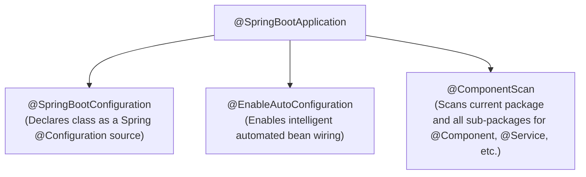
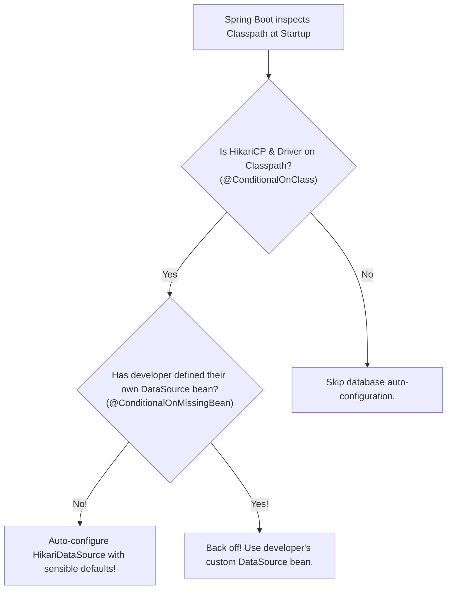

# Spring Boot Auto-Configuration, Starters & Application Properties

> **Phase 10: Spring Boot, REST APIs & Data Persistence**  
> *Estimated Reading Time: 45 minutes | Total Practice Effort: ~3 hours | Tier: Core Essential*

---

## 1. Purpose & Prerequisites

### Why This Matters in Full Stack Development
Before Spring Boot was created in 2014, setting up a production Spring web application required days of painful boilerplate:
- Writing hundreds of lines of XML (`web.xml`, `applicationContext.xml`).
- Manually configuring embedded servlet containers, JSON serializers, database connection pools, and dispatcher servlets.
- Resolving conflicting JAR versions in Maven (the infamous "Dependency Hell").

**Spring Boot** revolutionized enterprise Java with its **opinionated convention-over-configuration philosophy**:
Add a single starter dependency (`spring-boot-starter-web`), write one annotation (`@SpringBootApplication`), and you have a production-ready web server running on port 8080 in under 3 seconds!

In this lesson, you will demystify how Spring Boot's magic actually works under the hood.

### Prerequisites
- [Topic 3.3: Maven Build Lifecycles & POM](../03-core/03-maven.md)
- [Topic 10.2: Spring Core: IoC & Dependency Injection](02-ioc-di.md)

---

## 2. Plain-English Mental Model

```
[ Traditional Spring (Pre-Boot): Building a Car from Raw Scraps ]
- You buy tires from Germany, an engine from Japan, and an alternator from the US.
- You spend 3 weeks soldering wires, adjusting voltages, and mounting brackets before the car starts.

[ Spring Boot: A Modern Luxury Vehicle with Keyless Start ]
- You press the Start button.
- Sensors detect darkness -> Headlights turn on automatically.
- Sensors detect rain -> Windshield wipers start wiping automatically.
- Prefer manual headlights? You flip the switch, and the automated sensor gracefully steps aside.
- That is Auto-Configuration and @ConditionalOnMissingBean!
```

---

## 3. Deconstructing `@SpringBootApplication`

When you create a Spring Boot application, your main class looks like this:

```java
package com.career.learning;

import org.springframework.boot.SpringApplication;
import org.springframework.boot.autoconfigure.SpringBootApplication;

@SpringBootApplication
public class LearningPlatformApplication {
    public static void main(String[] args) {
        SpringApplication.run(LearningPlatformApplication.class, args);
    }
}
```

`@SpringBootApplication` is a **composite annotation** combining three foundational annotations:



> **Crucial Package Layout Rule:**  
> `@ComponentScan` scans only the **current package and child sub-packages**. If your main class is in `com.career.learning`, and you place a controller in `com.other.controller`, Spring Boot will **never find it**! Always keep your main application class at the root package.

---

## 4. How Starters Eliminate "Dependency Hell"

In standard Maven, if you want to build a REST API, you have to find and maintain compatible versions of Spring MVC, Jackson Databind, Tomcat Core, Hibernate Validator, and SLF4J.

A **Spring Boot Starter** is an umbrella POM file that bundles tested, mutually compatible dependencies:

```xml
<!-- 1 Single Dependency replaces 15 manual dependencies! -->
<dependency>
    <groupId>org.springframework.boot</groupId>
    <artifactId>spring-boot-starter-web</artifactId>
</dependency>
```

`spring-boot-starter-web` transitively pulls in:
- `spring-webmvc` (REST framework)
- `tomcat-embed-core` (Embedded web server; no standalone Tomcat installation required!)
- `jackson-databind` (JSON serialization)
- `spring-boot-starter-logging` (SLF4J + Logback)

---

## 5. Under the Hood: Conditional Auto-Configuration

How does Spring Boot know whether to configure a database pool, an embedded Tomcat server, or a Kafka consumer?

It uses **Conditional Annotations** located inside `spring-boot-autoconfigure.jar`:



### The Magic `@Conditional` Family:
- **`@ConditionalOnClass(DataSource.class)`:** Auto-configures only if the specified class exists on the runtime classpath.
- **`@ConditionalOnMissingBean(DataSource.class)`:** **The graceful back-off mechanism!** Auto-configures only if the developer has *not* defined their own custom `@Bean`.
- **`@ConditionalOnProperty(name = "features.email.enabled", havingValue = "true")`:** Enables a bean only if a specific property flag is set in `application.properties`.

---

## 6. Externalized Configuration: Properties vs YAML

Spring Boot allows you to externalize configuration so the same compiled JAR can run in local development, QA, staging, and production without rebuilding.

### `application.yml` (Recommended for Readability):
```yaml
server:
  port: 8080
  shutdown: graceful

spring:
  datasource:
    url: jdbc:mysql://localhost:3306/learning_platform?useSSL=false&serverTimezone=UTC
    username: root
    password: ${DB_PASSWORD:secret_default} # Reads from environment variable with fallback!
    hikari:
      maximum-pool-size: 15
```

---

## 7. Type-Safe Configuration with `@ConfigurationProperties`

In early Spring, developers used `@Value("${property.name}")` on individual fields. In enterprise applications, this becomes messy and untyped.

The modern standard is **Type-Safe `@ConfigurationProperties`**:

### In `application.yml`:
```yaml
app:
  jwt:
    secret-key: dGhpcy1pcy1hLXZlcnktc2VjdXJlLTI1Ni1iaXQta2V5
    expiration-minutes: 60
    refresh-expiration-days: 7
```

### In Java:
```java
package com.career.learning.config;

import org.springframework.boot.context.properties.ConfigurationProperties;
import org.springframework.context.annotation.Configuration;
import org.springframework.validation.annotation.Validated;
import jakarta.validation.constraints.Min;
import jakarta.validation.constraints.NotBlank;

@Configuration
@ConfigurationProperties(prefix = "app.jwt")
@Validated // Validates properties at startup!
public class JwtProperties {

    @NotBlank(message = "JWT secret key must not be blank")
    private String secretKey;

    @Min(value = 5, message = "Expiration must be at least 5 minutes")
    private int expirationMinutes = 60; // Sensible default

    private int refreshExpirationDays = 7;

    // Getters and Setters
    public String getSecretKey() { return secretKey; }
    public void setSecretKey(String secretKey) { this.secretKey = secretKey; }

    public int getExpirationMinutes() { return expirationMinutes; }
    public void setExpirationMinutes(int expirationMinutes) { this.expirationMinutes = expirationMinutes; }

    public int getRefreshExpirationDays() { return refreshExpirationDays; }
    public void setRefreshExpirationDays(int refreshExpirationDays) { this.refreshExpirationDays = refreshExpirationDays; }
}
```

If someone misconfigures the application (e.g., sets `expiration-minutes: 1`), **Spring Boot refuses to start up**, providing an immediate, clear error message before handling any traffic!

---

## 8. Multi-Environment Spring Profiles

Enterprise apps need different settings for local development vs production:

- `application.yml` (Common shared settings)
- `application-dev.yml` (Local H2/Docker database, debug logging, mock payments)
- `application-prod.yml` (Production RDS/MySQL, Hikari tuning, real Stripe credentials)

### Activating a Profile:
1. **Via Command Line:**  
   `java -jar app.jar --spring.profiles.active=prod`
2. **Via Environment Variable (Docker / Kubernetes):**  
   `export SPRING_PROFILES_ACTIVE=prod`

### Conditional Beans per Profile:
```java
@Service
@Profile("dev")
public class MockEmailService implements EmailService {
    @Override
    public void sendEmail(String to, String msg) {
        log.info(" MOCK EMAIL sent to: {}", to);
    }
}

@Service
@Profile("prod")
public class SmtpEmailService implements EmailService {
    @Override
    public void sendEmail(String to, String msg) {
        // Send real email via AWS SES / SendGrid
    }
}
```

---

## 9. Common Rookie Mistakes & Traps

### Trap 1: Placing Classes Outside the Base Package
Placing a `@RestController` in `com.mycompany.controllers` while the `@SpringBootApplication` is in `com.mycompany.app`.  
*Result:* Spring Boot's `@ComponentScan` will never discover the controller, and requests will fail with `404 Not Found`!

### Trap 2: Hardcoding Production Secrets in `application.yml`
Committing database passwords or AWS keys into Git.  
*Fix:* Use environment variable substitution: `password: ${PROD_DB_PASSWORD}`.

---

## 10. Guided Hands-On Exercise

### The Scenario
You are integrating an external SMS gateway (Twilio).  
Configuration requirements:
- Prefix: `app.sms`
- Properties: `account-sid` (String, required), `auth-token` (String, required), `max-retries` (int, default 3).

### Your Challenge:
Write a validated `@ConfigurationProperties` class `SmsProperties`.

<details>
<summary>💡 Hint: Use @ConfigurationProperties and jakarta.validation</summary>

```java
@Configuration
@ConfigurationProperties(prefix = "app.sms")
@Validated
public class SmsProperties { ... }
```
</details>

<details>
<summary>✅ Solution</summary>

```java
package com.career.learning.config;

import jakarta.validation.constraints.Min;
import jakarta.validation.constraints.NotBlank;
import org.springframework.boot.context.properties.ConfigurationProperties;
import org.springframework.context.annotation.Configuration;
import org.springframework.validation.annotation.Validated;

@Configuration
@ConfigurationProperties(prefix = "app.sms")
@Validated
public class SmsProperties {

    @NotBlank(message = "Twilio Account SID is mandatory")
    private String accountSid;

    @NotBlank(message = "Twilio Auth Token is mandatory")
    private String authToken;

    @Min(value = 1, message = "Max retries must be at least 1")
    private int maxRetries = 3;

    public String getAccountSid() { return accountSid; }
    public void setAccountSid(String accountSid) { this.accountSid = accountSid; }

    public String getAuthToken() { return authToken; }
    public void setAuthToken(String authToken) { this.authToken = authToken; }

    public int getMaxRetries() { return maxRetries; }
    public void setMaxRetries(int maxRetries) { this.maxRetries = maxRetries; }
}
```
</details>

---

## 11. Knowledge Check & Interview Defense

### Quick Quiz
1. **Which three core annotations are composed into `@SpringBootApplication`?**
   - [x] A) `@SpringBootConfiguration`, `@EnableAutoConfiguration`, and `@ComponentScan`.
   - [ ] B) `@Component`, `@Service`, and `@Repository`.
   - [ ] C) `@Entity`, `@Table`, and `@Id`.
   - [ ] D) `@Bean`, `@Scope`, and `@Autowired`.

2. **How does Spring Boot allow a developer to override an auto-configured default bean?**
   - [x] A) Auto-configuration classes annotate default beans with `@ConditionalOnMissingBean`; if the developer defines their own `@Bean`, Spring Boot gracefully backs off.
   - [ ] B) Developers must delete the auto-configure JAR from Maven.
   - [ ] C) By editing bytecode.
   - [ ] D) Spring Boot does not allow overriding auto-configured beans.

3. **How do you activate the `prod` profile when launching a Spring Boot JAR from the terminal?**
   - [x] A) `java -jar app.jar --spring.profiles.active=prod`
   - [ ] B) `java -jar app.jar -profile prod`
   - [ ] C) `java -jar app.jar --env=production`
   - [ ] D) `java -jar app.jar /mode prod`

---

### Junior Developer Interview Q&A

#### Q: "What happens when Spring Boot starts up? Explain the auto-configuration lifecycle."
> **Model Answer:**  
> "When `SpringApplication.run()` is invoked:
> 1. Spring Boot initializes the environment, reads `application.properties`/`application.yml`, and sets up the active profiles.
> 2. It instantiates the `ApplicationContext` (an `AnnotationConfigServletWebServerApplicationContext` for web applications).
> 3. `@ComponentScan` scans the package structure for our application beans (`@Component`, `@Service`, `@RestController`).
> 4. Next, `@EnableAutoConfiguration` scans `META-INF/spring/org.springframework.boot.autoconfigure.AutoConfiguration.imports` across all dependency JARs on the classpath.
> 5. It evaluates all conditional annotations (`@ConditionalOnClass`, `@ConditionalOnMissingBean`, `@ConditionalOnProperty`). If conditions match and no user bean overrides them, it creates and registers the default beans (such as the embedded Tomcat container, Jackson ObjectMapper, and HikariDataSource).
> 6. Finally, it starts the embedded web server on the configured port (e.g. 8080) and fires the `ApplicationReadyEvent`."

---

## 12. Mastery Checklist & Next Step

Before moving on, verify that you can:
- [ ] Deconstruct the three sub-annotations inside `@SpringBootApplication`.
- [ ] Explain how Spring Boot Starters eliminate version conflicts and boilerplate.
- [ ] Understand conditional configuration mechanics (`@ConditionalOnClass`, `@ConditionalOnMissingBean`).
- [ ] Externalize properties safely with type-safe `@ConfigurationProperties` and Bean Validation.
- [ ] Configure and switch between multi-environment Spring Profiles (`dev`, `prod`).

👉 **Next Lesson:** **[Topic 10.4: Building REST APIs: Controllers, Path Variables & Request Bodies](04-controllers.md)**
