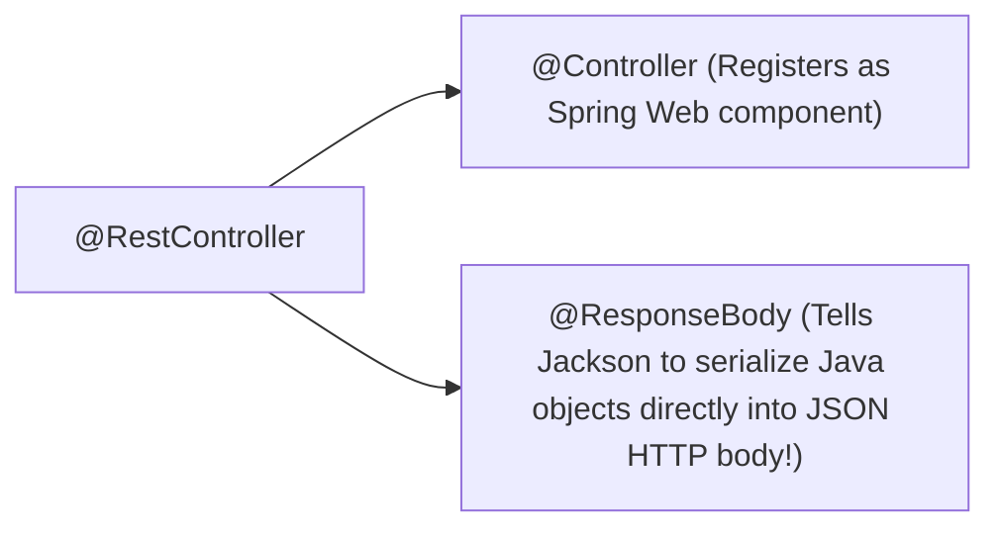
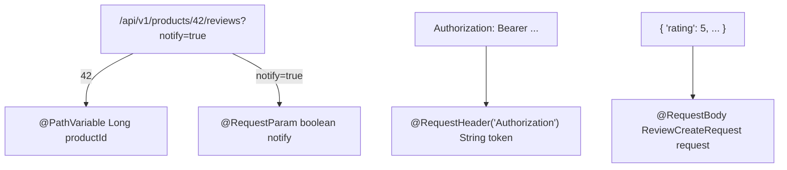

# Building REST APIs: Controllers, Path Variables & Request Bodies

> **Phase 10: Spring Boot, REST APIs & Data Persistence**  
> *Estimated Reading Time: 50 minutes | Total Practice Effort: ~3.5 hours | Tier: Core Essential*

---

## 1. Purpose & Prerequisites

### Why This Matters in Full Stack Development
In a modern decoupled architecture, your Spring Boot backend serves as a headless API service. It does not render HTML pages; it exposes **JSON endpoints** consumed by React, Vue, mobile apps, and third-party microservices.

To build APIs that frontends can easily integrate with, you must know how to:
- Route HTTP requests to specific controller methods using `@GetMapping`, `@PostMapping`, and `@DeleteMapping`.
- Extract data from the URL path (`@PathVariable`), query parameters (`@RequestParam`), and request payload (`@RequestBody`).
- Return rich, semantically accurate HTTP responses with custom status codes and headers using `ResponseEntity<T>`.

### Prerequisites
- [Topic 10.1: Web Protocol Fundamentals: HTTP Verbs & REST](01-http-rest.md)
- [Topic 10.2: Spring Core: IoC & Dependency Injection](02-ioc-di.md)
- [Topic 10.3: Spring Boot Auto-Configuration](03-autoconfig.md)

---

## 2. Plain-English Mental Model

```
[ Spring MVC DispatcherServlet: The Airport Flight Terminal ]
1. An airplane lands (Incoming HTTP Request from React browser).
2. The Air Traffic Controller (DispatcherServlet) reads the flight number (/api/v1/courses/42).
3. The controller routes the passengers to Gate 14 (CourseController.getCourseById()).
4. The gate agent (Controller method) checks tickets (parameters) and calls luggage handling (Service layer).
5. The gate agent hands the passenger an official boarding pass (ResponseEntity with 200 OK + JSON payload).
```

---

## 3. `@RestController` vs `@Controller`

In classic Spring MVC, `@Controller` was designed to return the name of an HTML template (like Thymeleaf, JSP, or Freemarker) for server-side rendering:

```java
// CLASSIC SPRING MVC (Server-Side HTML Rendering)
@Controller
public class WebPageController {
    @GetMapping("/home")
    public String showHomePage() {
        return "home"; // Resolves to templates/home.html
    }
}
```

In modern full-stack development, we use **`@RestController`**:


---

## 4. Extracting Client Inputs: The 4 Key Annotations

```
HTTP Request: POST /api/v1/products/42/reviews?notify=true
Headers: Authorization: Bearer eyJ...
Body: { "rating": 5, "comment": "Great keyboard!" }
```



### 1. `@PathVariable`: Extracting Dynamic URL Segments
Used for identifying a specific resource in hierarchical REST URIs:
```java
@GetMapping("/api/v1/users/{id}")
public UserDto getUserById(@PathVariable("id") Long userId) { ... }
```

### 2. `@RequestParam`: Query String Filtering, Sorting & Pagination
Used for optional query parameters following the `?` in the URL:
```java
// Handles: /api/v1/products?category=electronics&page=0&size=20
@GetMapping("/api/v1/products")
public List<ProductDto> getProducts(
        @RequestParam(name = "category", required = false) String category,
        @RequestParam(name = "page", defaultValue = "0") int page,
        @RequestParam(name = "size", defaultValue = "20") int size) { ... }
```

### 3. `@RequestBody`: JSON Payload Deserialization
Jackson automatically deserializes the incoming JSON payload into your Java Data Transfer Object (DTO):
```java
@PostMapping("/api/v1/products")
public ProductDto createProduct(@RequestBody ProductCreateRequest request) { ... }
```

### 4. `@RequestHeader`: Extracting HTTP Headers
```java
@GetMapping("/api/v1/profile")
public ProfileDto getProfile(@RequestHeader("Authorization") String authHeader) { ... }
```

---

## 5. Controlling HTTP Responses with `ResponseEntity<T>`

While you *can* return a raw object from a controller method, production APIs use `ResponseEntity<T>` to gain full control over:
1. **HTTP Status Codes** (`200 OK`, `201 Created`, `204 No Content`).
2. **Custom HTTP Headers** (such as `Location` or custom rate-limiting headers).
3. **Response Body Payload**.

### Idiomatic `ResponseEntity` Builder Patterns:
```java
// 1. Returning 200 OK with body:
return ResponseEntity.ok(courseDto);

// 2. Returning 201 Created with Location header:
URI location = URI.create("/api/v1/courses/" + createdCourse.id());
return ResponseEntity.created(location).body(createdCourse);

// 3. Returning 204 No Content (Standard for DELETE):
return ResponseEntity.noContent().build();

// 4. Custom status with headers:
return ResponseEntity.status(HttpStatus.ACCEPTED)
        .header("X-Job-Id", jobId)
        .body(jobStatus);
```

---

## 6. End-to-End Production CRUD Controller

Here is a complete, industry-standard REST controller:

### The DTO Records:
```java
package com.career.learning.dto;

import java.math.BigDecimal;

public record CourseCreateRequest(String title, String description, BigDecimal price) {}
public record CourseResponse(Long id, String title, String description, BigDecimal price) {}
```

### The Controller Implementation:
```java
package com.career.learning.controller;

import com.career.learning.dto.CourseCreateRequest;
import com.career.learning.dto.CourseResponse;
import com.career.learning.service.CourseService;
import org.springframework.http.HttpStatus;
import org.springframework.http.ResponseEntity;
import org.springframework.web.bind.annotation.*;
import org.springframework.web.servlet.support.ServletUriComponentsBuilder;

import java.net.URI;
import java.util.List;

@RestController
@RequestMapping("/api/v1/courses") // Base URI path
public class CourseController {

    private final CourseService courseService;

    // Constructor Injection
    public CourseController(CourseService courseService) {
        this.courseService = courseService;
    }

    // 1. GET ALL with optional search filter
    @GetMapping
    public ResponseEntity<List<CourseResponse>> getAllCourses(
            @RequestParam(required = false) String search) {
        List<CourseResponse> courses = courseService.findAll(search);
        return ResponseEntity.ok(courses);
    }

    // 2. GET BY ID
    @GetMapping("/{id}")
    public ResponseEntity<CourseResponse> getCourseById(@PathVariable Long id) {
        CourseResponse course = courseService.findById(id);
        return ResponseEntity.ok(course);
    }

    // 3. CREATE (POST)
    @PostMapping
    public ResponseEntity<CourseResponse> createCourse(@RequestBody CourseCreateRequest request) {
        CourseResponse created = courseService.create(request);

        // Build standard RFC-compliant Location header: /api/v1/courses/{newId}
        URI location = ServletUriComponentsBuilder.fromCurrentRequest()
                .path("/{id}")
                .buildAndExpand(created.id())
                .toUri();

        return ResponseEntity.created(location).body(created);
    }

    // 4. UPDATE (PUT)
    @PutMapping("/{id}")
    public ResponseEntity<CourseResponse> updateCourse(
            @PathVariable Long id,
            @RequestBody CourseCreateRequest request) {
        CourseResponse updated = courseService.update(id, request);
        return ResponseEntity.ok(updated);
    }

    // 5. DELETE
    @DeleteMapping("/{id}")
    public ResponseEntity<Void> deleteCourse(@PathVariable Long id) {
        courseService.delete(id);
        return ResponseEntity.noContent().build(); // HTTP 204 No Content
    }
}
```

---

## 7. Common Rookie Mistakes & Anti-Patterns

### Trap 1: Returning Entity Models Directly to the Client
```java
// DISASTROUS ANTI-PATTERN:
@GetMapping("/users/{id}")
public UserEntity getUser(@PathVariable Long id) {
    return userRepository.findById(id).get(); // ACCIDENTALLY EXPOSES PASSWORD HASH TO JSON!
}
```
*Why this is bad:*
1. Security: Entity classes contain sensitive fields (passwords, internal audit metadata) that get serialized to JSON.
2. Serialization Loops: Bi-directional JPA relationships (`@OneToMany` / `@ManyToOne`) trigger infinite recursion and `StackOverflowError` in Jackson!
*Rule:* **Never expose `@Entity` directly from controllers. Always map to DTO records!**

### Trap 2: Forgetting `@RequestBody`
If you omit `@RequestBody` on a POST/PUT parameter, Spring treats the parameter as request query parameters rather than deserializing the JSON payload. All fields in your DTO will be `null`!

---

## 8. Guided Hands-On Exercise

### The Scenario
You are developing an e-commerce Product Catalog endpoint.  
Requirements:
- Endpoint: `GET /api/v1/products`
- Query parameters:
  - `minPrice` (optional `Double`)
  - `maxPrice` (optional `Double`)
  - `category` (mandatory `String`)
- Return: `ResponseEntity<List<ProductDto>>`

### Your Challenge:
Write the controller method signature and annotations satisfying these requirements.

<details>
<summary>💡 Hint: Use @RequestParam with required attribute</summary>

```java
@GetMapping
public ResponseEntity<List<ProductDto>> filterProducts(
    @RequestParam(name = "category", required = true) String category,
    ...
```
</details>

<details>
<summary>✅ Solution</summary>

```java
@GetMapping
public ResponseEntity<List<ProductDto>> getProducts(
        @RequestParam(name = "category", required = true) String category,
        @RequestParam(name = "minPrice", required = false) Double minPrice,
        @RequestParam(name = "maxPrice", required = false) Double maxPrice) {

    List<ProductDto> products = productService.filter(category, minPrice, maxPrice);
    return ResponseEntity.ok(products);
}
```
</details>

---

## 9. Knowledge Check & Interview Defense

### Quick Quiz
1. **What is the functional difference between `@Controller` and `@RestController` in Spring?**
   - [x] A) `@RestController` is a convenience annotation combining `@Controller` and `@ResponseBody`, instructing Spring to serialize method return values directly into HTTP response bodies (typically JSON) rather than resolving HTML view templates.
   - [ ] B) `@RestController` only works with databases.
   - [ ] C) `@Controller` is deprecated in Spring Boot.
   - [ ] D) `@RestController` creates background threads for every request.

2. **Given the URL `/api/v1/orders/104?printReceipt=true`, which Spring annotations should be used to extract `104` and `true`?**
   - [x] A) `@PathVariable Long id` for `104`, and `@RequestParam boolean printReceipt` for `true`.
   - [ ] B) `@RequestBody` for both.
   - [ ] C) `@RequestHeader` for both.
   - [ ] D) `@RequestParam` for `104`, and `@PathVariable` for `true`.

3. **What HTTP status code is standard for a successful `DELETE` endpoint that returns no response payload?**
   - [x] A) `204 No Content`.
   - [ ] B) `200 OK`.
   - [ ] C) `201 Created`.
   - [ ] D) `404 Not Found`.

---

### Junior Developer Interview Q&A

#### Q: "Why should a Spring REST API never return database JPA Entity objects directly from controller endpoints?"
> **Model Answer:**  
> "Returning JPA Entities directly from REST controllers introduces three critical architectural and security risks:
>
> 1. **Security & Information Leakage:** Entities represent the physical database schema and often contain sensitive fields (such as `passwordHash`, `ssn`, or internal audit columns). Returning the entity risks exposing sensitive data to client browsers.
>
> 2. **Jackson Infinite Serialization Recursion:** JPA entities often feature bidirectional relationships (e.g., a `User` has a `List<Order>`, and each `Order` references its parent `User`). When Jackson attempts to serialize the entity to JSON, it gets trapped in an infinite recursive loop, triggering a `StackOverflowError`.
>
> 3. **API Contract Stability:** If you alter a database column name or normalize a table, your frontend API JSON contract immediately breaks! By mapping entities to dedicated **Data Transfer Objects (DTOs)**, the external API contract remains stable and decoupled from internal database schema evolution."

---

## 10. Mastery Checklist & Next Step

Before moving on, verify that you can:
- [ ] Differentiate between `@Controller` and `@RestController`.
- [ ] Map HTTP verbs using `@GetMapping`, `@PostMapping`, `@PutMapping`, and `@DeleteMapping`.
- [ ] Extract parameters using `@PathVariable`, `@RequestParam`, and `@RequestBody`.
- [ ] Build semantically rich HTTP responses using `ResponseEntity<T>` and `ServletUriComponentsBuilder`.
- [ ] Isolate domain entities from public APIs using DTO records.

👉 **Next Lesson:** **[Topic 10.5: Request Validation (jakarta.validation), DTOs & Global Exceptions](05-validation-advice.md)**
