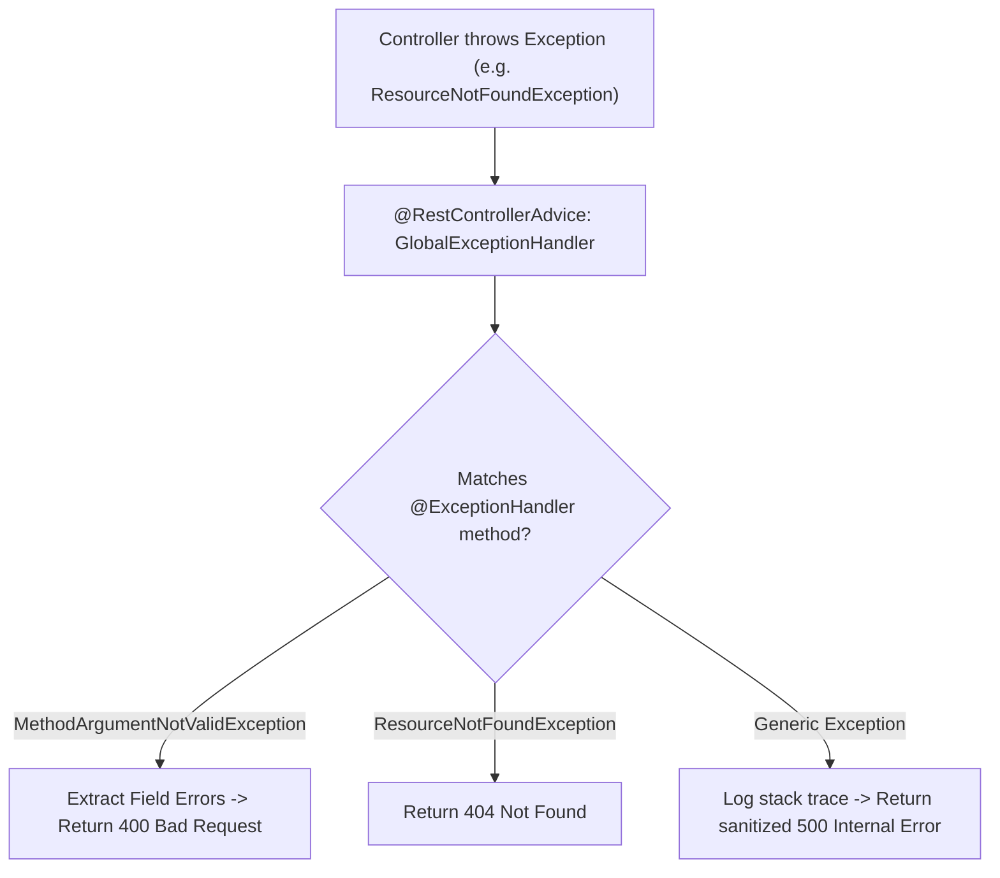

# Request Validation (jakarta.validation), DTOs & Global Exceptions

> **Phase 10: Spring Boot, REST APIs & Data Persistence**  
> *Estimated Reading Time: 50 minutes | Total Practice Effort: ~3.5 hours | Tier: Core Essential*

---

## 1. Purpose & Prerequisites

### Why This Matters in Full Stack Development
In full-stack engineering, the golden rule of cybersecurity is: **Never trust client input**.

A user might submit a registration request with:
- An empty email string `""`.
- A negative purchase price `"-50.00"`.
- A 50,000-character malicious string designed to overflow database columns.

If you don't validate requests at the gateway of your API:
1. Invalid data pollutes your database tables.
2. Unhandled runtime exceptions crash your controllers and return raw **internal Java stack traces** to the browser, exposing server paths and software versions to attackers!

In this lesson, you will master declarative **Jakarta Bean Validation** and build a centralized, enterprise-grade **`@RestControllerAdvice` Global Exception Handler**.

### Prerequisites
- [Topic 3.1: Exceptions: Checked, Unchecked & Best Practices](../03-core/01-exceptions.md)
- [Topic 10.1: Web Protocol Fundamentals & Status Codes](01-http-rest.md)
- [Topic 10.4: Building REST APIs: Controllers & DTOs](04-controllers.md)

---

## 2. Plain-English Mental Model

```
[ The Nightclub Bouncer: Jakarta Bean Validation ]
- You don't let people into the nightclub and then check their ID inside by the bar.
- The bouncer stands at the velvet rope (Controller method entrance).
- If your ID is expired or fake (@NotBlank, @Email, @Min), the bouncer turns you away instantly.
- The bartender (Service layer) never deals with unauthorized or invalid guests!

[ The PR Spokesperson: @RestControllerAdvice ]
- If a pipe bursts inside the nightclub (an unexpected exception throws),
- The staff does not panic and scream internal blueprints at the crowd (Stack Trace Leak).
- The official PR spokesperson calmly delivers a clear, standardized statement (RFC Problem Details JSON).
```

---

## 3. Jakarta Bean Validation Annotations

Spring Boot Starter Validation (`spring-boot-starter-validation`) uses **Hibernate Validator** (the reference implementation of Jakarta Bean Validation):

```xml
<dependency>
    <groupId>org.springframework.boot</groupId>
    <artifactId>spring-boot-starter-validation</artifactId>
</dependency>
```

### The Critical Difference: `@NotNull` vs `@NotEmpty` vs `@NotBlank`

| Annotation | Rejects `null`? | Rejects `""` (Empty)? | Rejects `"   "` (Whitespace)? | Best Used For |
| :--- | :---: | :---: | :---: | :--- |
| **`@NotNull`** | ❌ Yes | ❌ No | ❌ No | Numbers, Dates, Booleans, Objects |
| **`@NotEmpty`** | ❌ Yes | ❌ Yes | ❌ No | Collections, Lists, Maps, Arrays |
| **`@NotBlank`** | ❌ Yes | ❌ Yes | ❌ Yes | **Text / String fields only!** |

> **Pro Tip:** Always use `@NotBlank` for String text fields! `@NotNull` will happily accept `""` or `"   "`, causing invalid data to pass validation.

### Other Essential Validation Annotations:
- **`@Size(min = 8, max = 64)`**: Length of strings or size of collections.
- **`@Min(1)` / `@Max(100)`**: Numerical boundary limits.
- **`@Positive` / `@PositiveOrZero`**: Numbers strictly $> 0$ or $\ge 0$.
- **`@Email`**: Validates RFC 5322 email syntax.
- **`@Past` / `@Future`**: Temporal validation for `LocalDate` / `LocalDateTime`.
- **`@Pattern(regexp = "^[A-Z0-9_-]+$")`**: Custom regex validation.

---

## 4. Declaring a Validated DTO

```java
package com.career.learning.dto;

import jakarta.validation.constraints.*;
import java.math.BigDecimal;
import java.time.LocalDate;

public record UserRegistrationRequest(

    @NotBlank(message = "Username is mandatory")
    @Size(min = 3, max = 30, message = "Username must be between 3 and 30 characters")
    @Pattern(regexp = "^[a-zA-Z0-9_]+$", message = "Username can only contain alphanumeric characters and underscores")
    String username,

    @NotBlank(message = "Email is mandatory")
    @Email(message = "Please provide a valid email address")
    String email,

    @NotBlank(message = "Password is mandatory")
    @Size(min = 8, max = 100, message = "Password must be at least 8 characters long")
    String password,

    @NotNull(message = "Birth date is mandatory")
    @Past(message = "Birth date must be in the past")
    LocalDate birthDate,

    @NotNull(message = "Initial deposit is mandatory")
    @PositiveOrZero(message = "Initial deposit cannot be negative")
    BigDecimal initialDeposit
) {}
```

---

## 5. Triggering Validation in Controllers: `@Valid`

To activate validation, place the `@Valid` annotation on the `@RequestBody` parameter:

```java
@PostMapping("/api/v1/users/register")
public ResponseEntity<UserResponse> registerUser(
        @Valid @RequestBody UserRegistrationRequest request) { // <-- @Valid triggers check!
    
    UserResponse response = userService.register(request);
    return ResponseEntity.status(HttpStatus.CREATED).body(response);
}
```

If the client sends an invalid payload (e.g. `email: "not-an-email"`), Spring **intercepts the request before it reaches your method body** and throws a `MethodArgumentNotValidException`.

---

## 6. The Standardized API Error Response DTO

Never return raw strings or stack traces on errors. Standardize on a clean error envelope:

```java
package com.career.learning.dto;

import java.time.Instant;
import java.util.Map;

public record ApiErrorResponse(
    Instant timestamp,
    int status,
    String error,
    String message,
    String path,
    Map<String, String> validationErrors // fieldName -> errorMessage
) {}
```

---

## 7. Centralized Error Handling with `@RestControllerAdvice`

Instead of writing `try-catch` blocks in every single controller method, Spring provides `@RestControllerAdvice` to intercept exceptions across the entire application:



### Complete Production `@RestControllerAdvice`:
```java
package com.career.learning.exception;

import com.career.learning.dto.ApiErrorResponse;
import jakarta.servlet.http.HttpServletRequest;
import org.slf4j.Logger;
import org.slf4j.LoggerFactory;
import org.springframework.http.HttpStatus;
import org.springframework.http.ResponseEntity;
import org.springframework.validation.FieldError;
import org.springframework.web.bind.MethodArgumentNotValidException;
import org.springframework.web.bind.annotation.ExceptionHandler;
import org.springframework.web.bind.annotation.RestControllerAdvice;

import java.time.Instant;
import java.util.HashMap;
import java.util.Map;

@RestControllerAdvice
public class GlobalExceptionHandler {

    private static final Logger log = LoggerFactory.getLogger(GlobalExceptionHandler.class);

    // 1. Handle Bean Validation Errors (@Valid failure -> 400 Bad Request)
    @ExceptionHandler(MethodArgumentNotValidException.class)
    public ResponseEntity<ApiErrorResponse> handleValidationExceptions(
            MethodArgumentNotValidException ex, HttpServletRequest request) {

        Map<String, String> errors = new HashMap<>();
        for (FieldError fieldError : ex.getBindingResult().getFieldErrors()) {
            errors.put(fieldError.getField(), fieldError.getDefaultMessage());
        }

        ApiErrorResponse response = new ApiErrorResponse(
            Instant.now(),
            HttpStatus.BAD_REQUEST.value(),
            "Validation Failed",
            "One or more fields failed validation criteria",
            request.getRequestURI(),
            errors
        );

        return ResponseEntity.status(HttpStatus.BAD_REQUEST).body(response);
    }

    // 2. Handle Custom Not Found Exceptions -> 404 Not Found
    @ExceptionHandler(ResourceNotFoundException.class)
    public ResponseEntity<ApiErrorResponse> handleResourceNotFound(
            ResourceNotFoundException ex, HttpServletRequest request) {

        ApiErrorResponse response = new ApiErrorResponse(
            Instant.now(),
            HttpStatus.NOT_FOUND.value(),
            "Not Found",
            ex.getMessage(),
            request.getRequestURI(),
            null
        );

        return ResponseEntity.status(HttpStatus.NOT_FOUND).body(response);
    }

    // 3. Handle Business Conflicts (e.g. Duplicate Email) -> 409 Conflict
    @ExceptionHandler(DuplicateResourceException.class)
    public ResponseEntity<ApiErrorResponse> handleDuplicateResource(
            DuplicateResourceException ex, HttpServletRequest request) {

        ApiErrorResponse response = new ApiErrorResponse(
            Instant.now(),
            HttpStatus.CONFLICT.value(),
            "Conflict",
            ex.getMessage(),
            request.getRequestURI(),
            null
        );

        return ResponseEntity.status(HttpStatus.CONFLICT).body(response);
    }

    // 4. Catch-All for Unhandled Server Exceptions -> 500 Internal Server Error
    @ExceptionHandler(Exception.class)
    public ResponseEntity<ApiErrorResponse> handleGeneralException(
            Exception ex, HttpServletRequest request) {

        // Log full stack trace internally for developers, but DO NOT leak it to the client!
        log.error("Unhandled server exception at URI: {}", request.getRequestURI(), ex);

        ApiErrorResponse response = new ApiErrorResponse(
            Instant.now(),
            HttpStatus.INTERNAL_SERVER_ERROR.value(),
            "Internal Server Error",
            "An unexpected internal error occurred. Please contact support.",
            request.getRequestURI(),
            null
        );

        return ResponseEntity.status(HttpStatus.INTERNAL_SERVER_ERROR).body(response);
    }
}
```

---

## 8. What the React Frontend Receives on Validation Failure

When the frontend sends invalid JSON, it receives clean, machine-parsable error feedback with **HTTP 400 Bad Request**:

```json
{
  "timestamp": "2026-10-20T14:30:00.123Z",
  "status": 400,
  "error": "Validation Failed",
  "message": "One or more fields failed validation criteria",
  "path": "/api/v1/users/register",
  "validationErrors": {
    "email": "Please provide a valid email address",
    "password": "Password must be at least 8 characters long",
    "username": "Username must be between 3 and 30 characters"
  }
}
```
The React frontend can simply iterate over `response.data.validationErrors` to highlight the exact input fields in red with specific user-friendly messages!

---

## 9. Common Rookie Mistakes & Anti-Patterns

### Anti-Pattern 1: Try-Catch Clutter in Controllers
```java
// BAD CODE: Boilerplate in every controller!
@PostMapping
public ResponseEntity<?> create(@RequestBody UserDto dto) {
    try {
        return ResponseEntity.ok(service.create(dto));
    } catch (UserNotFoundException e) {
        return ResponseEntity.status(404).body(e.getMessage());
    } catch (Exception e) {
        return ResponseEntity.status(500).body("Error");
    }
}
```
*Rule:* Controllers should never have manual `try-catch` blocks for business exceptions. Let exceptions propagate naturally to `@RestControllerAdvice`!

### Anti-Pattern 2: Leaking Database Details to Attackers
Returning `ex.getMessage()` when a `SQLException` occurs. The message might say:  
`Table 'prod_db.tbl_user_credentials' does not have column 'ssn'`.  
Attackers use this to map out your internal database structure!

---

## 10. Guided Hands-On Exercise

### The Scenario
You are building an e-commerce order placement endpoint: `POST /api/v1/orders`.  
Create an `OrderCreateRequest` DTO satisfying these business rules:
- `customerId`: Mandatory `Long`, must be positive.
- `items`: Mandatory `List<OrderItemRequest>`, must not be empty.
- `shippingZipCode`: Mandatory String, must match a 5-digit US postal format (`^[0-9]{5}$`).

### Your Challenge:
Write the `OrderCreateRequest` record using Jakarta Bean Validation.

<details>
<summary>💡 Hint: Use @Positive, @NotEmpty, and @Pattern</summary>

```java
public record OrderCreateRequest(
    @NotNull @Positive Long customerId,
    @NotEmpty List<OrderItemRequest> items,
    @NotBlank @Pattern(regexp = "^\\d{5}$") String shippingZipCode
) {}
```
</details>

<details>
<summary>✅ Solution</summary>

```java
package com.career.learning.dto;

import jakarta.validation.Valid;
import jakarta.validation.constraints.NotBlank;
import jakarta.validation.constraints.NotEmpty;
import jakarta.validation.constraints.NotNull;
import jakarta.validation.constraints.Pattern;
import jakarta.validation.constraints.Positive;
import java.util.List;

public record OrderCreateRequest(

    @NotNull(message = "Customer ID is required")
    @Positive(message = "Customer ID must be a positive integer")
    Long customerId,

    @NotEmpty(message = "Order must contain at least one item")
    List<@Valid OrderItemRequest> items, // @Valid ensures child items are also validated!

    @NotBlank(message = "Shipping zip code is required")
    @Pattern(regexp = "^\\d{5}$", message = "Zip code must be exactly 5 digits")
    String shippingZipCode
) {}
```
</details>

---

## 11. Knowledge Check & Interview Defense

### Quick Quiz
1. **Which annotation should be used on a text String field to reject both `null`, empty strings `""`, and strings containing only whitespace `"   "`?**
   - [x] A) `@NotBlank`.
   - [ ] B) `@NotNull`.
   - [ ] C) `@NotEmpty`.
   - [ ] D) `@Size`.

2. **What Spring annotation is used on a class to define centralized, cross-cutting exception handling for all `@RestController` components?**
   - [x] A) `@RestControllerAdvice` (or `@ControllerAdvice`).
   - [ ] B) `@ExceptionHandlerService`.
   - [ ] C) `@GlobalCatch`.
   - [ ] D) `@Aspect`.

3. **What happens if a client submits invalid JSON against a `@Valid @RequestBody` method parameter?**
   - [x] A) Spring throws a `MethodArgumentNotValidException`, which can be captured by an `@ExceptionHandler` to return a `400 Bad Request` with field error details.
   - [ ] B) Java crashes with an unrecoverable `OutOfMemoryError`.
   - [ ] C) Spring silently ignores the invalid fields and sets them to null.
   - [ ] D) The database drops the connection.

---

### Junior Developer Interview Q&A

#### Q: "Why is `@RestControllerAdvice` preferred over handling exceptions using try-catch blocks inside individual controller methods?"
> **Model Answer:**  
> "`@RestControllerAdvice` provides three major architectural advantages:
>
> 1. **Separation of Concerns (DRY Principle):** Instead of duplicating identical `try-catch` blocks and HTTP status mapping logic across dozens of controller endpoints, all error-handling rules are centralized in one clean, maintainable class.
>
> 2. **Consistent API Error Contracts:** It ensures that every error returned by the API adheres to the exact same JSON schema (`ApiErrorResponse`), making it predictable and straightforward for frontend React clients to parse.
>
> 3. **Information Leakage Prevention:** By catching generic `Exception.class` globally, we prevent unhandled exceptions from bubbling up to the servlet container, ensuring internal server stack traces and database schema details are logged safely to server files but never leaked to external users."

---

## 12. Mastery Checklist & Next Step

Before moving on, verify that you can:
- [ ] Differentiate between `@NotNull`, `@NotEmpty`, and `@NotBlank`.
- [ ] Apply numerical, date, and regex validation annotations (`@Min`, `@Past`, `@Pattern`).
- [ ] Trigger validation on request payloads using `@Valid`.
- [ ] Intercept validation failures (`MethodArgumentNotValidException`) in `@RestControllerAdvice`.
- [ ] Return standardized JSON error responses with HTTP `400`, `404`, `409`, and sanitized `500`.

👉 **Next Lesson:** **[Topic 10.6: Spring Data JPA: Entity Lifecycle, Repositories & Auto-Queries](06-jpa-entities.md)**
