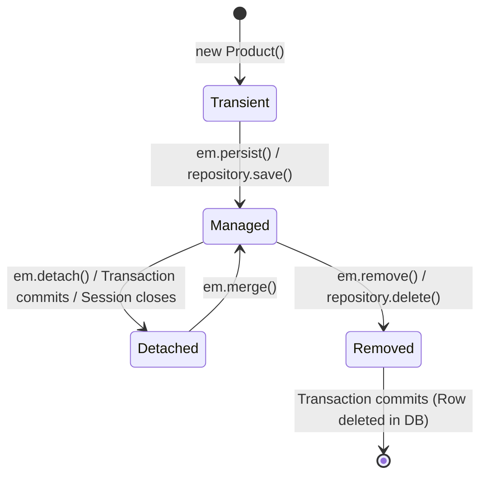

# Spring Data JPA: Entity Lifecycle, Repositories & Auto-Queries

> **Phase 10: Spring Boot, REST APIs & Data Persistence**  
> *Estimated Reading Time: 55 minutes | Total Practice Effort: ~4 hours | Tier: Core Essential*

---

## 1. Purpose & Prerequisites

### Why This Matters in Full Stack Development
In Phase 8, you wrote database code using raw JDBC:
You manually wrote SQL strings, opened connections, set 1-based bind parameters, iterated over `ResultSet` cursors, and mapped rows to POJOs.

For simple queries, JDBC is fast. But writing thousands of lines of repetitive CRUD boilerplate for 50 domain tables is tedious and error-prone.

**Spring Data JPA** (built on top of **Hibernate**, the industry standard **Object-Relational Mapping (ORM)** engine) allows you to:
- Map a Java class directly to a database table using annotations (`@Entity`, `@Table`).
- Perform full CRUD operations without writing a single line of SQL simply by extending `JpaRepository`.
- Let Hibernate automatically detect object mutations and generate optimal `UPDATE` statements via **Dirty Checking**.

### Prerequisites
- [Topic 7.1: Relational Concepts: Tables, PKs & FKs](../07-sql/01-db-concepts.md)
- [Topic 8.4: Querying Tabular Data with ResultSet](../08-jdbc/04-resultset.md)
- [Topic 10.2: Spring Core: IoC & Repositories](02-ioc-di.md)

---

## 2. Plain-English Mental Model

```
[ Raw JDBC: Manual Hand-Drawn Blueprints ]
- You want to store a User in MySQL.
- You manually write out every brick and mortar: INSERT INTO users (name, email, age) VALUES (?, ?, ?).
- You manually parse each brick back out: rs.getString("name"), rs.getInt("age").

[ JPA / Hibernate: The Magic Mirror ]
- You place a Java User object in front of the "Magic Mirror" (Persistence Context).
- When you update the user in Java: user.setEmail("new@corp.com"),
  the mirror notices the reflection changed!
- When your transaction commits, Hibernate automatically executes the UPDATE statement behind the scenes!
- This automated reflection sync is called Dirty Checking.
```

---

## 3. Mapping Entities: Core JPA Annotations

```java
package com.career.learning.entity;

import jakarta.persistence.*;
import java.math.BigDecimal;
import java.time.LocalDateTime;

@Entity // 1. Tells Hibernate this class maps to a relational database table
@Table(name = "products") // 2. Specifies the physical table name in MySQL
public class Product {

    @Id // 3. Primary Key
    @GeneratedValue(strategy = GenerationType.IDENTITY) // 4. Maps to MySQL AUTO_INCREMENT
    private Long id;

    @Column(name = "sku", nullable = false, unique = true, length = 50)
    private String sku;

    @Column(name = "title", nullable = false, length = 150)
    private String title;

    @Column(name = "price", nullable = false, precision = 10, scale = 2)
    private BigDecimal price;

    @Enumerated(EnumType.STRING) // 5. MANDATORY: Store enum name as String, NEVER ordinal integer!
    @Column(name = "status", nullable = false, length = 20)
    private ProductStatus status = ProductStatus.DRAFT;

    @Column(name = "created_at", nullable = false, updatable = false)
    private LocalDateTime createdAt = LocalDateTime.now();

    // 6. Hibernate REQUIRES a no-arguments constructor for reflection!
    protected Product() {}

    public Product(String sku, String title, BigDecimal price) {
        this.sku = sku;
        this.title = title;
        this.price = price;
    }

    // Getters and Business Mutation Methods
    public Long getId() { return id; }
    public String getSku() { return sku; }
    public String getTitle() { return title; }
    public BigDecimal getPrice() { return price; }
    public ProductStatus getStatus() { return status; }
    public LocalDateTime getCreatedAt() { return createdAt; }

    public void updatePrice(BigDecimal newPrice) {
        if (newPrice.compareTo(BigDecimal.ZERO) <= 0) {
            throw new IllegalArgumentException("Price must be positive");
        }
        this.price = newPrice;
    }

    public void publish() {
        this.status = ProductStatus.ACTIVE;
    }
}
```

> **CRITICAL RULE: `@Enumerated(EnumType.STRING)`**  
> Never omit this annotation! By default, JPA uses `EnumType.ORDINAL`, storing the enum's array index (`0, 1, 2`). If another developer later adds an enum value at the top of the list, **all historical database records become corrupted with wrong enum types!** Always specify `EnumType.STRING`.

---

## 4. The 4 Hibernate Entity Lifecycle States

Every entity instance in a JPA application exists in one of four states relative to the **Persistence Context** (the Hibernate Session):



| Lifecycle State | Description | Managed by Hibernate? | Has Database ID? |
| :--- | :--- | :---: | :---: |
| **1. Transient** | Created via `new Product()`. Plain Java object in JVM memory. | ❌ No | ❌ No |
| **2. Managed (Persistent)** | Associated with an active Hibernate session/transaction. | ✅ **Yes** | ✅ **Yes** |
| **3. Detached** | Was once managed, but transaction completed or session closed. | ❌ No | ✅ Yes |
| **4. Removed** | Scheduled for deletion; `DELETE` SQL will fire upon transaction commit. | ✅ Yes | ✅ Yes |

---

## 5. Under the Hood: Dirty Checking (Automatic Updates)

When an entity is in the **Managed** state, Hibernate takes an in-memory snapshot of its initial field values.

When you modify a managed entity inside a `@Transactional` service method:
```java
@Transactional
public void updateProductPrice(Long id, BigDecimal newPrice) {
    // 1. Entity enters MANAGED state in Hibernate's PersistenceContext
    Product product = productRepository.findById(id)
            .orElseThrow(() -> new ResourceNotFoundException("Product not found"));

    // 2. We simply mutate the Java object field!
    product.updatePrice(newPrice);

    // NOTICE: We do NOT need to call productRepository.save(product)!
    // When the @Transactional method finishes, Hibernate compares the current entity 
    // against its initial snapshot (Dirty Checking).
    // It detects that 'price' changed and automatically fires:
    // UPDATE products SET price = ? WHERE id = ?
}
```

---

## 6. The `JpaRepository` Interface

By creating an interface that extends `JpaRepository<EntityType, IdType>`, Spring Data JPA automatically generates the complete implementation at runtime:

```java
package com.career.learning.repository;

import com.career.learning.entity.Product;
import com.career.learning.entity.ProductStatus;
import org.springframework.data.jpa.repository.JpaRepository;
import org.springframework.data.jpa.repository.Query;
import org.springframework.data.repository.query.Param;
import org.springframework.stereotype.Repository;

import java.math.BigDecimal;
import java.util.List;
import java.util.Optional;

@Repository
public interface ProductRepository extends JpaRepository<Product, Long> {

    // 1. Built-in out-of-the-box methods (no code needed!):
    // productRepository.save(product);
    // productRepository.findById(id);
    // productRepository.findAll();
    // productRepository.deleteById(id);
    // productRepository.existsById(id);
    // productRepository.count();

    // 2. Derived Query Methods (Spring parses method names into SQL!):
    Optional<Product> findBySku(String sku);

    List<Product> findByStatus(ProductStatus status);

    List<Product> findByStatusAndPriceLessThanEqual(ProductStatus status, BigDecimal maxPrice);

    boolean existsBySku(String sku);

    // 3. Custom JPQL Queries (Queries against Java Entity names, NOT DB tables!)
    @Query("SELECT p FROM Product p WHERE p.status = :status AND LOWER(p.title) LIKE LOWER(CONCAT('%', :keyword, '%'))")
    List<Product> searchActiveByKeyword(
            @Param("status") ProductStatus status, 
            @Param("keyword") String keyword);

    // 4. Native SQL Queries (When database-specific SQL features are needed)
    @Query(value = "SELECT * FROM products WHERE price > :minPrice ORDER BY RAND() LIMIT 5", nativeQuery = true)
    List<Product> findRandomFeaturedProducts(@Param("minPrice") BigDecimal minPrice);
}
```

---

## 7. Derived Query Method Keywords Reference

Spring Data JPA parses method names using an internal grammar:

| Method Name Pattern | Generated SQL WHERE Clause |
| :--- | :--- |
| `findByEmail(String email)` | `WHERE email = ?` |
| `findByTitleContaining(String text)` | `WHERE title LIKE '%?%'` |
| `findByTitleStartingWith(String prefix)` | `WHERE title LIKE '?%'` |
| `findByPriceGreaterThan(BigDecimal price)` | `WHERE price > ?` |
| `findByCreatedAtBetween(date1, date2)` | `WHERE created_at BETWEEN ? AND ?` |
| `findByActiveTrue()` | `WHERE is_active = true` |
| `findByEmailIgnoreCase(String email)` | `WHERE UPPER(email) = UPPER(?)` |
| `findTop5ByOrderByPriceDesc()` | `ORDER BY price DESC LIMIT 5` |

---

## 8. Common Rookie Mistakes & Traps

### Trap 1: Forgetting the No-Args Constructor
Hibernate instantiates entities using Java reflection. If your entity does not have a `protected` or `public` default constructor with no arguments:
`org.hibernate.InstantiationException: No default constructor for entity`  
*Fix:* Always provide `protected MyEntity() {}`.

### Trap 2: Using `final` on Entity Classes or Fields
Hibernate creates runtime dynamic proxies (using ByteBuddy/CGLIB) by subclassing your entity class. If you mark your entity `public final class Product` or declare fields `final`, Hibernate **cannot proxy the class**, breaking lazy loading.

### Trap 3: Calling `repository.save()` inside `@Transactional` Methods
While harmless, calling `productRepository.save(product)` at the end of a `@Transactional` update method is completely redundant because Hibernate's **Dirty Checking** automatically flushes all mutations on transaction commit!

---

## 9. Guided Hands-On Exercise

### The Scenario
You are developing an online learning platform. Model a `Student` entity:
- `id` (Long, auto-increment)
- `email` (String, unique, not null)
- `fullName` (String, not null)
- `tier` (Enum: `FREE`, `PREMIUM`, `ENTERPRISE`, stored as String)
- `enrolledAt` (LocalDateTime, not null)

### Your Challenge:
1. Write the `Student` JPA entity with appropriate annotations.
2. Write a `StudentRepository` containing a derived query method to find all students enrolled after a specific date belonging to a specific tier.

<details>
<summary>💡 Hint: Use findByTierAndEnrolledAtAfter</summary>

```java
List<Student> findByTierAndEnrolledAtAfter(StudentTier tier, LocalDateTime date);
```
</details>

<details>
<summary>✅ Solution</summary>

```java
package com.career.learning.student;

import jakarta.persistence.*;
import java.time.LocalDateTime;
import java.util.List;
import org.springframework.data.jpa.repository.JpaRepository;
import org.springframework.stereotype.Repository;

public enum StudentTier { FREE, PREMIUM, ENTERPRISE }

@Entity
@Table(name = "students")
public class Student {

    @Id
    @GeneratedValue(strategy = GenerationType.IDENTITY)
    private Long id;

    @Column(name = "email", nullable = false, unique = true, length = 150)
    private String email;

    @Column(name = "full_name", nullable = false, length = 100)
    private String fullName;

    @Enumerated(EnumType.STRING)
    @Column(name = "tier", nullable = false, length = 20)
    private StudentTier tier;

    @Column(name = "enrolled_at", nullable = false)
    private LocalDateTime enrolledAt;

    protected Student() {}

    public Student(String email, String fullName, StudentTier tier, LocalDateTime enrolledAt) {
        this.email = email;
        this.fullName = fullName;
        this.tier = tier;
        this.enrolledAt = enrolledAt;
    }

    public Long getId() { return id; }
    public String getEmail() { return email; }
    public String getFullName() { return fullName; }
    public StudentTier getTier() { return tier; }
    public LocalDateTime getEnrolledAt() { return enrolledAt; }
}

@Repository
public interface StudentRepository extends JpaRepository<Student, Long> {
    List<Student> findByTierAndEnrolledAtAfter(StudentTier tier, LocalDateTime date);
}
```
</details>

---

## 10. Knowledge Check & Interview Defense

### Quick Quiz
1. **What is "Dirty Checking" in Hibernate / JPA?**
   - [x] A) Hibernate automatically tracks changes made to Managed entities within an active transaction and synchronizes those changes with the database via generated `UPDATE` statements when the transaction commits.
   - [ ] B) A compiler check that scans for SQL injection.
   - [ ] C) A virus scanner for database connections.
   - [ ] D) Manually calling `repository.save()` on every line.

2. **Why must `@Enumerated(EnumType.STRING)` always be specified when mapping an enum field?**
   - [x] A) To store the enum's text name rather than its numerical ordinal index (`EnumType.ORDINAL`), preventing historical data corruption if enum constants are ever reordered or added.
   - [ ] B) Enums cannot be saved as numbers in MySQL.
   - [ ] C) It speeds up query execution.
   - [ ] D) It is required by Maven.

3. **In which Hibernate lifecycle state is an entity immediately after being instantiated with `new User("test@corp.com")`?**
   - [x] A) Transient.
   - [ ] B) Managed.
   - [ ] C) Detached.
   - [ ] D) Removed.

---

### Junior Developer Interview Q&A

#### Q: "What is the difference between JPQL (Java Persistence Query Language) and native SQL in Spring Data JPA?"
> **Model Answer:**  
> "The primary difference lies in the level of abstraction:
>
> 1. **JPQL (Java Persistence Query Language):** Queries are written against the **Java Domain Entities and their attributes** rather than physical database tables (e.g. `SELECT p FROM Product p WHERE p.price > 100`). JPQL is database-agnostic; Hibernate translates the JPQL query into the specific SQL dialect of the underlying database (MySQL, PostgreSQL, Oracle) automatically.
>
> 2. **Native SQL:** Queries are written directly in the **raw SQL dialect** of the target database engine against physical table and column names (`@Query(value = "SELECT * FROM tbl_products WHERE price > 100", nativeQuery = true)`).
>
> In production enterprise applications, we prefer JPQL because it is type-safe, supports entity relationships cleanly, and prevents vendor lock-in. We resort to Native SQL only when we need database-specific features (such as MySQL JSON functions, window functions, or specialized hardware hints) that JPQL cannot express."

---

## 11. Mastery Checklist & Next Step

Before moving on, verify that you can:
- [ ] Map Java classes to relational database tables using `@Entity`, `@Table`, and `@Id`.
- [ ] Explain why `@Enumerated(EnumType.STRING)` is mandatory.
- [ ] Diagram the 4 entity lifecycle states (Transient, Managed, Detached, Removed).
- [ ] Explain how Dirty Checking automatically persists mutations without explicit `save()` calls.
- [ ] Create repository interfaces extending `JpaRepository` with custom derived query methods and JPQL `@Query`.

👉 **Next Lesson:** **[Topic 10.7: JPA Entity Relationships: @ManyToOne, @OneToMany & Fetch Modes](07-relationships.md)**
