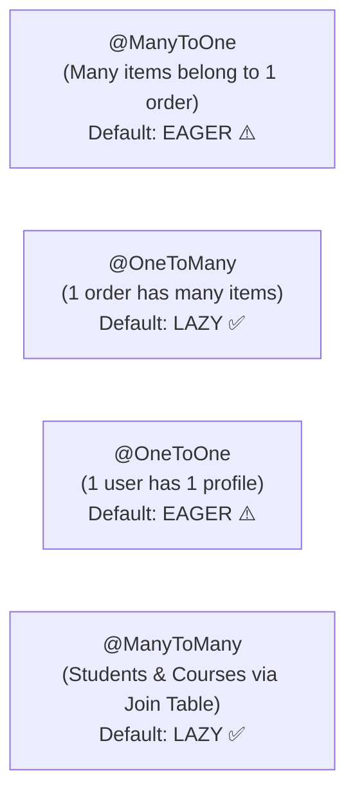

# JPA Entity Relationships: @ManyToOne, @OneToMany & Fetch Modes

> **Phase 10: Spring Boot, REST APIs & Data Persistence**  
> *Estimated Reading Time: 55 minutes | Total Practice Effort: ~4 hours | Tier: Core Essential*

---

## 1. Purpose & Prerequisites

### Why This Matters in Full Stack Development
In the real world, database tables do not live in isolation:
- A `Customer` places many `Orders`.
- An `Order` contains multiple `OrderItems`.
- A `Student` enrolls in multiple `Courses`.

In relational SQL, relationships are maintained strictly using **Foreign Keys**.  
In Java, relationships are maintained using **Object References** and **Collections** (`List<OrderItem>`).

If you misconfigure these relationships in Hibernate:
- Saving an order might fail to save its items.
- A simple `SELECT` query could secretly load **100,000 related rows into memory**, freezing your server!
- Or your application might crash with the dreaded `LazyInitializationException: could not initialize proxy - no Session`.

In this lesson, you will master **Entity Relationships**, **the Owning Side (`mappedBy`)**, **Cascade Operations**, and **Fetch Modes (`LAZY` vs `EAGER`)**.

### Prerequisites
- [Topic 7.1: Relational Concepts: Foreign Keys](../07-sql/01-db-concepts.md)
- [Topic 7.4: SQL Joins](../07-sql/04-joins.md)
- [Topic 10.6: Spring Data JPA & Entity Lifecycle](06-jpa-entities.md)

---

## 2. Plain-English Mental Model

```
[ Who Wears the Wedding Ring? (The Owning Side) ]
- In a traditional marriage ceremony, both partners acknowledge the relationship.
- But in a database, only ONE table physically contains the foreign key column!
- In an Order <---> OrderItem relationship, the order_items table physically holds the order_id column.
- Therefore, OrderItem is the OWNING SIDE of the relationship.
- Order is the INVERSE SIDE; it simply points to OrderItem using mappedBy = "order".
```

---

## 3. The 4 JPA Relationship Mappings



---

## 4. Modeling a Bidirectional One-to-Many Association

Let's model the classic `Order` $\leftrightarrow$ `OrderItem` association:

### 1. The Child Entity: `OrderItem` (The Owning Side)
The table with the physical foreign key column (`order_id`) is **always the Owning Side**:

```java
package com.career.learning.entity;

import jakarta.persistence.*;
import java.math.BigDecimal;

@Entity
@Table(name = "order_items")
public class OrderItem {

    @Id
    @GeneratedValue(strategy = GenerationType.IDENTITY)
    private Long id;

    @Column(nullable = false)
    private String productTitle;

    @Column(nullable = false)
    private int quantity;

    @Column(nullable = false, precision = 10, scale = 2)
    private BigDecimal unitPrice;

    // OWNING SIDE: Defines the foreign key column in SQL!
    // CRITICAL: Always explicitly configure fetch = FetchType.LAZY!
    @ManyToOne(fetch = FetchType.LAZY, optional = false)
    @JoinColumn(name = "order_id", nullable = false)
    private Order order;

    protected OrderItem() {}

    public OrderItem(String productTitle, int quantity, BigDecimal unitPrice) {
        this.productTitle = productTitle;
        this.quantity = quantity;
        this.unitPrice = unitPrice;
    }

    public Long getId() { return id; }
    public String getProductTitle() { return productTitle; }
    public int getQuantity() { return quantity; }
    public BigDecimal getUnitPrice() { return unitPrice; }
    public Order getOrder() { return order; }
    public void setOrder(Order order) { this.order = order; }
}
```

---

### 2. The Parent Entity: `Order` (The Inverse Side)
The parent does *not* have an `order_id` column; it simply points back to the field on `OrderItem` using `mappedBy`:

```java
package com.career.learning.entity;

import jakarta.persistence.*;
import java.time.LocalDateTime;
import java.util.ArrayList;
import java.util.Collections;
import java.util.List;

@Entity
@Table(name = "orders")
public class Order {

    @Id
    @GeneratedValue(strategy = GenerationType.IDENTITY)
    private Long id;

    @Column(nullable = false)
    private String customerEmail;

    @Column(nullable = false)
    private LocalDateTime orderDate = LocalDateTime.now();

    // INVERSE SIDE: mappedBy refers to the Java field name in OrderItem!
    // cascade = ALL: Persisting Order automatically persists its items!
    // orphanRemoval = true: Removing an item from this list deletes its row from SQL!
    @OneToMany(mappedBy = "order", cascade = CascadeType.ALL, orphanRemoval = true)
    private List<OrderItem> items = new ArrayList<>();

    protected Order() {}

    public Order(String customerEmail) {
        this.customerEmail = customerEmail;
    }

    // Bidirectional Helper Synchronization Methods (MANDATORY IN JPA!)
    public void addOrderItem(OrderItem item) {
        items.add(item);
        item.setOrder(this); // Keeps both sides in sync in Java memory!
    }

    public void removeOrderItem(OrderItem item) {
        items.remove(item);
        item.setOrder(null);
    }

    public Long getId() { return id; }
    public String getCustomerEmail() { return customerEmail; }
    public List<OrderItem> getItems() { return Collections.unmodifiableList(items); }
}
```

---

## 5. Understanding `CascadeType` & `orphanRemoval`

### `CascadeType`: Propagating State Transitions
When you perform an operation on the parent entity (`Order`), cascade rules tell Hibernate what to do with child entities (`OrderItem`):

- **`CascadeType.PERSIST`**: When `order` is saved, automatically save all its `items`.
- **`CascadeType.REMOVE`**: When `order` is deleted, automatically delete all its `items`.
- **`CascadeType.ALL`**: Applies all cascade operations (`PERSIST`, `MERGE`, `REMOVE`, `REFRESH`, `DETACH`).

### `orphanRemoval = true`
If you delete an item from the Java collection:
```java
order.removeOrderItem(existingItem);
```
With `orphanRemoval = true`, Hibernate detects that the item was orphaned from its parent and automatically executes:
`DELETE FROM order_items WHERE id = ?`.

---

## 6. Fetch Modes: `LAZY` vs `EAGER`

```
FetchType.LAZY   -> "Don't load from the database until I explicitly ask for it!"
FetchType.EAGER  -> "Load EVERYTHING immediately in the initial query, whether I need it or not!"
```

### The Golden Rule of Enterprise JPA:
> **ALWAYS MAKE ALL ASSOCIATIONS `FetchType.LAZY`!**  
> By default in JPA:
> - `@OneToMany` and `@ManyToMany` default to **LAZY** (Good).
> - `@ManyToOne` and `@OneToOne` default to **EAGER** (⚠️ Dangerous!).
> 
> **You must explicitly override `@ManyToOne(fetch = FetchType.LAZY)` on every single `@ManyToOne` in your codebase!**

### Why `EAGER` Destroys Performance:
If you have 10 `@ManyToOne` relationships configured with `EAGER`, querying for a single `Order` executes a giant, slow SQL query with **10 multi-table `LEFT OUTER JOIN`s**, consuming massive memory and CPU even if your endpoint only wanted to read the `orderDate`!

---

## 7. The Dreaded `LazyInitializationException`

When a field is `FetchType.LAZY`, Hibernate injects a **Dynamic Proxy** (a hollow placeholder object) instead of loading real database rows.

### What Causes the Crash:
```java
// Controller or non-transactional method:
Order order = orderService.getOrderById(101L); // Transaction closes here!

// Sometime later, in JSON serialization or template rendering:
int itemCount = order.getItems().size(); // CRASH!
```

```
org.hibernate.LazyInitializationException: could not initialize proxy [com.career.learning.entity.OrderItem] - no Session
```

### Why it Happens:
The Hibernate Session (`EntityManager`) was closed when the `@Transactional` service method ended. When code tries to access `order.getItems()`, Hibernate tries to open a new SQL query, realizes there is **no active database session/connection**, and throws an exception!

### The Solution:
Never make the relationship `EAGER` to fix this! Instead:
1. Fetch the required data inside the service transaction using **`JOIN FETCH`** or **`@EntityGraph`** (covered in the next lesson!).
2. Map the entity to a DTO *inside* the `@Transactional` boundary before returning to the controller.

---

## 8. Common Rookie Mistakes & Anti-Patterns

### Anti-Pattern 1: The `toString()` Infinite Recursion Crash
```java
// IN Order:
public String toString() { return "Order{items=" + items + "}"; }

// IN OrderItem:
public String toString() { return "OrderItem{order=" + order + "}"; }
```
*Result:* Calling `System.out.println(order)` or logging it triggers an infinite recursive loop: `Order -> OrderItem -> Order -> OrderItem ...` crashing your JVM with `StackOverflowError`!  
*Rule:* **Never include bidirectional relationship fields in `toString()`, `equals()`, or `hashCode()`!**

### Anti-Pattern 2: Forgetting to Set Both Sides in Memory
```java
Order order = new Order("alice@corp.com");
OrderItem item = new OrderItem("Keyboard", 1, new BigDecimal("100.00"));

order.getItems().add(item); // BUG: item.setOrder(order) was NEVER CALLED!
orderRepository.save(order);
```
*Result:* Hibernate saves `order`, but `item.order_id` in SQL will be **`NULL`**, failing database foreign key constraints! Always use helper synchronization methods: `order.addOrderItem(item)`.

---

## 9. Guided Hands-On Exercise

### The Scenario
You are modeling an online education platform:
- Entity 1: `Course` (id, title)
- Entity 2: `Lesson` (id, title, durationMinutes)
- A `Course` has many `Lessons`. A `Lesson` belongs to exactly one `Course`.

### Your Challenge:
1. Write the `Lesson` entity as the Owning Side (`@ManyToOne` with `LAZY` fetch).
2. Write the `Course` entity with a `@OneToMany` collection, `CascadeType.ALL`, and synchronization helper method `addLesson(Lesson lesson)`.

<details>
<summary>💡 Hint: Use mappedBy and bidirectional sync</summary>

```java
// In Course:
@OneToMany(mappedBy = "course", cascade = CascadeType.ALL, orphanRemoval = true)
private List<Lesson> lessons = new ArrayList<>();
```
</details>

<details>
<summary>✅ Solution</summary>

```java
package com.career.learning.course;

import jakarta.persistence.*;
import java.util.ArrayList;
import java.util.Collections;
import java.util.List;

@Entity
@Table(name = "lessons")
public class Lesson {

    @Id
    @GeneratedValue(strategy = GenerationType.IDENTITY)
    private Long id;

    @Column(nullable = false)
    private String title;

    @Column(nullable = false)
    private int durationMinutes;

    @ManyToOne(fetch = FetchType.LAZY, optional = false)
    @JoinColumn(name = "course_id", nullable = false)
    private Course course;

    protected Lesson() {}

    public Lesson(String title, int durationMinutes) {
        this.title = title;
        this.durationMinutes = durationMinutes;
    }

    public Long getId() { return id; }
    public String getTitle() { return title; }
    public int getDurationMinutes() { return durationMinutes; }
    public Course getCourse() { return course; }
    public void setCourse(Course course) { this.course = course; }
}

@Entity
@Table(name = "courses")
public class Course {

    @Id
    @GeneratedValue(strategy = GenerationType.IDENTITY)
    private Long id;

    @Column(nullable = false)
    private String title;

    @OneToMany(mappedBy = "course", cascade = CascadeType.ALL, orphanRemoval = true)
    private List<Lesson> lessons = new ArrayList<>();

    protected Course() {}

    public Course(String title) {
        this.title = title;
    }

    public void addLesson(Lesson lesson) {
        lessons.add(lesson);
        lesson.setCourse(this); // Sync both sides!
    }

    public Long getId() { return id; }
    public String getTitle() { return title; }
    public List<Lesson> getLessons() { return Collections.unmodifiableList(lessons); }
}
```
</details>

---

## 10. Knowledge Check & Interview Defense

### Quick Quiz
1. **In a bidirectional `@OneToMany` / `@ManyToOne` association, which side must declare the `mappedBy` attribute?**
   - [x] A) The Inverse (Parent) side with `@OneToMany`; `mappedBy` references the field name of the child entity that owns the foreign key.
   - [ ] B) The Owning (Child) side with `@ManyToOne`.
   - [ ] C) Both sides must declare `mappedBy`.
   - [ ] D) Neither; `mappedBy` was removed in JPA 3.

2. **What is the default fetch type for `@ManyToOne` and `@OneToOne` associations in JPA?**
   - [x] A) `FetchType.EAGER` (which should almost always be explicitly changed to `FetchType.LAZY` for performance).
   - [ ] B) `FetchType.LAZY`.
   - [ ] C) `FetchType.BATCH`.
   - [ ] D) `FetchType.SUBSELECT`.

3. **What causes a `LazyInitializationException` in a Spring Boot application?**
   - [x] A) Attempting to access a `LAZY` association after the Hibernate Session / PersistenceContext has closed (outside a `@Transactional` boundary).
   - [ ] B) A syntax error in SQL.
   - [ ] C) A database connection timeout.
   - [ ] D) Forgetting to annotate a class with `@Entity`.

---

### Junior Developer Interview Q&A

#### Q: "Why should we avoid `FetchType.EAGER` in enterprise JPA applications?"
> **Model Answer:**  
> "`FetchType.EAGER` instructs Hibernate to immediately load the associated entity every single time the parent entity is fetched, regardless of whether that related data is actually needed by the current use case.
>
> In enterprise systems with complex domain models, eager loading triggers three severe performance problems:
> 1. **Massive Join Explosions:** A query for a single entity can result in multi-table SQL queries joining 10 to 15 tables with dozens of columns, degrading query execution time and bloating database memory.
> 2. **Uncontrolled Memory Consumption:** If Entity A eagerly loads B, and B eagerly loads C and D, querying a list of 500 records can accidentally load tens of thousands of related objects into JVM heap memory, triggering `OutOfMemoryError`.
> 3. **The N+1 Query Problem:** When executing JPQL queries on entities with eager associations, Hibernate frequently executes one initial query followed by $N$ secondary queries for each child.
>
> In enterprise architecture, best practice dictates making **all associations `FetchType.LAZY` by default**, and selectively fetching only the required relationships per use case using `JOIN FETCH` or `@EntityGraph`."

---

## 11. Mastery Checklist & Next Step

Before moving on, verify that you can:
- [ ] Differentiate between the Owning Side (`@JoinColumn`) and Inverse Side (`mappedBy`).
- [ ] Model clean bidirectional relationships with synchronization helper methods.
- [ ] Configure `CascadeType.ALL` and `orphanRemoval = true`.
- [ ] Override the default eager fetch on `@ManyToOne` with `fetch = FetchType.LAZY`.
- [ ] Explain the cause and resolution of `LazyInitializationException`.

👉 **Next Lesson:** **[Topic 10.8: The N+1 Query Problem & Remediation (JOIN FETCH, EntityGraphs)](08-n-plus-one.md)**
