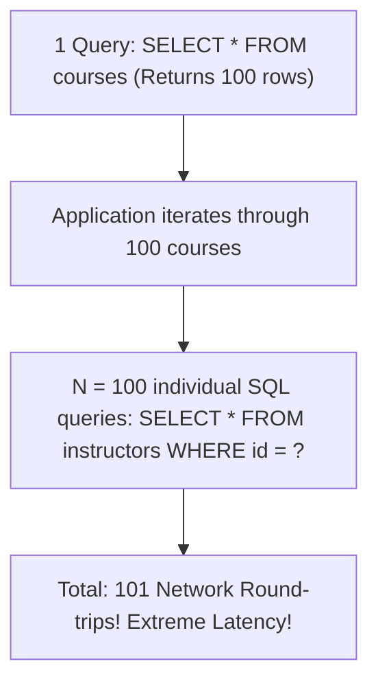

# The N+1 Query Problem & Remediation (JOIN FETCH, EntityGraphs)

> **Phase 10: Spring Boot, REST APIs & Data Persistence**  
> *Estimated Reading Time: 55 minutes | Total Practice Effort: ~4 hours | Tier: Core Essential*

---

## 1. Purpose & Prerequisites

### Why This Matters in Full Stack Development
In the world of Java full-stack engineering, the **N+1 Query Problem** is responsible for more production outages, slow dashboard loading screens, and database CPU spikes than any other ORM issue.

Here is what happens:
- A developer writes a simple endpoint to list 100 courses on an education dashboard.
- In local testing with 3 records, everything loads in 15 milliseconds.
- In production with 500 courses, the page takes **12 seconds to load**, spiking database connections and saturating the network!

Why? Because behind the scenes, Hibernate executed **1 initial query** followed by **500 secondary queries** across the network!

In this lesson, you will learn how to detect the N+1 problem in your logs and eliminate it completely using **JPQL `JOIN FETCH`**, **`@EntityGraph`**, and **Batch Fetching (`@BatchSize`)**.

### Prerequisites
- [Topic 7.4: SQL Joins](../07-sql/04-joins.md)
- [Topic 10.6: Spring Data JPA & Repositories](06-jpa-entities.md)
- [Topic 10.7: JPA Entity Relationships & Fetch Modes](07-relationships.md)

---

## 2. Plain-English Mental Model

```
[ The Inefficient Grocery Shopper (N+1 Queries) ]
- You have a recipe requiring 50 ingredients.
- Trip 1: You drive to the supermarket, buy a carton of milk, and drive home (Query 1).
- Trip 2: You drive to the supermarket, buy an onion, and drive home (Query 2).
- ... You repeat this 50 times!
- Total trips: 1 + 50 = 51 car trips. Insanely slow and wasteful!

[ The Smart Shopper (JOIN FETCH) ]
- You look at your full grocery list.
- You make ONE single trip to the supermarket.
- You put all 50 ingredients into your shopping cart at once and drive home in ONE trip!
- Total trips: 1 query. Lightning fast!
```

---

## 3. Anatomizing the N+1 Bug

Consider this standard relationship:
- Every `Course` has an `Instructor` (`@ManyToOne(fetch = FetchType.LAZY)`).

### The Innocent-Looking Service Code:
```java
@Transactional(readOnly = true)
public List<CourseSummaryDto> getAllCourseSummaries() {
    List<Course> courses = courseRepository.findAll(); // 1 QUERY EXECUTED!

    return courses.stream()
            .map(course -> new CourseSummaryDto(
                    course.getId(),
                    course.getTitle(),
                    course.getInstructor().getName() // ⚠️ DANGER ZONE!
            ))
            .toList();
}
```

### What Actually Happens in the Database Logs:
If `courseRepository.findAll()` returns **100 courses**:

```sql
-- 1. Initial Query (The "1" query)
SELECT id, title, instructor_id FROM courses;

-- 2. Then, inside the loop, course.getInstructor().getName() triggers secondary queries!
SELECT id, name FROM instructors WHERE id = 1;  -- Query 2
SELECT id, name FROM instructors WHERE id = 2;  -- Query 3
SELECT id, name FROM instructors WHERE id = 3;  -- Query 4
...
SELECT id, name FROM instructors WHERE id = 100; -- Query 101!
```



Even if each query takes only 2ms, $101 \times 2\text{ms} = 202\text{ms}$ of pure network latency, plus connection pool overhead! If there are 1,000 courses, the application executes **1,001 SQL queries**!

---

## 4. Remediation 1: JPQL `JOIN FETCH` (The Primary Solution)

The most robust way to solve N+1 in Spring Data JPA is writing a JPQL query with **`JOIN FETCH`**:

```java
@Repository
public interface CourseRepository extends JpaRepository<Course, Long> {

    // JOIN FETCH tells Hibernate: "Fetch courses AND instructors together in 1 SQL JOIN!"
    @Query("SELECT c FROM Course c JOIN FETCH c.instructor")
    List<Course> findAllWithInstructors();
}
```

### What Hibernate Executes in SQL:
```sql
SELECT c.id, c.title, c.instructor_id, i.id, i.name 
FROM courses c 
INNER JOIN instructors i ON c.instructor_id = i.id;
```

**Result:**  
- **Exactly 1 single SQL query** is sent over the network!
- Hibernate populates both `Course` and `Instructor` objects into memory simultaneously.
- When `course.getInstructor().getName()` is called, the data is already in memory. Zero secondary queries!

---

## 5. Remediation 2: Spring Data JPA `@EntityGraph`

If you want to keep Spring Data's auto-generated query methods without writing manual JPQL queries, use **`@EntityGraph`**:

```java
@Repository
public interface CourseRepository extends JpaRepository<Course, Long> {

    // Overrides LAZY loading declaratively for this specific method!
    @EntityGraph(attributePaths = {"instructor"})
    List<Course> findAll();

    // Can fetch multiple associations:
    @EntityGraph(attributePaths = {"instructor", "category"})
    List<Course> findByActiveTrue();
}
```

### Why `@EntityGraph` is Elegant:
- Declarative and clean.
- Uses `LEFT OUTER JOIN` under the hood.
- Leaves the entity mapping as `LAZY` globally, but selectively eagerly loads associations for specific endpoints!

---

## 6. Remediation 3: Batch Fetching (`@BatchSize`)

What if you have existing code across 30 repositories and cannot rewrite every query today?

You can enable **Hibernate Batch Fetching**:

### In `application.yml`:
```yaml
spring:
  jpa:
    properties:
      hibernate:
        default_batch_fetch_size: 50
```

### Or on a Specific Entity / Collection:
```java
@Entity
public class Course {
    @BatchSize(size = 50)
    @OneToMany(mappedBy = "course")
    private List<Lesson> lessons = new ArrayList<>();
}
```

### How Batch Fetching Works:
Instead of running 100 individual queries for instructors (`WHERE id = ?`), Hibernate batches the foreign key lookups using an **`IN` clause**:

```sql
SELECT * FROM instructors WHERE id IN (?, ?, ?, ?, ... up to 50);
```

**Result:** Reduces 100 secondary queries down to **2 queries**! It is a fantastic safety net for enterprise systems.

---

## 7. The MultipleBagFetchException (The Cartesian Product Trap)

A common mistake when developers discover `JOIN FETCH` is attempting to fetch two `@OneToMany` collections simultaneously:

```java
// DANGEROUS ATTEMPT:
@Query("SELECT c FROM Course c JOIN FETCH c.lessons JOIN FETCH c.reviews")
List<Course> findCourseWithLessonsAndReviews();
```

### What Happens:
Hibernate will throw:
`org.hibernate.loader.MultipleBagFetchException: cannot simultaneously fetch multiple bags: [c.lessons, c.reviews]`

### Why this happens (The Cartesian Product):
If a course has 10 lessons and 10 reviews, a SQL join of both tables produces:
$$10 \text{ lessons} \times 10 \text{ reviews} = 100 \text{ duplicate result rows per course!}$$
If you fetch 100 courses, the database returns **10,000 duplicate rows** over the wire, bloating RAM and creating duplicate records.

### The Solution:
Fetch one collection with `JOIN FETCH`, and fetch the other using `@BatchSize` or a separate query.

---

## 8. Detecting N+1 Queries in Development

To catch N+1 bugs before they reach production:

### 1. Enable SQL Logging in `application-dev.yml`:
```yaml
spring:
  jpa:
    show-sql: true
    properties:
      hibernate:
        format_sql: true
```
If you hit an API endpoint in your browser and see dozens of identical `SELECT` statements streaming across your terminal, you have an N+1 bug!

### 2. Assert Query Counts in Unit Tests (using `yannicel/quick-perf` or `datasource-proxy`):
```java
@Test
@ExpectSelect(1) // Test FAILS if more than 1 SQL query is executed!
void shouldFetchAllCoursesInSingleQuery() {
    courseService.getAllCourseSummaries();
}
```

---

## 9. Guided Hands-On Exercise

### The Scenario
You are auditing an e-commerce platform. When `GET /api/v1/orders` is called, the console prints:
```
Hibernate: select o1_0.id, o1_0.customer_id, o1_0.order_date from orders o1_0
Hibernate: select c1_0.id, c1_0.name, c1_0.email from customers c1_0 where c1_0.id=?
Hibernate: select c1_0.id, c1_0.name, c1_0.email from customers c1_0 where c1_0.id=?
Hibernate: select c1_0.id, c1_0.name, c1_0.email from customers c1_0 where c1_0.id=?
... (repeated 85 times)
```

### Your Challenge:
1. Explain why this N+1 bug is occurring.
2. Fix the repository query using **`JOIN FETCH`**.
3. Fix the repository query alternatively using **`@EntityGraph`**.

<details>
<summary>💡 Hint: Fetch customer association</summary>

```java
@Query("SELECT o FROM Order o JOIN FETCH o.customer")
List<Order> findAllWithCustomer();
```
</details>

<details>
<summary>✅ Solution</summary>

```java
package com.career.learning.order;

import org.springframework.data.jpa.repository.EntityGraph;
import org.springframework.data.jpa.repository.JpaRepository;
import org.springframework.data.jpa.repository.Query;
import org.springframework.stereotype.Repository;
import java.util.List;

@Repository
public interface OrderRepository extends JpaRepository<Order, Long> {

    // Fix Approach 1: JPQL JOIN FETCH
    @Query("SELECT o FROM Order o JOIN FETCH o.customer")
    List<Order> findAllOrdersWithCustomer();

    // Fix Approach 2: Declarative @EntityGraph
    @EntityGraph(attributePaths = {"customer"})
    @Query("SELECT o FROM Order o")
    List<Order> findAllOrdersWithCustomerGraph();
}
```
Both solutions execute **exactly 1 single SQL query with an INNER/LEFT JOIN**, eliminating the 85 secondary queries completely!
</details>

---

## 10. Knowledge Check & Interview Defense

### Quick Quiz
1. **What is the root cause of the N+1 query problem in JPA?**
   - [x] A) Loading a list of $N$ parent entities in 1 initial query, and then subsequently executing $N$ secondary queries across the network to fetch a related association for each parent inside a loop.
   - [ ] B) Adding too many indexes to a table.
   - [ ] C) Running queries on an 8-core CPU.
   - [ ] D) Forgetting to annotate primary keys with `@Id`.

2. **What is the difference between `JOIN` and `JOIN FETCH` in JPQL?**
   - [x] A) `JOIN` filters rows based on a relationship but does NOT populate the associated entity fields into memory; `JOIN FETCH` instructs Hibernate to eagerly load and populate the associated entities in the same result set.
   - [ ] B) `JOIN FETCH` only works on MySQL.
   - [ ] C) There is no difference.
   - [ ] D) `JOIN FETCH` deletes child records.

3. **Why does Hibernate throw `MultipleBagFetchException` when attempting to `JOIN FETCH` two `@OneToMany` list collections simultaneously?**
   - [x] A) Because joining two independent collection bags produces a Cartesian product of duplicate rows in SQL, which corrupts list indexing and consumes excessive memory.
   - [ ] B) Because MySQL allows only 1 join per query.
   - [ ] C) Because collections must be arrays.
   - [ ] D) Because Hibernate does not support lists.

---

### Junior Developer Interview Q&A

#### Q: "How do you detect and fix the N+1 query problem in a Spring Boot JPA application?"
> **Model Answer:**  
> "We detect the N+1 query problem in development by:
> 1. Enabling `spring.jpa.show-sql=true` and inspecting console logs for repeated sequential `SELECT ... WHERE id = ?` queries following an initial list query.
> 2. Using logging tools like `datasource-proxy` or automated test assertions (like QuickPerf) to assert that an endpoint executes exactly 1 query.
>
> We fix the N+1 problem through three primary remediation strategies:
> 1. **JPQL `JOIN FETCH`:** Explicitly writing `@Query("SELECT e FROM Entity e JOIN FETCH e.association")` to load parent and child in a single SQL query.
> 2. **`@EntityGraph`:** Annotating repository methods with `@EntityGraph(attributePaths = {"association"})` to override lazy loading per use case.
> 3. **Batch Fetching (`@BatchSize`):** Configuring `hibernate.default_batch_fetch_size: 50` so that any lazy relationship lookups are chunked into SQL `WHERE id IN (?, ?...)` queries, reducing $N$ roundtrips by up to 98%."

---

## 11. Mastery Checklist & Next Step

Before moving on, verify that you can:
- [ ] Diagram and explain how N+1 query cascades degrade API latency.
- [ ] Inspect console logs to identify repeating secondary `SELECT` statements.
- [ ] Remediate N+1 using JPQL `JOIN FETCH`.
- [ ] Remediate N+1 declaratively using `@EntityGraph(attributePaths = {...})`.
- [ ] Configure global batch fetching using `hibernate.default_batch_fetch_size`.
- [ ] Avoid Cartesian product crashes (`MultipleBagFetchException`).

👉 **Next Lesson:** **[Topic 10.9: Transaction Management in Spring: @Transactional & Propagation](09-transactional.md)**
