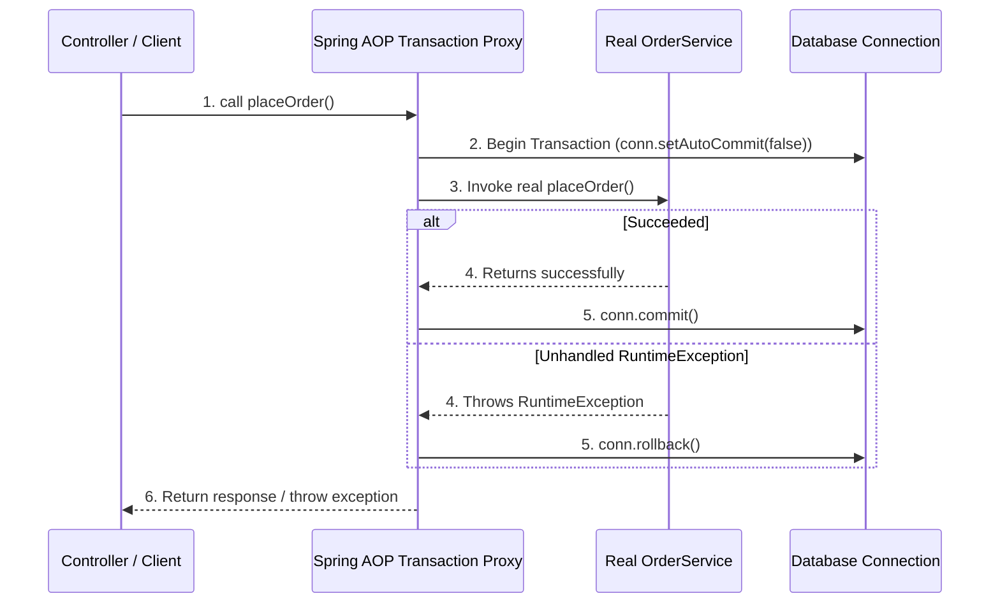
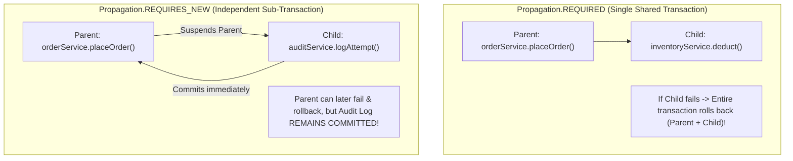

# Transaction Management in Spring: @Transactional & Propagation

> **Phase 10: Spring Boot, REST APIs & Data Persistence**  
> *Estimated Reading Time: 50 minutes | Total Practice Effort: ~3.5 hours | Tier: Core Essential*

---

## 1. Purpose & Prerequisites

### Why This Matters in Full Stack Development
In Phase 8, you wrote database transactions manually using raw JDBC:
`conn.setAutoCommit(false)`, `conn.commit()`, and `conn.rollback()` in a verbose `try-catch-finally` block.

In enterprise Spring applications, business operations frequently span **multiple repositories, services, and entities**:
When a student enrolls in a paid course:
1. Charge payment.
2. Create enrollment record.
3. Decrement available course seats.
4. Issue invoice.

Instead of cluttering business logic with low-level connection plumbing, Spring provides **Declarative Transaction Management** via the **`@Transactional`** annotation.

However, if you do not understand **Spring AOP Proxy semantics**, **checked exception rollback rules**, and **Transaction Propagation (`REQUIRED` vs `REQUIRES_NEW`)**, you will encounter silent data corruption, failed rollbacks, and connection starvation in production.

### Prerequisites
- [Topic 7.7: ACID Properties & Transaction Isolation Levels](../07-sql/07-acid-transactions.md)
- [Topic 8.5: Managing Transactions via JDBC](../08-jdbc/05-transactions.md)
- [Topic 10.2: Spring Core: IoC & Proxies](02-ioc-di.md)

---

## 2. Plain-English Mental Model

```
[ Spring @Transactional: The Bank Security Officer (The Proxy) ]
- You don't manage the vault doors yourself.
- When you invoke a method annotated with @Transactional, 
  you are not talking directly to your service class.
- You are talking to a Spring AOP Proxy (The Security Officer).
- The officer opens the vault (obtains a DB connection, disables auto-commit).
- You do your work.
- If you finish cleanly -> The officer locks the vault (COMMIT).
- If you drop an unhandled exception -> The officer sounds the alarm and shreds the papers (ROLLBACK)!
```

---

## 3. Under the Hood: Spring AOP Proxy Mechanics

When Spring detects `@Transactional` on a class or method, it wraps your bean inside a **Dynamic Proxy** (using CGLIB or JDK Dynamic Proxies):



---

## 4. The Deadly "Self-Invocation" Trap

Because `@Transactional` relies on Spring AOP proxies, **the method MUST be called from an external caller** for the proxy to intercept it!

### The Bug That Fooled Thousands of Developers:
```java
@Service
public class UserService {

    // NOT transactional
    public void registerUser(UserDto dto) {
        // ...
        this.saveWithAudit(dto); // ⚠️ FATAL BUG: Direct internal call on 'this'!
    }

    // Has @Transactional annotation
    @Transactional
    public void saveWithAudit(UserDto dto) {
        userRepository.save(new User(dto));
        auditRepository.save(new AuditLog("REGISTER", dto.email()));
        // If an exception throws here, IT WILL NOT ROLL BACK!
    }
}
```

### Why it Fails:
When `registerUser()` calls `this.saveWithAudit()`, it is executing directly on the **target Java instance**, completely bypassing the Spring AOP Proxy! The `@Transactional` annotation is **completely ignored**!

### The Solution:
1. Move `saveWithAudit()` to a separate Spring `@Service` component so it is called through its proxy.
2. Or annotate the outer calling method `registerUser()` with `@Transactional`.

---

## 5. Rollback Rules: The Checked Exception Pitfall

By default in Spring:
- Transactions **ROLLBACK** automatically on **`RuntimeException`** (unchecked) and **`Error`**.
- Transactions **DO NOT ROLLBACK** on **Checked Exceptions (`Exception`)**!

```java
// BUG ALERT!
@Transactional
public void processPayment() throws InsufficientBalanceException { // Checked Exception!
    accountRepository.debit(500);
    throw new InsufficientBalanceException(); 
    // SPRING WILL STILL COMMIT THE TRANSACTION! Money is deducted!
}
```

### The Industry Standard Fix: `rollbackFor`
Always configure `rollbackFor = Exception.class` on your `@Transactional` annotations:

```java
@Transactional(rollbackFor = Exception.class)
public void processPayment() throws InsufficientBalanceException {
    accountRepository.debit(500);
    throw new InsufficientBalanceException(); // NOW ROLLS BACK SAFELY!
}
```

---

## 6. Transaction Propagation Modes

What happens when Method A (which has a transaction) calls Method B (which also has a transaction)?

Spring provides **Transaction Propagation** settings:

```
@Transactional(propagation = Propagation.REQUIRED) // Default
```

| Propagation Mode | Behavior If Active Transaction Exists | Behavior If NO Transaction Exists | Typical Use Case |
| :--- | :--- | :--- | :--- |
| **`REQUIRED`** *(Default)* | **Joins** the existing transaction. | Creates a **new** transaction. | Standard business workflows (95% of use cases). |
| **`REQUIRES_NEW`** | **Suspends** active transaction; creates an independent physical transaction. | Creates a **new** transaction. | Audit logs, notification tracking, external payment logging that must persist even if parent fails! |
| **`SUPPORTS`** | Executes within transaction. | Executes non-transactionally. | Read-only helper methods. |
| **`NOT_SUPPORTED`** | **Suspends** active transaction; executes non-transactionally. | Executes non-transactionally. | Heavy non-DB computation or slow external HTTP calls. |
| **`MANDATORY`** | Executes within transaction. | **Throws Exception**! | Methods that strictly forbid being called outside a transaction. |
| **`NEVER`** | **Throws Exception**! | Executes non-transactionally. | Long-running background jobs that must not hold locks. |

---

## 7. Deep Dive: `REQUIRED` vs `REQUIRES_NEW`



### Real-World Example of `REQUIRES_NEW`:
When a user attempts an invalid login, you want to record the failed login attempt in `security_audit_logs`.  
If the parent authentication service rolls back because of bad credentials, you **still want the audit log record saved**!

```java
@Service
public class SecurityAuditService {

    // Runs in its own independent transaction!
    @Transactional(propagation = Propagation.REQUIRES_NEW)
    public void recordFailedAttempt(String username, String ipAddress) {
        auditRepository.save(new FailedLoginLog(username, ipAddress, LocalDateTime.now()));
    } // Commits immediately here!
}
```

---

## 8. Read-Only Optimization: `@Transactional(readOnly = true)`

For queries and search endpoints, always annotate with:
```java
@Transactional(readOnly = true)
public CourseDetailsDto getCourseDetails(Long id) { ... }
```

### Why `readOnly = true` is a Massive Performance Win:
1. **Disables Hibernate Dirty Checking:** Hibernate skips creating initial memory snapshots of entities, saving significant CPU cycles and JVM heap space!
2. **Database Engine Routing:** Cloud databases (like AWS Aurora or MySQL Read Replicas) can automatically route `readOnly` transactions to read-only replica instances, offloading traffic from the primary write master!
3. **Flushing Mode:** Sets flush mode to `FlushMode.MANUAL`, preventing accidental SQL update execution.

---

## 9. Common Rookie Mistakes & Anti-Patterns

### Anti-Pattern 1: Putting `@Transactional` on `private` Methods
Spring AOP proxies subclass your bean.  
Subclasses **cannot override private methods**!  
*Result:* Putting `@Transactional` on a private method compiles without error, but **has zero transactional effect**! Spring silently ignores it. Always put `@Transactional` on `public` methods.

### Anti-Pattern 2: Slow Network Calls Inside `@Transactional`
```java
@Transactional
public void processOrder(OrderDto dto) {
    orderRepository.save(order); // Holds DB connection lock!
    stripeClient.chargeCard();   // Takes 3.5 seconds over external internet!
    order.setStatus("PAID");
}
```
*Why this kills systems:* The database connection is checked out from HikariCP and held hostage for 3.5 seconds while waiting for Stripe. Under 50 concurrent requests, the connection pool exhausts and the entire backend crashes!  
*Rule:* **Never make external HTTP/REST API calls inside a `@Transactional` boundary.**

---

## 10. Guided Hands-On Exercise

### The Scenario
You are developing an e-commerce checkout service.  
When an order fails (e.g. `PaymentFailedException`), the order transaction must rollback.  
However, an audit event must be persisted to the database recording that the payment attempt failed.

### Your Challenge:
1. Implement `OrderService.checkout()` with standard `@Transactional`.
2. Implement `AuditService.logFailure()` using `Propagation.REQUIRES_NEW` so that when `checkout()` throws an exception and rolls back, the failure audit log remains committed in the database.

<details>
<summary>💡 Hint: Separate services with Propagation.REQUIRES_NEW</summary>

```java
@Service
public class AuditService {
    @Transactional(propagation = Propagation.REQUIRES_NEW)
    public void logFailure(Long orderId, String reason) { ... }
}
```
</details>

<details>
<summary>✅ Solution</summary>

```java
package com.career.learning.service;

import org.springframework.stereotype.Service;
import org.springframework.transaction.annotation.Propagation;
import org.springframework.transaction.annotation.Transactional;

@Service
public class AuditService {

    private final AuditRepository auditRepository;

    public AuditService(AuditRepository auditRepository) {
        this.auditRepository = auditRepository;
    }

    // REQUIRES_NEW guarantees an isolated transaction that commits independently!
    @Transactional(propagation = Propagation.REQUIRES_NEW)
    public void logFailure(Long orderId, String reason) {
        auditRepository.save(new AuditRecord("CHECKOUT_FAILURE", "Order: " + orderId + ", Reason: " + reason));
    }
}

@Service
public class OrderService {

    private final OrderRepository orderRepository;
    private final PaymentClient paymentClient;
    private final AuditService auditService;

    public OrderService(OrderRepository orderRepository, PaymentClient paymentClient, AuditService auditService) {
        this.orderRepository = orderRepository;
        this.paymentClient = paymentClient;
        this.auditService = auditService;
    }

    @Transactional(rollbackFor = Exception.class)
    public void checkout(Long orderId, String paymentToken) {
        Order order = orderRepository.findById(orderId).orElseThrow();
        order.setStatus("PROCESSING");

        try {
            paymentClient.charge(paymentToken, order.getTotal());
            order.setStatus("CONFIRMED");
        } catch (PaymentException ex) {
            // Log failure in separate physical transaction!
            auditService.logFailure(orderId, ex.getMessage());
            // Re-throw to trigger rollback of order status!
            throw ex;
        }
    }
}
```
</details>

---

## 11. Knowledge Check & Interview Defense

### Quick Quiz
1. **Why does calling a `@Transactional` method internally from within the same class (`this.method()`) fail to start a transaction?**
   - [x] A) Because internal calls bypass the Spring AOP dynamic proxy; transactions can only be intercepted when called from an external bean.
   - [ ] B) Java does not allow methods to call each other.
   - [ ] C) Spring only allows one method per class.
   - [ ] D) The database drops internal socket connections.

2. **By default, which types of exceptions trigger an automatic rollback in Spring's `@Transactional`?**
   - [x] A) `RuntimeException` (unchecked) and `Error` only; checked exceptions (`Exception`) do not trigger a rollback unless `rollbackFor` is specified.
   - [ ] B) All exceptions without exception.
   - [ ] C) Only `SQLException`.
   - [ ] D) None; rollbacks must always be called manually.

3. **What is the primary benefit of annotating read queries with `@Transactional(readOnly = true)`?**
   - [x] A) Hibernate disables Dirty Checking snapshots, significantly reducing memory consumption and CPU usage, and allows read traffic to route to read replicas.
   - [ ] B) It prevents users from viewing data.
   - [ ] C) It deletes temporary tables.
   - [ ] D) It runs queries in parallel threads.

---

### Junior Developer Interview Q&A

#### Q: "What is the difference between `Propagation.REQUIRED` and `Propagation.REQUIRES_NEW`?"
> **Model Answer:**  
> "The difference governs how transactions are bounded across multiple service method calls:
>
> 1. **`Propagation.REQUIRED` (Default):** If an active transaction already exists when the method is called, it **joins** that existing transaction. Both methods share the exact same physical database connection and transaction boundary. If either method encounters an unhandled exception, the **entire shared transaction rolls back**. If no transaction exists, it creates a new one.
>
> 2. **`Propagation.REQUIRES_NEW`:** It always executes in a **brand-new, completely independent physical transaction**. If an active transaction exists, Spring **suspends** the outer transaction, opens a second database connection, executes the inner method, and immediately commits (or rolls back) that inner transaction. Then it resumes the outer transaction.
>
> We use `REQUIRES_NEW` for operations that must be permanently saved regardless of whether the outer business process succeeds or fails, such as security audit logging, billing attempt records, or dead-letter queue emissions."

---

## 12. Mastery Checklist & Next Step

Before moving on, verify that you can:
- [ ] Diagram the Spring AOP proxy interception sequence for `@Transactional`.
- [ ] Explain and avoid the Self-Invocation Proxy trap.
- [ ] Configure `rollbackFor = Exception.class` to prevent checked exception commit bugs.
- [ ] Contrast `Propagation.REQUIRED` with `Propagation.REQUIRES_NEW`.
- [ ] Optimize read-only service methods using `@Transactional(readOnly = true)`.
- [ ] Keep slow external HTTP requests outside of database transaction boundaries.

👉 **Next Lesson:** **[Topic 10.10: Pagination, Dynamic Filtering & API Testing with MockMvc](10-pagination-testing.md)**
