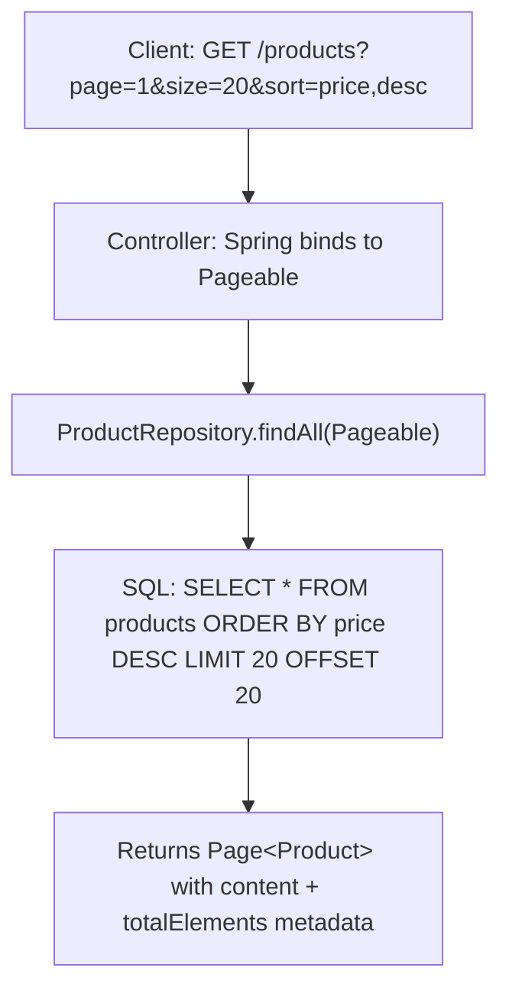

# Pagination, Dynamic Filtering & API Testing with MockMvc

> **Phase 10: Spring Boot, REST APIs & Data Persistence**  
> *Estimated Reading Time: 50 minutes | Total Practice Effort: ~3.5 hours | Tier: Core Essential*

---

## 1. Purpose & Prerequisites

### Why This Matters in Full Stack Development
In a production database with 2 million products or 50 million audit records:
- Executing `SELECT * FROM products` and returning all rows in a single HTTP response will **instantly crash your JVM with `OutOfMemoryError`**, saturate server bandwidth, and freeze the user's browser.
- Real-world frontends (React, mobile apps) display data in **paginated pages** (Page 1, 2, 3...) or **infinite scrolling feeds**.

Furthermore, how do you verify that your `@RestController` routes URLs correctly, parses query parameters, validates JSON payloads, and returns correct HTTP status codes without manually clicking buttons in Postman?

You use **Spring Data Pagination (`Pageable` & `Page<T>`)** and **Spring MockMvc Integration Testing**.

### Prerequisites
- [Topic 7.3: Filtering & Sorting in SQL](../07-sql/03-filtering-aggregations.md)
- [Topic 10.4: Building REST APIs: Controllers & DTOs](04-controllers.md)
- [Topic 10.5: Validation & Global Exception Handling](05-validation-advice.md)

---

## 2. Plain-English Mental Model

```
[ Unpaginated API: Pouring a Firehose into a Teacup ]
- You ask for products. The server dumps 1,000,000 records all at once.
- The user's phone runs out of memory and crashes.
- The database spent 10 seconds serializing data nobody will ever scroll to!

[ Spring Data Pageable: The 20-Card Rolodex ]
- You ask for: "Page 0, Size 20, Sorted by Price Descending".
- The database uses SQL LIMIT 20 OFFSET 0.
- It returns exactly 20 lightweight records in 3 milliseconds!

[ MockMvc: The Astronaut Flight Simulator ]
- To test if a cockpit works, you don't launch a multi-million-dollar rocket into orbit.
- You use a high-fidelity flight simulator that mimics the exact physics and controls.
- MockMvc simulates the complete Spring Web MVC HTTP pipeline (filters, serialization, validation) 
  without binding to a real physical network port!
```

---

## 3. Spring Data Pagination: `Pageable`, `Page<T>` vs `Slice<T>`

Spring Data provides first-class support for SQL pagination through the `org.springframework.data.domain.Pageable` interface:



### `Page<T>` vs `Slice<T>`: Which should you choose?

| Feature | `Page<T>` | `Slice<T>` |
| :--- | :--- | :--- |
| **Database Queries Executed** | **2 Queries:** 1 query for records (`LIMIT 20 OFFSET 0`) + 1 query for total count (`SELECT COUNT(*)`) | **1 Query:** Queries `LIMIT 21` (fetches $size + 1$ to check if next page exists) |
| **Total Count Available?** | ✅ Yes (`getTotalElements()`, `getTotalPages()`) | ❌ No (Only knows if `hasNext()` is true) |
| **Best UI Use Case** | Classic numbered pagination (`[1] [2] [3] ... [Last Page]`) | **Infinite Scroll / Mobile Feeds** (Instagram, Twitter, TikTok) |
| **Performance on Large Tables** | Slower on 10M+ rows because `SELECT COUNT(*)` requires a full index scan | **Ultra-fast!** Zero count queries. |

---

## 4. Implementing Pagination in Spring Boot

### 1. Repository:
```java
@Repository
public interface ProductRepository extends JpaRepository<Product, Long> {
    // Built-in JpaRepository already includes: Page<T> findAll(Pageable pageable);
    
    // Custom query with pagination:
    Page<Product> findByCategoryAndActiveTrue(String category, Pageable pageable);
}
```

### 2. Service Layer:
```java
@Service
public class ProductService {

    private final ProductRepository productRepository;

    public ProductService(ProductRepository productRepository) {
        this.productRepository = productRepository;
    }

    @Transactional(readOnly = true)
    public Page<ProductResponse> getProducts(String category, Pageable pageable) {
        Page<Product> productPage = (category != null && !category.isBlank())
                ? productRepository.findByCategoryAndActiveTrue(category, pageable)
                : productRepository.findAll(pageable);

        // Map entity page to DTO page preserving pagination metadata!
        return productPage.map(p -> new ProductResponse(p.getId(), p.getSku(), p.getTitle(), p.getPrice()));
    }
}
```

### 3. Controller Layer:
```java
@RestController
@RequestMapping("/api/v1/products")
public class ProductController {

    private final ProductService productService;

    public ProductController(ProductService productService) {
        this.productService = productService;
    }

    // Handles: GET /api/v1/products?page=0&size=20&sort=price,desc
    @GetMapping
    public ResponseEntity<Page<ProductResponse>> getProducts(
            @RequestParam(required = false) String category,
            @PageableDefault(page = 0, size = 20, sort = "createdAt", direction = Sort.Direction.DESC) Pageable pageable) {

        Page<ProductResponse> page = productService.getProducts(category, pageable);
        return ResponseEntity.ok(page);
    }
}
```

---

## 5. What the Client Receives (The JSON Page Contract)

```json
{
  "content": [
    { "id": 101, "sku": "KB-01", "title": "Wireless Keyboard", "price": 89.99 },
    { "id": 102, "sku": "MS-02", "title": "Ergonomic Mouse", "price": 49.99 }
  ],
  "pageable": {
    "pageNumber": 0,
    "pageSize": 20,
    "offset": 0
  },
  "totalElements": 154,
  "totalPages": 8,
  "last": false,
  "first": true,
  "size": 20,
  "number": 0,
  "numberOfElements": 2,
  "empty": false
}
```
The React frontend easily extracts `data.content` for rendering cards and `data.totalPages` for rendering pagination controls!

---

## 6. Integration Testing with MockMvc & `@WebMvcTest`

To test controllers thoroughly without booting a full, heavy server on a random network port, use **`@WebMvcTest`**:


### Features of `@WebMvcTest`:
1. **Lightweight & Fast:** Scans *only* the web layer (`@RestController`, `@ControllerAdvice`, filters). It does **not** load repositories or database connections!
2. **True HTTP Pipeline:** Tests URL mapping, JSON serialization, query parameter parsing, and `@Valid` request validation!

---

## 7. Complete Production MockMvc Test Example

```java
package com.career.learning.controller;

import com.career.learning.dto.CourseResponse;
import com.career.learning.service.CourseService;
import org.junit.jupiter.api.DisplayName;
import org.junit.jupiter.api.Test;
import org.springframework.beans.factory.annotation.Autowired;
import org.springframework.boot.test.autoconfigure.web.servlet.WebMvcTest;
import org.springframework.boot.test.mock.mockito.MockBean;
import org.springframework.data.domain.Page;
import org.springframework.data.domain.PageImpl;
import org.springframework.data.domain.PageRequest;
import org.springframework.http.MediaType;
import org.springframework.test.web.servlet.MockMvc;

import java.math.BigDecimal;
import java.util.List;

import static org.mockito.ArgumentMatchers.any;
import static org.mockito.Mockito.when;
import static org.springframework.test.web.servlet.request.MockMvcRequestBuilders.get;
import static org.springframework.test.web.servlet.result.MockMvcResultMatchers.*;

@WebMvcTest(CourseController.class) // Slices only CourseController web layer!
class CourseControllerTest {

    @Autowired
    private MockMvc mockMvc;

    @MockBean // Replaces real service with Mockito mock inside Spring web context
    private CourseService courseService;

    @Test
    @DisplayName("GET /api/v1/courses should return paginated list with HTTP 200")
    void shouldReturnPaginatedCourses() throws Exception {
        // GIVEN
        List<CourseResponse> courseList = List.of(
            new CourseResponse(1L, "Java Masterclass", "Complete Java roadmap", new BigDecimal("99.00")),
            new CourseResponse(2L, "Spring Boot Pro", "REST and Microservices", new BigDecimal("129.00"))
        );
        Page<CourseResponse> mockPage = new PageImpl<>(courseList, PageRequest.of(0, 10), 2);

        when(courseService.findAllCourses(any())).thenReturn(mockPage);

        // WHEN & THEN
        mockMvc.perform(get("/api/v1/courses")
                .param("page", "0")
                .param("size", "10")
                .param("sort", "title,asc")
                .contentType(MediaType.APPLICATION_JSON))
                // Verify HTTP Status
                .andExpect(status().isOk())
                // Verify Content-Type Header
                .andExpect(content().contentType(MediaType.APPLICATION_JSON))
                // Verify JSON Payload using JSONPath assertions!
                .andExpect(jsonPath("$.content.length()").value(2))
                .andExpect(jsonPath("$.content[0].id").value(1))
                .andExpect(jsonPath("$.content[0].title").value("Java Masterclass"))
                .andExpect(jsonPath("$.totalElements").value(2))
                .andExpect(jsonPath("$.totalPages").value(1))
                .andExpect(jsonPath("$.last").value(true));
    }

    @Test
    @DisplayName("GET /api/v1/courses/{id} should return 404 when course does not exist")
    void shouldReturn404WhenNotFound() throws Exception {
        when(courseService.findById(999L))
                .thenThrow(new ResourceNotFoundException("Course not found with id: 999"));

        mockMvc.perform(get("/api/v1/courses/999"))
                .andExpect(status().isNotFound())
                .andExpect(jsonPath("$.status").value(404))
                .andExpect(jsonPath("$.error").value("Not Found"));
    }
}
```

---

## 8. Common Rookie Mistakes & Anti-Patterns

### Trap 1: Zero-Based vs One-Based Page Indexing
In Spring Data, **page indexing is 0-based** (Page 0 is the first page!).  
Beginners often pass `page=1` expecting the first page, inadvertently skipping the first 20 records!  
*Tip:* To make Spring match 1-based frontend UI components, you can configure:
```yaml
spring:
  data:
    web:
      pageable:
        one-indexed-parameters: true
```

### Trap 2: In-Memory "Fake Pagination"
```java
// DISASTROUS ANTI-PATTERN!
List<User> allUsers = userRepository.findAll(); // Loads 1,000,000 users into JVM heap!
return allUsers.subList(0, 20); // Fakes pagination in memory!
```
*Why this is fatal:* You fetched all 1,000,000 rows across the network and allocated 500MB of JVM RAM just to display 20 items. Always pass `Pageable` directly into the database query!

---

## 9. Guided Hands-On Exercise

### The Scenario
You are testing a `POST /api/v1/users` endpoint.  
The DTO `UserCreateRequest` requires:
- `username`: `@NotBlank`
- `email`: `@Email`

### Your Challenge:
Write a MockMvc test verifying that sending a request with a malformed email returns **HTTP 400 Bad Request** and an error message on the `email` field.

<details>
<summary>💡 Hint: Use post() and jsonPath("$.validationErrors.email")</summary>

```java
mockMvc.perform(post("/api/v1/users")
    .contentType(MediaType.APPLICATION_JSON)
    .content("{\"username\": \"john\", \"email\": \"invalid-email\"}"))
    .andExpect(status().isBadRequest()) ...
```
</details>

<details>
<summary>✅ Solution</summary>

```java
@Test
@DisplayName("POST /api/v1/users should return 400 Bad Request when email format is invalid")
void shouldRejectInvalidEmailOnCreation() throws Exception {
    String invalidJsonPayload = """
        {
            "username": "sarah_connor",
            "email": "not-an-email-address"
        }
        """;

    mockMvc.perform(post("/api/v1/users")
            .contentType(MediaType.APPLICATION_JSON)
            .content(invalidJsonPayload))
            .andExpect(status().isBadRequest())
            .andExpect(jsonPath("$.status").value(400))
            .andExpect(jsonPath("$.error").value("Validation Failed"))
            .andExpect(jsonPath("$.validationErrors.email").exists());
}
```
</details>

---

## 10. Knowledge Check & Interview Defense

### Quick Quiz
1. **What is the performance advantage of `Slice<T>` over `Page<T>` in Spring Data JPA?**
   - [x] A) `Slice<T>` avoids executing the expensive `SELECT COUNT(*)` query, making it optimal for infinite scrolling feeds where total page count is not required.
   - [ ] B) `Slice<T>` compresses JSON responses with gzip.
   - [ ] C) `Slice<T>` stores data in browser local storage.
   - [ ] D) `Slice<T>` does not use SQL.

2. **What does the `@WebMvcTest` annotation do in Spring Boot?**
   - [x] A) It boots a lightweight sliced test context containing only Spring MVC web components (controllers, advice, filters), allowing fast controller testing with mocked service dependencies.
   - [ ] B) It starts a real embedded Tomcat server on port 8080.
   - [ ] C) It connects to a production MySQL database.
   - [ ] D) It runs browser automated clicks using Selenium.

3. **By default in Spring Data JPA, what index number represents the first page of results?**
   - [x] A) `0` (Zero-indexed).
   - [ ] B) `1`.
   - [ ] C) `-1`.
   - [ ] D) Determined by the database vendor.

---

### Junior Developer Interview Q&A

#### Q: "What is the difference between `@WebMvcTest` and `@SpringBootTest` when writing integration tests in Spring Boot?"
> **Model Answer:**  
> "The difference is one of **scope and execution speed**:
>
> 1. **`@WebMvcTest` (Sliced Web Test):** Focuses exclusively on the web controller layer. It starts only the Spring MVC infrastructure (`DispatcherServlet`, Jackson ObjectMapper, ControllerAdvice, security filters). It does **not** load repositories, databases, or application service beans. All service dependencies must be mocked with `@MockBean`. These tests execute in milliseconds and are ideal for verifying HTTP routing, request deserialization, validation errors, and JSON responses.
>
> 2. **`@SpringBootTest` (Full Integration Test):** Boots the **entire ApplicationContext** from the root `@SpringBootApplication`. It initializes real database connections (or in-memory H2/Testcontainers), repositories, services, and asynchronous event listeners. When used with `webEnvironment = WebEnvironment.RANDOM_PORT`, it launches a real embedded Tomcat server. These tests are much slower to execute, but they verify that all architectural layers work together seamlessly end-to-end."

---

## 11. Mastery Checklist & Next Step

Before moving on, verify that you can:
- [ ] Implement database-level pagination using Spring Data `Pageable` and `Page<T>`.
- [ ] Choose between `Page<T>` and `Slice<T>` based on UI requirements and database scale.
- [ ] Configure `@PageableDefault` with sort order and fallback page sizes.
- [ ] Write integration slice tests for controllers using `@WebMvcTest` and `MockMvc`.
- [ ] Assert status codes, headers, and JSON body properties using JSONPath expressions.

🎉 **Phase 10: Spring Boot, REST APIs & Data Persistence Complete!**  
👉 **Next Phase:** **[Topic 11.1: Spring Security Architecture & Filter Chain Demystified](../11-production/01-security-filter-chain.md)**
