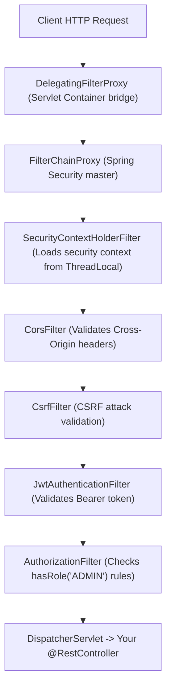

# Spring Security Architecture & Filter Chain Demystified

> **Phase 11: Production Engineering, Security & Docker**  
> *Estimated Reading Time: 55 minutes | Total Practice Effort: ~4 hours | Tier: Core Essential*

---

## 1. Purpose & Prerequisites

### Why This Matters in Full Stack Development
In any real-world production application:
- Some endpoints are **publicly accessible** (e.g. `POST /api/v1/auth/login`, `GET /api/v1/catalog`).
- Some endpoints require **authentication** (e.g. `GET /api/v1/user/profile`).
- Some endpoints require **elevated administrative privileges** (e.g. `DELETE /api/v1/admin/users/{id}`).

**Spring Security** is the de facto standard framework for securing Java enterprise applications.

However, for beginners, Spring Security is often seen as a confusing "black box." When a request returns an unexpected `401 Unauthorized` or `403 Forbidden`, developers struggle to diagnose why without understanding the underlying **Servlet Filter Chain**.

In this lesson, you will demystify Spring Security 6's architecture, understand the **SecurityFilterChain**, and learn modern, component-based security configuration.

### Prerequisites
- [Topic 10.1: Web Protocol Fundamentals & Status Codes](../10-spring/01-http-rest.md)
- [Topic 10.2: Spring Core: IoC & Configuration](../10-spring/02-ioc-di.md)
- [Topic 10.4: Building REST APIs: Controllers](../10-spring/04-controllers.md)

---

## 2. Plain-English Mental Model

```
[ Airport Security Checkpoints (The Filter Chain) ]
- You don't just walk straight from the parking lot onto an international airplane.
- You must pass through a strict sequence of checkpoints (Filters):
  1. Ticket Verification: Do you have a boarding pass?
  2. Identity Check: Is your passport valid and matching your name? (Authentication)
  3. Security Scan: Are you carrying unauthorized items?
  4. VIP / First-Class Lounge Entrance: Are you on the VIP guest list? (Authorization)
- If you fail ANY checkpoint, you are immediately turned away (401 or 403).
- Only when you pass ALL checkpoints do you reach your Departure Gate (Your @RestController)!
```

---

## 3. The Servlet Filter Architecture: How It Works

Spring Security operates at the **Jakarta Servlet Filter** level—*before* requests ever reach Spring MVC's `DispatcherServlet` or your `@RestController`:



1. **`DelegatingFilterProxy`:** A standard Servlet filter registered with Tomcat. It delegates all work to a Spring-managed bean named `FilterChainProxy`.
2. **`FilterChainProxy`:** Contains the list of security filters that inspect, authenticate, and authorize each incoming request.
3. **Short-Circuiting:** If a filter fails (e.g. invalid JWT token), it immediately writes a `401 Unauthorized` JSON response and halts the chain. The controller method is never invoked.

---

## 4. Authentication vs Authorization

Mixing up these two terms is the most common mistake in junior technical interviews:

```
[ Authentication (AuthN): "Who are you?" ]
- Verifying the identity of the user.
- Done via Passwords, JWT Tokens, OAuth2, or API Keys.
- Produces an Authentication object (Principal).
- Failure code: 401 Unauthorized.

[ Authorization (AuthZ): "What are you allowed to do?" ]
- Checking if the authenticated user has permission to access a specific resource.
- Done via Roles (ROLE_ADMIN) or Authorities (SCOPE_read).
- Failure code: 403 Forbidden.
```

---

## 5. Modern Spring Security 6 Configuration (No Deprecated Adapters!)

In legacy tutorials (Spring Boot 2 / Spring Security 5), developers extended `WebSecurityConfigurerAdapter`.  
**In Spring Boot 3 / Spring Security 6, `WebSecurityConfigurerAdapter` is completely removed!**

Modern Spring Security uses **pure component-based configuration** with the **Lambda DSL**:

```java
package com.career.learning.security;

import org.springframework.context.annotation.Bean;
import org.springframework.context.annotation.Configuration;
import org.springframework.http.HttpMethod;
import org.springframework.security.config.annotation.method.configuration.EnableMethodSecurity;
import org.springframework.security.config.annotation.web.builders.HttpSecurity;
import org.springframework.security.config.annotation.web.configuration.EnableWebSecurity;
import org.springframework.security.config.http.SessionCreationPolicy;
import org.springframework.security.web.SecurityFilterChain;
import org.springframework.security.web.authentication.UsernamePasswordAuthenticationFilter;

@Configuration
@EnableWebSecurity
@EnableMethodSecurity // Enables @PreAuthorize("hasRole('ADMIN')") on service methods!
public class SecurityConfig {

    private final JwtAuthenticationFilter jwtAuthFilter;

    public SecurityConfig(JwtAuthenticationFilter jwtAuthFilter) {
        this.jwtAuthFilter = jwtAuthFilter;
    }

    @Bean
    public SecurityFilterChain securityFilterChain(HttpSecurity http) throws Exception {
        http
            // 1. Disable CSRF for stateless REST APIs (since we use JWT tokens, not cookies!)
            .csrf(csrf -> csrf.disable())

            // 2. Configure Stateless Session Management (No HTTP Sessions in memory!)
            .sessionManagement(session -> session
                .sessionCreationPolicy(SessionCreationPolicy.STATELESS)
            )

            // 3. Define Endpoint Access Authorization Rules
            .authorizeHttpRequests(auth -> auth
                // Public endpoints (Auth, Swagger, Catalog)
                .requestMatchers("/api/v1/auth/**").permitAll()
                .requestMatchers(HttpMethod.GET, "/api/v1/courses/**").permitAll()

                // Role-restricted endpoints
                .requestMatchers("/api/v1/admin/**").hasRole("ADMIN")
                .requestMatchers(HttpMethod.DELETE, "/api/v1/**").hasRole("ADMIN")
                .requestMatchers("/api/v1/instructor/**").hasAnyRole("INSTRUCTOR", "ADMIN")

                // All other endpoints require authentication
                .anyRequest().authenticated()
            )

            // 4. Inject our custom JWT Authentication Filter before Spring's username/password filter!
            .addFilterBefore(jwtAuthFilter, UsernamePasswordAuthenticationFilter.class);

        return http.build();
    }
}
```

---

## 6. Understanding `hasRole()` vs `hasAuthority()`

Spring Security maintains a subtle naming convention between **Roles** and **Authorities**:

```java
// Under the hood:
// hasRole("ADMIN") checks for the authority: "ROLE_ADMIN"!
// hasAuthority("ADMIN") checks for the exact literal string: "ADMIN"!
```

- When you use `.hasRole("ADMIN")`, Spring automatically prepends the prefix **`ROLE_`**.
- When assigning roles to a user in your database or JWT claims, always format them as:  
  `new SimpleGrantedAuthority("ROLE_ADMIN")` or `new SimpleGrantedAuthority("ROLE_STUDENT")`.

---

## 7. The `SecurityContextHolder`

Once a user is successfully authenticated by a filter, Spring stores their identity in the **`SecurityContextHolder`**:

```java
// Under the hood: Backed by a ThreadLocal!
SecurityContextHolder.getContext().setAuthentication(authenticatedToken);
```

### Accessing the Currently Authenticated User in Controllers:
You can retrieve the logged-in user in any service or controller without querying the database again:

```java
@GetMapping("/api/v1/users/me")
public ResponseEntity<UserProfileDto> getCurrentUserProfile(
        @AuthenticationPrincipal UserDetails userDetails) {
    
    String currentUsername = userDetails.getUsername();
    UserProfileDto profile = userService.findByUsername(currentUsername);
    return ResponseEntity.ok(profile);
}
```

---

## 8. Common Rookie Mistakes & Traps

### Trap 1: Forgetting `SessionCreationPolicy.STATELESS`
If you build a JWT-based REST API but omit `SessionCreationPolicy.STATELESS`, Spring Security will create an in-memory HTTP Session cookie (`JSESSIONID`) on the first login. Subsequent requests might succeed using the cookie even if the JWT expired, masking critical auth bugs!

### Trap 2: Order of `requestMatchers()` Matters!
Spring Security evaluates authorization rules from **top to bottom**, stopping at the **first matching rule**:
```java
// FATAL FLAW:
.requestMatchers("/api/v1/**").permitAll()
.requestMatchers("/api/v1/admin/**").hasRole("ADMIN") // NEVER REACHED!
```
*Rule:* **Always place specific, restrictive rules first**, and broad wildcard rules last!

### Trap 3: Accidentally Checking for `ROLE_ROLE_ADMIN`
If your JWT claim has `"ROLE_ADMIN"` and you configure `.hasRole("ROLE_ADMIN")`, Spring checks for `"ROLE_ROLE_ADMIN"`, causing an immediate `403 Forbidden`!  
*Rule:* In `hasRole()`, omit the `ROLE_` prefix: `.hasRole("ADMIN")`.

---

## 9. Guided Hands-On Exercise

### The Scenario
You are securing a hospital patient records management system.  
Rules:
1. `POST /api/v1/auth/login` and `POST /api/v1/auth/register` are open to everyone (`permitAll`).
2. `GET /api/v1/patients/{id}/records` can be accessed by `DOCTOR` or `ADMIN`.
3. `POST /api/v1/admin/**` can be accessed ONLY by `ADMIN`.
4. All other endpoints require authentication.

### Your Challenge:
Write the `.authorizeHttpRequests(...)` configuration block satisfying these rules in the correct order.

<details>
<summary>💡 Hint: Restrictive paths first</summary>

```java
.requestMatchers("/api/v1/auth/**").permitAll()
.requestMatchers("/api/v1/admin/**").hasRole("ADMIN")
.requestMatchers(HttpMethod.GET, "/api/v1/patients/*/records").hasAnyRole("DOCTOR", "ADMIN")
.anyRequest().authenticated()
```
</details>

<details>
<summary>✅ Solution</summary>

```java
.authorizeHttpRequests(auth -> auth
    // 1. Public Authentication Routes
    .requestMatchers("/api/v1/auth/login", "/api/v1/auth/register").permitAll()

    // 2. Strict Administrative Routes
    .requestMatchers("/api/v1/admin/**").hasRole("ADMIN")

    // 3. Sensitive Doctor Patient Records
    .requestMatchers(HttpMethod.GET, "/api/v1/patients/*/records").hasAnyRole("DOCTOR", "ADMIN")

    // 4. Default Catch-All
    .anyRequest().authenticated()
)
```
</details>

---

## 10. Knowledge Check & Interview Defense

### Quick Quiz
1. **At what layer in the request lifecycle does Spring Security intercept incoming HTTP requests?**
   - [x] A) At the Servlet Filter layer (via `DelegatingFilterProxy` and `FilterChainProxy`), before requests reach the `DispatcherServlet` or `@RestController`.
   - [ ] B) Inside the database engine.
   - [ ] C) Inside the `@Service` constructor.
   - [ ] D) In browser JavaScript.

2. **What HTTP status code is returned when a user provides valid login credentials, but does not possess the required `ROLE_ADMIN` role to access an endpoint?**
   - [x] A) `403 Forbidden`.
   - [ ] B) `401 Unauthorized`.
   - [ ] C) `404 Not Found`.
   - [ ] D) `500 Server Error`.

3. **When you write `.hasRole("MANAGER")` in Spring Security, what authority string does Spring evaluate internally?**
   - [x] A) `ROLE_MANAGER` (Spring automatically prepends the `ROLE_` prefix).
   - [ ] B) `MANAGER`.
   - [ ] C) `AUTHORITY_MANAGER`.
   - [ ] D) `USER_MANAGER`.

---

### Junior Developer Interview Q&A

#### Q: "Why do we disable CSRF (`csrf.disable()`) in stateless REST APIs using JWT authentication?"
> **Model Answer:**  
> "**Cross-Site Request Forgery (CSRF)** is an attack vector that exploits browser-managed credentials—specifically **session cookies (`JSESSIONID`)** that the browser automatically attaches to every outgoing cross-origin request.
>
> In modern stateless REST APIs using **JWT Bearer Token authentication**, tokens are not stored in automatic ambient browser cookies; they are typically stored in application memory and manually attached to the `Authorization: Bearer <token>` HTTP header by the client (such as an Axios or Fetch interceptor).
>
> Because malicious cross-origin third-party websites have no way to access or automatically attach custom `Authorization` headers, CSRF attacks are fundamentally impossible against header-based stateless APIs. Disabling CSRF eliminates unnecessary overhead and prevents false-positive request rejections on POST, PUT, and DELETE operations."

---

## 11. Mastery Checklist & Next Step

Before moving on, verify that you can:
- [ ] Diagram the Servlet `SecurityFilterChain` architecture from Tomcat to Controller.
- [ ] Contrast Authentication (401) with Authorization (403).
- [ ] Configure Spring Security 6 using component-based `SecurityFilterChain` beans.
- [ ] Differentiate between `hasRole()` (`ROLE_` prefix) and `hasAuthority()`.
- [ ] Retrieve the current authenticated user via `SecurityContextHolder` and `@AuthenticationPrincipal`.

👉 **Next Lesson:** **[Topic 11.2: Password Hashing with BCrypt, Salting & Brute-Force Defense](02-password-hashing.md)**
