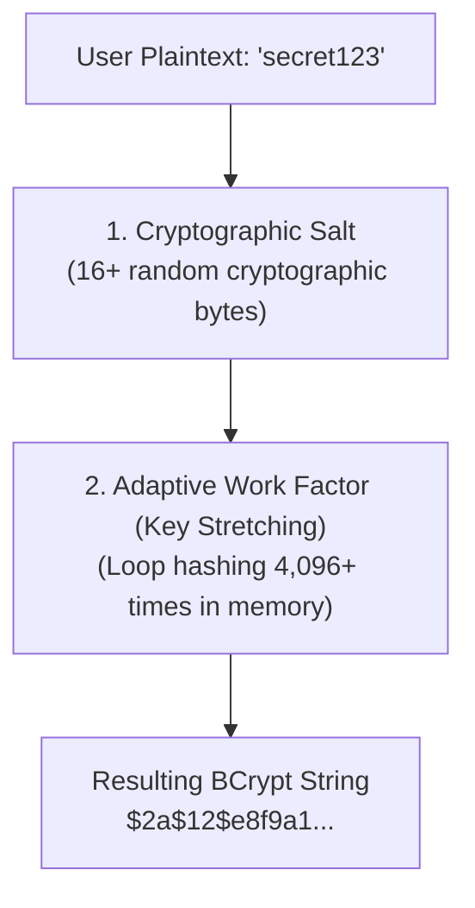

# Password Hashing with BCrypt, Salting & Brute-Force Defense

> **Phase 11: Production Engineering, Security & Docker**  
> *Estimated Reading Time: 40 minutes | Total Practice Effort: ~2.5 hours | Tier: Core Essential*

---

## 1. Purpose & Prerequisites

### Why This Matters in Full Stack Development
In modern cybersecurity, you must assume a **"Zero Trust"** posture:  
Assume that at some point, a malicious actor might obtain a read-only dump of your SQL database through a SQL injection, an unencrypted backup, or a compromised employee laptop.

If passwords in that database are stored in:
- **Plaintext:** You will face catastrophic liability, lawsuits, regulatory fines (GDPR, CCPA), and immediate public disgrace.
- **Fast Hashes (MD5 or SHA-256):** An attacker with a modern \$1,500 gaming GPU (NVIDIA RTX 4090) can test **billions of passwords per second**, cracking 90% of user accounts within minutes!

In this lesson, you will master **Cryptographic One-Way Hashing**, **Salting**, and **BCrypt's Adaptive Work Factor**.

### Prerequisites
- [Topic 1.3: Operators & Expressions](../01-foundations/03-operators.md)
- [Topic 11.1: Spring Security Architecture](01-security-filter-chain.md)

---

## 2. Plain-English Mental Model

```
[ Encryption vs Hashing ]
- Encryption (Two-Way): A Lockable Safe.
  You lock a secret with a key; anyone with the key can unlock it and read the original text.
- Hashing (One-Way): A Kitchen Blender.
  You toss strawberries, milk, and protein powder into a blender.
  You get a pink smoothie (The Hash).
  No chemist on Earth can run the blender in reverse to turn the smoothie back into whole strawberries!

[ The Slowness of BCrypt: The Heavy Bank Vault Door ]
- MD5/SHA-256 is like a flimsy screen door. You can kick it open 100,000 times a second.
- BCrypt is a 5-ton bank vault door with heavy gears.
- Turning the gears takes 100 milliseconds.
- A legitimate user logging in doesn't notice a 100ms delay.
- An attacker trying 10 billion password guesses is stopped dead in their tracks!
```

---

## 3. Why Fast Hashes (MD5, SHA-1, SHA-256) Fail for Passwords

Algorithms like **MD5**, **SHA-1**, and **SHA-256** were designed for **speed**: to calculate checksums of 10-gigabyte ISO files or verify network packet integrity in microseconds.

Because they are fast:
1. **GPU Acceleration:** Modern GPUs calculate **15 billion SHA-256 hashes per second**.
2. **Rainbow Tables:** Attackers have pre-computed dictionary tables containing every 8-character password permutation matched to its SHA-256 hash. Cracking a stolen hash takes $O(1)$ constant time lookup!

---

## 4. The Two Defenses: Salting & Adaptive Work Factors

To securely store passwords, an algorithm must provide two properties:



### 1. Cryptographic Salt
A **Salt** is a sequence of cryptographically random bytes generated uniquely for every single user:
- If Alice and Bob both choose the password `"Password123!"`, their salts are completely different.
- Consequently, their stored hashes look completely different in the database!
- **Defeats Rainbow Tables:** Attackers cannot use pre-computed lookup tables because the salt modifies the input space.

### 2. Adaptive Work Factor (Cost Factor)
BCrypt includes a tunable **Cost Factor** (typically $10$ to $12$):
$$\text{Iterations} = 2^{\text{cost}}$$
- At Cost 10: $2^{10} = 1,024$ internal rounds of key expansion.
- At Cost 12: $2^{12} = 4,096$ internal rounds.
- As computer hardware gets faster in the future, developers can simply bump the cost factor to 13 or 14 to keep cracking economically impossible, without changing the database schema!

---

## 5. Deconstructing a BCrypt Hash String

When BCrypt generates a hash, it outputs a standardized 60-character string:

```
$2a$12$N9qo8uLOickgx2ZMRZoMyeIjZAgcfl7p92ldGxad68LJZdL17lhWy
--- -- ---------------------- -------------------------------
 |   |           |                           |
 1   2           3                           4
```

1. **`$2a$`**: Algorithm identifier (BCrypt format version).
2. **`12`**: Cost / Work Factor ($2^{12} = 4,096$ rounds).
3. **`N9qo8uLOickgx2ZMRZoMye`**: The **22-character Salt** (embedded directly into the string!).
4. **`IjZAgcfl7p92ldGxad68LJZdL17lhWy`**: The **31-character Checksum Hash**.

> **Crucial Discovery:**  
> Beginners often ask: *"Where do I store the salt in MySQL? Do I need a `salt` column?"*  
> **NO!** BCrypt automatically embeds the salt directly into the first 29 characters of the output string!

---

## 6. Implementing `BCryptPasswordEncoder` in Spring

### 1. Register the Bean in `@Configuration`:
```java
package com.career.learning.config;

import org.springframework.context.annotation.Bean;
import org.springframework.context.annotation.Configuration;
import org.springframework.security.crypto.bcrypt.BCryptPasswordEncoder;
import org.springframework.security.crypto.password.PasswordEncoder;

@Configuration
public class SecurityBeansConfig {

    @Bean
    public PasswordEncoder passwordEncoder() {
        // Cost factor 12 (Optimal balance between security and server throughput)
        return new BCryptPasswordEncoder(12);
    }
}
```

---

### 2. Password Registration & Verification in Service:
```java
package com.career.learning.service;

import com.career.learning.entity.User;
import com.career.learning.repository.UserRepository;
import org.springframework.security.crypto.password.PasswordEncoder;
import org.springframework.stereotype.Service;
import org.springframework.transaction.annotation.Transactional;

@Service
public class AuthenticationService {

    private final UserRepository userRepository;
    private final PasswordEncoder passwordEncoder;

    public AuthenticationService(UserRepository userRepository, PasswordEncoder passwordEncoder) {
        this.userRepository = userRepository;
        this.passwordEncoder = passwordEncoder;
    }

    // 1. REGISTRATION: Hash the password before saving!
    @Transactional
    public void registerUser(String email, String rawPassword) {
        // passwordEncoder.encode() automatically generates a fresh random salt!
        String passwordHash = passwordEncoder.encode(rawPassword);

        User user = new User(email, passwordHash);
        userRepository.save(user);
    }

    // 2. LOGIN: Verify the password using matches()!
    @Transactional(readOnly = true)
    public boolean verifyLogin(String email, String rawPasswordAttempt) {
        User user = userRepository.findByEmail(email)
                .orElseThrow(() -> new IllegalArgumentException("Invalid credentials"));

        // CRITICAL: NEVER re-encode and compare using equals()!
        // Always use passwordEncoder.matches()!
        boolean passwordsMatch = passwordEncoder.matches(rawPasswordAttempt, user.getPasswordHash());

        return passwordsMatch;
    }
}
```

---

## 7. How `passwordEncoder.matches()` Works Under the Hood

Why can't you just write `newHash.equals(storedHash)`?

Because calling `passwordEncoder.encode(password)` generates a **brand-new random salt every time**! If you encode the same password twice, you get two completely different strings.

### How `matches()` verifies without a separate salt column:
1. `matches(rawAttempt, storedHash)` extracts the **salt** and **cost factor** directly from the first 29 characters of `storedHash`.
2. It hashes `rawAttempt` using that **extracted salt**.
3. It performs a **Constant-Time Comparison** (`MessageDigest.isEqual`) between the generated hash and the stored hash to prevent **Timing Attacks**!

---

## 8. Common Rookie Mistakes & Anti-Patterns

### Anti-Pattern 1: The `equals()` Comparison Bug
```java
// FATAL BUG: WILL ALWAYS RETURN FALSE!
String attemptHash = passwordEncoder.encode(rawAttempt); // Uses NEW random salt!
if (attemptHash.equals(user.getPasswordHash())) { ... } // NEVER MATCHES!
```
*Rule:* Always use `passwordEncoder.matches(rawAttempt, user.getPasswordHash())`.

### Anti-Pattern 2: Insufficient Column Length in Database
In your MySQL schema:
```sql
-- WRONG: BCrypt hash is 60 characters long!
password_hash VARCHAR(30) -- TRUNCATES HASH! USER CAN NEVER LOG IN!

-- CORRECT:
password_hash VARCHAR(100) NOT NULL
```

### Anti-Pattern 3: Setting Cost Factor Too High
Setting `new BCryptPasswordEncoder(18)`.  
$2^{18} = 262,144$ rounds!  
*Result:* Each password check consumes **3 seconds of 100% CPU time**. A small influx of 20 simultaneous logins will freeze your entire production server! Keep cost factor between **10 and 12**.

---

## 9. Guided Hands-On Exercise

### The Scenario
You are writing a unit test verifying password security:
1. Two registrations with the exact same raw password `"P@ssword123"` must produce different hash strings.
2. The correct raw password must match both hashes using `encoder.matches()`.
3. An incorrect password must return `false`.

### Your Challenge:
Write a JUnit 5 test using `BCryptPasswordEncoder` asserting these properties.

<details>
<summary>💡 Hint: Assert not equals on hashes, but matches() true on both</summary>

```java
String hash1 = encoder.encode(password);
String hash2 = encoder.encode(password);
assertNotEquals(hash1, hash2);
assertTrue(encoder.matches(password, hash1));
```
</details>

<details>
<summary>✅ Solution</summary>

```java
package com.career.learning.security;

import org.junit.jupiter.api.DisplayName;
import org.junit.jupiter.api.Test;
import org.springframework.security.crypto.bcrypt.BCryptPasswordEncoder;
import org.springframework.security.crypto.password.PasswordEncoder;

import static org.junit.jupiter.api.Assertions.*;

class PasswordSecurityTest {

    private final PasswordEncoder encoder = new BCryptPasswordEncoder(10);

    @Test
    @DisplayName("Identical passwords must produce distinct salted hashes, but verify successfully")
    void shouldProduceDistinctSaltsAndMatchCorrectly() {
        String rawPassword = "SuperSecretPassword#2026";

        // Hash the identical password twice
        String hash1 = encoder.encode(rawPassword);
        String hash2 = encoder.encode(rawPassword);

        // 1. Hashes must NOT be identical (proves unique cryptographic salting!)
        assertNotEquals(hash1, hash2, "BCrypt must generate a unique salt for every invocation");

        // 2. Both hashes must be exactly 60 characters
        assertEquals(60, hash1.length());
        assertEquals(60, hash2.length());

        // 3. Both hashes must verify true against the original password
        assertTrue(encoder.matches(rawPassword, hash1));
        assertTrue(encoder.matches(rawPassword, hash2));

        // 4. Incorrect password must be rejected
        assertFalse(encoder.matches("WrongPassword", hash1));
    }
}
```
</details>

---

## 10. Knowledge Check & Interview Defense

### Quick Quiz
1. **Why is SHA-256 unsuitable for storing user passwords compared to BCrypt?**
   - [x] A) SHA-256 is designed to be extremely fast; modern GPUs can compute billions of SHA-256 hashes per second, making brute-force cracking trivial. BCrypt is slow by design with an adaptive work factor.
   - [ ] B) SHA-256 is an encryption algorithm, not a hash.
   - [ ] C) SHA-256 cannot be stored in SQL.
   - [ ] D) Spring does not support SHA-256.

2. **Where is the random salt stored when using BCrypt in Spring Security?**
   - [x] A) It is embedded directly in the first 29 characters of the generated 60-character hash string.
   - [ ] B) In a separate `salt` column in the database.
   - [ ] C) In an external Redis cache.
   - [ ] D) In browser local storage.

3. **Why should you never write `newHash.equals(storedHash)` to verify a user password with BCrypt?**
   - [x] A) Calling `encode()` generates a brand-new random salt every time, so the resulting string will never equal the previously stored hash. You must use `passwordEncoder.matches()`.
   - [ ] B) Strings in Java do not support `.equals()`.
   - [ ] C) It triggers a `NullPointerException`.
   - [ ] D) The database locks the record.

---

### Junior Developer Interview Q&A

#### Q: "What is a 'Timing Attack' in password verification and how does Spring Security protect against it?"
> **Model Answer:**  
> "A **Timing Attack** is a side-channel attack where an attacker measures the microsecond or nanosecond response time of the server to deduce information about secrets.
>
> In standard string comparison (`String.equals()`), the equality check stops immediately (**short-circuits**) at the very first character that does not match. If the attacker's guess matches the first 5 characters, the check takes slightly longer than if it failed on character 1. By sending millions of requests and measuring latency distributions, an attacker can determine secrets character by character.
>
> Spring Security's `PasswordEncoder` defends against timing attacks by using **Constant-Time Comparison** (`MessageDigest.isEqual()`). It iterates through all bytes in the hash regardless of where a mismatch occurs, ensuring that every comparison takes the exact same amount of time and leaking zero information to latency analyzers."

---

## 11. Mastery Checklist & Next Step

Before moving on, verify that you can:
- [ ] Contrast two-way Encryption with one-way Cryptographic Hashing.
- [ ] Explain why fast hashing algorithms (MD5, SHA-256) are dangerous for passwords.
- [ ] Deconstruct the four components of a 60-character BCrypt hash string.
- [ ] Configure `BCryptPasswordEncoder` as a Spring `@Bean`.
- [ ] Use `passwordEncoder.matches()` to verify passwords and explain constant-time comparison.

👉 **Next Lesson:** **[Topic 11.3: Stateless API Security: JWT Authentication, Claims & Bearer Auth](03-jwt-auth.md)**
