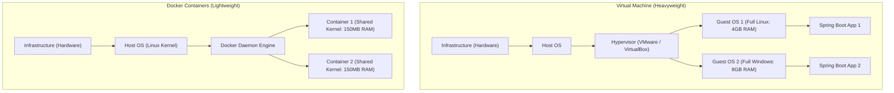

# Docker Basics: Writing Dockerfiles & Multi-Stage JRE Builds

> **Phase 11: Production Engineering, Security & Docker**  
> *Estimated Reading Time: 50 minutes | Total Practice Effort: ~3.5 hours | Tier: Core Essential*

---

## 1. Purpose & Prerequisites

### Why This Matters in Full Stack Development
Every developer has experienced this frustrating scenario:
- *"The Spring Boot backend works perfectly on my MacBook!"*
- But when deployed to the Linux cloud server, it crashes:
  - Wrong Java version installed (Java 11 instead of Java 21).
  - Missing native libraries or timezone configuration.
  - Windows file path separators (`\`) breaking on Linux (`/`).

**Docker** solves the age-old *"It works on my machine!"* problem forever.

By packaging your Spring Boot application into a **Docker Container**, you bundle your application code, runtime dependencies, Java Virtual Machine, and Linux system libraries into a single **immutable, portable artifact** that runs identically on any laptop, server, or cloud provider.

### Prerequisites
- [Topic 1.1: Setup & Anatomy of a Java Program](../01-foundations/01-setup-anatomy.md)
- [Topic 3.3: Maven Build Lifecycles & JAR packaging](../03-core/03-maven.md)
- [Topic 10.3: Spring Boot Auto-Configuration](../10-spring/03-autoconfig.md)

---

## 2. Plain-English Mental Model

```
[ Traditional Deployment: Moving Houses with Loose Items ]
- You throw your mattress, plates, lamps, and spices into the back of an open pickup truck.
- By the time you arrive at your new house in the rain, plates are broken and mattresses are soaked!

[ Docker Containerization: The Standard Intermodal Shipping Container ]
- In global commerce, cargo ships don't care if you are shipping bananas, cars, or pianos.
- Everything is packed into a standard 40-foot steel container.
- Any crane can lift it. Any train, truck, or ship can carry it anywhere on Earth.
- A Docker Container is a standardized steel container for your software!
```

---

## 3. Virtual Machines vs Docker Containers



| Feature | Virtual Machines (VMs) | Docker Containers |
| :--- | :--- | :--- |
| **Operating System** | Bundles a full, independent Guest OS. | Shares the **Host OS Kernel**; bundles only user-space binaries. |
| **Startup Time** | Minutes (Booting complete operating system). | **Sub-second** (Launching an isolated OS process). |
| **Resource Overhead** | Gigabytes of RAM and disk per VM. | **Megabytes** of RAM and disk. |
| **Density** | Can run 5-10 VMs on a server. | Can run **hundreds of containers** on the same server! |

---

## 4. Images vs Containers

- **Docker Image:** An immutable, read-only snapshot containing your application code, JRE, and configuration. Think of it as the **Class** in Java.
- **Docker Container:** A live, running instance of an image. Think of it as an **Object instance** created with `new Image()`.

---

## 5. The Naive Dockerfile vs The Production Multi-Stage Build

### ❌ The Naive (Bloated) Dockerfile (Anti-Pattern):
```dockerfile
# BAD: Uses a massive full JDK with Maven installed!
FROM maven:3.9.6-eclipse-temurin-21
WORKDIR /app
COPY . .
RUN mvn clean package -DskipTests
CMD ["java", "-jar", "target/learning-api.jar"]
```
*Why this is terrible:*  
The resulting Docker image is **over 900 Megabytes**! It contains the Maven compiler, build tools, source code, and git metadata that have no business being on a production server. It is slow to download and creates a massive security attack surface.

---

### ✅ The Production Multi-Stage Dockerfile (Industry Standard):
A **Multi-Stage Build** uses two distinct stages:
1. **Stage 1 (Builder):** Uses a heavy image with Maven and the full JDK to compile the Java source code into a `.jar` file.
2. **Stage 2 (Runtime):** Uses a minimal, hardened JRE (Java Runtime Environment) image on Alpine Linux. It copies **only the compiled `.jar` file** from Stage 1, discarding all compilers and source code!

```dockerfile
# ==========================================
# STAGE 1: Build & Compile the Application
# ==========================================
FROM maven:3.9.6-eclipse-temurin-21-alpine AS builder

WORKDIR /build

# Copy only pom.xml first to take advantage of Docker layer caching!
COPY pom.xml .
# Download dependencies in a separate layer (cached unless pom.xml changes!)
RUN mvn dependency:go-offline -B

# Copy application source code
COPY src ./src

# Compile and package application (skip unit tests for fast image packaging)
RUN mvn clean package -DskipTests

# ==========================================
# STAGE 2: Minimal Production JRE Runtime
# ==========================================
FROM eclipse-temurin:21-jre-alpine

WORKDIR /app

# Security Best Practice: Never run containers as the 'root' user!
RUN addgroup -S appgroup && adduser -S appuser -G appgroup
USER appuser

# Copy ONLY the final compiled JAR from the builder stage
COPY --from=builder /build/target/*.jar app.jar

# Expose standard Spring Boot HTTP port
EXPOSE 8080

# Configure production JVM memory flags and launch application
ENTRYPOINT ["java", "-XX:+UseG1GC", "-XX:MaxRAMPercentage=75.0", "-jar", "app.jar"]
```

**The Result:**  
- The final image size drops from 900MB to **under 140MB**!
- Lightning-fast deployment and zero build tools left in production.

---

## 6. The `.dockerignore` File

Just like `.gitignore`, you must always place a `.dockerignore` file in the root directory to prevent huge local build artifacts and secrets from being copied into the Docker daemon:

```
target/
.git/
.gitignore
.idea/
*.iml
*.log
node_modules/
.env
```

---

## 7. Essential Docker CLI Commands

### 1. Build the Docker Image:
```bash
# -t sets the image name and tag. The dot '.' specifies current directory
docker build -t career-learning-api:1.0 .
```

### 2. Run the Container:
```bash
# -d: Run in background (detached mode)
# -p 8080:8080: Map host port 8080 to container port 8080
# --name: Assign a human-readable container name
docker run -d -p 8080:8080 --name backend-service career-learning-api:1.0
```

### 3. Inspect and Monitor:
```bash
# List active running containers
docker ps

# Follow live container logs in real time
docker logs -f backend-service

# Inspect live container CPU and Memory usage
docker stats backend-service
```

### 4. Stop and Clean Up:
```bash
# Gracefully stop the container
docker stop backend-service

# Remove the container
docker rm backend-service

# Remove the image
docker rmi career-learning-api:1.0
```

---

## 8. Common Rookie Mistakes & Anti-Patterns

### Anti-Pattern 1: Running as the `root` User
By default, Docker containers run commands as the root user. If an attacker discovers a Remote Code Execution (RCE) vulnerability in a dependency (like Log4Shell), they gain root privileges inside the container!  
*Fix:* Always create and switch to a non-root user: `USER appuser`.

### Anti-Pattern 2: Forgetting Port Mapping (`-p host:container`)
A developer starts the container with `docker run backend-api` and cannot understand why `http://localhost:8080` fails in their browser.  
Containers run on isolated private bridge networks. You must explicitly publish ports: `-p 8080:8080`.

### Anti-Pattern 3: Hardcoding JVM `-Xmx` Limits
Setting `-Xmx512m` in the Dockerfile. If you deploy the container to an AWS ECS task with 2GB of RAM, Java will still only use 512MB!  
*Fix:* Use container-aware flags: `-XX:MaxRAMPercentage=75.0`. The JVM automatically computes 75% of whatever RAM is allocated to the container!

---

## 9. Guided Hands-On Exercise

### The Scenario
You need to containerize a Spring Boot microservice.  
Requirements:
1. Multi-stage build (Builder stage compiles source, Runtime stage runs minimal JRE).
2. Runtime base image: `eclipse-temurin:21-jre-alpine`.
3. Run as non-root user `spring`.
4. Expose port `8080`.

### Your Challenge:
Write the complete production `Dockerfile`.

<details>
<summary>💡 Hint: Use AS builder and COPY --from=builder</summary>

```dockerfile
FROM maven:... AS builder
...
FROM eclipse-temurin:21-jre-alpine
RUN adduser ...
USER spring
COPY --from=builder ...
```
</details>

<details>
<summary>✅ Solution</summary>

```dockerfile
# Stage 1: Build
FROM maven:3.9.6-eclipse-temurin-21-alpine AS builder
WORKDIR /workspace
COPY pom.xml .
RUN mvn dependency:go-offline -B
COPY src ./src
RUN mvn package -DskipTests

# Stage 2: Minimal Runtime
FROM eclipse-temurin:21-jre-alpine
WORKDIR /app

RUN addgroup -S spring && adduser -S spring -G spring
USER spring

COPY --from=builder /workspace/target/*.jar application.jar

EXPOSE 8080
ENTRYPOINT ["java", "-XX:MaxRAMPercentage=75.0", "-jar", "application.jar"]
```
</details>

---

## 10. Knowledge Check & Interview Defense

### Quick Quiz
1. **What is the primary architectural benefit of a Docker Multi-Stage Build?**
   - [x] A) It separates the heavy build environment (Maven, compilers, source code) from the runtime environment, resulting in lightweight, secure production images containing only the compiled JAR and minimal JRE.
   - [ ] B) It compiles Java code directly into C++ binaries.
   - [ ] C) It connects to MySQL automatically.
   - [ ] D) It runs unit tests in parallel across 10 machines.

2. **In the Docker run command `docker run -d -p 3000:8080 my-app`, what does `3000:8080` mean?**
   - [x] A) It maps port 3000 on the host machine to port 8080 inside the container.
   - [ ] B) It limits container memory between 3000MB and 8080MB.
   - [ ] C) It specifies user ID 3000 and group ID 8080.
   - [ ] D) It runs the application for 3000 seconds.

3. **Why is it considered a security best practice to include `USER appuser` in a production Dockerfile?**
   - [x] A) It prevents container processes from running with root privileges, reducing the damage if an application vulnerability is compromised.
   - [ ] B) Java cannot run as root.
   - [ ] C) Root users use more memory.
   - [ ] D) Linux drops root network sockets.

---

### Junior Developer Interview Q&A

#### Q: "What is the difference between a Virtual Machine and a Docker Container?"
> **Model Answer:**  
> "The core difference is at the **Operating System level**:
>
> 1. **Virtual Machines (VMs):** Each VM runs on top of a Hypervisor (like VMware or KVM) and includes a **complete, independent Guest Operating System** (with its own kernel, system drivers, and background processes). This makes VMs heavy (consuming gigabytes of disk and RAM) and slow to boot (taking minutes).
>
> 2. **Docker Containers:** Containers run directly on top of the host operating system's kernel. They do **not** boot a guest OS; they share the host Linux kernel using kernel features like **cgroups** (resource constraints) and **namespaces** (process isolation).
>
> Because containers share the host kernel, they boot in milliseconds, have near-zero virtualization overhead, consume only megabytes of RAM, and allow developers to run hundreds of isolated services on a single physical host."

---

## 11. Mastery Checklist & Next Step

Before moving on, verify that you can:
- [ ] Contrast Virtual Machines with lightweight Docker Containers.
- [ ] Differentiate between immutable Docker Images and running Containers.
- [ ] Author a production multi-stage Dockerfile that drops image size by over 80%.
- [ ] Enforce container security by running under a non-root user.
- [ ] Manage container lifecycles using `docker build`, `run`, `ps`, `logs`, and `stop`.

👉 **Next Lesson:** **[Topic 11.5: Docker Compose: Multi-Service Orchestration (Spring Boot + MySQL)](05-docker-compose.md)**
