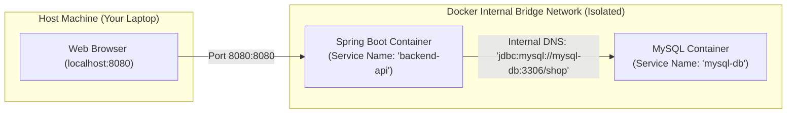

# Docker Compose: Multi-Service Orchestration (Spring Boot + MySQL)

> **Phase 11: Production Engineering, Security & Docker**  
> *Estimated Reading Time: 50 minutes | Total Practice Effort: ~3.5 hours | Tier: Core Essential*

---

## 1. Purpose & Prerequisites

### Why This Matters in Full Stack Development
A real-world full-stack application rarely consists of a single standalone container:
- You have a **Spring Boot backend**.
- A **MySQL database** storing persistent relational tables.
- A **RabbitMQ message broker** or **Redis cache**.
- A **React frontend SPA**.

If a new developer joins your team, forcing them to spend 2 days manually installing MySQL 8, configuring local root passwords, creating databases, and matching port configurations is slow and error-prone.

With **Docker Compose**, you define your entire multi-service stack in a single declarative `docker-compose.yml` file.  
Any developer can clone the repository and run:
```bash
docker compose up -d
```
Within 60 seconds, the database, backend, and network are completely initialized, wired together, and running!

### Prerequisites
- [Topic 8.1: JDBC Architecture & Connections](../08-jdbc/01-architecture-connections.md)
- [Topic 11.4: Docker Basics & Multi-Stage Builds](04-docker-basics.md)

---

## 2. Plain-English Mental Model

```
[ Solo Docker: Assembling Furniture Piece-by-Piece ]
- You manually run docker run for MySQL with 10 command-line flags.
- You manually create a Docker bridge network.
- You manually run docker run for Spring Boot, hoping you typed the IP address correctly.
- It's exhausting and easy to misplace a parameter!

[ Docker Compose: The Master Architect Blueprint ]
- You hand a single blueprint (docker-compose.yml) to the construction crew.
- The blueprint specifies:
  - Room 1: MySQL Database with a secure underground storage vault (Volume).
  - Room 2: Spring Boot Application.
  - Intercom System: An internal private telephone line between them (Docker Network).
- One command builds the entire house automatically!
```

---

## 3. The Docker Bridge Network: Automatic Service DNS

When multiple containers are defined in the same `docker-compose.yml` file, Docker automatically creates an isolated **Internal Bridge Network**.



### The Magic of Service Name Resolution:
Inside the Docker network, **the service name in `docker-compose.yml` acts as the hostname!**
- You do **NOT** use `localhost:3306` inside your Spring Boot container! To the backend container, `localhost` refers to *itself*, not the database container!
- Instead, you set your JDBC URL to:  
  `jdbc:mysql://mysql-db:3306/learning_platform`
- Docker's internal embedded DNS server automatically resolves `mysql-db` to the private IP address of the MySQL container!

---

## 4. Persistent Storage: Docker Volumes

Containers are **ephemeral** (disposable by design).  
If you stop or delete a container (`docker rm`), all data written to its internal file system is permanently destroyed.

To ensure your MySQL tables and customer orders survive container restarts and upgrades, you must attach a **Named Volume**:

```yaml
volumes:
  mysql_data: # Declares a persistent volume managed by Docker on the host disk
```

When MySQL writes data to `/var/lib/mysql`, Docker redirects those disk writes to the persistent `mysql_data` volume on your physical host machine. You can destroy, rebuild, or upgrade the MySQL container a hundred times; **your database data remains 100% intact!**

---

## 5. The Startup Race Condition & Healthchecks

A very common problem when starting containers together:
- Spring Boot starts up in **2 seconds**.
- MySQL needs **15 seconds** on initial startup to create tablespaces, generate SSL certs, and start listening on port 3306.
- If Spring Boot attempts to connect immediately, it crashes with `CommunicationsLinkException: Connection refused`!

Using `depends_on: [mysql-db]` only waits for the MySQL container to *start*, not for MySQL to *finish initializing*!

### The Solution: Docker Healthchecks
We configure a healthcheck on MySQL and instruct Spring Boot to wait until the database is **healthy**:

```yaml
healthcheck:
  test: ["CMD", "mysqladmin", "ping", "-h", "localhost"]
  interval: 5s
  timeout: 5s
  retries: 10
```

---

## 6. Complete Production `docker-compose.yml`

Here is a full production orchestration file wiring Spring Boot and MySQL 8:

```yaml
version: '3.8'

services:
  # ==========================================
  # SERVICE 1: MySQL Database Engine
  # ==========================================
  mysql-db:
    image: mysql:8.3
    container_name: learning-mysql
    restart: always
    environment:
      MYSQL_DATABASE: learning_platform
      MYSQL_ROOT_PASSWORD: ${DB_ROOT_PASSWORD:-rootpassword}
      MYSQL_USER: appuser
      MYSQL_PASSWORD: ${DB_APP_PASSWORD:-userpassword}
    ports:
      - "3306:3306" # Expose to host so you can connect from DBeaver / IntelliJ
    volumes:
      - mysql_data:/var/lib/mysql # Persistent storage
    networks:
      - app-network
    healthcheck:
      test: ["CMD", "mysqladmin", "ping", "-h", "localhost", "-u", "appuser", "-puserpassword"]
      interval: 5s
      timeout: 5s
      retries: 10
      start_period: 10s

  # ==========================================
  # SERVICE 2: Spring Boot REST API
  # ==========================================
  backend-api:
    build:
      context: .
      dockerfile: Dockerfile
    container_name: learning-backend
    restart: always
    depends_on:
      mysql-db:
        condition: service_healthy # Waits until MySQL is 100% ready to accept queries!
    environment:
      SPRING_DATASOURCE_URL: jdbc:mysql://mysql-db:3306/learning_platform?useSSL=false&serverTimezone=UTC&allowPublicKeyRetrieval=true
      SPRING_DATASOURCE_USERNAME: appuser
      SPRING_DATASOURCE_PASSWORD: ${DB_APP_PASSWORD:-userpassword}
      SPRING_PROFILES_ACTIVE: prod
      SERVER_PORT: 8080
    ports:
      - "8080:8080"
    networks:
      - app-network

# ==========================================
# Persistent Volumes Definition
# ==========================================
volumes:
  mysql_data:
    driver: local

# ==========================================
# Network Definition
# ==========================================
networks:
  app-network:
    driver: bridge
```

---

## 7. Essential Docker Compose CLI Commands

### 1. Launch the Entire Stack in Background:
```bash
# --build ensures images are recompiled if code changed
docker compose up -d --build
```

### 2. View Real-Time Logs Across All Services:
```bash
# Follow logs for the backend container only
docker compose logs -f backend-api

# Follow all services simultaneously
docker compose logs -f
```

### 3. Check Service Status & Health:
```bash
docker compose ps
```
Output:
```
NAME               IMAGE         STATUS                   PORTS
learning-backend   backend-api   Up 2 minutes             0.0.0.0:8080->8080/tcp
learning-mysql     mysql:8.3     Up 2 minutes (healthy)   0.0.0.0:3306->3306/tcp
```

### 4. Stop the Environment:
```bash
# Stops and removes containers and network, but PRESERVES the volume!
docker compose down

# DANGER: Stops containers AND WIPES the persistent database volume!
docker compose down -v
```

---

## 8. Common Rookie Mistakes & Anti-Patterns

### Anti-Pattern 1: Using `localhost` for Database URL
```yaml
# FATAL MISTAKE:
SPRING_DATASOURCE_URL: jdbc:mysql://localhost:3306/db
```
Inside a container, `localhost` resolves to the container's own internal loopback interface, not your laptop or other containers! Always use the service name: `jdbc:mysql://mysql-db:3306/db`.

### Anti-Pattern 2: Accidentally Running `docker compose down -v`
Passing `-v` instructs Docker to delete all attached volumes. All your database tables, users, and uploaded files will be permanently erased! Only use `-v` when you explicitly want to reset everything to a clean slate.

---

## 9. Guided Hands-On Exercise

### The Scenario
You need to add a third service to your `docker-compose.yml`: a **Redis in-memory caching container** (`redis:7-alpine`).  
Requirements:
- Service name: `redis-cache`
- Container name: `learning-redis`
- Port: `6379:6379`
- Connect to the existing `app-network`.

### Your Challenge:
Write the YAML configuration block for the Redis service.

<details>
<summary>💡 Hint: Use image: redis:7-alpine</summary>

```yaml
redis-cache:
  image: redis:7-alpine
  container_name: learning-redis
  ports:
    - "6379:6379"
  networks:
    - app-network
```
</details>

<details>
<summary>✅ Solution</summary>

```yaml
  redis-cache:
    image: redis:7-alpine
    container_name: learning-redis
    restart: always
    ports:
      - "6379:6379"
    networks:
      - app-network
    healthcheck:
      test: ["CMD", "redis-cli", "ping"]
      interval: 5s
      timeout: 3s
      retries: 5
```
</details>

---

## 10. Knowledge Check & Interview Defense

### Quick Quiz
1. **Inside a Docker Compose network, how does the Spring Boot backend container resolve the IP address of the MySQL database container?**
   - [x] A) It uses the service name (e.g. `mysql-db`) defined in `docker-compose.yml`, which Docker's internal DNS automatically resolves to the container's private IP.
   - [ ] B) It must use the host laptop's public IP address.
   - [ ] C) It uses `localhost`.
   - [ ] D) By reading the Windows hosts file.

2. **What is the difference between `docker compose down` and `docker compose down -v`?**
   - [x] A) `docker compose down` stops and removes containers while preserving database volume data; adding `-v` permanently destroys all attached volumes and wipes stored database records.
   - [ ] B) `-v` validates YAML syntax.
   - [ ] C) `-v` starts containers in verbose mode.
   - [ ] D) There is no difference.

3. **Why is `condition: service_healthy` used in `depends_on` between Spring Boot and MySQL?**
   - [x] A) Because standard `depends_on` only waits for the MySQL process to launch, whereas `service_healthy` waits until MySQL has completely finished initializing tablespaces and is ready to accept incoming SQL connections.
   - [ ] B) To check if the server has enough disk space.
   - [ ] C) To run unit tests before starting MySQL.
   - [ ] D) It is required by Kubernetes.

---

### Junior Developer Interview Q&A

#### Q: "What is the difference between a Named Volume and a Bind Mount in Docker Compose?"
> **Model Answer:**  
> "The difference comes down to **who manages the file storage on the host machine**:
>
> 1. **Named Volume (e.g. `mysql_data:/var/lib/mysql`):** Docker completely manages the storage location on the host disk (typically inside `/var/lib/docker/volumes/`). Named volumes are high-performance, isolated from accidental host user tampering, and are the industry standard for production databases and message queues.
>
> 2. **Bind Mount (e.g. `./src:/app/src`):** Directly maps a specific host directory or file into the container. Whatever changes you make on your local machine are immediately reflected inside the container. Bind mounts are commonly used in local development for live hot-reloading (such as editing frontend React or backend templates), but should never be used for production database storage due to host filesystem permission issues and performance overhead."

---

## 11. Mastery Checklist & Next Step

Before moving on, verify that you can:
- [ ] Author a multi-service `docker-compose.yml` for Spring Boot and MySQL.
- [ ] Connect services using Docker's internal bridge network DNS (service names).
- [ ] Ensure database persistence across container destruction using Named Volumes.
- [ ] Prevent startup connection failures using Docker Healthchecks and `service_healthy`.
- [ ] Manage local environments using `docker compose up -d`, `logs`, and `down`.

👉 **Next Lesson:** **[Topic 11.6: Message Brokers: Decoupling Microservices with RabbitMQ [ADVANCED]](06-rabbitmq.md)**
