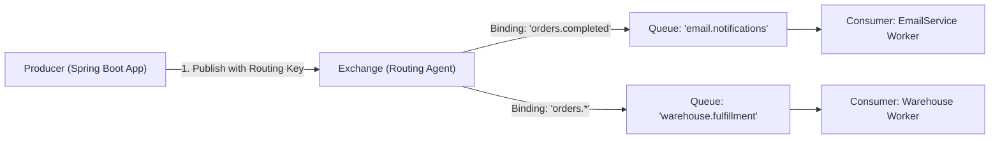
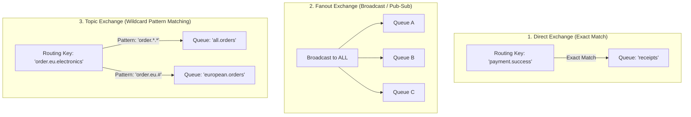

# Message Brokers: Decoupling Microservices with RabbitMQ [ADVANCED]

> **Phase 11: Production Engineering, Security & Docker**  
> *Estimated Reading Time: 60 minutes | Total Practice Effort: ~4.5 hours | Tier: Advanced Production*

---

## 1. Purpose & Prerequisites

### Why This Matters in Full Stack Development
In synchronous HTTP REST architecture:
- When a user clicks **"Place Order"**, the backend charges credit cards, inserts 5 database rows, generates an 8-page PDF invoice, sends an email over SMTP, and pings an inventory warehouse API.
- All of this runs inside the user's single HTTP request thread.
- If the SMTP email server takes 6 seconds or fails, the user's browser spins, times out, and the entire checkout fails!

In enterprise systems, **heavy, non-blocking side-effects must be processed asynchronously** using a **Message Broker**.

With **RabbitMQ**:
1. The backend saves the order in 10ms and publishes a lightweight message: `OrderPlacedEvent`.
2. The user instantly receives a `200 OK` response with their confirmation screen in **50 milliseconds**.
3. Background worker services consume the message from the queue and generate PDFs, send emails, and notify warehouses at their own pace.

### Prerequisites
- [Topic 6.5: Production Thread Management & Executors](../06-concurrency/05-executors.md)
- [Topic 10.4: Building REST APIs](../10-spring/04-controllers.md)
- [Topic 11.5: Docker Compose Orchestration](05-docker-compose.md)

---

## 2. Plain-English Mental Model

```
[ Synchronous HTTP: Waiting at the Post Office Counter ]
- You hand a package to the clerk.
- You refuse to leave the counter until the clerk drives across the country, 
  delivers the package to your friend's door, and walks back to give you a thumbs up.
- Everyone behind you in line is blocked and angry!

[ RabbitMQ Message Broker: Dropping a Letter in the Mailbox ]
- You drop your envelope into the neighborhood blue mailbox.
- You walk away in 2 seconds and continue your day.
- A postal sorting hub (Exchange) reads the routing label and drops it into the delivery truck (Queue).
- The delivery driver (Consumer) delivers it when ready.
- If the driver gets a flat tire, the letter sits safely in the truck until fixed (Fault Tolerance)!
```

---

## 3. The AMQP Core Architecture (Exchanges, Queues, Bindings)

RabbitMQ implements the **AMQP (Advanced Message Queuing Protocol)** standard. Unlike simple queues, producers **never send messages directly to a queue**; they send them to an **Exchange**:



### The 4 Core AMQP Building Blocks:
1. **Producer:** The application that creates and emits the message payload.
2. **Exchange:** The message routing agent. It receives messages from producers and determines which queues should receive them based on **Bindings** and **Routing Keys**.
3. **Queue:** A safe, in-memory or on-disk buffer that stores messages until worker consumers process them.
4. **Consumer:** A background worker service that listens to a queue and executes business tasks.

---

## 4. The 3 Primary Exchange Types



### 1. Direct Exchange
Routes messages to queues based on an **exact match** between the message's routing key and the queue's binding key.  
*Example:* `routingKey = "pdf.generate"`.

### 2. Fanout Exchange
Ignores routing keys completely. It **duplicates and broadcasts every message** to every single queue bound to it.  
*Example:* Real-time notifications or price ticker updates.

### 3. Topic Exchange (Most Powerful)
Routes messages based on wildcard patterns with dot-separated words:
- `*` (star): Substitutes for **exactly one word**.  
  *Example:* `order.*.completed` matches `order.us.completed` and `order.eu.completed`.
- `#` (hash): Substitutes for **zero or more words**.  
  *Example:* `audit.#` matches `audit.user.login` and `audit.order.payment.failed`.

---

## 5. Reliability: Acknowledgments & Dead-Letter Queues (DLQ)

### 1. Consumer Acknowledgments (`ACK` vs `NACK`)
When a consumer receives a message, RabbitMQ does not delete it immediately:
- **`ACK` (Acknowledge):** Consumer finished work successfully; RabbitMQ permanently removes the message.
- **`NACK` (Negative Acknowledge) / `REJECT`:** Consumer encountered an error (e.g. database down). If `requeue = true`, RabbitMQ puts the message back at the head of the queue for retry.

### 2. Dead-Letter Queues (DLQ)
What happens if a message has corrupted data (e.g. malformed JSON)?  
The consumer will fail, reject the message, requeue it, fail again, and enter an **infinite crash loop**!

A **Dead-Letter Queue (DLQ)** acts as an isolation quarantine ward:
- When a message fails 3 retry attempts, RabbitMQ automatically routes it to the Dead-Letter Queue.
- The main queue continues processing other orders smoothly.
- Developers inspect the DLQ to diagnose the bug.

---

## 6. Complete Spring Boot RabbitMQ Implementation

### 1. Maven Dependency:
```xml
<dependency>
    <groupId>org.springframework.boot</groupId>
    <artifactId>spring-boot-starter-amqp</artifactId>
</dependency>
```

### 2. Infrastructure Configuration Class:
```java
package com.career.learning.config;

import org.springframework.amqp.core.*;
import org.springframework.amqp.support.converter.Jackson2JsonMessageConverter;
import org.springframework.amqp.support.converter.MessageConverter;
import org.springframework.context.annotation.Bean;
import org.springframework.context.annotation.Configuration;

@Configuration
public class RabbitMqConfig {

    public static final String ORDER_EXCHANGE = "order.exchange";
    public static final String ORDER_QUEUE = "order.fulfillment.queue";
    public static final String ORDER_ROUTING_KEY = "order.created";

    // 1. Declare Topic Exchange
    @Bean
    public TopicExchange orderExchange() {
        return new TopicExchange(ORDER_EXCHANGE, true, false); // durable = true
    }

    // 2. Declare Queue
    @Bean
    public Queue orderQueue() {
        return QueueBuilder.durable(ORDER_QUEUE)
                .withArgument("x-dead-letter-exchange", "order.dlx") // Link to DLQ!
                .build();
    }

    // 3. Bind Queue to Exchange with Routing Key
    @Bean
    public Binding orderBinding(Queue orderQueue, TopicExchange orderExchange) {
        return BindingBuilder.bind(orderQueue).to(orderExchange).with(ORDER_ROUTING_KEY);
    }

    // 4. Use Jackson to serialize messages to JSON instead of Java Native Serialization!
    @Bean
    public MessageConverter jsonMessageConverter() {
        return new Jackson2JsonMessageConverter();
    }
}
```

---

### 3. The Producer: Publishing Messages with `RabbitTemplate`
```java
package com.career.learning.service;

import com.career.learning.config.RabbitMqConfig;
import org.slf4j.Logger;
import org.slf4j.LoggerFactory;
import org.springframework.amqp.rabbit.core.RabbitTemplate;
import org.springframework.stereotype.Service;

import java.math.BigDecimal;

public record OrderPlacedEvent(Long orderId, String customerEmail, BigDecimal totalAmount) {}

@Service
public class OrderEventProducer {

    private static final Logger log = LoggerFactory.getLogger(OrderEventProducer.class);
    private final RabbitTemplate rabbitTemplate;

    public OrderEventProducer(RabbitTemplate rabbitTemplate) {
        this.rabbitTemplate = rabbitTemplate;
    }

    public void publishOrderPlaced(Long orderId, String email, BigDecimal amount) {
        OrderPlacedEvent event = new OrderPlacedEvent(orderId, email, amount);

        log.info("📤 Publishing OrderPlacedEvent to RabbitMQ: {}", event);

        // Publishes asynchronously over network in microseconds!
        rabbitTemplate.convertAndSend(
                RabbitMqConfig.ORDER_EXCHANGE,
                RabbitMqConfig.ORDER_ROUTING_KEY,
                event
        );
    }
}
```

---

### 4. The Consumer: Listening with `@RabbitListener`
```java
package com.career.learning.consumer;

import com.career.learning.config.RabbitMqConfig;
import com.career.learning.service.OrderPlacedEvent;
import org.slf4j.Logger;
import org.slf4j.LoggerFactory;
import org.springframework.amqp.rabbit.annotation.RabbitListener;
import org.springframework.stereotype.Component;

@Component
public class FulfillmentWorker {

    private static final Logger log = LoggerFactory.getLogger(FulfillmentWorker.class);

    // Listens continuously to the queue in a background thread pool!
    @RabbitListener(queues = RabbitMqConfig.ORDER_QUEUE)
    public void processOrderFulfillment(OrderPlacedEvent event) {
        log.info("📥 [WORKER] Received OrderPlacedEvent: OrderId: {}", event.orderId());

        try {
            // Simulate heavy background work: PDF invoice generation & warehouse packing
            Thread.sleep(1500);
            log.info(" Order #{} packed and ready for delivery to {}", event.orderId(), event.customerEmail());

        } catch (InterruptedException e) {
            Thread.currentThread().interrupt();
        }
    }
}
```

---

## 7. Common Rookie Mistakes & Anti-Patterns

### Anti-Pattern 1: Java Native Serialization Vulnerability
By default, Spring AMQP uses standard Java native object serialization (`SimpleMessageConverter`).  
*Why this is dangerous:* Java native deserialization is notoriously vulnerable to **Remote Code Execution (RCE) gadget attacks** and makes cross-language messaging (Node.js/Python reading Java events) impossible!  
*Rule:* Always configure `Jackson2JsonMessageConverter` to use standardized JSON payloads.

### Anti-Pattern 2: Non-Durable Queues
Creating a queue with `durable = false`. If the RabbitMQ server restarts or container reboots, **all unconsumed messages in the queue are permanently destroyed!** Always use `durable = true`.

---

## 8. Guided Hands-On Exercise

### The Scenario
You need to configure an asynchronous email notification queue:
- Exchange: `notifications.exchange` (Fanout Exchange)
- Queue: `email.welcome.queue`
- Produce a `WelcomeEmailEvent(String email, String name)`.

### Your Challenge:
Write the `@RabbitListener` consumer that reads from `email.welcome.queue` and logs a confirmation message.

<details>
<summary>💡 Hint: Use @RabbitListener(queues = "...")</summary>

```java
@Component
public class WelcomeEmailConsumer {
    @RabbitListener(queues = "email.welcome.queue")
    public void handle(WelcomeEmailEvent event) { ... }
}
```
</details>

<details>
<summary>✅ Solution</summary>

```java
package com.career.learning.notification;

import org.slf4j.Logger;
import org.slf4j.LoggerFactory;
import org.springframework.amqp.rabbit.annotation.RabbitListener;
import org.springframework.stereotype.Component;

public record WelcomeEmailEvent(String email, String name) {}

@Component
public class WelcomeEmailConsumer {

    private static final Logger log = LoggerFactory.getLogger(WelcomeEmailConsumer.class);

    @RabbitListener(queues = "email.welcome.queue")
    public void consumeWelcomeEmail(WelcomeEmailEvent event) {
        log.info("✉️ Sending customized welcome email to {} ({})", event.name(), event.email());
        // Execute SMTP email delivery without blocking HTTP request
    }
}
```
</details>

---

## 9. Knowledge Check & Interview Defense

### Quick Quiz
1. **In AMQP / RabbitMQ architecture, what entity is responsible for receiving messages from producers and routing them to queues?**
   - [x] A) The Exchange.
   - [ ] B) The Queue directly.
   - [ ] C) The JVM Garbage Collector.
   - [ ] D) The Database Trigger.

2. **Which Exchange type broadcasts every incoming message to ALL bound queues regardless of routing keys?**
   - [x] A) Fanout Exchange.
   - [ ] B) Direct Exchange.
   - [ ] C) Topic Exchange.
   - [ ] D) Headers Exchange.

3. **What is the purpose of a Dead-Letter Queue (DLQ)?**
   - [x] A) To isolate and store messages that repeatedly fail consumer processing, preventing infinite retry loops from crashing workers.
   - [ ] B) To permanently delete unread emails.
   - [ ] C) To speed up database queries.
   - [ ] D) To manage user sessions.

---

### Junior Developer Interview Q&A

#### Q: "Why should we prefer asynchronous messaging with RabbitMQ over direct synchronous HTTP REST calls between microservices?"
> **Model Answer:**  
> "Synchronous HTTP REST between microservices introduces three critical failure modes:
>
> 1. **Temporal Coupling:** If Service A calls Service B synchronously, Service B **must be online and healthy at that exact millisecond**. If Service B is restarting or experiencing high latency, Service A fails or times out. With RabbitMQ, Service A publishes the message and continues immediately; if Service B is temporarily down, the message waits safely in the durable queue until Service B recovers.
>
> 2. **Cascading Latency:** In a chain of 4 synchronous HTTP services, total latency is the sum of all 4 network roundtrips. Asynchronous messaging decouples request processing, providing sub-50ms API responses to users.
>
> 3. **Traffic Spike Buffering (Load Leveling):** If 50,000 customers purchase tickets simultaneously during Black Friday, synchronous REST calls can overwhelm database connections. With RabbitMQ, all 50,000 orders are buffered in the queue, and background workers process them at a steady, sustainable rate without crashing infrastructure."

---

## 10. Mastery Checklist & Next Step

Before moving on, verify that you can:
- [ ] Explain why asynchronous messaging eliminates temporal coupling and cascading latency.
- [ ] Differentiate between Producers, Exchanges, Queues, Bindings, and Consumers.
- [ ] Select appropriate exchange types: Direct, Fanout, and Topic.
- [ ] Configure `Jackson2JsonMessageConverter` for secure JSON serialization.
- [ ] Publish messages with `RabbitTemplate` and consume them with `@RabbitListener`.
- [ ] Protect systems against poison pills using Dead-Letter Queues (DLQ).

👉 **Next Lesson:** **[Topic 11.7: High-Performance Caching with Redis & The Cache-Aside Pattern [ADVANCED]](07-redis-caching.md)**
