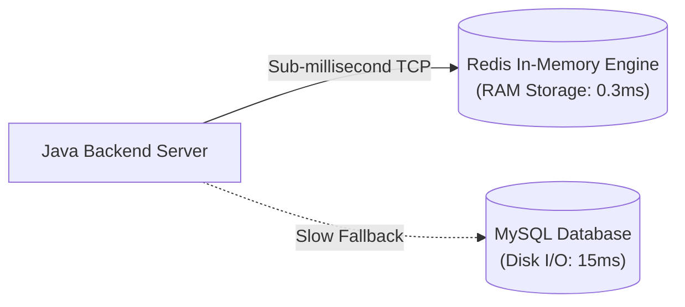
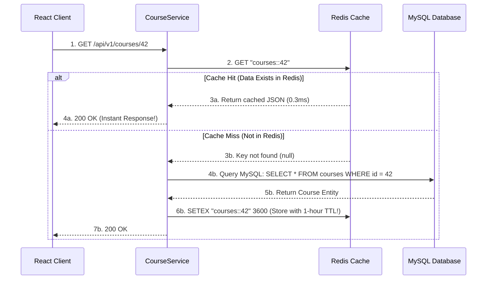

# High-Performance Caching with Redis & The Cache-Aside Pattern [ADVANCED]

> **Phase 11: Production Engineering, Security & Docker**  
> *Estimated Reading Time: 55 minutes | Total Practice Effort: ~4 hours | Tier: Advanced Production*

---

## 1. Purpose & Prerequisites

### Why This Matters in Full Stack Development
In most web applications, **read traffic dwarfs write traffic by 90 to 1**:
- Millions of users view the homepage, search products, or load course catalogs.
- Only a tiny fraction of users create orders or update profiles.

Reading from a relational database (like MySQL) involves disk I/O, parsing SQL, evaluating indexes, and network serialization, typically taking **5 to 25 milliseconds**.

Reading from **Redis** (an in-memory data store) takes **less than 0.5 milliseconds (sub-millisecond)**!

By introducing a caching layer, you can:
1. Reduce read latency by **95%**.
2. Protect your primary database from CPU saturation during high-traffic viral events.

In this lesson, you will master **Redis**, the **Cache-Aside Pattern**, **Spring Cache Annotations (`@Cacheable`, `@CacheEvict`)**, and defenses against **Cache Stampede / Avalanche**.

### Prerequisites
- [Topic 7.8: B-Tree Indexes & Query Optimization](../07-sql/08-indexes-explain.md)
- [Topic 10.6: Spring Data JPA Repositories](../10-spring/06-jpa-entities.md)
- [Topic 11.5: Docker Compose Orchestration](05-docker-compose.md)

---

## 2. Plain-English Mental Model

```
[ Reading from MySQL: Walking to the Library Basement ]
- You need the answer to a question.
- You stand up, take an elevator to the library basement, search a dusty filing cabinet, 
  and walk back upstairs (15 milliseconds).

[ Reading from Redis: A Sticky Note on Your Desk ]
- You write the answer on a sticky note directly on your computer monitor.
- Next time you need the answer, you glance at the sticky note (0.3 milliseconds).
- But beware! If the facts change, you must THROW AWAY the old sticky note!
- (This is Cache Invalidation, one of the two hardest problems in Computer Science!)
```

---

## 3. Why Redis Is Ultra-Fast: Architecture

**Redis (Remote Dictionary Server)** is an open-source, in-memory key-value data structure store:



### Why Redis Outperforms Traditional Databases:
1. **In-Memory Storage:** All data resides in physical RAM. There is zero disk seek latency for read operations.
2. **Single-Threaded Event Loop:** Redis processes commands sequentially using an ultra-fast non-blocking event loop (using Linux `epoll`). It has **zero thread context switching overhead** and **zero lock contention**!
3. **Optimized C Data Structures:** Strings, Hashes, Lists, Sets, and Sorted Sets implemented directly in optimized C.

---

## 4. The Cache-Aside Pattern (Lazy Loading)

The industry standard caching pattern for REST APIs is the **Cache-Aside Pattern**:



### Cache Invalidation on Writes:
When an instructor updates Course #42:
1. The service updates MySQL: `UPDATE courses SET title = ...`.
2. The service immediately **evicts/deletes** the key from Redis: `DEL "courses::42"`.
3. The next user who reads Course #42 will experience a cache miss, fetch the fresh data from MySQL, and repopulate Redis!

---

## 5. Spring Cache Abstraction: Declarative Caching

Spring Boot provides declarative caching via annotations, requiring zero manual Redis socket boilerplate:

### 1. Maven Dependency:
```xml
<dependency>
    <groupId>org.springframework.boot</groupId>
    <artifactId>spring-boot-starter-data-redis</artifactId>
</dependency>
<dependency>
    <groupId>org.springframework.boot</groupId>
    <artifactId>spring-boot-starter-cache</artifactId>
</dependency>
```

---

### 2. Enable Caching & Configure Redis JSON Serialization:
```java
package com.career.learning.config;

import org.springframework.cache.annotation.EnableCaching;
import org.springframework.context.annotation.Bean;
import org.springframework.context.annotation.Configuration;
import org.springframework.data.redis.cache.RedisCacheConfiguration;
import org.springframework.data.redis.serializer.GenericJackson2JsonRedisSerializer;
import org.springframework.data.redis.serializer.RedisSerializationContext;

import java.time.Duration;

@Configuration
@EnableCaching // Activates Spring Cache Proxy interceptors!
public class RedisCacheConfig {

    @Bean
    public RedisCacheConfiguration cacheConfiguration() {
        return RedisCacheConfiguration.defaultCacheConfig()
                // 1. Set global default Time-To-Live (TTL) of 60 minutes
                .entryTtl(Duration.ofMinutes(60))
                // 2. Prevent caching of null values
                .disableCachingNullValues()
                // 3. Serialize values to JSON instead of binary JDK serialization!
                .serializeValuesWith(RedisSerializationContext.SerializationPair.fromSerializer(
                        new GenericJackson2JsonRedisSerializer()
                ));
    }
}
```

---

### 3. Using `@Cacheable`, `@CachePut`, and `@CacheEvict` in Service:

```java
package com.career.learning.service;

import com.career.learning.dto.CourseResponse;
import com.career.learning.entity.Course;
import com.career.learning.repository.CourseRepository;
import org.slf4j.Logger;
import org.slf4j.LoggerFactory;
import org.springframework.cache.annotation.CacheEvict;
import org.springframework.cache.annotation.CachePut;
import org.springframework.cache.annotation.Cacheable;
import org.springframework.stereotype.Service;
import org.springframework.transaction.annotation.Transactional;

@Service
public class CourseService {

    private static final Logger log = LoggerFactory.getLogger(CourseService.class);
    private final CourseRepository courseRepository;

    public CourseService(CourseRepository courseRepository) {
        this.courseRepository = courseRepository;
    }

    // 1. @Cacheable: Check cache first! If hit, method body NEVER runs!
    @Cacheable(value = "courses", key = "#id")
    @Transactional(readOnly = true)
    public CourseResponse getCourseById(Long id) {
        log.info("🐢 Cache Miss! Fetching Course #{} from slow MySQL database...", id);

        Course course = courseRepository.findById(id)
                .orElseThrow(() -> new ResourceNotFoundException("Course not found: " + id));

        return new CourseResponse(course.getId(), course.getTitle(), course.getDescription(), course.getPrice());
    }

    // 2. @CacheEvict: Remove stale entry from Redis when data is updated!
    @CacheEvict(value = "courses", key = "#id")
    @Transactional
    public CourseResponse updateCourse(Long id, CourseUpdateRequest request) {
        log.info("🗑️ Evicting Course #{} from Redis cache due to update...", id);

        Course course = courseRepository.findById(id).orElseThrow();
        course.setTitle(request.title());
        course.setPrice(request.price());

        return new CourseResponse(course.getId(), course.getTitle(), course.getDescription(), course.getPrice());
    }

    // 3. @CacheEvict with allEntries = true: Wipe entire cache prefix!
    @CacheEvict(value = "courses", allEntries = true)
    @Transactional
    public void wipeEntireCourseCache() {
        log.warn("🧹 Wiping all cached courses across Redis cluster!");
    }
}
```

---

## 6. The 3 Classic Caching Disasters & Defenses

In high-concurrency systems, naive caching can crash your database in three distinct ways:

### 1. Cache Penetration
- **The Problem:** An attacker queries non-existent IDs in a tight loop: `GET /courses/-999999`. Since `-999999` never exists in Redis or MySQL, every single request bypasses the cache and hammers the database!
- **The Fix:**
  1. Cache empty/null results with a short TTL (e.g. 2 minutes).
  2. Or use a **Bloom Filter** at the gateway to filter out non-existent keys before querying!

### 2. Cache Breakdown (Hotspot Invalidating)
- **The Problem:** A single ultra-hot key (e.g. "World Cup Live Score") expires from Redis. At that exact millisecond, 50,000 concurrent requests experience a cache miss and all rush to query MySQL simultaneously, instantly crashing the database!
- **The Fix:** Use Spring's **`sync = true`** attribute on `@Cacheable`:
  ```java
  @Cacheable(value = "liveScores", key = "#matchId", sync = true)
  ```
  `sync = true` instructs the local JVM to lock threads: **only one thread** queries the database; the other 49,999 threads wait and read from cache once the first thread finishes!

### 3. Cache Avalanche
- **The Problem:** 100,000 course keys were all inserted at 12:00 PM with a fixed TTL of 60 minutes. At 1:00 PM, **all 100,000 keys expire at the exact same second**! Traffic surges to MySQL, triggering a catastrophic cascading failure.
- **The Fix:** **Add Random Jitter to TTLs!**  
  Instead of fixed 60 minutes, set:
  $$\text{TTL} = 60 \text{ minutes} + \text{random}(1 \text{ to } 10 \text{ minutes})$$
  Expirations are staggered smoothly across time.

---

## 7. Common Rookie Mistakes & Anti-Patterns

### Anti-Pattern 1: Caching Without a TTL (Infinite Life)
Calling `redisTemplate.opsForValue().set("key", value)` without setting a Time-To-Live.  
*Result:* Redis will consume memory until the server hits `maxmemory`. When RAM runs out, Redis either crashes with OutOfMemory or begins aggressively evicting keys! **Always configure a TTL.**

### Anti-Pattern 2: Caching Un-Serializable Objects
Using Java Default Serialization on an entity that does not implement `java.io.Serializable`. Spring will throw `SerializationFailedException`! Always use Jackson JSON serialization (`GenericJackson2JsonRedisSerializer`).

---

## 8. Guided Hands-On Exercise

### The Scenario
You are building an e-commerce Product service with high traffic.  
Requirements:
1. Method `ProductDto getProductBySku(String sku)` must be cached under the cache name `"products"` with key `#sku`.
2. Concurrent requests for an un-cached SKU must be synchronized to prevent Cache Breakdown (`sync = true`).
3. Method `void deleteProduct(String sku)` must evict the cached SKU.

### Your Challenge:
Write the annotated service methods.

<details>
<summary>💡 Hint: Use @Cacheable(..., sync = true) and @CacheEvict</summary>

```java
@Cacheable(value = "products", key = "#sku", sync = true)
public ProductDto getProductBySku(String sku) { ... }

@CacheEvict(value = "products", key = "#sku")
public void deleteProduct(String sku) { ... }
```
</details>

<details>
<summary>✅ Solution</summary>

```java
package com.career.learning.product;

import org.springframework.cache.annotation.CacheEvict;
import org.springframework.cache.annotation.Cacheable;
import org.springframework.stereotype.Service;
import org.springframework.transaction.annotation.Transactional;

@Service
public class CachedProductService {

    private final ProductRepository productRepository;

    public CachedProductService(ProductRepository productRepository) {
        this.productRepository = productRepository;
    }

    // Protected against Cache Breakdown using sync = true!
    @Cacheable(value = "products", key = "#sku", sync = true)
    @Transactional(readOnly = true)
    public ProductDto getProductBySku(String sku) {
        Product p = productRepository.findBySku(sku)
                .orElseThrow(() -> new ResourceNotFoundException("Product not found: " + sku));
        return new ProductDto(p.getId(), p.getSku(), p.getTitle(), p.getPrice());
    }

    // Automatically evicts stale entry from Redis
    @CacheEvict(value = "products", key = "#sku")
    @Transactional
    public void deleteProduct(String sku) {
        productRepository.deleteBySku(sku);
    }
}
```
</details>

---

## 9. Knowledge Check & Interview Defense

### Quick Quiz
1. **What is the Cache-Aside pattern?**
   - [x] A) The application checks the cache first; on a cache miss, it reads from the database, writes the result to the cache with a TTL, and returns the data. On updates, it invalidates (evicts) the cache.
   - [ ] B) Writing data directly to the database only.
   - [ ] C) Storing data in browser cookies.
   - [ ] D) Running queries in parallel threads.

2. **How does adding random jitter to Cache TTLs protect against a "Cache Avalanche"?**
   - [x] A) It staggers key expirations over a time window, preventing thousands of cached entries from expiring at the exact same second and overwhelming the database.
   - [ ] B) It encrypts cache keys.
   - [ ] C) It deletes duplicate rows.
   - [ ] D) It runs Redis in multiple threads.

3. **What Spring Cache annotation is used to remove an item from the Redis cache when a record is updated or deleted?**
   - [x] A) `@CacheEvict`.
   - [ ] B) `@CacheRemove`.
   - [ ] C) `@CacheDelete`.
   - [ ] D) `@CacheClear`.

---

### Junior Developer Interview Q&A

#### Q: "What is the difference between Cache Penetration, Cache Breakdown, and Cache Avalanche?"
> **Model Answer:**  
> "These are the three classic distributed caching failure modes:
>
> 1. **Cache Penetration:** Occurs when requests query for **data that does not exist in either the cache or the database** (e.g., malicious requests for ID -1). Every request misses the cache and directly hammers the database. We remediate this by caching null values with short TTLs or using **Bloom Filters**.
>
> 2. **Cache Breakdown (Hotspot Expired):** Occurs when a **single ultra-popular key** (a hot key receiving thousands of requests per second) expires. At that exact millisecond, thousands of concurrent requests miss the cache and hit the database simultaneously. We fix this by using **Mutex Locks** (like Spring's `@Cacheable(sync = true)`).
>
> 3. **Cache Avalanche:** Occurs when **large batches of keys expire at the exact same timestamp**, causing a massive stampede of traffic across many different queries to hit the database at once. We fix this by **adding random time jitter** (e.g. $TTL + \text{random}(1..10 \text{ mins})$) to stagger expiration times."

---

## 10. Mastery Checklist & Next Step

Before moving on, verify that you can:
- [ ] Explain why in-memory single-threaded Redis achieves sub-millisecond read latency.
- [ ] Implement the Cache-Aside pattern using `@Cacheable` and `@CacheEvict`.
- [ ] Configure `GenericJackson2JsonRedisSerializer` for human-readable, secure JSON caching.
- [ ] Set optimal Time-To-Live (TTL) expiration rules.
- [ ] Identify and defend against Cache Penetration, Cache Breakdown, and Cache Avalanche.

🎉 **Phase 11: Production Engineering, Security & Docker Complete!**  
👉 **Next Phase:** **[Topic 12.1: Semantic HTML5, Document Structure & Web Accessibility (a11y)](../12-frontend-foundations/01-html5.md)**
