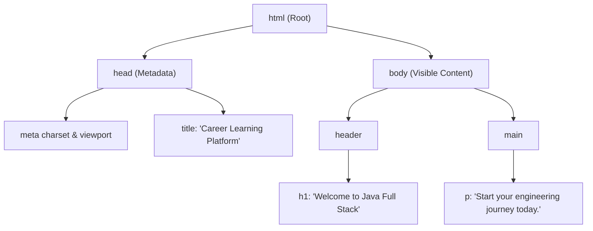
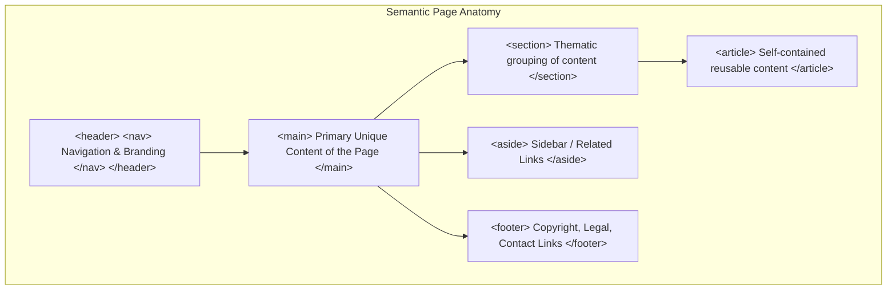

# Semantic HTML5, Document Structure & Web Accessibility (a11y)

> **Phase 12: Modern Frontend Foundations (HTML5, CSS3 & JavaScript ES6+)**  
> *Estimated Reading Time: 40 minutes | Total Practice Effort: ~2.5 hours | Tier: Core Essential*

---

## 1. Purpose & Prerequisites

### Why This Matters in Full Stack Development
A true full-stack engineer does not stop at writing Spring Boot microservices. To build user-facing software, you must understand how browsers interpret and render user interfaces.

**HTML5 (Hypertext Markup Language)** is the structural backbone of every website and web application on Earth.

However, many backend developers make the mistake of creating **"Div Soup"**: wrapping every paragraph, button, and navigation bar in a generic `<div>` tag:
- Search engines (Googlebot, Bing) cannot understand your content hierarchy, destroying **SEO ranking**.
- Visually impaired users using screen readers cannot navigate your site, violating international **Web Accessibility (WCAG / a11y)** laws.

In this lesson, you will master **Semantic HTML5 tags**, build **accessible forms**, and follow international **Accessibility (a11y)** standards.

### Prerequisites
- [Topic 10.1: Web Protocol Fundamentals (HTTP & REST)](../10-spring/01-http-rest.md)
- A modern web browser (Chrome, Firefox, or Edge) with Developer Tools (`F12`).

---

## 2. Plain-English Mental Model

```
[ The Human Body Analogy ]
- HTML: The Skeleton.
  The skull, spine, ribcage, and joints. It defines structure and hierarchy.
- CSS: The Skin, Hair & Fashion.
  Eye color, clothing, layout, animations, and typography.
- JavaScript: The Nervous System & Muscles.
  Reacting to touches, clicking buttons, fetching remote data, and moving joints.

[ A house without a foundation collapses; a website with bad HTML is broken before CSS even loads! ]
```

---

## 3. The DOM (Document Object Model) Tree

When a browser loads an HTML document, it parses the text into a tree of nodes called the **DOM (Document Object Model)**:

```html
<!DOCTYPE html>
<html lang="en">
  <head>
    <meta charset="UTF-8" />
    <meta name="viewport" content="width=device-width, initial-scale=1.0" />
    <title>Career Learning Platform</title>
  </head>
  <body>
    <header>
      <h1>Welcome to Java Full Stack</h1>
    </header>
    <main>
      <p>Start your engineering journey today.</p>
    </main>
  </body>
</html>
```



---

## 4. Semantic HTML5 vs The "Div Soup" Anti-Pattern

### ❌ The "Div Soup" Anti-Pattern:
```html
<!-- TERRIBLE: Zero semantic meaning! Screen readers see meaningless boxes! -->
<div class="header">
  <div class="nav-bar">
    <div class="nav-item" onclick="navigate()">Home</div>
  </div>
</div>
<div class="content">
  <div class="title">My Blog Post</div>
</div>
```

---

### ✅ Modern Semantic HTML5:
Semantic elements clearly describe their meaning to both the browser and developer:



| Semantic Tag | Architectural Purpose |
| :--- | :--- |
| **`<header>`** | Introductory content, branding logos, top navigation. |
| **`<nav>`** | Major navigation links (menus, table of contents). |
| **`<main>`** | The **dominant, unique content** of the page (only ONE per document!). |
| **`<article>`** | A standalone, self-contained piece of content (blog post, product card, forum comment). |
| **`<section>`** | A thematic grouping of content, typically with a heading (`<h2>`). |
| **`<aside>`** | Content indirectly related to main content (sidebars, callout boxes, ads). |
| **`<footer>`** | Author info, copyright notices, terms of service links. |

---

## 5. The Golden Rule: `<button>` vs `<a>`

Mixing up links and buttons is the #1 HTML mistake made by developers:

```
[ <a> (Anchor / Link): NAVIGATES to a URL ]
- Takes you to a new page or new URL fragment: <a href="/courses/java">Explore Courses</a>
- Supports: Right-click -> "Open in New Tab", bookmarking, search engine crawling.

[ <button>: PERFORMS AN ACTION ]
- Triggers a script, submits a form, opens a modal: <button type="button">Delete Item</button>
- Supports: Native keyboard Enter/Spacebar activation, disabled state, form submission.
```

> **NEVER DO THIS:** `<div onclick="...">` or `<a href="#">Click Me</a>`!  
> Generic `div` elements cannot be focused with the `Tab` key and cannot be triggered by the keyboard without writing custom accessibility event listeners! Always use `<button>`.

---

## 6. Accessible Forms: Labels & Inputs

Every full-stack developer builds login forms, search inputs, and checkout forms.

### Explicit `<label>` Association (MANDATORY):
A form input without a label is inaccessible to screen readers:

```html
<!-- ALWAYS explicitly link <label for="..."> to <input id="..."> -->
<form action="/api/v1/auth/login" method="POST">
  
  <div class="form-group">
    <label for="user-email">Email Address</label>
    <input 
      type="email" 
      id="user-email" 
      name="email" 
      placeholder="you@example.com" 
      required 
      autocomplete="email" 
    />
  </div>

  <div class="form-group">
    <label for="user-password">Password</label>
    <input 
      type="password" 
      id="user-password" 
      name="password" 
      required 
      minlength="8" 
      autocomplete="current-password" 
    />
  </div>

  <button type="submit">Sign In</button>
</form>
```

### Why Explicit Labels Matter:
1. **Screen Readers:** When a blind user tabs into the input, the screen reader announces: *"Email Address, edit text"*. Without a label, it simply says: *"Blank, edit text"*.
2. **Mobile Usability:** Clicking the label text automatically focuses the input, providing a much larger touch target on small smartphone screens!

---

## 7. Web Accessibility (a11y) & WCAG Fundamentals

**a11y** (a + 11 letters + y = Accessibility) ensures people with disabilities (visual, auditory, motor, cognitive) can use your application.

### The 4 Core a11y Pillars:
1. **Meaningful Image `alt` Text:**
   - Informative image: ``
   - Purely decorative icon: `` (Screen reader skips it!).
2. **Strict Heading Hierarchy:** Never jump from `<h1>` directly to `<h4>`. Always descend sequentially: `<h1>` -> `<h2>` -> `<h3>`.
3. **Keyboard Navigability:** A user should be able to navigate your entire application using **only the `Tab` key**, `Enter`, and `Spacebar`. Never set `outline: none` in CSS without providing a visible focus indicator!
4. **Color Contrast:** Text must have a contrast ratio of at least **4.5:1** against its background (WCAG AA standard).

---

## 8. Common Rookie Mistakes & Anti-Patterns

### Anti-Pattern 1: Multiple `<h1>` Tags on a Page
A page should have **exactly ONE `<h1>`** tag representing the overall title of the document. Having five `<h1>` tags confuses search engines and screen readers.

### Anti-Pattern 2: Using Placeholder Instead of Label
`<input placeholder="Email Address">` without a `<label>`.  
*Why it fails:* Once the user starts typing, the placeholder disappears! Users with cognitive impairments forget what the field was for, and screen readers often ignore placeholders entirely.

### Anti-Pattern 3: Obsolete Presentational Tags
Using legacy HTML4 formatting tags: `<b>`, `<i>`, `<center>`, `<font>`.  
*Modern replacement:* Use semantic tags `<strong>` (for importance) and `<em>` (for stress emphasis), and handle visual styling purely with CSS.

---

## 9. Guided Hands-On Exercise

### The Scenario
A junior frontend coder wrote this inaccessible signup form:

```html
<div>
  <div>Create Your Account</div>
  <div>
    <div>Name</div>
    <input type="text" placeholder="Enter name">
  </div>
  <div>
    <div>Agree to Terms</div>
    <input type="checkbox">
  </div>
  <div class="submit-btn" onclick="submitForm()">Register</div>
</div>
```

### Your Challenge:
Refactor this into semantic, fully accessible HTML5 using `<form>`, `<label>`, `<button>`, and semantic tags.

<details>
<summary>💡 Hint: Use label for="..." and button type="submit"</summary>

Link each input id to a label, wrap in a form, and use a real button element.
</details>

<details>
<summary>✅ Solution</summary>

```html
<section class="registration-section" aria-labelledby="register-heading">
  <h2 id="register-heading">Create Your Account</h2>

  <form action="/api/v1/auth/register" method="POST" novalidate>
    
    <div class="form-field">
      <label for="full-name">Full Name</label>
      <input 
        type="text" 
        id="full-name" 
        name="fullName" 
        required 
        autocomplete="name" 
      />
    </div>

    <div class="form-field checkbox-field">
      <input 
        type="checkbox" 
        id="terms-agreement" 
        name="termsAgreement" 
        required 
      />
      <label for="terms-agreement">I agree to the Terms of Service and Privacy Policy</label>
    </div>

    <button type="submit" class="btn-primary">Register</button>
  </form>
</section>
```
</details>

---

## 10. Knowledge Check & Interview Defense

### Quick Quiz
1. **What is the difference between an `<a>` tag and a `<button>` tag?**
   - [x] A) `<a>` is an anchor tag used to navigate to a new URL; `<button>` is an interactive element used to trigger actions, execute JavaScript, or submit forms.
   - [ ] B) `<a>` is for mobile devices; `<button>` is for desktop computers.
   - [ ] C) Buttons cannot be styled with CSS.
   - [ ] D) There is no difference; they are interchangeable.

2. **Why is it essential to explicitly link `<label for="email">` with `<input id="email">`?**
   - [x] A) It enables screen readers to announce the label when the input is focused, and expands the clickable touch target area to the label itself.
   - [ ] B) It prevents SQL injection attacks in the browser.
   - [ ] C) It connects the input to the MySQL database.
   - [ ] D) It is required by the JavaScript compiler.

3. **What semantic HTML5 element should be used for the single primary, non-repeated content area of a webpage?**
   - [x] A) `<main>`.
   - [ ] B) `<article>`.
   - [ ] C) `<header>`.
   - [ ] D) `<section>`.

---

### Junior Developer Interview Q&A

#### Q: "What is Semantic HTML and why does it matter for SEO and Web Accessibility?"
> **Model Answer:**  
> "**Semantic HTML** refers to the practice of using HTML tags that reinforce the actual meaning and structure of the underlying content (such as `<header>`, `<nav>`, `<main>`, `<article>`, `<section>`, and `<footer>`) rather than generic, non-descriptive tags like `<div>` and `<span>`.
>
> Semantic HTML matters for two primary reasons:
> 1. **Web Accessibility (a11y):** Assistive technologies (like screen readers used by visually impaired users) rely on semantic tags to construct an accessibility tree. This allows users to skip directly to the `<main>` content, jump between landmarks, and understand which items are clickable buttons versus navigation links.
> 2. **Search Engine Optimization (SEO):** Search engine web crawlers (like Googlebot) use semantic tags to understand the structure, importance, and hierarchy of content on a page. Headings (`<h1>` through `<h3>`) and `<article>` tags signal core topic relevance, leading to higher search ranking and richer search result snippets."

---

## 11. Mastery Checklist & Next Step

Before moving on, verify that you can:
- [ ] Diagram the DOM tree generated from an HTML5 document.
- [ ] Replace "Div Soup" with semantic structural tags (`header`, `nav`, `main`, `section`, `article`, `footer`).
- [ ] Apply the Golden Rule: `<a>` for navigation, `<button>` for actions.
- [ ] Build accessible forms by linking `<label for>` to `<input id>`.
- [ ] Provide meaningful `alt` text and enforce logical heading hierarchies for WCAG compliance.

👉 **Next Lesson:** **[Topic 12.2: CSS3 Styling: The Box Model, Flexbox & CSS Grid Layouts](02-css3-layouts.md)**
