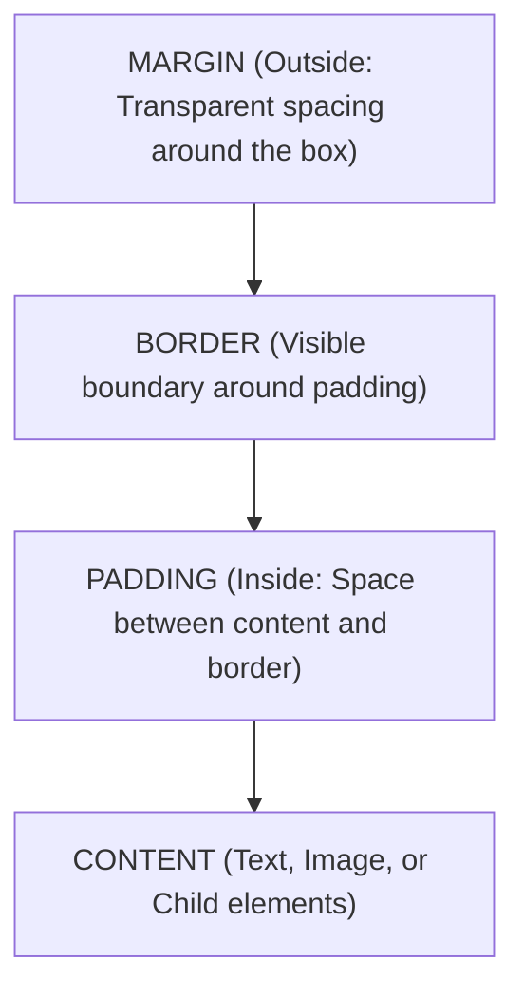
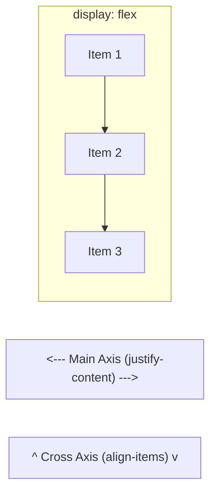

# CSS3 Styling: The Box Model, Flexbox & CSS Grid Layouts

> **Phase 12: Modern Frontend Foundations (HTML5, CSS3 & JavaScript ES6+)**  
> *Estimated Reading Time: 50 minutes | Total Practice Effort: ~3.5 hours | Tier: Core Essential*

---

## 1. Purpose & Prerequisites

### Why This Matters in Full Stack Development
Before 2012, building responsive multi-column layouts in CSS required fragile hacks: using `table` elements, CSS `float: left`, and `clearfix` wrappers. Modifying a layout broke alignment across browsers.

Modern CSS has completely transformed web UI engineering with:
1. **The CSS Box Model** (`box-sizing: border-box`).
2. **CSS Flexbox** (1-Dimensional alignment for navbars, toolbars, and card content).
3. **CSS Grid** (2-Dimensional layout system for overall page structures and dashboard card grids).
4. **Mobile-First Responsive Design** (`@media` queries).

Mastering these layout primitives is essential before diving into component libraries like Tailwind CSS or React styling.

### Prerequisites
- [Topic 12.1: Semantic HTML5 & Document Structure](01-html5.md)

---

## 2. Plain-English Mental Model

```
[ The Box Model: A Framed Museum Painting ]
- Content: The physical painted artwork itself.
- Padding: The white mat-board paper border inside the frame.
- Border: The wooden picture frame holding the glass.
- Margin: The empty wall space separating this frame from adjacent paintings!

[ Flexbox vs Grid ]
- Flexbox (1-Dimensional): A Train on a Track.
  Aligning cars in a single direction (either in a row or in a column).
  Perfect for a navbar or centering an item.
- CSS Grid (2-Dimensional): A Chessboard.
  Managing both rows and columns simultaneously.
  Perfect for an entire dashboard page layout!
```

---

## 3. The CSS Box Model & `box-sizing: border-box`

Every HTML element rendered on a screen is treated by the browser as a rectangular box:



### The Historical Bug: `box-sizing: content-box` (Default)
In default CSS, when you set `width: 300px` and add `padding: 20px` + `border: 5px`, the browser calculates the **total rendered width** as:
$$\text{Total Width} = 300\text{px} + (2 \times 20\text{px}) + (2 \times 5\text{px}) = 350\text{px}!$$
Your box expands beyond its container and breaks grid layouts!

### The Universal CSS Reset: `border-box`
```css
/* THE GOLDEN RULE OF MODERN CSS: Put this at the top of every stylesheet! */
*, *::before, *::after {
  box-sizing: border-box;
  margin: 0;
  padding: 0;
}
```
With `border-box`, when you say `width: 300px`, the box remains **exactly 300px wide**. Padding and borders are absorbed *inside* the box!

---

## 4. Modern 1D Layouts with Flexbox

To turn any element into a Flex container, set:
```css
.container {
  display: flex;
}
```



### Essential Flexbox Container Properties:

#### 1. `justify-content` (Aligns items along the Main Axis / Direction):
- `flex-start` (Default): Pack items at start.
- `center`: Center items along main axis.
- `flex-end`: Pack items at end.
- `space-between`: Distribute evenly; first item at start, last at edge.
- `space-around`: Equal space around each item.

#### 2. `align-items` (Aligns items along the Cross Axis):
- `stretch` (Default): Stretches items to fill container height.
- `center`: Centers items vertically along cross axis.
- `flex-start` / `flex-end`: Aligns to top or bottom.

#### 3. `gap`:
Specifies the exact space between flex items without needing margin hacks:
```css
gap: 1.5rem; /* 24px space between items */
```

### The Classic Problem Solved: Perfect Centering
Centering an element both vertically and horizontally in CSS used to take 10 lines of hacks. In Flexbox, it takes **2 lines**:
```css
.center-box {
  display: flex;
  justify-content: center; /* Horizontal */
  align-items: center;     /* Vertical */
}
```

---

## 5. Modern 2D Layouts with CSS Grid

CSS Grid allows you to define rows and columns simultaneously.

```css
.dashboard-grid {
  display: grid;
  grid-template-columns: 260px 1fr; /* 260px sidebar + remaining space for main */
  grid-template-rows: 70px 1fr 60px; /* Header, Content, Footer */
  min-height: 100vh;
  gap: 1rem;
}
```

### The Ultimate Responsive Card Grid (No Media Queries Needed!):
```css
.card-catalog {
  display: grid;
  /* Automatically wraps cards: each card is minimum 280px, expanding to fill fraction! */
  grid-template-columns: repeat(auto-fit, minmax(280px, 1fr));
  gap: 1.5rem;
}
```
**Why this is pure magic:**  
- On a 4K monitor: Displays 6 columns.
- On a laptop: Displays 3 columns.
- On a smartphone: Automatically collapses into 1 single column!  
**Zero media queries required!**

---

## 6. Mobile-First Responsive Design & Media Queries

**Mobile-First Design** means writing the base CSS rules for mobile smartphone screens first, and progressively adding complexity for larger screens using `@media (min-width: ...)`:

```css
/* 1. Base Styles (Mobile First: Default is 1 column) */
.product-grid {
  display: grid;
  grid-template-columns: 1fr;
  gap: 1rem;
}

/* 2. Tablet Breakpoint (Screen width >= 768px -> 2 columns) */
@media (min-width: 768px) {
  .product-grid {
    grid-template-columns: repeat(2, 1fr);
  }
}

/* 3. Desktop Breakpoint (Screen width >= 1024px -> 4 columns) */
@media (min-width: 1024px) {
  .product-grid {
    grid-template-columns: repeat(4, 1fr);
  }
}
```

---

## 7. Working Code: Responsive Full-Stack Navbar

Here is an accessible, responsive navigation bar using Flexbox:

```html
<header class="site-header">
  <div class="logo">
    <a href="/">⚡ CodeArena</a>
  </div>
  <nav class="main-nav">
    <ul class="nav-links">
      <li><a href="/courses">Courses</a></li>
      <li><a href="/roadmap">Roadmaps</a></li>
      <li><a href="/pricing">Pricing</a></li>
    </ul>
  </nav>
  <div class="auth-buttons">
    <a href="/login" class="btn btn-secondary">Log In</a>
    <a href="/register" class="btn btn-primary">Get Started</a>
  </div>
</header>
```

```css
.site-header {
  display: flex;
  justify-content: space-between;
  align-items: center;
  padding: 1rem 2rem;
  background-color: #1e293b;
  color: #f8fafc;
  box-shadow: 0 4px 6px -1px rgba(0, 0, 0, 0.1);
}

.site-header .logo a {
  font-size: 1.5rem;
  font-weight: 700;
  color: #38bdf8;
  text-decoration: none;
}

.nav-links {
  display: flex;
  list-style: none;
  gap: 2rem;
}

.nav-links a {
  color: #94a3b8;
  text-decoration: none;
  font-weight: 500;
  transition: color 0.2s ease;
}

.nav-links a:hover {
  color: #f8fafc;
}

.auth-buttons {
  display: flex;
  gap: 1rem;
}

.btn {
  padding: 0.5rem 1rem;
  border-radius: 6px;
  font-weight: 600;
  text-decoration: none;
  font-size: 0.875rem;
}

.btn-primary {
  background-color: #0284c7;
  color: #ffffff;
}

.btn-secondary {
  background-color: transparent;
  color: #f8fafc;
  border: 1px solid #475569;
}
```

---

## 8. Common Rookie Mistakes & Traps

### Trap 1: Forgetting `box-sizing: border-box`
If your layout horizontal scrollbar appears unexpectedly, inspect elements for `box-sizing`. Extra padding on a `100vw` element will trigger horizontal page overflow!

### Trap 2: Using Floats for Grid Layouts
Using legacy CSS `float: left` and `clear: both`. Float was designed for wrapping text around images in 1996, not for UI app layouts! Always use Flexbox or Grid.

### Trap 3: Desktop-First `max-width` Chaos
Writing CSS for a 1920px monitor and then trying to hack it down with 20 `@media (max-width: ...)` queries. It leads to specificity conflicts and bloated CSS. Always write **Mobile-First with `min-width`**.

---

## 9. Guided Hands-On Exercise

### The Scenario
You are styling a 3-tier pricing table (`Free`, `Pro`, `Enterprise`).  
Requirements:
1. Container uses CSS Grid.
2. Mobile screens: 1 single column.
3. Desktops ($\ge 1024\text{px}$): 3 equal columns (`repeat(3, 1fr)`).
4. Equal gap of `2rem` between cards.

### Your Challenge:
Write the Mobile-First CSS classes for `.pricing-container`.

<details>
<summary>💡 Hint: Use mobile default grid-template-columns: 1fr and min-width: 1024px</summary>

```css
.pricing-container {
  display: grid;
  grid-template-columns: 1fr;
  gap: 2rem;
}
@media (min-width: 1024px) {
  .pricing-container {
    grid-template-columns: repeat(3, 1fr);
  }
}
```
</details>

<details>
<summary>✅ Solution</summary>

```css
/* Mobile-First Base Layout (1 Column) */
.pricing-container {
  display: grid;
  grid-template-columns: 1fr;
  gap: 2rem;
  max-width: 1200px;
  margin: 0 auto;
  padding: 2rem 1rem;
}

/* Desktop Expansion (3 Columns) */
@media (min-width: 1024px) {
  .pricing-container {
    grid-template-columns: repeat(3, 1fr);
    padding: 4rem 2rem;
  }
}
```
</details>

---

## 10. Knowledge Check & Interview Defense

### Quick Quiz
1. **What is the effect of setting `box-sizing: border-box;` in CSS?**
   - [x] A) Padding and border widths are included inside the element's total declared width and height, preventing unexpected layout expansion and overflow.
   - [ ] B) It forces all borders to be black.
   - [ ] C) It rounds the corners of buttons.
   - [ ] D) It centers the box on screen.

2. **Which CSS layout system is optimal for a 1-dimensional row of navigation links with space-between distribution?**
   - [x] A) CSS Flexbox (`display: flex; justify-content: space-between`).
   - [ ] B) CSS Tables.
   - [ ] C) CSS Floats (`float: left`).
   - [ ] D) HTML framesets.

3. **In modern responsive web design, what does the "Mobile-First" approach mean?**
   - [x] A) Writing the base CSS rules for small mobile screens first, and using `@media (min-width: ...)` queries to progressively layer styles for larger tablet and desktop viewports.
   - [ ] B) Building mobile apps in Java Android only.
   - [ ] C) Disabling desktop browser support.
   - [ ] D) Forbidding the use of images.

---

### Junior Developer Interview Q&A

#### Q: "When should you use CSS Flexbox versus CSS Grid?"
> **Model Answer:**  
> "The fundamental distinction is **1-Dimensional vs 2-Dimensional Layouts**:
>
> 1. **CSS Flexbox (1-Dimensional):** Designed for laying out items along a **single axis**—either in a row or in a column. Flexbox is content-driven: items adjust their size dynamically based on their content (`flex-grow`, `flex-shrink`). Use Flexbox for UI components: navigation bars, toolbars, modal action buttons, form input groupings, or centering an item vertically and horizontally.
>
> 2. **CSS Grid (2-Dimensional):** Designed for laying out items across **both rows and columns simultaneously**. Grid is container-driven: you define the rigid grid tracks (`grid-template-columns`, `grid-template-rows`), and items place themselves into cells. Use CSS Grid for overall page layouts (headers, sidebars, main content areas, footers) and multi-column card catalogs (`repeat(auto-fit, minmax(280px, 1fr))`)."

---

## 11. Mastery Checklist & Next Step

Before moving on, verify that you can:
- [ ] Diagram the CSS Box Model: Content, Padding, Border, Margin.
- [ ] Explain why `box-sizing: border-box` is the standard reset for all modern websites.
- [ ] Align items with Flexbox using `justify-content`, `align-items`, and `gap`.
- [ ] Create auto-fitting, responsive card grids with CSS Grid.
- [ ] Implement Mobile-First responsive layouts using `@media (min-width: ...)` breakpoints.

👉 **Next Lesson:** **[Topic 12.3: Modern JavaScript (ES6+): Variables (let/const), Types & Functions](03-javascript-es6.md)**
