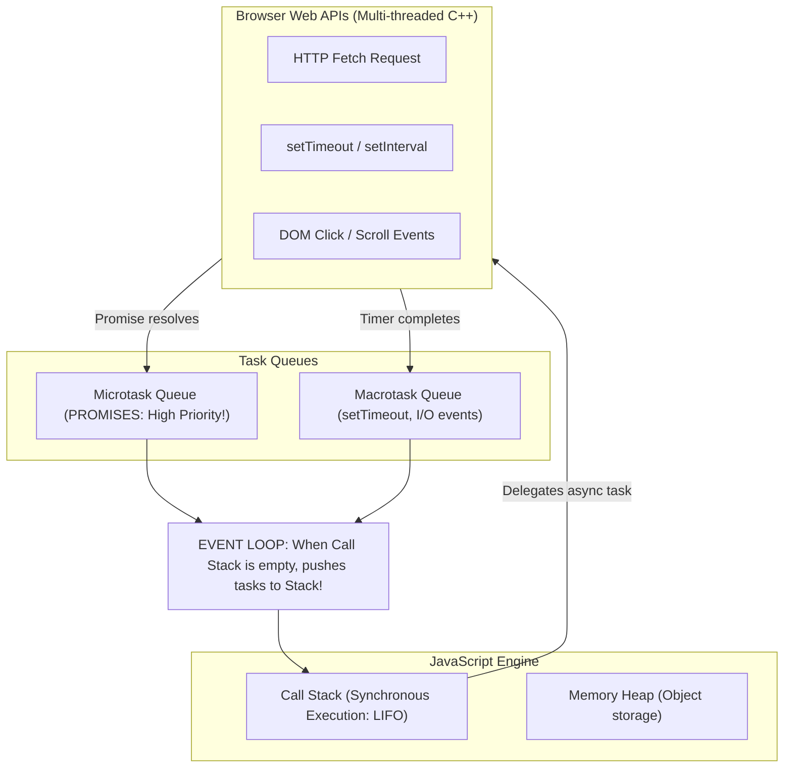

# Asynchronous JavaScript: Promises, async/await & The Fetch API

> **Phase 12: Modern Frontend Foundations (HTML5, CSS3 & JavaScript ES6+)**  
> *Estimated Reading Time: 55 minutes | Total Practice Effort: ~4 hours | Tier: Core Essential*

---

## 1. Purpose & Prerequisites

### Why This Matters in Full Stack Development
JavaScript is fundamentally **single-threaded**. It has only **one Call Stack** running in the browser.

Imagine if an HTTP request to your Spring Boot backend took 2 seconds to return data:
- In a blocking model, the browser would completely freeze for 2 seconds.
- The user could not scroll, click buttons, type in text fields, or close the tab!

To keep user interfaces fluid and responsive at 60 frames per second, browsers use an **Asynchronous Non-Blocking Event Loop**.

In this lesson, you will master **The JavaScript Event Loop**, **Promises**, **`async` / `await`**, and consume Spring Boot REST endpoints using the native **Fetch API**.

### Prerequisites
- [Topic 10.1: Web Protocol Fundamentals (HTTP Verbs & Status Codes)](../10-spring/01-http-rest.md)
- [Topic 12.3: Modern JavaScript (ES6+): Variables, Types & Functions](03-javascript-es6.md)

---

## 2. Plain-English Mental Model

```
[ The Fast-Food Restaurant Buzzer Pager ]
- You walk up to a fast-food counter and order a burger.
- Blocking System (Terrible):
  You stand frozen at the register for 8 minutes while the kitchen cooks. 
  Nobody behind you in line can order!
- Asynchronous System (The Event Loop):
  The cashier hands you a vibrating Pager (A Promise).
  You step aside to a table, text your friends, and drink your soda (The main thread stays responsive!).
  When the burger is cooked, the pager buzzes (Promise resolved).
  You walk to the pickup counter and enjoy your meal (async/await resumes)!
```

---

## 3. The Browser Event Loop & Concurrency Architecture

How does single-threaded JavaScript handle multiple concurrent timers and network requests?



### The Rule of the Event Loop:
1. Synchronous code on the **Call Stack** always runs to completion first.
2. When an asynchronous operation (like `fetch()`) finishes in the background, its callback is placed in the **Microtask Queue**.
3. The **Event Loop** continuously monitors the Call Stack. As soon as the stack is empty, it flushes the Microtask Queue back onto the stack!

---

## 4. The Evolution: From Callback Hell to `async` / `await`

### 1. The Historical "Callback Hell" (Pyramid of Doom):
```javascript
// HORRIBLE: Deeply nested callbacks (2010 style)
getUser(userId, function(user) {
  getOrders(user.id, function(orders) {
    getOrderDetails(orders[0].id, function(details) {
      // Unreadable, impossible to handle errors cleanly!
    });
  });
});
```

---

### 2. ES6 Promises: `.then()` & `.catch()`
A **Promise** is an object representing the eventual completion (or failure) of an asynchronous operation:
- **`pending`**: Initial state, neither fulfilled nor rejected.
- **`fulfilled`**: Operation completed successfully (`.then()`).
- **`rejected`**: Operation failed (`.catch()`).

```javascript
fetchUser(userId)
  .then(user => fetchOrders(user.id))
  .then(orders => fetchOrderDetails(orders[0].id))
  .catch(error => console.error("Pipeline failed:", error));
```

---

### 3. Modern ES8 `async` / `await` (The Industry Standard)
`async` and `await` are syntactic sugar over Promises. They allow you to write asynchronous code that reads sequentially like synchronous code:

```javascript
// CLEAN & READABLE:
const loadUserDashboard = async (userId) => {
  try {
    const user = await fetchUser(userId);
    const orders = await fetchOrders(user.id);
    const details = await fetchOrderDetails(orders[0].id);
    return details;
  } catch (error) {
    console.error("Dashboard loading failed:", error.message);
  }
};
```

---

## 5. Consuming REST APIs with `fetch()`

`fetch()` is the native browser API for making HTTP network requests.

### The Two-Step Fetch Process:
`fetch()` returns a Promise that resolves to a `Response` object. Parsing the JSON body requires a **second `await`**:

```javascript
const response = await fetch("https://api.example.com/v1/courses"); // Step 1: Wait for HTTP Headers
const courses = await response.json();                              // Step 2: Wait for JSON body to parse!
```

---

### ⚠️ The Critical "Fetch Trap":
> **`fetch()` does NOT reject on HTTP 404, 401, or 500 errors!**  
> `fetch()` only rejects if there is a **physical network failure** (e.g. computer disconnected from Wi-Fi or DNS lookup failed).  
> If the backend returns `404 Not Found` or `500 Server Error`, **`fetch()` considers it a success!**

You **must** check `response.ok` manually:

```javascript
const response = await fetch("/api/v1/courses/42");

// response.ok is true if HTTP status code is in the 200-299 range!
if (!response.ok) {
  throw new Error(`HTTP Error! Status: ${response.status} (${response.statusText})`);
}

const course = await response.json();
```

---

## 6. Complete CRUD Examples with `fetch()`

### 1. `GET` Request (Fetching Data):
```javascript
const getCourses = async () => {
  try {
    const response = await fetch("/api/v1/courses?page=0&size=10", {
      headers: {
        "Accept": "application/json"
      }
    });

    if (!response.ok) {
      throw new Error(`Failed to load courses: ${response.status}`);
    }

    const data = await response.json();
    return data.content; // Return array of courses from Spring Pageable
  } catch (error) {
    console.error("Network error:", error.message);
    throw error;
  }
};
```

---

### 2. `POST` Request (Creating a Resource with Auth Header):
```javascript
const createCourse = async (newCourse, authToken) => {
  try {
    const response = await fetch("/api/v1/courses", {
      method: "POST", // HTTP Method
      headers: {
        "Content-Type": "application/json",            // Tells Spring Boot body is JSON!
        "Authorization": `Bearer ${authToken}`        // Attaches JWT Bearer token!
      },
      body: JSON.stringify(newCourse) // Must convert JavaScript object to JSON string!
    });

    if (!response.ok) {
      const errorData = await response.json();
      throw new Error(errorData.message || "Failed to create course");
    }

    const createdCourse = await response.json();
    return createdCourse;
  } catch (error) {
    console.error("Create course failed:", error);
    throw error;
  }
};
```

---

## 7. Parallel Asynchronous Execution with `Promise.all()`

If you need to fetch data from two independent endpoints:
```javascript
// SLOW (Sequential: Takes 100ms + 100ms = 200ms):
const users = await fetchUsers();
const products = await fetchProducts();

// FAST (Parallel: Runs both concurrently! Takes max(100ms, 100ms) = 100ms!):
const [users, products] = await Promise.all([
  fetchUsers(),
  fetchProducts()
]);
```
`Promise.all()` initiates both network requests simultaneously and resolves when all requests succeed.

---

## 8. Common Rookie Mistakes & Anti-Patterns

### Anti-Pattern 1: Forgetting `JSON.stringify()` in `POST` Bodies
```javascript
// BUG: Sends "[object Object]" as the HTTP body! Spring Boot fails with 400 Bad Request!
body: newCourse 

// FIX: Always serialize object to JSON string:
body: JSON.stringify(newCourse)
```

### Anti-Pattern 2: Forgetting `await` on `response.json()`
```javascript
// BUG: courseData is a pending Promise, not the actual data!
const courseData = response.json(); 
console.log(courseData.title); // undefined!

// FIX:
const courseData = await response.json();
```

### Anti-Pattern 3: Unhandled Promise Rejection
Calling an `async` function without wrapping it in a `try-catch` block or appending `.catch()`. In modern browsers and Node.js, this causes an `UnhandledPromiseRejection` error.

---

## 9. Guided Hands-On Exercise

### The Scenario
You are building a client function `fetchUserProfile(userId, token)`.  
Requirements:
1. Endpoint: `GET /api/v1/users/${userId}`.
2. Attach header: `Authorization: Bearer ${token}`.
3. Check `if (!response.ok)`. If status is `401`, throw `"Session expired. Please log in again."`.
4. Return the parsed JSON user profile.

### Your Challenge:
Write the complete asynchronous function with robust error handling.

<details>
<summary>💡 Hint: Check response.status === 401</summary>

```javascript
const response = await fetch(...);
if (response.status === 401) throw new Error("Session expired. Please log in again.");
if (!response.ok) throw new Error("Failed");
return await response.json();
```
</details>

<details>
<summary>✅ Solution</summary>

```javascript
const fetchUserProfile = async (userId, token) => {
  try {
    const response = await fetch(`/api/v1/users/${userId}`, {
      method: "GET",
      headers: {
        "Accept": "application/json",
        "Authorization": `Bearer ${token}`
      }
    });

    if (response.status === 401) {
      throw new Error("Session expired. Please log in again.");
    }

    if (!response.ok) {
      throw new Error(`Failed to retrieve profile: HTTP ${response.status}`);
    }

    const userProfile = await response.json();
    return userProfile;

  } catch (error) {
    console.error("fetchUserProfile error:", error.message);
    throw error; // Re-throw for React UI to display toast notification
  }
};
```
</details>

---

## 10. Knowledge Check & Interview Defense

### Quick Quiz
1. **What happens if a Spring Boot server returns HTTP status `500 Internal Server Error` when queried by `fetch()`?**
   - [x] A) `fetch()` resolves successfully without throwing an error; the developer must inspect `response.ok` (which will be `false`) or `response.status` (which will be `500`).
   - [ ] B) `fetch()` automatically throws an exception caught by `catch`.
   - [ ] C) The browser restarts.
   - [ ] D) The computer disconnects from the internet.

2. **In what queue does the JavaScript Event Loop place resolved Promise callbacks?**
   - [x] A) The Microtask Queue (which has higher priority than the standard Macrotask callback queue).
   - [ ] B) The Call Stack directly.
   - [ ] C) The Operating System Disk Queue.
   - [ ] D) The Garbage Collection Pool.

3. **How do you execute three independent HTTP requests concurrently in parallel and wait for all of them to finish?**
   - [x] A) `const [res1, res2, res3] = await Promise.all([fetch1, fetch2, fetch3]);`
   - [ ] B) Writing three consecutive `await` lines.
   - [ ] C) Using a `while` loop.
   - [ ] D) JavaScript cannot execute requests in parallel.

---

### Junior Developer Interview Q&A

#### Q: "How does the JavaScript Event Loop work, and why doesn't single-threaded JavaScript freeze during heavy network I/O?"
> **Model Answer:**  
> "JavaScript is single-threaded, meaning it has only one Call Stack executing code synchronously.
>
> However, the browser runtime environment provides multi-threaded **Web APIs** (written in C++) that handle timers, network sockets (`fetch()`), and DOM events outside of the JavaScript thread.
>
> When code calls `fetch()`, the browser hands the network I/O to an operating system thread. The JavaScript Call Stack remains completely unblocked and immediately continues executing other UI tasks (such as button clicks and animations).
>
> When the network response arrives from the server, the browser wraps the response in a task and drops it into the **Microtask Queue**.
>
> The **Event Loop** is a continuously running background loop that checks whether the Call Stack is empty. As soon as the stack is clear, the Event Loop takes the completed Promise callback from the Microtask Queue and pushes it onto the Call Stack to resume execution. This non-blocking architecture allows single-threaded JavaScript to achieve high concurrent I/O performance."

---

## 11. Mastery Checklist & Next Step

Before moving on, verify that you can:
- [ ] Diagram the Event Loop: Call Stack, Web APIs, Microtask Queue, and Macrotask Queue.
- [ ] Understand Promise states (`pending`, `fulfilled`, `rejected`).
- [ ] Write clean asynchronous code using `async` and `await`.
- [ ] Use `fetch()` with custom headers, HTTP methods, and JSON payloads.
- [ ] Check `response.ok` to avoid the "Fetch Doesn't Reject on 404/500" trap.
- [ ] Run concurrent requests in parallel using `Promise.all()`.

🎉 **Phase 12: Modern Frontend Foundations Complete!**  
👉 **Next Phase:** **[Topic 13.1: React 18 Core: JSX Syntax, Functional Components & Props](../13-react/01-react-core.md)**
