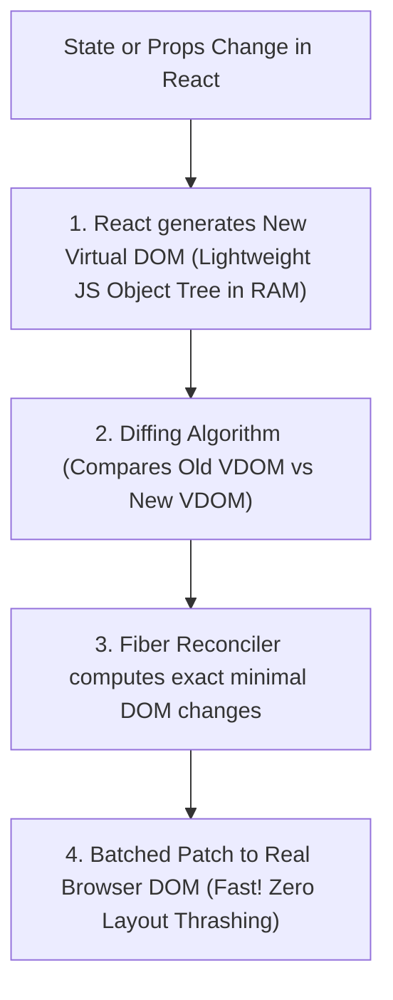
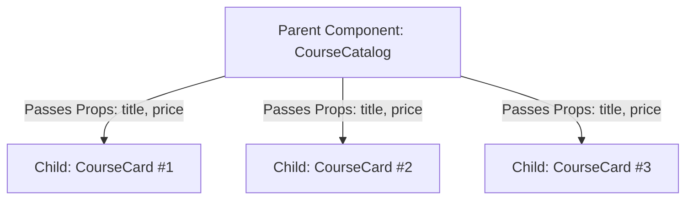

# React 18 Core: JSX Syntax, Functional Components & Props

> **Phase 13: Modern React 18 & Full-Stack Integration**  
> *Estimated Reading Time: 45 minutes | Total Practice Effort: ~3 hours | Tier: Core Essential*

---

## 1. Purpose & Prerequisites

### Why This Matters in Full Stack Development
In traditional web development with vanilla JavaScript, updating the user interface is **imperative**:
```javascript
// Imperative DOM manipulation (Fragile and messy):
const p = document.createElement("p");
p.innerText = "Order Placed!";
document.getElementById("container").appendChild(p);
```
As applications grow with dozens of interactive buttons, live notifications, and real-time carts, keeping the browser DOM in sync with backend state manually becomes an unmaintainable nightmare.

**React** revolutionized frontend engineering through **Declarative Component-Driven Architecture**:
Instead of micro-managing DOM mutations, you simply declare:  
*"Given this data state, this is what the UI should look like."*  
React handles all DOM updates automatically.

In this lesson, you will master **React 18 fundamentals**, **the Virtual DOM**, **JSX syntax**, **Functional Components**, and **Props**.

### Prerequisites
- [Topic 12.1: Semantic HTML5](01-html5.md)
- [Topic 12.3: Modern JavaScript (ES6+): Arrow Functions & Destructuring](03-javascript-es6.md)

---

## 2. Plain-English Mental Model

```
[ Traditional Web Development: Hand-Carving Wooden Toys ]
- Every time you want to change an arm or leg, you must chisel, sand, and glue it in place.
- One wrong cut ruins the entire toy!

[ React 18: LEGO Bricks ]
- You create small, reusable, independent LEGO bricks:
  - Button brick (<Button />)
  - Card brick (<CourseCard />)
  - Navigation brick (<Navbar />)
- You snap these bricks together to assemble a complete spaceship or castle (<App />).
- Want to change a card? You swap out that one single brick without touching the rest of the spaceship!
```

---

## 3. Under the Hood: The Virtual DOM (VDOM) & Reconciliation

Why does React use a **Virtual DOM** instead of updating the browser DOM directly?



1. **The Real DOM is Slow:** Updating physical browser DOM nodes triggers expensive browser **reflows** (recalculating element geometries) and **repaints** (redrawing pixels on screen).
2. **The Virtual DOM is Fast:** The Virtual DOM is a lightweight JavaScript object representation of the real DOM stored in memory.
3. **Reconciliation (Diffing):** When data changes, React compares the new Virtual DOM tree against the previous snapshot. It calculates the **exact minimal difference** (e.g. *"Only the text inside button #3 changed"*), and batches that single surgical update to the real DOM!

---

## 4. Deconstructing JSX (JavaScript XML)

**JSX** looks like HTML, but it is actually syntactically valid JavaScript:

```jsx
const element = <h1 className="title">Hello, {userName}!</h1>;
```

### What the Babel / Vite Compiler Transpiles JSX Into:
```javascript
const element = React.createElement(
  "h1",
  { className: "title" },
  "Hello, ",
  userName,
  "!"
);
```

### The 4 Strict Rules of JSX:
1. **Single Root Element:** A component must return a single root element. If you don't want an extra wrapper `<div>` in the DOM, use a **React Fragment** (`<> ... </>`):
   ```jsx
   return (
     <>
       <Header />
       <MainContent />
     </>
   );
   ```
2. **All Tags Must Self-Close:** In HTML, `` or `<input>` don't require closing tags. In JSX, they strictly must: ``.
3. **Attribute Renaming:**
   - Use `className` instead of `class` (since `class` is a reserved keyword in JavaScript).
   - Use `htmlFor` instead of `for` on `<label>` elements.
   - Use camelCase for event handlers: `onClick`, `onChange`, `onSubmit`.
4. **Embedding JavaScript Expressions:** Use single curly braces `{}` to run any valid JavaScript expression (variables, function calls, math):
   ```jsx
   <p>Total Price: ${price * quantity}</p>
   ```

---

## 5. Functional Components & Reusability

In modern React 18, all components are written as **JavaScript functions** that receive `props` and return JSX:

```jsx
// A clean, reusable CourseCard component:
const CourseCard = ({ title, category, price, isFeatured }) => {
  return (
    <article className={`course-card ${isFeatured ? "featured" : ""}`}>
      <span className="badge">{category}</span>
      <h3>{title}</h3>
      <p className="price">${price.toFixed(2)}</p>
      <button type="button" className="btn-enroll">Enroll Now</button>
    </article>
  );
};

export default CourseCard;
```

---

## 6. Props & One-Way Data Flow

Data in React flows strictly in **one direction**: from Parent down to Children via **Props (Properties)**.



### The Immutability Rule of Props:
> **PROPS ARE READ-ONLY (IMMUTABLE)!**  
> A child component must **never mutate its props**:
> ```jsx
> // FORBIDDEN! NEVER MUTATE PROPS:
> props.price = 50.00; // CRASH / UNPREDICTABLE BUG!
> ```
> If a child needs to modify data, the parent must pass down an **event handler callback function** (e.g. `onDelete={() => handleDelete(id)}`).

### The Special `children` Prop:
The `children` prop allows components to act as generic layout wrappers:

```jsx
const Modal = ({ title, isOpen, children }) => {
  if (!isOpen) return null;

  return (
    <div className="modal-backdrop">
      <div className="modal-content">
        <h2>{title}</h2>
        <div className="modal-body">
          {children} {/* Injects whatever JSX was passed inside <Modal>...</Modal>! */}
        </div>
      </div>
    </div>
  );
};

// Usage:
<Modal title="Delete Confirmation" isOpen={true}>
  <p>Are you sure you want to permanently delete this user?</p>
  <button>Confirm</button>
</Modal>
```

---

## 7. Rendering Lists & The Critical `key` Prop

To render a list of data in React, use JavaScript's native `.map()` method:

```jsx
const CourseList = ({ courses }) => {
  return (
    <div className="course-grid">
      {courses.map((course) => (
        // MANDATORY: Every item in a mapped list MUST have a unique 'key' prop!
        <CourseCard 
          key={course.id} 
          title={course.title} 
          price={course.price} 
          category={course.category} 
        />
      ))}
    </div>
  );
};
```

### Why the `key` Prop is Mandatory:
The `key` is a unique identifier used by React's Virtual DOM diffing algorithm:
- When an item is added, deleted, or reordered, React matches existing DOM elements by their `key`.
- **Never use array index as key (`key={index}`)** for dynamic lists! If an item is deleted from the middle of the list, all array indices shift by 1, forcing React to destroy and re-render every single component in the list, breaking input state and degrading performance!
- Always use a unique database identifier: `key={course.id}`.

---

## 8. Common Rookie Mistakes & Traps

### Trap 1: Confusing Curly Braces `{}` with Quotes `""`
```jsx
// WRONG: Passes the literal string "{99}" instead of the number 99!
<CourseCard price="{99}" />

// CORRECT: Curly braces pass JavaScript numbers, booleans, or objects:
<CourseCard price={99} isEnrolled={true} />
```

### Trap 2: Missing Parentheses Around Multi-Line JSX Return
```jsx
// BUG: JavaScript's automatic semicolon insertion turns this into "return;"!
return 
  <div>Hello</div> // Never reached!

// FIX: Wrap in parentheses:
return (
  <div>Hello</div>
);
```

### Trap 3: Rendering `0` Unexpectedly with `&&`
```jsx
// BUG: If courses.length is 0, JavaScript prints the number "0" on screen!
{courses.length && <CourseList courses={courses} />}

// FIX: Always use a boolean check:
{courses.length > 0 && <CourseList courses={courses} />}
```

---

## 9. Guided Hands-On Exercise

### The Scenario
You are building an active user badge list for an admin dashboard.  
Data:
```javascript
const students = [
  { id: 101, name: "Alice", role: "PRO", enrolled: true },
  { id: 102, name: "Bob", role: "FREE", enrolled: false },
  { id: 103, name: "Charlie", role: "ENTERPRISE", enrolled: true }
];
```

### Your Challenge:
Create a component `StudentRoster` that renders only students who are `enrolled: true`.  
Each card must display their name and a badge with their role, using proper React keys and semantic HTML.

<details>
<summary>💡 Hint: Filter first, then map with key={student.id}</summary>

```jsx
students.filter(s => s.enrolled).map(s => <div key={s.id}>...</div>)
```
</details>

<details>
<summary>✅ Solution</summary>

```jsx
import React from "react";

const StudentRoster = ({ students }) => {
  const activeStudents = students.filter((s) => s.enrolled);

  return (
    <section className="student-roster">
      <h2>Enrolled Students ({activeStudents.length})</h2>
      <ul className="student-list">
        {activeStudents.map((student) => (
          <li key={student.id} className="student-item">
            <span className="student-name">{student.name}</span>
            <span className={`badge badge-${student.role.toLowerCase()}`}>
              {student.role}
            </span>
          </li>
        ))}
      </ul>
    </section>
  );
};

export default StudentRoster;
```
</details>

---

## 10. Knowledge Check & Interview Defense

### Quick Quiz
1. **What is the Virtual DOM and why does React use it?**
   - [x] A) A lightweight JavaScript object tree in memory; React compares it against previous snapshots (diffing) to calculate the minimum set of real DOM updates required, avoiding expensive layout reflows.
   - [ ] B) A virtual machine running inside the browser.
   - [ ] C) A local storage database for caching API requests.
   - [ ] D) A replacement for CSS.

2. **Why should developers avoid using array indices as the `key` prop when rendering dynamic lists in React?**
   - [x] A) If items are reordered, inserted, or deleted, array indices change, confusing React's reconciliation algorithm and causing UI state bugs and unnecessary re-renders.
   - [ ] B) React throws a fatal compiler error if index is used.
   - [ ] C) Indices take up too much memory.
   - [ ] D) Indices are strings.

3. **Can a child component directly modify the value of a prop passed to it by its parent?**
   - [x] A) No; props in React are strictly read-only and immutable. To change parent state, the parent must pass down an event callback function.
   - [ ] B) Yes, by assigning `props.val = 10`.
   - [ ] C) Only if the prop is a number.
   - [ ] D) Yes, in React 18.

---

### Junior Developer Interview Q&A

#### Q: "What is JSX, and what happens to JSX code when your React application is built?"
> **Model Answer:**  
> "JSX stands for **JavaScript XML**. It is a syntax extension for JavaScript that allows developers to write HTML-like markup directly inside JavaScript files.
>
> Browsers cannot execute JSX directly. During the application build step (using compilers like Babel, Vite, or SWC), JSX is transpiled into pure JavaScript function calls:
>
> For example:  
> `<button className="primary">Click</button>`  
> is compiled into:  
> `React.createElement('button', { className: 'primary' }, 'Click')`
>
> When executed, `React.createElement()` returns a plain JavaScript object representing that Virtual DOM node. JSX provides a clean, visual way to structure component hierarchies without writing deeply nested `React.createElement()` calls manually."

---

## 11. Mastery Checklist & Next Step

Before moving on, verify that you can:
- [ ] Explain how the Virtual DOM and Reconciliation diffing optimize performance.
- [ ] Write valid JSX adhering to single root, closing tags, and `className` rules.
- [ ] Build reusable functional components and pass data via Props.
- [ ] Utilize the `children` prop for flexible component wrapper layouts.
- [ ] Render dynamic lists using `.map()` with unique, stable `key` identifiers.

👉 **Next Lesson:** **[Topic 13.2: React Hooks: Managing State with useState & Side Effects with useEffect](02-react-hooks.md)**
