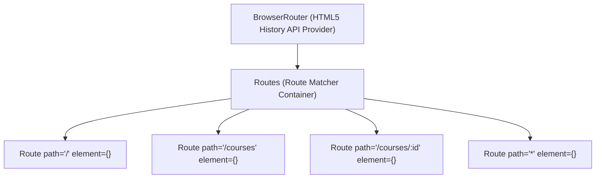

# Client-Side Routing with React Router v6 & Navigation Guards

> **Phase 13: Modern React 18 & Full-Stack Integration**  
> *Estimated Reading Time: 45 minutes | Total Practice Effort: ~3 hours | Tier: Core Essential*

---

## 1. Purpose & Prerequisites

### Why This Matters in Full Stack Development
In traditional multi-page web applications, clicking a link causes the browser to make a full round-trip HTTP request to the server, re-download the entire HTML page, re-parse CSS stylesheets, and re-execute scripts. The screen flashes white between clicks.

In a **Single Page Application (SPA)** with **React Router v6**:
- There is only **one single HTML file** (`index.html`).
- When a user clicks a link from `/courses` to `/profile`, **no page reload occurs**.
- React Router intercepts the URL change using the browser's HTML5 History API, unmounts the `<CourseList />` component, and instantly mounts the `<UserProfile />` component in **less than 10 milliseconds**!

In this lesson, you will master **React Router v6**, **Dynamic Route Parameters (`useParams`)**, **Shared Layouts (`<Outlet />`)**, and **Protected Routes (Authentication Guards)**.

### Prerequisites
- [Topic 10.1: Web Protocol Fundamentals (HTTP & REST)](../10-spring/01-http-rest.md)
- [Topic 13.1: React 18 Core: Components & Props](01-react-core.md)
- [Topic 13.2: React Hooks: useState & useEffect](02-react-hooks.md)

---

## 2. Plain-English Mental Model

```
[ Traditional Website: Tearing Down the Entire House ]
- You want to walk from the Living Room to the Kitchen.
- The construction crew completely demolishes the entire house, builds a brand new foundation, 
  and rebuilds the house with you standing in the kitchen!
- Slow, jarring, and wasteful!

[ React Router SPA: Walking Through an Open Doorway ]
- The house (Navbar, Footer, Application State) stays permanently in place.
- You simply walk through an open doorway.
- Only the scenery inside the center room changes instantly!
```

---

## 3. React Router v6 Core Architecture

React Router v6 provides declarative routing components:



### Installation:
```bash
npm install react-router-dom
```

---

## 4. The Golden Rule: `<Link>` vs `<a href>`

```jsx
// ❌ CRITICAL ANTI-PATTERN: NEVER USE RAW <a> TAGS FOR INTERNAL NAVIGATION!
<a href="/courses">View Courses</a>
// Triggers a full browser page reload, wipes React state, and restarts the app!

// ✅ THE CORRECT WAY: USE <Link> or <NavLink>:
import { Link, NavLink } from "react-router-dom";

<Link to="/courses">View Courses</Link>
```

### Why `<NavLink>` is Great for Navigation Bars:
`<NavLink>` automatically adds an `.active` CSS class to the link when the current browser URL matches the route:

```jsx
<NavLink 
  to="/dashboard" 
  className={({ isActive }) => isActive ? "nav-link active" : "nav-link"}
>
  Dashboard
</NavLink>
```

---

## 5. Dynamic URL Parameters (`useParams`)

When building details pages (e.g. `/courses/42` or `/users/sarah`):

### 1. Define the Route with a Colon `:`
```jsx
<Route path="/courses/:courseId" element={<CourseDetailPage />} />
```

### 2. Extract the Parameter Inside the Component:
```jsx
import React from "react";
import { useParams } from "react-router-dom";

const CourseDetailPage = () => {
  // Extract parameter matching the :courseId segment!
  const { courseId } = useParams();

  return (
    <div>
      <h1>Loading Course #{courseId}</h1>
      {/* Fetch course data from Spring Boot API using courseId */}
    </div>
  );
};

export default CourseDetailPage;
```

---

## 6. Shared Layouts with Nested Routes & `<Outlet />`

Most applications share a common **Navbar** and **Footer** across every page.  
Instead of copy-pasting `<Navbar />` into every component, use **Nested Routes** and **`<Outlet />`**:

```jsx
import React from "react";
import { Outlet } from "react-router-dom";
import Navbar from "./Navbar";
import Footer from "./Footer";

// Master Layout Wrapper
const AppLayout = () => {
  return (
    <div className="app-container">
      <Navbar />
      <main className="page-content">
        {/* <Outlet /> renders whichever child route is currently active! */}
        <Outlet />
      </main>
      <Footer />
    </div>
  );
};

export default AppLayout;
```

### In `App.jsx`:
```jsx
import { BrowserRouter, Routes, Route } from "react-router-dom";

function App() {
  return (
    <BrowserRouter>
      <Routes>
        {/* Parent Route with shared layout */}
        <Route path="/" element={<AppLayout />}>
          <Route index element={<HomePage />} />
          <Route path="courses" element={<CourseCatalog />} />
          <Route path="courses/:courseId" element={<CourseDetailPage />} />
          <Route path="*" element={<NotFoundPage />} />
        </Route>
      </Routes>
    </BrowserRouter>
  );
}
```

---

## 7. Programmatic Navigation with `useNavigate`

Sometimes you need to navigate the user via code (e.g., redirecting to the dashboard after a successful login):

```jsx
import { useNavigate } from "react-router-dom";

const LoginForm = () => {
  const navigate = useNavigate();

  const handleLogin = async (credentials) => {
    const success = await authService.login(credentials);
    if (success) {
      // Programmatically redirect to dashboard!
      navigate("/dashboard");
      // Or go back one step in browser history: navigate(-1);
    }
  };
};
```

---

## 8. Protected Routes & Authentication Guards

How do you protect private routes (like `/dashboard` or `/admin`) from unauthenticated visitors?

We build a **`ProtectedRoute` wrapper**:

```jsx
import React from "react";
import { Navigate, useLocation } from "react-router-dom";

const ProtectedRoute = ({ isAuthenticated, children }) => {
  const location = useLocation();

  if (!isAuthenticated) {
    // Redirect unauthenticated user to /login!
    // 'state={{ from: location }}' remembers the page they were trying to visit!
    return <Navigate to="/login" replace state={{ from: location }} />;
  }

  return children;
};

export default ProtectedRoute;
```

### Applying the Guard in `App.jsx`:
```jsx
<Route
  path="/dashboard"
  element={
    <ProtectedRoute isAuthenticated={userToken !== null}>
      <UserDashboard />
    </ProtectedRoute>
  }
/>
```

---

## 9. Common Rookie Mistakes & Anti-Patterns

### Anti-Pattern 1: Forgetting `<Outlet />` in Layouts
Creating a parent layout route `<Route element={<Layout />}>`, but forgetting to place `<Outlet />` inside `Layout.jsx`.  
*Result:* Child pages will never render on screen!

### Anti-Pattern 2: Not Setting `replace` on Login Redirects
When redirecting an unauthorized user with `<Navigate to="/login" />`, if you omit `replace`, the unauthorized URL remains in browser history. When the user clicks the browser Back button, they get bounced straight back to login in a frustrating loop!  
*Fix:* Always use `<Navigate to="/login" replace />`.

---

## 10. Guided Hands-On Exercise

### The Scenario
You need to create a `RoleGuard` component.  
Requirements:
1. Receives props: `userRole`, `allowedRoles`, `children`.
2. If `userRole` is included in `allowedRoles`, render `children`.
3. If not, redirect to `/unauthorized` with `replace`.

### Your Challenge:
Write the complete `RoleGuard` component.

<details>
<summary>💡 Hint: Use allowedRoles.includes(userRole)</summary>

```jsx
if (!allowedRoles.includes(userRole)) {
  return <Navigate to="/unauthorized" replace />;
}
return children;
```
</details>

<details>
<summary>✅ Solution</summary>

```jsx
import React from "react";
import { Navigate } from "react-router-dom";

const RoleGuard = ({ userRole, allowedRoles, children }) => {
  if (!allowedRoles.includes(userRole)) {
    return <Navigate to="/unauthorized" replace />;
  }

  return children;
};

export default RoleGuard;

// Usage:
// <RoleGuard userRole={currentUser.role} allowedRoles={["ADMIN"]}>
//   <AdminPanel />
// </RoleGuard>
```
</details>

---

## 11. Knowledge Check & Interview Defense

### Quick Quiz
1. **What is the difference between a traditional multi-page website and a React SPA utilizing React Router?**
   - [x] A) In an SPA, URL transitions intercept navigation client-side using the HTML5 History API, mounting and unmounting React components in milliseconds without requesting a full new HTML document from the server.
   - [ ] B) React SPAs cannot have multiple URLs.
   - [ ] C) React Router runs inside MySQL.
   - [ ] D) React SPAs do not support CSS.

2. **Why must developers use `<Link to="...">` instead of `<a href="...">` for internal SPA navigation?**
   - [x] A) `<a href>` triggers a full-page browser refresh, reloading all assets and erasing in-memory React state; `<Link>` changes the URL client-side without reloading the page.
   - [ ] B) `<a>` tags are banned in HTML5.
   - [ ] C) React components do not support `<a>` tags.
   - [ ] D) `<Link>` encrypts URL parameters.

3. **In React Router v6, what component acts as a placeholder inside a parent layout to render the matching child route?**
   - [x] A) `<Outlet />`.
   - [ ] B) `<Child />`.
   - [ ] C) `<Slot />`.
   - [ ] D) `<View />`.

---

### Junior Developer Interview Q&A

#### Q: "How do you implement client-side Protected Routes (Authentication Guards) in React Router v6?"
> **Model Answer:**  
> "In React Router v6, we implement Protected Routes by creating a higher-order wrapper component (typically named `ProtectedRoute`).
>
> 1. The wrapper inspects our global authentication state (such as checking if a valid JWT token exists in React Context or local memory).
> 2. If the user is authenticated, the component renders the requested child component (`children` or `<Outlet />`).
> 3. If the user is unauthenticated, the component returns the `<Navigate to="/login" replace state={{ from: location }} />` component.
> 4. The `replace` flag replaces the current history entry so the browser back button behaves intuitively, and `state={{ from: location }}` preserves the original URL they intended to visit, allowing us to redirect them back to their requested page immediately after login."

---

## 12. Mastery Checklist & Next Step

Before moving on, verify that you can:
- [ ] Configure `BrowserRouter`, `Routes`, and `Route` in a React 18 SPA.
- [ ] Use `<Link>` and `<NavLink>` for instant, zero-reload navigation.
- [ ] Extract dynamic URL route parameters using `useParams()`.
- [ ] Implement nested shared layouts using the `<Outlet />` component.
- [ ] Perform programmatic navigation with `useNavigate()`.
- [ ] Protect private routes and redirect unauthenticated users using `<Navigate replace />`.

👉 **Next Lesson:** **[Topic 13.5: Full-Stack Integration: Axios HTTP Client, Interceptors & JWT Auth](05-axios-spring-integration.md)**
