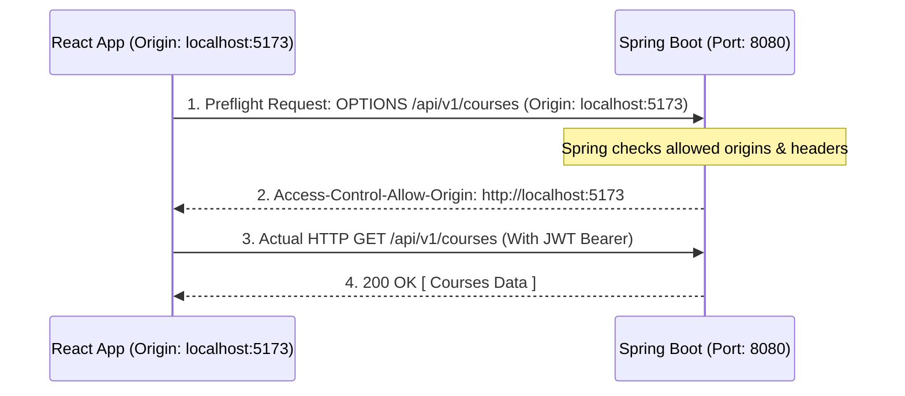

# Full-Stack Integration: Axios HTTP Client, Interceptors & JWT Auth

> **Phase 13: Modern React 18 & Full-Stack Integration**  
> *Estimated Reading Time: 60 minutes | Total Practice Effort: ~4.5 hours | Tier: Core Essential*

---

## 1. Purpose & Prerequisites

### Why This Matters in Full Stack Development
You have built a secure, high-performance Spring Boot backend with JPA and JWT security.  
You have built responsive, accessible React components with React Router.

Now comes the defining moment of full-stack engineering: **Connecting the two layers together into a unified system**.

If you connect them naively using raw `fetch()` calls scattered across 50 components:
- You will have to copy-paste the `Authorization: Bearer <token>` header into every single file.
- If a token expires, every component will fail independently without a clean way to redirect to the login screen.
- And on your very first API call, your browser will immediately block the request with a dreaded **CORS (Cross-Origin Resource Sharing) Error**!

In this lesson, you will master **Axios**, configure **Automated Request & Response Interceptors**, resolve **CORS in Spring Boot**, and establish the full-stack authentication handshake.

### Prerequisites
- [Topic 11.1: Spring Security Filter Chain](../11-production/01-security-filter-chain.md)
- [Topic 11.3: Stateless API Security & JWT](../11-production/03-jwt-auth.md)
- [Topic 13.4: Client-Side Routing with React Router](04-react-router.md)

---

## 2. Plain-English Mental Model

```
[ Manual Fetch: Showing Your Passport to Every Guard Individually ]
- You walk through a 50-room palace.
- In every single doorway, you have to dig into your backpack, pull out your passport (JWT), 
  and show it to the guard.
- Forget it once? You get thrown out!

[ Axios Client with Interceptors: A Diplomatic Escort ]
- You hire a diplomatic escort (Axios Interceptor).
- Whenever you make any request, the escort automatically stamps your diplomatic credential 
  onto the envelope before it leaves the building (Request Interceptor).
- If the palace guard says "Your visa expired!" (HTTP 401), the escort intercepts the rejection, 
  clears your badge, and walks you safely back to the embassy check-in desk (Response Interceptor)!
```

---

## 3. Why Axios Outperforms Raw `fetch()` in Enterprise React

While native `fetch()` is built into browsers, **Axios** is the overwhelming industry standard for production enterprise SPAs:

| Feature | Native `fetch()` | Axios (`axios`) |
| :--- | :--- | :--- |
| **JSON Serialization** | Manual (`JSON.stringify(body)`) | **Automatic** (Accepts objects directly) |
| **JSON Parsing** | Manual 2-step (`await res.json()`) | **Automatic** (`response.data`) |
| **Error Handling** | Does **NOT** reject on 4xx/5xx codes | **Automatically rejects Promises on 4xx/5xx** |
| **Global Base URL** | Must repeat `http://api.domain.com` everywhere | **Configured once in a central instance** |
| **Interceptors** | ❌ None (Must write custom wrappers) | ✅ **First-class Request & Response Interceptors** |
| **Request Timeout** | Complicated (`AbortController`) | Built-in: `timeout: 10000` |

### Installation:
```bash
npm install axios
```

---

## 4. Demystifying CORS (Cross-Origin Resource Sharing)

When your React app running on `http://localhost:5173` calls your Spring Boot backend on `http://localhost:8080`, your browser blocks the request with:
`Access to fetch at 'http://localhost:8080' from origin 'http://localhost:5173' has been blocked by CORS policy`



### The Fix: Global CORS Configuration in Spring Boot
Never put `@CrossOrigin("*")` on every single controller!  
Configure CORS centrally inside your `SecurityConfig`:

```java
package com.career.learning.config;

import org.springframework.context.annotation.Bean;
import org.springframework.context.annotation.Configuration;
import org.springframework.web.cors.CorsConfiguration;
import org.springframework.web.cors.CorsConfigurationSource;
import org.springframework.web.cors.UrlBasedCorsConfigurationSource;

import java.util.List;

@Configuration
public class CorsConfig {

    @Bean
    public CorsConfigurationSource corsConfigurationSource() {
        CorsConfiguration config = new CorsConfiguration();
        
        // 1. Allow the React development and production origins
        config.setAllowedOrigins(List.of("http://localhost:5173", "http://localhost:3000", "https://app.careerlearning.com"));
        
        // 2. Allow standard HTTP Verbs
        config.setAllowedMethods(List.of("GET", "POST", "PUT", "PATCH", "DELETE", "OPTIONS"));
        
        // 3. Allow standard headers (Authorization is strictly required for JWT!)
        config.setAllowedHeaders(List.of("Authorization", "Content-Type", "Accept", "X-Requested-With"));
        
        // 4. Expose custom headers to client if needed
        config.setExposedHeaders(List.of("Location"));
        
        config.setAllowCredentials(true);
        config.setMaxAge(3600L); // Cache preflight OPTIONS response for 1 hour

        UrlBasedCorsConfigurationSource source = new UrlBasedCorsConfigurationSource();
        source.registerCorsConfiguration("/**", config);
        return source;
    }
}
```

---

## 5. Building the Centralized Axios Client (`apiClient.js`)

In your React project under `src/api/apiClient.js`:

```javascript
import axios from "axios";

// 1. Create Axios instance with environment-based Base URL
const apiClient = axios.create({
  baseURL: import.meta.env.VITE_API_BASE_URL || "http://localhost:8080/api/v1",
  timeout: 15000, // 15 seconds timeout
  headers: {
    "Content-Type": "application/json",
    "Accept": "application/json"
  }
});

// 2. REQUEST INTERCEPTOR: Automatically attach JWT Bearer token to EVERY outgoing request!
apiClient.interceptors.request.use(
  (config) => {
    // Retrieve token from localStorage (or state management)
    const token = localStorage.getItem("accessToken");

    if (token) {
      config.headers.Authorization = `Bearer ${token}`;
    }

    return config;
  },
  (error) => {
    return Promise.reject(error);
  }
);

// 3. RESPONSE INTERCEPTOR: Global Error Handling & 401 Auto-Logout!
apiClient.interceptors.response.use(
  (response) => {
    // If request succeeded, just return the data payload directly!
    return response;
  },
  (error) => {
    const originalRequest = error.config;

    // Check if error is 401 Unauthorized (Token expired or invalid)
    if (error.response && error.response.status === 401) {
      console.warn("🔒 Session expired. Redirecting to login...");

      // Clear expired credentials
      localStorage.removeItem("accessToken");
      localStorage.removeItem("user");

      // Redirect user to login screen (if not already on auth page)
      if (!window.location.pathname.startsWith("/login")) {
        window.location.href = "/login?expired=true";
      }
    }

    // Standardize error message extraction from Spring Boot ErrorResponse
    const message =
      error.response?.data?.message ||
      error.response?.data?.error ||
      error.message ||
      "An unexpected network error occurred.";

    return Promise.reject(new Error(message));
  }
);

export default apiClient;
```

---

## 6. Consuming the API in React Components

Look at how clean your component code becomes once the Axios client and interceptors are in place:

### The Course Service Module (`src/services/courseService.js`):
```javascript
import apiClient from "../api/apiClient";

export const courseService = {
  // GET all courses
  getAllCourses: async (page = 0, size = 10) => {
    const response = await apiClient.get("/courses", {
      params: { page, size }
    });
    return response.data; // Already parsed from JSON!
  },

  // GET course by ID
  getCourseById: async (id) => {
    const response = await apiClient.get(`/courses/${id}`);
    return response.data;
  },

  // POST create course (Bearer token is attached automatically!)
  createCourse: async (courseData) => {
    const response = await apiClient.post("/courses", courseData);
    return response.data;
  },

  // DELETE course
  deleteCourse: async (id) => {
    await apiClient.delete(`/courses/${id}`);
  }
};
```

---

## 7. The Full-Stack Authentication Flow in Action

```jsx
// src/pages/LoginPage.jsx
import React, { useState } from "react";
import { useNavigate, useLocation } from "react-router-dom";
import apiClient from "../api/apiClient";

const LoginPage = () => {
  const [credentials, setCredentials] = useState({ email: "", password: "" });
  const [error, setError] = useState(null);
  const [isLoading, setIsLoading] = useState(false);

  const navigate = useNavigate();
  const location = useLocation();
  const from = location.state?.from?.pathname || "/dashboard";

  const handleChange = (e) => {
    setCredentials({ ...credentials, [e.target.name]: e.target.value });
  };

  const handleLogin = async (e) => {
    e.preventDefault();
    setIsLoading(true);
    setError(null);

    try {
      // 1. Submit login request to Spring Boot
      const response = await apiClient.post("/auth/login", credentials);
      const { accessToken, user } = response.data;

      // 2. Persist token in localStorage
      localStorage.setItem("accessToken", accessToken);
      localStorage.setItem("user", JSON.stringify(user));

      // 3. Redirect back to the page the user originally requested!
      navigate(from, { replace: true });

    } catch (err) {
      setError(err.message || "Invalid email or password");
    } finally {
      setIsLoading(false);
    }
  };

  return (
    <div className="login-container">
      <form onSubmit={handleLogin} className="auth-card">
        <h2>Sign In to CodeArena</h2>
        {error && <div className="alert-danger">{error}</div>}

        <div className="form-group">
          <label>Email Address</label>
          <input 
            type="email" 
            name="email" 
            value={credentials.email} 
            onChange={handleChange} 
            required 
          />
        </div>

        <div className="form-group">
          <label>Password</label>
          <input 
            type="password" 
            name="password" 
            value={credentials.password} 
            onChange={handleChange} 
            required 
          />
        </div>

        <button type="submit" disabled={isLoading} className="btn-primary">
          {isLoading ? "Signing in..." : "Log In"}
        </button>
      </form>
    </div>
  );
};

export default LoginPage;
```

---

## 8. Common Rookie Mistakes & Anti-Patterns

### Anti-Pattern 1: Hardcoding `http://localhost:8080` in Every Component
If you write `fetch("http://localhost:8080/...")` in 20 components, deploying to production requires editing 20 files!  
*Fix:* Use `import.meta.env.VITE_API_BASE_URL` in an `.env` file!

### Anti-Pattern 2: Infinite Redirect Loop in 401 Interceptor
If the user is *already* on the `/login` page and types a wrong password, the backend returns `401 Unauthorized`.  
If your 401 response interceptor blindly calls `window.location.href = "/login"`, it refreshes the login page on failed login, wiping the error message!  
*Fix:* Guard against redirecting when already on the auth route:
```javascript
if (error.response.status === 401 && !window.location.pathname.startsWith("/login")) { ... }
```

---

## 9. Guided Hands-On Exercise

### The Scenario
You need to test your Axios client interceptor logic.  
Requirements:
1. Verify that when `localStorage.getItem("accessToken")` returns `"test-token-123"`, the outgoing Axios config contains `headers.Authorization = "Bearer test-token-123"`.
2. When no token is in storage, `headers.Authorization` is undefined.

### Your Challenge:
Write a unit test verifying this request interceptor behavior.

<details>
<summary>💡 Hint: Call interceptor function with mock config</summary>

```javascript
const mockConfig = { headers: {} };
localStorage.setItem("accessToken", "xyz");
const result = requestInterceptor(mockConfig);
expect(result.headers.Authorization).toBe("Bearer xyz");
```
</details>

<details>
<summary>✅ Solution</summary>

```javascript
describe("Axios Request Interceptor", () => {
  beforeEach(() => {
    localStorage.clear();
  });

  it("should attach Bearer token when accessToken exists in localStorage", () => {
    localStorage.setItem("accessToken", "jwt-sample-token-456");

    const mockConfig = { headers: {} };
    // Simulate the interceptor logic:
    const token = localStorage.getItem("accessToken");
    if (token) {
      mockConfig.headers.Authorization = `Bearer ${token}`;
    }

    expect(mockConfig.headers.Authorization).toBe("Bearer jwt-sample-token-456");
  });

  it("should not attach Authorization header when no token is in storage", () => {
    const mockConfig = { headers: {} };
    const token = localStorage.getItem("accessToken");
    if (token) {
      mockConfig.headers.Authorization = `Bearer ${token}`;
    }

    expect(mockConfig.headers.Authorization).toBeUndefined();
  });
});
```
</details>

---

## 10. Knowledge Check & Interview Defense

### Quick Quiz
1. **What browser security mechanism causes requests from `http://localhost:5173` to `http://localhost:8080` to fail unless specifically permitted by the backend?**
   - [x] A) CORS (Cross-Origin Resource Sharing) enforced by the browser's Same-Origin Policy.
   - [ ] B) MySQL User Privileges.
   - [ ] C) Windows Defender.
   - [ ] D) The JavaScript Garbage Collector.

2. **What is an Axios Request Interceptor primarily used for in full-stack applications?**
   - [x] A) To automatically intercept all outgoing HTTP requests and inject the `Authorization: Bearer <token>` header without repeating boilerplate in every service method.
   - [ ] B) To compile Java bytecode into JavaScript.
   - [ ] C) To style buttons with CSS.
   - [ ] D) To manage database transactions.

3. **In an Axios Response Interceptor, what action should typically be taken when an HTTP `401 Unauthorized` response is caught?**
   - [x] A) Clear the expired token from local storage and redirect the user to the login screen.
   - [ ] B) Retry the request in an infinite loop.
   - [ ] C) Ignore the error and return null.
   - [ ] D) Delete the database.

---

### Junior Developer Interview Q&A

#### Q: "What is CORS, and why does it happen when connecting React to Spring Boot?"
> **Model Answer:**  
> "**CORS (Cross-Origin Resource Sharing)** is a browser-enforced security mechanism based on the **Same-Origin Policy**. An 'Origin' is defined as the combination of **Protocol + Domain + Port** (e.g. `http://localhost:5173`).
>
> In development:
> - The React Vite server runs on `http://localhost:5173`.
> - The Spring Boot API server runs on `http://localhost:8080`.
>
> Because the ports differ (`5173` vs `8080`), they are considered different Origins. By default, browsers prevent scripts on one origin from reading sensitive responses from another origin to prevent malicious sites from stealing session data.
>
> To allow React to communicate with Spring Boot, the backend server must respond to the browser's initial preflight `OPTIONS` request with the header:  
> `Access-Control-Allow-Origin: http://localhost:5173` along with permitted methods and headers (`Authorization`). We configure this globally in Spring Security via a `CorsConfigurationSource` bean."

---

## 11. Mastery Checklist & Next Step

Before moving on, verify that you can:
- [ ] Contrast Axios features with native `fetch()`.
- [ ] Configure global CORS in Spring Security 6 (`CorsConfigurationSource`).
- [ ] Create a centralized Axios client with dynamic Base URL and timeout limits.
- [ ] Automatically attach JWT Bearer tokens using an Axios Request Interceptor.
- [ ] Handle token expiration globally using an Axios Response Interceptor (401 auto-logout).
- [ ] Build end-to-end full-stack authentication flows connecting React forms to Spring Boot endpoints.

🎉 **Phase 13: Modern React 18 & Full-Stack Integration Complete!**  
👉 **Next Phase:** **[Topic 14.1: Full-Stack Capstone: Architecture, Design System & REST Contracts](../14-capstone/01-fullstack-architecture.md)**
