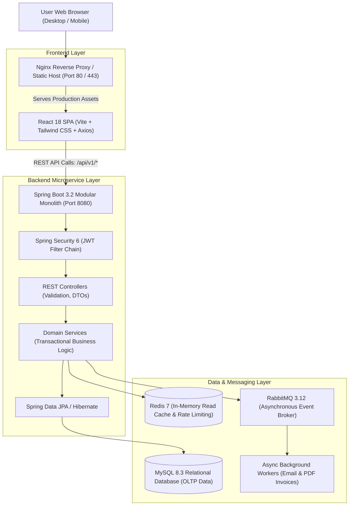
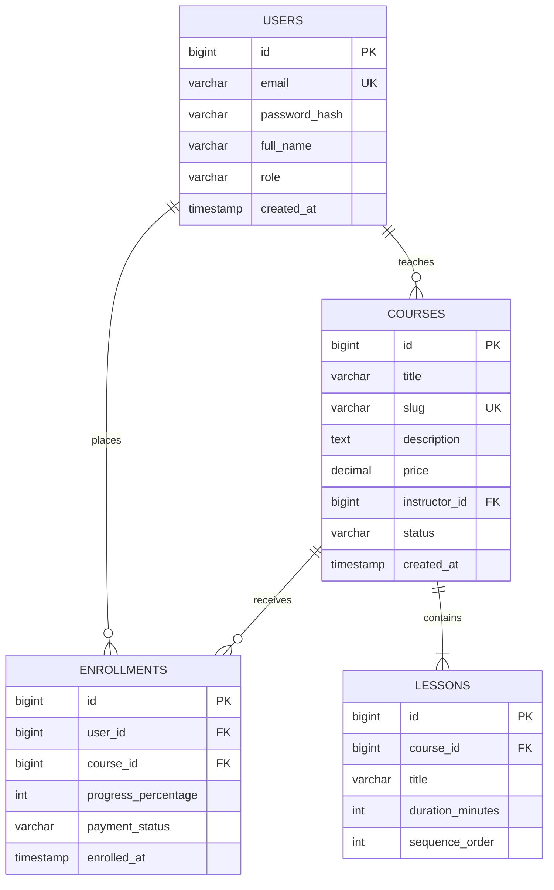
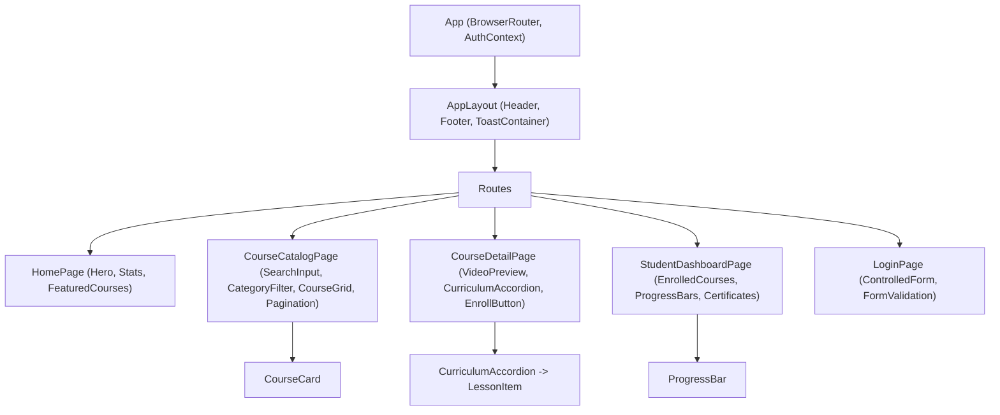

# Full-Stack Capstone: Architecture, Design System & REST Contracts

> **Phase 14: Full-Stack Capstone Project & Deployment**  
> *Estimated Reading Time: 60 minutes | Total Practice Effort: ~5 hours | Tier: Core Essential*

---

## 1. Purpose & Prerequisites

### Why This Matters in Full Stack Development
You have mastered Java programming, OOP, multithreading, relational database design, JDBC, Spring Boot, Spring Security, Docker, RabbitMQ, Redis, HTML5, CSS3, modern JavaScript, and React 18.

Now it is time to bring every single skill together into a **Production-Grade Full-Stack Capstone Project**:  
A complete **Career Learning & Course Management Platform** ("CodeArena Learn").

A true senior engineer does not start writing code blindly.  
Before writing a single line of backend Java or frontend React, you must define:
1. **The System Architecture & Component Topology.**
2. **The Relational Database Schema & Foreign Key Constraints.**
3. **The Contract-First REST API Specification.**
4. **The Frontend Design System & Component Hierarchy.**

### Prerequisites
- Completion of Phases 1 through 13.
- Familiarity with ER diagrams, HTTP REST standards, and React component trees.

---

## 2. Plain-English Mental Model

```
[ Building a Skyscraper: Blueprints Before Concrete ]
- You don't tell construction workers: "Just start pouring concrete and we'll figure out where the elevators go later!"
- You draft:
  1. Structural Engineering Drawings (Database ERD & Spring Architecture).
  2. Electrical & Plumbing Contracts (REST API JSON specifications).
  3. Architectural Elevations (React Component Wireframes).
- When the contracts are finalized, the frontend team and backend team can develop in parallel with zero friction!
```

---

## 3. High-Level System Architecture

Our Capstone follows a **Modular Monolith Architecture** with decoupled asynchronous event workers and an in-memory cache:



---

## 4. Domain Data Model & Relational Database Schema

The platform centers around 4 core domain entities:



### Relational DDL (MySQL 8):
```sql
CREATE TABLE users (
    id BIGINT PRIMARY KEY AUTO_INCREMENT,
    email VARCHAR(150) NOT NULL UNIQUE,
    password_hash VARCHAR(100) NOT NULL,
    full_name VARCHAR(100) NOT NULL,
    role VARCHAR(30) NOT NULL DEFAULT 'ROLE_STUDENT',
    created_at TIMESTAMP DEFAULT CURRENT_TIMESTAMP
);

CREATE TABLE courses (
    id BIGINT PRIMARY KEY AUTO_INCREMENT,
    title VARCHAR(150) NOT NULL,
    slug VARCHAR(180) NOT NULL UNIQUE,
    description TEXT NOT NULL,
    price DECIMAL(10,2) NOT NULL,
    instructor_id BIGINT NOT NULL,
    status VARCHAR(30) NOT NULL DEFAULT 'PUBLISHED',
    created_at TIMESTAMP DEFAULT CURRENT_TIMESTAMP,
    FOREIGN KEY (instructor_id) REFERENCES users(id),
    INDEX idx_courses_status_created (status, created_at DESC)
);

CREATE TABLE lessons (
    id BIGINT PRIMARY KEY AUTO_INCREMENT,
    course_id BIGINT NOT NULL,
    title VARCHAR(150) NOT NULL,
    duration_minutes INT NOT NULL,
    sequence_order INT NOT NULL,
    FOREIGN KEY (course_id) REFERENCES courses(id) ON DELETE CASCADE,
    CONSTRAINT uk_course_sequence UNIQUE (course_id, sequence_order)
);

CREATE TABLE enrollments (
    id BIGINT PRIMARY KEY AUTO_INCREMENT,
    user_id BIGINT NOT NULL,
    course_id BIGINT NOT NULL,
    progress_percentage INT NOT NULL DEFAULT 0,
    payment_status VARCHAR(30) NOT NULL DEFAULT 'COMPLETED',
    enrolled_at TIMESTAMP DEFAULT CURRENT_TIMESTAMP,
    FOREIGN KEY (user_id) REFERENCES users(id),
    FOREIGN KEY (course_id) REFERENCES courses(id),
    CONSTRAINT uk_user_course UNIQUE (user_id, course_id)
);
```

---

## 5. Contract-First REST API Specification

Before coding, both frontend and backend align on these strict JSON contracts:

### 1. `POST /api/v1/auth/login`
- **Request Body:**
  ```json
  {
    "email": "sarah@sky.net",
    "password": "Password123!"
  }
  ```
- **Response (200 OK):**
  ```json
  {
    "accessToken": "eyJhbGciOiJIUzI1NiIsIn...",
    "tokenType": "Bearer",
    "expiresIn": 3600,
    "user": {
      "id": 42,
      "email": "sarah@sky.net",
      "fullName": "Sarah Connor",
      "role": "ROLE_STUDENT"
    }
  }
  ```

---

### 2. `GET /api/v1/courses?page=0&size=10&search=java`
- **Response (200 OK):**
  ```json
  {
    "content": [
      {
        "id": 1,
        "title": "Java Foundations & OOP Mastery",
        "slug": "java-foundations-oop",
        "description": "Master core Java, memory mechanics, and class design.",
        "price": 89.99,
        "instructorName": "Dr. James Gosling",
        "lessonCount": 18,
        "totalDurationMinutes": 540
      }
    ],
    "pageable": { "pageNumber": 0, "pageSize": 10 },
    "totalElements": 1,
    "totalPages": 1,
    "last": true
  }
  ```

---

### 3. `POST /api/v1/courses/{id}/enroll`
- **Headers:** `Authorization: Bearer <accessToken>`
- **Response (201 Created):**
  ```json
  {
    "enrollmentId": 1042,
    "courseId": 1,
    "courseTitle": "Java Foundations & OOP Mastery",
    "progressPercentage": 0,
    "enrolledAt": "2026-10-20T15:00:00Z"
  }
  ```

---

## 6. Frontend Component Hierarchy & Design System

The React 18 frontend is organized into modular components:



---

## 7. Common Rookie Mistakes & Architecture Anti-Patterns

### Anti-Pattern 1: Entity-DTO Coupling
Directly returning the `Course` JPA entity in the REST response.  
*The Disaster:* If the entity changes its database column name, the React frontend contract breaks! Always use dedicated Java Records for request and response DTOs.

### Anti-Pattern 2: Missing Unique Constraints
Forgetting `CONSTRAINT uk_user_course UNIQUE (user_id, course_id)`.  
*The Disaster:* A student double-clicking the "Enroll" button will create two duplicate enrollment records, billing them twice! Enforce uniqueness at the database engine level.

---

## 8. Guided Hands-On Exercise

### The Scenario
You need to define the Java DTO records for the `CourseResponse` and `EnrollmentRequest` to match the API contract defined above.

### Your Challenge:
Write the immutable Java records with validation annotations.

<details>
<summary>💡 Hint: Use records with validation</summary>

```java
public record CourseResponse(Long id, String title, String slug, ... ) {}
```
</details>

<details>
<summary>✅ Solution</summary>

```java
package com.career.learning.dto;

import jakarta.validation.constraints.NotNull;
import jakarta.validation.constraints.Positive;
import java.math.BigDecimal;
import java.time.Instant;

public class CapstoneContracts {

    public record CourseSummaryResponse(
        Long id,
        String title,
        String slug,
        String description,
        BigDecimal price,
        String instructorName,
        int lessonCount,
        int totalDurationMinutes
    ) {}

    public record EnrollmentResponse(
        Long enrollmentId,
        Long courseId,
        String courseTitle,
        int progressPercentage,
        Instant enrolledAt
    ) {}

    public record EnrollmentRequest(
        @NotNull(message = "Course ID is required")
        @Positive(message = "Course ID must be positive")
        Long courseId
    ) {}
}
```
</details>

---

## 9. Knowledge Check & Interview Defense

### Quick Quiz
1. **What is the primary benefit of Contract-First REST API design in full-stack development?**
   - [x] A) It establishes an agreed-upon JSON schema and HTTP status codes before implementation, allowing frontend and backend engineers to develop and mock interfaces in parallel without waiting on each other.
   - [ ] B) It automatically compiles Java code into React JSX.
   - [ ] C) It deletes the MySQL database.
   - [ ] D) It makes Docker unnecessary.

2. **Why must the `enrollments` table enforce a unique constraint on `(user_id, course_id)`?**
   - [x] A) To guarantee idempotency and prevent duplicate enrollment records if a user clicks the enroll button multiple times concurrently.
   - [ ] B) To sort users alphabetically.
   - [ ] C) To encrypt the student's password.
   - [ ] D) It is required by the React Router.

3. **In the capstone architecture, what role does Nginx play?**
   - [x] A) Reverse proxy that serves compiled static React frontend assets and routes `/api/*` traffic to the Spring Boot backend container.
   - [ ] B) Database query optimizer.
   - [ ] C) Java compiler.
   - [ ] D) Message broker.

---

### Junior Developer Interview Q&A

#### Q: "How did you design the architecture of your full-stack capstone application?"
> **Model Answer:**  
> "I designed the application as a **decoupled Modular Monolith**:
>
> 1. **Frontend Layer:** A high-performance React 18 Single Page Application built with Vite and Tailwind CSS. It uses React Router v6 for client-side routing, controlled forms with live validation, and a centralized Axios client with request/response interceptors to attach JWT Bearer tokens and handle 401 session expirations.
>
> 2. **Backend Layer:** A Spring Boot 3 REST API structured with strict separation of concerns (Controllers, DTO Records, Services, Repositories). It uses Spring Security 6 with stateless JWT authentication and BCrypt password hashing.
>
> 3. **Persistence & Caching:** A MySQL 8 database storing normalized 3NF relational data with composite indexes to optimize read queries. High-frequency catalog queries are accelerated using an in-memory Redis cache with the Cache-Aside pattern.
>
> 4. **Asynchronous Messaging:** Heavy side-effects (like enrollment notifications and invoice generation) are decoupled using RabbitMQ topic exchanges and background worker consumers.
>
> 5. **Deployment:** The entire multi-container stack is containerized with multi-stage Dockerfiles and orchestrated using Docker Compose."

---

## 10. Mastery Checklist & Next Step

Before moving on, verify that you can:
- [ ] Diagram the multi-tier full-stack system architecture (React, Nginx, Spring Boot, MySQL, Redis, RabbitMQ).
- [ ] Design normalized relational schemas with foreign keys and unique constraints.
- [ ] Define contract-first REST API JSON specifications.
- [ ] Map out the React 18 component hierarchy and design system.

👉 **Next Lesson:** **[Topic 14.2: Full-Stack Capstone Implementation: React Frontend + Spring Backend](02-fullstack-implementation.md)**
