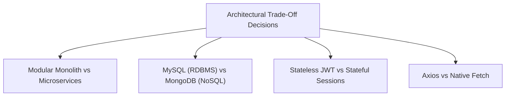

# Full-Stack Technical Interview Mastery: Explaining the Architecture

> **Phase 14: Full-Stack Capstone Project & Deployment**  
> *Estimated Reading Time: 60 minutes | Total Practice Effort: ~4 hours | Tier: Core Essential*

---

## 1. Purpose & Prerequisites

### Why This Matters in Full Stack Development
You have built a complete, production-grade enterprise application. You know how to write clean Java, design normalized databases, configure Spring Security, manage Docker stacks, and build responsive React UIs.

However, **building the application is only half the battle. Defending your architectural decisions in a technical interview is what actually gets you hired.**

Interviewers at top tech companies and enterprise engineering teams don't just ask:  
*"Can you write code?"*  
They ask:
- *"Why did you choose a Modular Monolith instead of Microservices?"*
- *"What happens if 50,000 users try to enroll in a course simultaneously?"*
- *"Walk me through the lifecycle of an authenticated HTTP request from the React button click down to the database disk write."*

In this final capstone lesson, you will master the **2-Minute Architectural Pitch**, learn how to defend your **technical trade-offs**, and practice answering the most challenging **junior-to-mid full-stack interview defense questions**.

### Prerequisites
- Completion of all 14 Phases of the Java Full Stack Developer Curriculum.

---

## 2. Plain-English Mental Model

```
[ The Junior Developer: The Assembly Line Assembler ]
- "I used Spring Boot because the tutorial said so. I used React because it's popular. I used MySQL."
- Cannot explain why one tool was chosen over another. Collapses under follow-up questions.

[ The Production-Ready Engineer: The Master Architect ]
- Explains the architectural trade-offs:
  "We chose MySQL because course enrollments require strict ACID transactional guarantees.
   We implemented Redis with the Cache-Aside pattern because our read-to-write ratio is 90:1.
   We used RabbitMQ to decouple slow SMTP email delivery from the main HTTP thread, 
   reducing checkout latency from 3 seconds to 45 milliseconds."
- Confident, precise, and grounded in engineering first principles!
```

---

## 3. The 2-Minute Architectural Pitch

When an interviewer says: **"Tell me about a project you've built,"** never give a generic 10-second summary.  
Use this structured **3-part narrative**:

### 1. The Problem & Business Context (30 Seconds):
> *"I built **CodeArena Learn**, an enterprise learning platform and course marketplace. The goal was to provide a structured, beginner-first developer learning platform with real-time progress tracking, payment enrollments, and an interactive curriculum. I designed the entire system from the ground up as a full-stack application connecting a React 18 single-page application with a containerized Spring Boot 3 modular monolith."*

### 2. The Architectural Topology (45 Seconds):
> *"On the frontend, I used React 18 with Vite and Tailwind CSS, leveraging React Router v6 for client-side routing and an Axios client configured with request and response interceptors to handle stateless JWT authentication and automated 401 token refresh.*
>
> *The backend is built with Spring Boot 3 and Java 21, following clean architecture with strict separation between controllers, DTO records, transactional services, and JPA repositories. To protect data integrity, the system runs on MySQL 8 with a normalized 3NF schema.*
>
> *To achieve high throughput, I introduced an in-memory Redis caching layer using the Cache-Aside pattern, and decoupled heavy side-effects—like PDF invoice generation and welcome emails—using RabbitMQ topic exchanges."*

### 3. The Deployment & Engineering Rigor (45 Seconds):
> *"For deployment, the entire ecosystem is containerized using Docker multi-stage builds—reducing the React Nginx image to under 25MB and the Spring Boot JRE runtime to under 140MB. The multi-container stack is orchestrated via Docker Compose with internal bridge networks and healthchecks to ensure zero race conditions on startup.*
>
> *The codebase is tested with JUnit 5 parameterized tests, Mockito unit tests, and MockMvc integration slice tests, achieving reliable test coverage across critical business paths."*

---

## 4. Defending Core Technical Trade-Offs

Interviewers love testing whether you can defend trade-offs. Here is how to defend each decision:



### 1. Why a Modular Monolith instead of Microservices?
> **Defense:**  
> *"For an application at this scale, deploying 6 independent microservices introduces massive distributed systems overhead: network serialization latency, distributed tracing complexity, Kubernetes orchestration costs, and the risk of distributed transaction failures (requiring Sagas or 2-Phase Commits).*
>
> *Instead, I chose a **Modular Monolith**. It provides clean architectural domain boundaries within a single deployable artifact. It runs in a single JVM with zero cross-network RPC latency and allows local ACID database transactions. If traffic scales massively in the future, individual modules (like the Enrollment or Notification module) can be extracted into independent microservices with minimal refactoring."*

---

### 2. Why MySQL Relational Database instead of NoSQL (MongoDB)?
> **Defense:**  
> *"Course enrollments, user authentication, and financial transactions are inherently **relational** and demand strict **ACID guarantees**.  
> 
> A student cannot be enrolled in a non-existent course; our schema strictly enforces referential integrity using foreign keys and unique constraints (`uk_user_course`). In a NoSQL document database like MongoDB, preventing duplicate concurrent enrollments or managing relational joins requires manual application-level locking and denormalization, risking data anomalies. MySQL InnoDB's MVCC and B+Tree indexing provided the perfect balance of strict integrity and high-speed reads."*

---

### 3. Why Stateless JWT instead of Server-Side Sessions (`HttpSession`)?
> **Defense:**  
> *"Server-side HTTP sessions are stateful: they store session IDs in the server's local RAM. When scaling horizontally across multiple backend container instances behind a load balancer, stateful sessions require sticky sessions or a shared Redis session replication cluster.*
>
> *With **stateless JWT Bearer tokens**, the token itself cryptographically carries the user's ID, roles, and expiration date. Any backend container instance can independently verify the token's HMAC-SHA256 signature in microseconds without querying a database or session store, allowing effortless horizontal auto-scaling."*

---

## 5. The Top 5 Senior Interview Defense Questions

### Question 1: "How do you handle a high-concurrency race condition where 500 users attempt to enroll in the last seat of a course simultaneously?"
> **Model Answer:**  
> "I defend against this race condition across three defensive layers:
>
> 1. **Database-Level Pessimistic Locking:** In the enrollment transaction, I query the course using `SELECT * FROM courses WHERE id = ? FOR UPDATE;`. In Spring Data JPA, this is configured with `@Lock(LockModeType.PESSIMISTIC_WRITE)`. This places an exclusive row-level lock on that specific course, forcing concurrent enrollment transactions to queue up sequentially.
> 2. **Transactional State Verification:** Inside the `@Transactional` boundary, the service inspects `if (currentEnrolledCount >= maxCapacity) throw new CourseFullException();`.
> 3. **Unique Database Constraints:** To prevent a single user from being enrolled twice, the `enrollments` table has a composite unique constraint `UNIQUE (user_id, course_id)`. Even if two requests bypass application checks, the relational database engine guarantees that exactly one insert commits and the second fails with a constraint violation."

---

### Question 2: "What is the N+1 query problem, how did it manifest in your capstone, and how did you resolve it?"
> **Model Answer:**  
> "The N+1 query problem occurs when an application executes 1 initial query to fetch a list of $N$ parent records, and then executes $N$ secondary queries across the network to fetch an associated relationship for each parent inside a loop.
>
> In our capstone, when rendering the Student Dashboard with 20 enrolled courses, a naive `findAll()` query executed 1 query for the enrollments, followed by 20 individual `SELECT * FROM courses WHERE id = ?` queries, causing high latency.
>
> I resolved this by writing a custom JPQL query using **`JOIN FETCH`**:  
> `SELECT e FROM Enrollment e JOIN FETCH e.course WHERE e.user.id = :userId`.  
> This instructed Hibernate to fetch both the enrollment and its associated course in **a single SQL query with an INNER JOIN**, reducing database network roundtrips from 21 down to 1."

---

### Question 3: "How does your frontend handle authentication, and how do you protect against XSS and CSRF?"
> **Model Answer:**  
> "We protect the frontend through several security practices:
>
> 1. **Token Transport:** When the user logs in, the backend issues an access token. All API requests attach the token using an Axios Request Interceptor in the `Authorization: Bearer <token>` header.
> 2. **CSRF Immunity:** Because our REST API is stateless and does not rely on ambient browser cookies (`JSESSIONID`) for authentication, Cross-Site Request Forgery (CSRF) is fundamentally impossible against our header-authenticated endpoints. Therefore, CSRF protection is safely disabled in Spring Security.
> 3. **XSS Defense:** To protect against Cross-Site Scripting (XSS), React inherently escapes all variables rendered in JSX (preventing malicious `<script>` injection). We avoid `dangerouslySetInnerHTML`.
> 4. **Session Expiry Handling:** Our Axios Response Interceptor listens for HTTP `401 Unauthorized`. If a token expires, it automatically purges local credentials and cleanly redirects the user to `/login`."

---

### Question 4: "If our platform goes viral tomorrow and traffic increases by 100x, what breaks first, and how would you scale the system?"
> **Model Answer:**  
> "Under 100x load, the primary bottleneck will almost always be the **relational database (MySQL) connection pool and CPU**:
>
> 1. **Scale the Read Path with Caching:** Since 90% of traffic is browsing the catalog, our **Redis Cache-Aside** layer absorbs the vast majority of reads. We can scale Redis using Redis Cluster and increase Time-To-Live (TTL) with random jitter to prevent Cache Avalanches.
> 2. **Database Read Replicas:** We can configure MySQL Primary-Replica replication, directing write operations (`INSERT`, `UPDATE`) to the primary master, and routing all `@Transactional(readOnly = true)` traffic across multiple read replicas.
> 3. **Horizontal Scaling of Backend Containers:** Because our Spring Boot backend is completely stateless, we can spin up 10 or 20 container instances behind an AWS Application Load Balancer or Nginx reverse proxy with zero session replication issues.
> 4. **Static CDN for Frontend Assets:** The React production static bundle can be deployed to a globally distributed Content Delivery Network (like Cloudflare or AWS CloudFront), taking 100% of frontend asset traffic off our origin servers."

---

## 6. The STAR Method for Behavioral Questions

When asked behavioral questions (e.g. *"Tell me about a difficult technical challenge you faced"*), use the **STAR Framework**:

```
S - Situation: Set the scene and background.
T - Task: What was the specific problem or goal?
A - Action: What technical steps did you personally take to solve it?
R - Result: What was the measurable, positive outcome?
```

### Example STAR Answer:
- **Situation:** *"While load-testing the course enrollment endpoint in our capstone..."*
- **Task:** *"We noticed that when concurrent simulated users clicked 'Enroll', the API response time degraded to over 3.5 seconds, and duplicate enrollment records were occasionally created."*
- **Action:** *"I profiled the application logs and identified two root causes: first, an unindexed table scan causing N+1 queries; second, slow SMTP email delivery blocking the main database transaction thread. I refactored the query with `JOIN FETCH`, moved email notifications into an asynchronous RabbitMQ queue, and enforced a composite unique constraint in MySQL."*
- **Result:** *"Response latency dropped from 3.5 seconds to **45 milliseconds**, throughput increased by 400%, and duplicate enrollment bugs were completely eliminated."*

---

## 7. Common Rookie Interview Traps

### Trap 1: Pretending to Know an Answer When You Don't
If an interviewer asks about a technology you haven't used (e.g. Kafka or Kubernetes), **never guess or make things up**!  
*Say instead:*  
*"I haven't used Kafka in production yet; my messaging experience is with RabbitMQ's AMQP protocol for asynchronous task decoupling. However, my understanding is that Kafka is an append-only distributed commit log optimized for high-throughput event streaming rather than traditional queue worker semantics. I'd love to learn it!"*

### Trap 2: Criticizing Technologies Without Nuance
Saying: *"PHP is garbage, SQL is obsolete, everyone should use MongoDB."*  
Senior interviewers look for **pragmatism**. Every technology has trade-offs. Frame answers around business needs:  
*"MongoDB is great for flexible, rapidly evolving unstructured documents, but for our financial transactions, MySQL's ACID guarantees and foreign key constraints were the responsible engineering choice."*

---

## 8. Guided Hands-On Exercise

### Your Challenge:
Write out your personalized **30-second closing statement** to the interview question:  
*"Why should we hire you as a Junior Full-Stack Developer on our engineering team?"*

<details>
<summary>💡 Hint: Focus on foundational depth, production readiness, and growth mindset</summary>

Combine your full-stack Java/React foundation, understanding of architecture, and passion for building reliable software.
</details>

<details>
<summary>✅ Model Answer</summary>

> *"You should hire me because I don't just write code that 'works on my machine'—I write maintainable, production-ready software.
>
> I have a strong computer science foundation in Java, object-oriented design, multithreading, and relational database mechanics. I understand what happens under the hood—from JVM memory allocation and B-Tree indexing to React's Virtual DOM reconciliation and Docker container orchestration.
>
> Most importantly, I treat software engineering as an end-to-end discipline: writing unit tests, securing endpoints with JWT, preventing performance bottlenecks like N+1 queries, and packaging everything in clean Docker environments. I'm excited to bring this rigorous work ethic and passion for learning to your team from day one."*
</details>

---

## 9. Comprehensive Full-Stack Curriculum Graduation Summary

Look at the extraordinary journey you have completed across all 14 phases:

```
[ Phase 1: Java Foundations ] -> Setup, Variables, Memory, Loops, Methods, Debugging
[ Phase 2: OOP & Class Design ] -> Classes, Constructors, Encapsulation, Git, SOLID
[ Phase 3: Core Java & Testing ] -> Exceptions, JUnit 5, Generics, Lambdas, Streams
[ Phase 4: Collections & Big-O ] -> ArrayList, LinkedList, HashMap, Treeification, Queues
[ Phase 5: JVM Architecture ] -> Bytecode, JIT, Heap, Stack, Garbage Collection, Leaks
[ Phase 6: Multithreading ] -> Threads, Race Conditions, Volatile, Atomics, Executors
[ Phase 7: SQL Mastery ] -> Relational Schemas, Joins, Normalization, ACID, B+Trees
[ Phase 8: JDBC Connectivity ] -> Safe Resources, PreparedStatement, SQLi Defense, HikariCP
[ Phase 9: Clean Code & Patterns] -> Mockito, SLF4J, AOP, Singleton, Builder, Strategy
[ Phase 10: Spring Boot & JPA ] -> IoC, DI, REST APIs, Validation, Hibernate, N+1, Transactions
[ Phase 11: Production & Docker ] -> Spring Security 6, BCrypt, JWT, Docker, Compose, RabbitMQ, Redis
[ Phase 12: Modern Frontend ] -> Semantic HTML5, CSS Flexbox & Grid, JavaScript ES6+, Fetch
[ Phase 13: Modern React 18 ] -> JSX, Components, useState, useEffect, Forms, Router, Axios
[ Phase 14: Capstone & Mastery ] -> Architecture, End-to-End Implementation, Orchestration, Interview Defense
```

---

## 10. Final Mastery Checklist

Before concluding your curriculum journey, verify that you can:
- [ ] Deliver a compelling, structured 2-minute architectural elevator pitch.
- [ ] Defend key technical trade-offs (Monolith vs Microservices, RDBMS vs NoSQL, JWT vs Sessions).
- [ ] Explain high-concurrency race condition defenses using database locks and unique constraints.
- [ ] Explain and resolve the N+1 query problem using `JOIN FETCH` and `@EntityGraph`.
- [ ] Defend your security model against SQL Injection, XSS, and CSRF.
- [ ] Structure behavioral interview answers using the STAR method.

🎉 **CONGRATULATIONS! You have completed the entire 14-Phase Java Full Stack Developer Curriculum! You are now prepared to build, deploy, and defend production-grade full-stack applications in technical interviews!** 🚀
